Oui. Pour une **boîte à outils microservices Spring Boot 4 / Spring Cloud 2025-2026**, ta liste peut être largement enrichie. Les briques que tu as choisies restent cohérentes : Spring Cloud Gateway 5.x supporte Spring Boot 4 / Spring Framework 7, Eureka reste disponible via Spring Cloud Netflix, et Spring Cloud LoadBalancer est l'implémentation Spring actuelle du load balancing côté client. ([Home][1])

Je structurerais la toolbox comme ceci.

## 1. Vue globale de la boîte à outils

| Catégorie         | Besoin                          | Solution recommandée                              |
| ----------------- | ------------------------------- | ------------------------------------------------- |
| 🌐 Réseau         | API Gateway                     | **Spring Cloud Gateway**                          |
| 🌐 Réseau         | Service Discovery               | **Eureka** / Kubernetes Service Discovery         |
| 🌐 Réseau         | Load Balancing                  | **Spring Cloud LoadBalancer**                     |
| 🌐 Réseau         | Rate Limiting                   | **Spring Cloud Gateway + Redis**                  |
| 🔄 Communication  | Communication synchrone         | **RestClient / WebClient / HTTP Service Clients** |
| 🔄 Communication  | Communication asynchrone        | **Kafka / RabbitMQ**                              |
| 🔄 Communication  | Abstraction Messaging           | **Spring Cloud Stream**                           |
| 🛡️ Résilience    | Circuit Breaker                 | **Resilience4j**                                  |
| 🛡️ Résilience    | Retry                           | **Resilience4j Retry / Spring Retry**             |
| 🛡️ Résilience    | Timeout                         | **Resilience4j TimeLimiter / clients HTTP**       |
| 🛡️ Résilience    | Bulkhead                        | **Resilience4j Bulkhead**                         |
| ⚡ Performance     | Caching                         | **Spring Cache + Redis/Caffeine**                 |
| ⚙️ Configuration  | Configuration centralisée       | **Spring Cloud Config**                           |
| 🔐 Configuration  | Secrets                         | **Vault / Kubernetes Secrets**                    |
| 🔐 Sécurité       | Authentification / Autorisation | **Spring Security + OAuth2/OIDC**                 |
| 🔐 Sécurité       | Identity Provider               | **Keycloak / Auth0 / Entra ID**                   |
| 📊 Observabilité  | Health / Metrics                | **Spring Boot Actuator + Micrometer**             |
| 📊 Observabilité  | Distributed Tracing             | **Micrometer Tracing + OpenTelemetry**            |
| 📊 Observabilité  | Métriques / dashboards          | **Prometheus + Grafana**                          |
| 📊 Observabilité  | Logs centralisés                | **Loki / ELK / OpenSearch**                       |
| 🗄️ Données       | Accès aux données               | **Spring Data JPA / JDBC / R2DBC**                |
| 🗄️ Données       | Migration BDD                   | **Flyway / Liquibase**                            |
| 🗄️ Données       | Transactions distribuées        | **Saga Pattern + Kafka**                          |
| 📨 Messaging      | Dead Letter Queue               | **Kafka DLQ / RabbitMQ DLX**                      |
| 📨 Messaging      | Idempotence                     | **Idempotency Key + DB/Redis**                    |
| 🧪 Tests          | Tests de contrats               | **Spring Cloud Contract**                         |
| 📝 API            | Documentation API               | **SpringDoc OpenAPI / Swagger UI**                |
| 🐳 Infrastructure | Conteneurisation                | **Docker**                                        |
| ☸️ Infrastructure | Orchestration                   | **Kubernetes**                                    |
| ☸️ Infrastructure | Spring + Kubernetes             | **Spring Cloud Kubernetes**                       |

Spring Cloud propose d'ailleurs officiellement plusieurs de ces projets : Gateway, Config, Circuit Breaker, Kubernetes, Netflix, Stream, Contract, Vault, etc. ([Home][2])

---

# 2. API Gateway — Spring Cloud Gateway

**Rôle :** point d'entrée unique du système. Il route les requêtes et peut appliquer authentification, rate limiting, logging, CORS, résilience, etc. Spring le décrit précisément comme une couche de routage accompagnée de préoccupations transversales telles que sécurité, monitoring et résilience. ([Home][1])

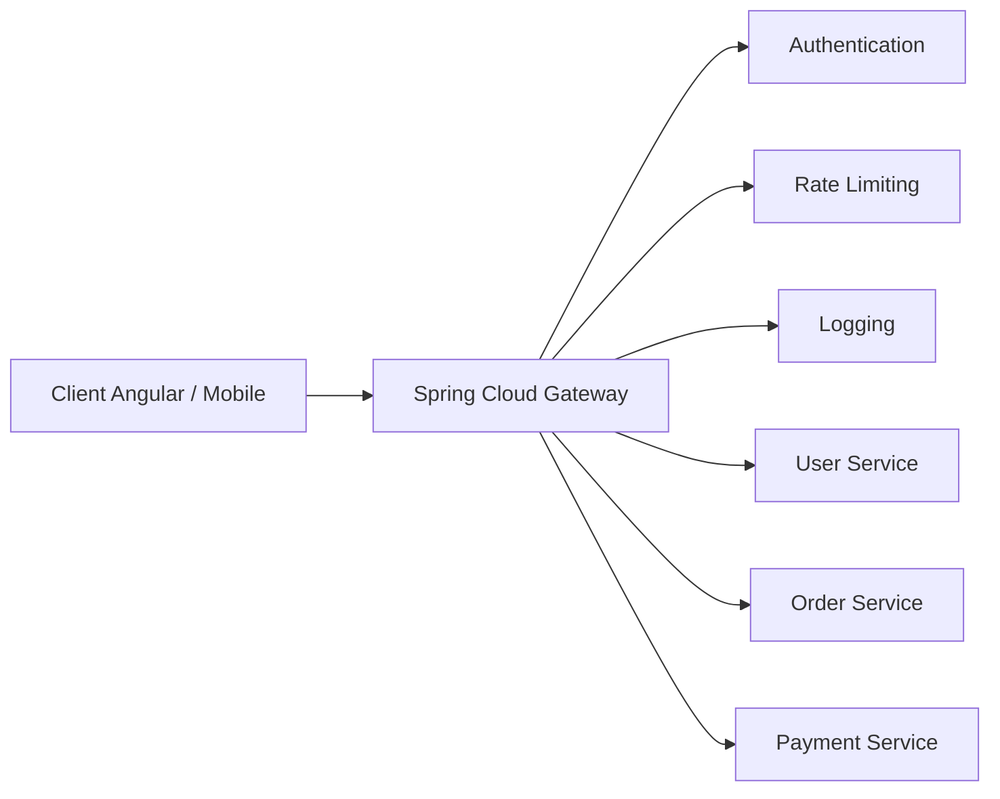

Au lieu de :

```text
Client → tous les microservices
```

on obtient :

```text
Client → Gateway → Microservices
```

---

# 3. Service Discovery — Eureka

**Rôle :** permettre aux microservices de se trouver sans connaître leurs IP/ports à l'avance.

Spring Cloud Netflix fournit toujours Eureka pour ce cas d'usage. ([Home][3])

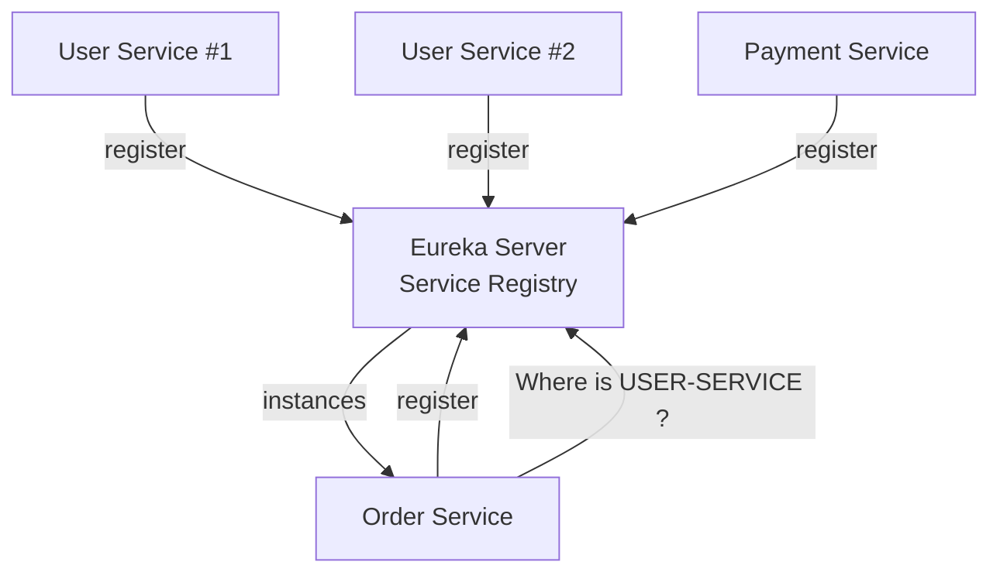

On utilise alors :

```text
http://USER-SERVICE/users
```

plutôt qu'une adresse figée :

```text
http://10.0.2.17:8082/users
```

**Attention :** sous Kubernetes, Eureka devient souvent inutile parce que Kubernetes fournit déjà service discovery + DNS.

---

# 4. Load Balancing — Spring Cloud LoadBalancer

**Rôle :** répartir les appels entre plusieurs instances d'un même service.

Spring Cloud LoadBalancer propose notamment Round Robin par défaut et Random. Il s'intègre avec RestClient et WebClient. ([Home][4])

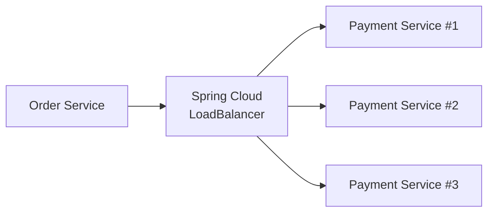

Par exemple :

```text
requête 1 → payment-service-1
requête 2 → payment-service-2
requête 3 → payment-service-3
requête 4 → payment-service-1
```

---

# 5. Caching — Spring Cache + Redis / Caffeine

**Rôle :** éviter de recalculer ou recharger des données fréquemment utilisées.

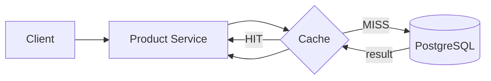

Deux stratégies typiques :

```text
Caffeine → cache local dans une instance
Redis    → cache partagé entre plusieurs instances
```

Dans une architecture microservices distribuée, **Redis est généralement plus intéressant**.

---

# 6. Configuration centralisée — Spring Cloud Config

**Rôle :** centraliser les `application.yml` des microservices.

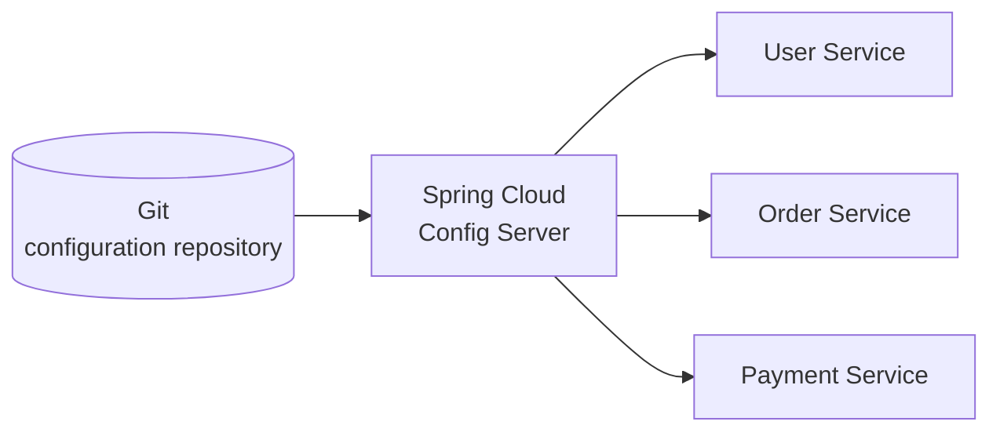

Au lieu d'avoir les configurations dispersées :

```text
user-service/application.yml
order-service/application.yml
payment-service/application.yml
```

on peut centraliser :

```text
configuration-repo/
 ├── user-service.yml
 ├── order-service.yml
 └── payment-service.yml
```

Spring Cloud Config fait toujours partie des projets Spring Cloud actuels. ([Home][2])

---

# 7. Circuit Breaker — Resilience4j

**Rôle :** éviter qu'une panne d'un service fasse tomber les autres services en cascade.

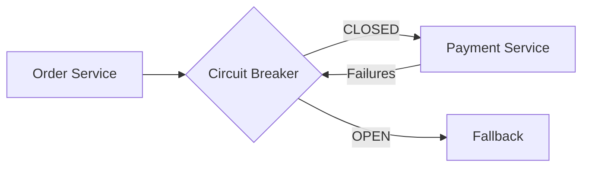

Cycle :

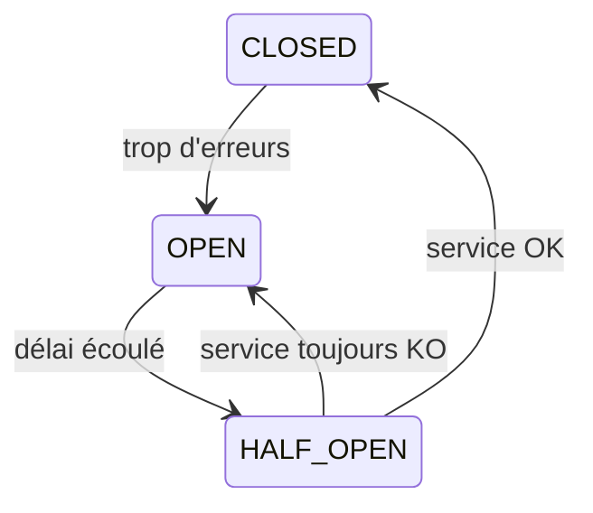

---

# 8. Retry — Resilience4j Retry

**Rôle :** retenter automatiquement une opération temporairement défaillante.

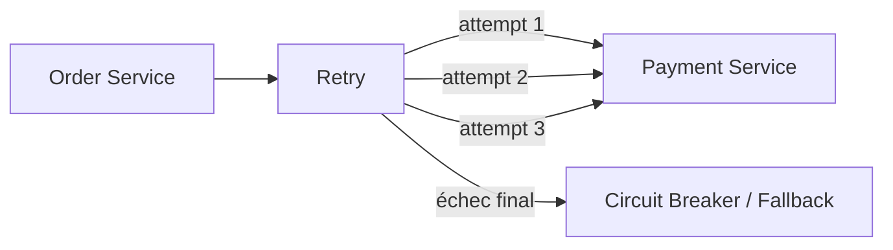

Typiquement :

```text
appel
 ↓
échec
 ↓
attendre 200 ms
 ↓
retry
 ↓
attendre 400 ms
 ↓
retry
```

Cela peut être combiné avec un **exponential backoff**.

---

# 9. Timeout — HTTP Client / Resilience4j TimeLimiter

**Rôle :** éviter qu'un service attende indéfiniment une réponse.

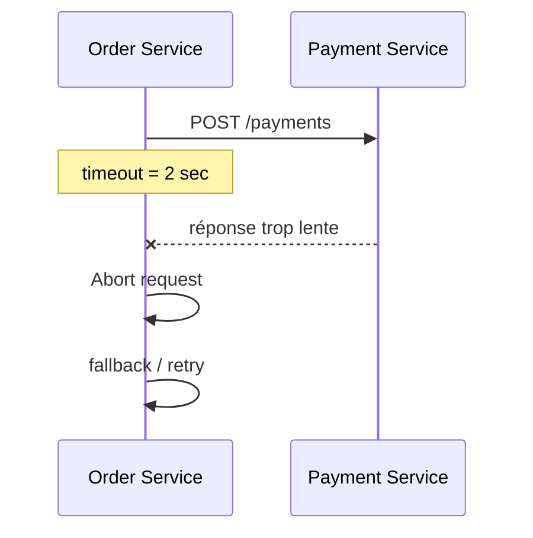

Le timeout est fondamental : **Circuit Breaker sans timeout est rarement suffisant.**

---

# 10. Bulkhead — Resilience4j Bulkhead

**Rôle :** isoler les ressources afin qu'un service lent n'utilise tous les threads/connexions disponibles.

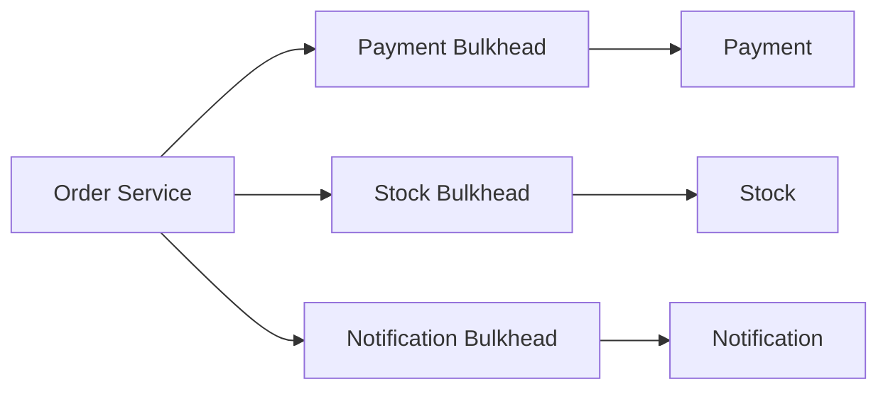

Ainsi :

```text
Payment Service saturé
        ↓
seulement son pool est saturé

Stock Service       ✅ continue
Notification Service ✅ continue
```

---

# 11. Communication synchrone — RestClient / WebClient / HTTP Service Clients

Pour les applications Spring récentes, je privilégierais :

```text
RestClient
HTTP Service Clients
WebClient
```

Spring Cloud LoadBalancer fournit explicitement des intégrations avec `RestClient` et `WebClient`. ([Home][4])

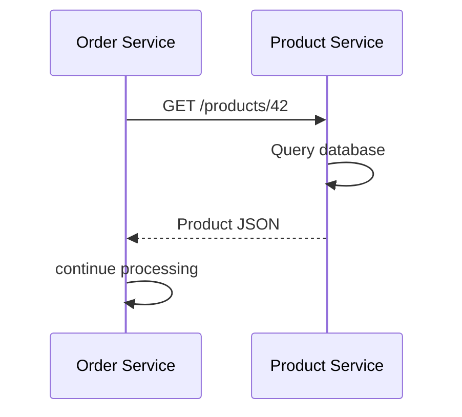

Communication synchrone :

```text
A appelle B
A attend B
B répond
A continue
```

---

# 12. Communication asynchrone — Kafka

**Rôle :** découpler les services par événements.

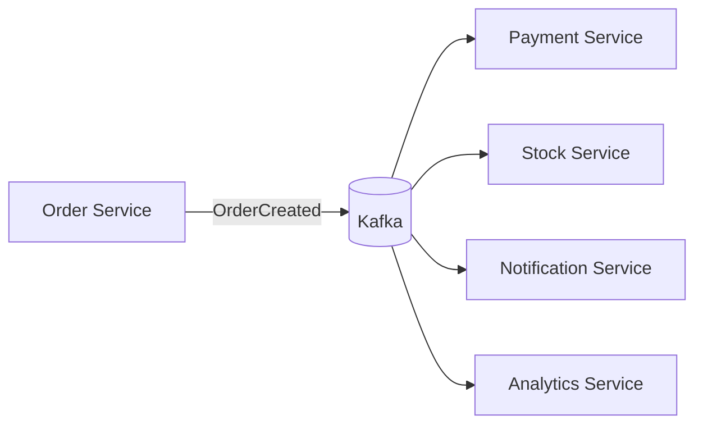

Order Service n'a plus besoin de connaître tous les consommateurs.

```text
Order Service
     │
     └── OrderCreated
             ↓
           Kafka
          / | | \
         ↓  ↓ ↓  ↓
 Payment Stock Email Analytics
```

---

# 13. Abstraction Messaging — Spring Cloud Stream

**Rôle :** fournir une abstraction Spring au-dessus des brokers.

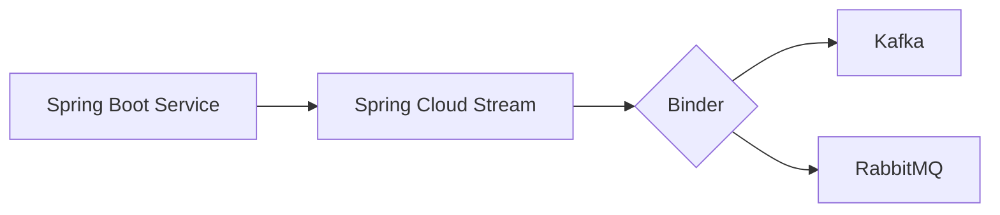

Ton code métier dépend davantage de Spring Cloud Stream que directement du broker.

Spring Cloud Stream fait toujours partie de l'écosystème Spring Cloud officiel. ([Home][2])

---

# 14. Authentification — Spring Security + OAuth2/OIDC

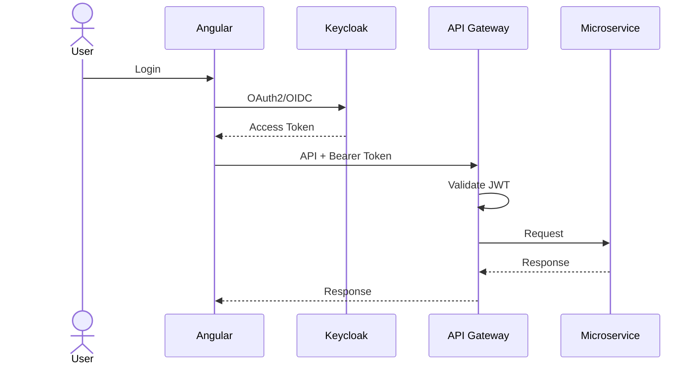

Répartition typique :

```text
Keycloak
   ↓
identité / utilisateurs / tokens

Spring Security
   ↓
validation token / rôles / permissions
```

---

# 15. Autorisation

Authentification et autorisation doivent être distinguées.

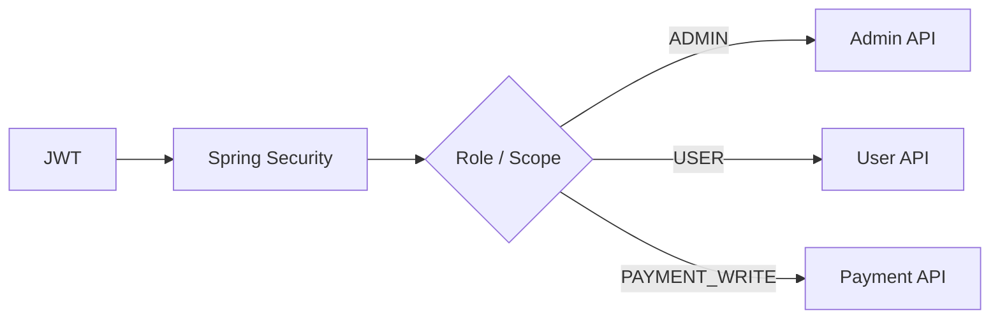

Exemples :

```java
@PreAuthorize("hasRole('ADMIN')")
```

ou :

```java
@PreAuthorize("hasAuthority('SCOPE_payment.write')")
```

---

# 16. Rate Limiting — Spring Cloud Gateway + Redis

**Rôle :** empêcher un client d'envoyer trop de requêtes.

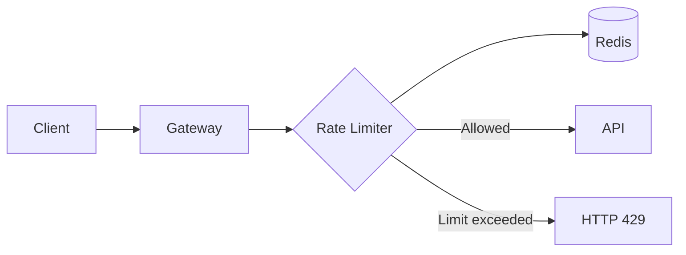

Exemple :

```text
Client A → max 100 requests/minute

101e requête
     ↓
HTTP 429 Too Many Requests
```

---

# 17. Health & Metrics — Actuator + Micrometer

**Rôle :** exposer l'état et les métriques du service.

```mermaid
flowchart LR
    APP[Spring Boot Service]

    APP --> A[Actuator]

    A --> H[/actuator/health]
    A --> M[/actuator/metrics]
    A --> P[/actuator/prometheus]

    P --> PROM[Prometheus]
```

Actuator expose notamment des informations exploitables par les outils d'observabilité.

---

# 18. Metrics — Prometheus + Grafana

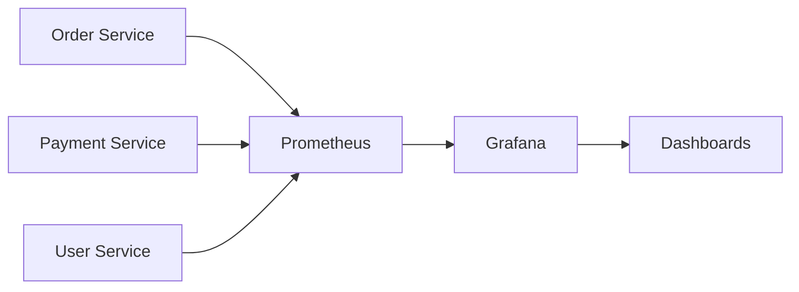

Tu peux observer :

```text
HTTP requests/sec
latency
CPU
RAM
JVM Heap
GC
nombre d'erreurs
pool de connexions DB
```

---

# 19. Distributed Tracing — Micrometer Tracing + OpenTelemetry

**Rôle :** suivre une requête traversant plusieurs microservices.

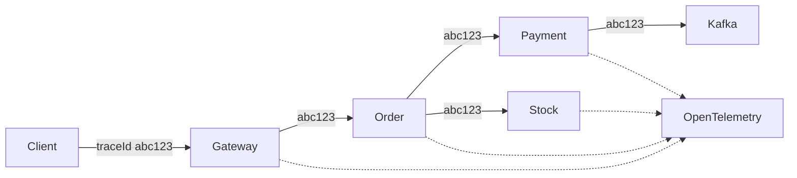

Tu peux alors retrouver :

```text
traceId=abc123

Gateway         15ms
   ↓
Order Service   80ms
   ↓
Payment Service 750ms  ← problème
```

---

# 20. Logs centralisés — Loki / ELK / OpenSearch

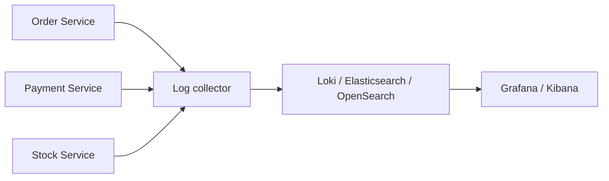

L'intérêt est de rechercher :

```text
traceId=abc123
```

et de retrouver les logs provenant de **tous les microservices**.

---

# 21. Secrets — Vault / Kubernetes Secrets

Ne mets pas :

```yaml
spring:
  datasource:
    password: mon-password
```

dans Git.

Architecture :

```mermaid
flowchart LR
    SECRET[Vault / Kubernetes Secret]

    SECRET --> U[User Service]
    SECRET --> O[Order Service]
    SECRET --> P[Payment Service]

    U --> DB1[(DB)]
    O --> DB2[(DB)]
    P --> DB3[(DB)]
```

Secrets concernés :

```text
DB_PASSWORD
API_KEY
JWT secret
certificats
Kafka credentials
OAuth client secret
```

---

# 22. Accès aux données — Spring Data

Dans une architecture microservices, le principe important est :

> **Database per Service.**

```mermaid
flowchart LR
    U[User Service] --> UDB[(User DB)]

    O[Order Service] --> ODB[(Order DB)]

    P[Payment Service] --> PDB[(Payment DB)]
```

À éviter :

```mermaid
flowchart TB
    U[User]
    O[Order]
    P[Payment]

    U --> DB[(Shared Database)]
    O --> DB
    P --> DB
```

Chaque service doit idéalement être propriétaire de ses données.

---

# 23. Migration BDD — Flyway / Liquibase

```mermaid
flowchart LR
    APP[Payment Service]

    APP --> F[Flyway]

    F --> V1[V1 create tables]
    F --> V2[V2 add index]
    F --> V3[V3 add column]

    V1 --> DB[(PostgreSQL)]
    V2 --> DB
    V3 --> DB
```

Au démarrage :

```text
Payment Service
      ↓
Flyway
      ↓
compare schema_version
      ↓
applique migrations manquantes
      ↓
application démarre
```

---

# 24. Transactions distribuées — Saga Pattern

Une transaction SQL classique ne fonctionne plus facilement lorsque plusieurs bases sont impliquées.

```mermaid
sequenceDiagram
    participant O as Order
    participant K as Kafka
    participant P as Payment
    participant S as Stock

    O->>K: OrderCreated
    K->>P: OrderCreated

    P->>K: PaymentCompleted
    K->>S: PaymentCompleted

    S->>K: StockReserved
    K->>O: StockReserved

    O->>O: Order CONFIRMED
```

En cas d'erreur :

```mermaid
sequenceDiagram
    participant O as Order
    participant P as Payment
    participant S as Stock

    O->>P: Pay
    P-->>O: Payment OK

    O->>S: Reserve stock
    S--xO: Out of stock

    O->>P: Compensate / Refund
```

C'est le principe de **transaction compensatoire**.

---

# 25. Dead Letter Queue — Kafka / RabbitMQ

**Rôle :** isoler les messages impossibles à traiter.

```mermaid
flowchart LR
    K[(Kafka Topic)]

    K --> C[Consumer]

    C -->|success| OK[Processed]

    C -->|failure| R[Retry]
    R -->|failure| R
    R -->|max retries| DLQ[(Dead Letter Topic)]

    DLQ --> OPS[Analysis / Replay]
```

Très important pour éviter :

```text
message défectueux
      ↓
consumer crash
      ↓
retry infini
```

---

# 26. Idempotence

Un message peut être reçu plusieurs fois.

```mermaid
flowchart TB
    K[Kafka]

    K --> M1[OrderCreated id=123]
    K --> M2[OrderCreated id=123]

    M1 --> C[Consumer]
    M2 --> C

    C --> CHECK{Already processed?}

    CHECK -->|No| PROCESS[Process]
    CHECK -->|Yes| IGNORE[Ignore]

    PROCESS --> DB[(Processed IDs)]
```

Cela permet d'obtenir :

```text
1 événement reçu 3 fois
         ↓
1 seule opération métier
```

Très important pour **Kafka, RabbitMQ, paiements et retries**.

---

# 27. Tests de contrats — Spring Cloud Contract

Imagine :

```text
Order Service → Payment Service
```

Order suppose que Payment retourne :

```json
{
  "id": 42,
  "status": "PAID"
}
```

Spring Cloud Contract permet de vérifier que ce contrat n'est pas cassé.

```mermaid
flowchart LR
    CONTRACT[API Contract]

    CONTRACT --> PROVIDER[Payment Service Tests]

    CONTRACT --> STUB[Generated Stub]

    STUB --> CONSUMER[Order Service Tests]
```

C'est particulièrement utile quand plusieurs équipes travaillent sur différents microservices.

Spring Cloud Contract fait partie des projets Spring Cloud actuels. ([Home][2])

---

# 28. Documentation API — SpringDoc OpenAPI

```mermaid
flowchart LR
    API[Spring Boot REST API]

    API --> DOC[SpringDoc OpenAPI]

    DOC --> JSON[/v3/api-docs]
    DOC --> SW[Swagger UI]

    JSON --> CLIENT[Client generation]
```

Typiquement :

```text
Spring Controller
       ↓
SpringDoc
       ↓
OpenAPI specification
       ↓
Swagger UI
```

---

# 29. Conteneurisation — Docker

Chaque microservice devient une image indépendante.

```mermaid
flowchart TB
    O[Order Service] --> OI[order-service:1.0]

    P[Payment Service] --> PI[payment-service:1.0]

    U[User Service] --> UI[user-service:1.0]

    OI --> D[Docker]
    PI --> D
    UI --> D
```

Cela garantit un environnement reproductible :

```text
code
 ↓
build
 ↓
Docker image
 ↓
dev / test / prod
```

---

# 30. Orchestration — Kubernetes

À partir d'un certain niveau, Kubernetes prend en charge une bonne partie de l'infrastructure.

```mermaid
flowchart TB
    K[Kubernetes Cluster]

    K --> G[Gateway Pods]

    K --> O1[Order Pod]
    K --> O2[Order Pod]

    K --> P1[Payment Pod]
    K --> P2[Payment Pod]

    KS1[Order Service] --> O1
    KS1 --> O2

    KS2[Payment Service] --> P1
    KS2 --> P2
```

Kubernetes fournit notamment :

```text
Service Discovery
Load Balancing
Self Healing
Scaling
Configuration
Secrets
Rolling Updates
Health Checks
```

Spring Cloud Kubernetes peut également s'intégrer au discovery et au load balancing Kubernetes. ([Home][5])

---

# 31. Architecture finale

Si on assemble toute la boîte à outils, on arrive à quelque chose comme :

```mermaid
flowchart TB
    CLIENT[Angular / Mobile]

    CLIENT --> IDP[Keycloak]
    CLIENT --> GW[Spring Cloud Gateway]

    GW --> RL[Rate Limiter / Redis]

    GW --> DISC[Service Discovery]

    DISC --> LB[Spring Cloud LoadBalancer]

    LB --> ORDER[Order Service]
    LB --> PRODUCT[Product Service]
    LB --> PAYMENT[Payment Service]

    ORDER --> ODB[(Order PostgreSQL)]
    PRODUCT --> PDB[(Product PostgreSQL)]
    PAYMENT --> PAYDB[(Payment PostgreSQL)]

    ORDER --> REDIS[(Redis Cache)]
    PRODUCT --> REDIS

    ORDER --> CB[Resilience4j]
    CB --> PAYMENT

    ORDER --> KAFKA[(Kafka)]

    KAFKA --> PAYMENT
    KAFKA --> NOTIF[Notification Service]
    KAFKA --> ANALYTICS[Analytics Service]

    CONFIG[Spring Cloud Config] --> ORDER
    CONFIG --> PRODUCT
    CONFIG --> PAYMENT

    VAULT[Vault / Secrets] --> ORDER
    VAULT --> PRODUCT
    VAULT --> PAYMENT

    ORDER --> OTEL[OpenTelemetry]
    PRODUCT --> OTEL
    PAYMENT --> OTEL

    ORDER --> PROM[Prometheus]
    PRODUCT --> PROM
    PAYMENT --> PROM

    PROM --> GRAFANA[Grafana]
    OTEL --> GRAFANA
```

## La toolbox que je retiendrais pour un projet moderne

Pour une application **Angular 22 + Java 25 + Spring Boot 4 en microservices**, je ne mettrais pas forcément les 30 briques dès le début. Je partirais plutôt sur ce noyau :

```text
                        ┌──────────────────────────┐
                        │      Angular 22          │
                        └────────────┬─────────────┘
                                     │
                              OAuth2 / OIDC
                                     │
                               ┌─────▼─────┐
                               │ Keycloak  │
                               └───────────┘
                                     │
                        ┌────────────▼────────────┐
                        │ Spring Cloud Gateway   │
                        └────────────┬────────────┘
                                     │
                   ┌─────────────────┼─────────────────┐
                   ▼                 ▼                 ▼
             Order Service     Product Service   Payment Service
                   │                 │                 │
                   ▼                 ▼                 ▼
              PostgreSQL        PostgreSQL        PostgreSQL

                   └───────────────┬─────────────────┘
                                   │
                              ┌────▼────┐
                              │  Kafka  │
                              └─────────┘

Redis             → cache + rate limiting
Resilience4j      → circuit breaker / retry / timeout / bulkhead
Spring Security   → sécurité des APIs
SpringDoc         → OpenAPI / Swagger
Flyway            → migrations SQL
Actuator          → health
Micrometer        → instrumentation
OpenTelemetry     → tracing
Prometheus        → metrics
Grafana           → dashboards
Loki              → logs
Docker            → conteneurs
Kubernetes        → orchestration
```

Un point particulièrement important : **Eureka + Spring Cloud LoadBalancer + Spring Cloud Config sont très intéressants pour apprendre l'écosystème Spring Cloud**, mais dans une architecture réellement déployée sur Kubernetes, Kubernetes peut remplacer une partie de ces responsabilités, notamment le service discovery et une partie du load balancing. Spring Cloud LoadBalancer reste néanmoins compatible avec une découverte basée sur Kubernetes. ([Home][4])

À retenir mentalement : **Gateway = entrée**, **Eureka = trouver**, **LoadBalancer = répartir**, **Redis = accélérer**, **Config = configurer**, **Resilience4j = résister**, **RestClient = appeler**, **Kafka = communiquer sans attendre**, **Security/Keycloak = sécuriser**, **Actuator/Micrometer/OpenTelemetry = observer**, **Prometheus/Grafana/Loki = superviser**, **Docker/Kubernetes = exécuter et orchestrer**.

[1]: https://docs.spring.io/spring-cloud-gateway/reference/?utm_source=chatgpt.com "Spring Cloud Gateway :: Spring Cloud Gateway"
[2]: https://docs.spring.io/spring-cloud-gateway/reference/spring-projects.html?utm_source=chatgpt.com "Spring Projects :: Spring Cloud Gateway"
[3]: https://docs.spring.io/spring-cloud-netflix/reference/index.html?utm_source=chatgpt.com "Spring Cloud Netflix :: Spring Cloud Netflix"
[4]: https://docs.spring.io/spring-cloud-commons/reference/spring-cloud-commons/loadbalancer.html?utm_source=chatgpt.com "Spring Cloud LoadBalancer :: Spring Cloud Commons"
[5]: https://docs.spring.io/spring-cloud-kubernetes/reference/load-balancer.html?utm_source=chatgpt.com "LoadBalancer for Kubernetes :: Spring Cloud Kubernetes"
