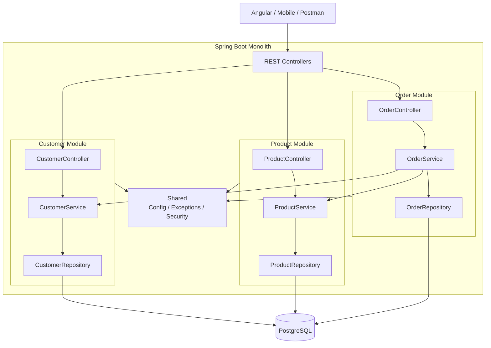

Pour un projet Spring Boot **monolithique**, le plus important est de ne pas tomber dans le piège du gros dossier `controller/service/repository` global. Je te conseille plutôt un **monolithe modulaire organisé par fonctionnalités métier**. C'est beaucoup plus maintenable et ça facilite une éventuelle migration vers des microservices plus tard.

Je te propose de construire pas à pas une petite API de **gestion de commandes** avec Java 25, Spring Boot 4, PostgreSQL, Maven et une architecture propre.

## 1. Architecture cible

On va partir sur cette organisation :

```text
order-management/
├── src/
│   ├── main/
│   │   ├── java/com/example/ordermanagement/
│   │   │   ├── OrderManagementApplication.java
│   │   │   │
│   │   │   ├── customer/
│   │   │   │   ├── controller/
│   │   │   │   ├── service/
│   │   │   │   ├── repository/
│   │   │   │   ├── entity/
│   │   │   │   ├── dto/
│   │   │   │   └── mapper/
│   │   │   │
│   │   │   ├── product/
│   │   │   │   ├── controller/
│   │   │   │   ├── service/
│   │   │   │   ├── repository/
│   │   │   │   ├── entity/
│   │   │   │   ├── dto/
│   │   │   │   └── mapper/
│   │   │   │
│   │   │   ├── order/
│   │   │   │   ├── controller/
│   │   │   │   ├── service/
│   │   │   │   ├── repository/
│   │   │   │   ├── entity/
│   │   │   │   ├── dto/
│   │   │   │   └── mapper/
│   │   │   │
│   │   │   └── shared/
│   │   │       ├── config/
│   │   │       ├── exception/
│   │   │       └── util/
│   │   │
│   │   └── resources/
│   │       ├── application.yml
│   │       ├── application-dev.yml
│   │       └── db/
│   │           └── migration/
│   │
│   └── test/
│       └── java/com/example/ordermanagement/
│
├── pom.xml
├── Dockerfile
├── docker-compose.yml
└── README.md
```

Le principe est :

```text
Application
│
├── Customer
├── Product
├── Order
└── Shared
```

Chaque domaine possède ses propres couches.

---

# 2. Créer le projet

Avec Spring Initializr, choisis par exemple :

```text
Project : Maven
Language : Java
Spring Boot : 4.x
Java : 25

Group:
com.example

Artifact:
order-management
```

Dépendances :

```text
Spring Web
Spring Data JPA
PostgreSQL Driver
Validation
Spring Boot Actuator
Flyway Migration
Lombok (optionnel)
```

Tu peux aussi ajouter OpenAPI ensuite.

---

# 3. Le point d'entrée Spring Boot

Tu obtiens :

```java
package com.example.ordermanagement;

import org.springframework.boot.SpringApplication;
import org.springframework.boot.autoconfigure.SpringBootApplication;

@SpringBootApplication
public class OrderManagementApplication {

    public static void main(String[] args) {
        SpringApplication.run(OrderManagementApplication.class, args);
    }
}
```

Il faut idéalement placer cette classe **tout en haut de l'arborescence des packages**.

Pourquoi ?

Parce que Spring effectue son component scanning à partir de ce package :

```text
com.example.ordermanagement
```

Il détectera donc :

```text
com.example.ordermanagement.customer
com.example.ordermanagement.product
com.example.ordermanagement.order
com.example.ordermanagement.shared
```

---

# 4. Pourquoi je déconseille cette structure

On voit énormément de projets organisés ainsi :

```text
controller/
    CustomerController
    ProductController
    OrderController

service/
    CustomerService
    ProductService
    OrderService

repository/
    CustomerRepository
    ProductRepository
    OrderRepository

entity/
    Customer
    Product
    Order
```

Ça fonctionne.

Mais lorsque ton projet grossit :

```text
controller/
   42 fichiers

service/
   58 fichiers

repository/
   35 fichiers
```

Il devient difficile de savoir ce qui appartient à quel domaine.

---

# 5. Préférer une architecture par feature

Utilise plutôt :

```text
customer/
product/
order/
```

Puis chaque feature contient ce dont elle a besoin.

```text
customer/
├── controller/
├── dto/
├── entity/
├── mapper/
├── repository/
└── service/
```

Par exemple :

```text
customer/
├── controller/
│   └── CustomerController.java
├── dto/
│   ├── CreateCustomerRequest.java
│   └── CustomerResponse.java
├── entity/
│   └── Customer.java
├── mapper/
│   └── CustomerMapper.java
├── repository/
│   └── CustomerRepository.java
└── service/
    └── CustomerService.java
```

C'est déjà une forme de **monolithe modulaire**.

---

# 6. Créer l'entité Customer

```java
package com.example.ordermanagement.customer.entity;

import jakarta.persistence.*;

@Entity
@Table(name = "customers")
public class Customer {

    @Id
    @GeneratedValue(strategy = GenerationType.IDENTITY)
    private Long id;

    @Column(nullable = false)
    private String firstName;

    @Column(nullable = false)
    private String lastName;

    @Column(nullable = false, unique = true)
    private String email;

    public Customer() {
    }

    public Long getId() {
        return id;
    }

    public String getFirstName() {
        return firstName;
    }

    public void setFirstName(String firstName) {
        this.firstName = firstName;
    }

    public String getLastName() {
        return lastName;
    }

    public void setLastName(String lastName) {
        this.lastName = lastName;
    }

    public String getEmail() {
        return email;
    }

    public void setEmail(String email) {
        this.email = email;
    }
}
```

Architecture :

```text
customer
   ↓
entity
   ↓
Customer.java
```

---

# 7. Créer le Repository

```java
package com.example.ordermanagement.customer.repository;

import com.example.ordermanagement.customer.entity.Customer;
import org.springframework.data.jpa.repository.JpaRepository;

public interface CustomerRepository
        extends JpaRepository<Customer, Long> {

    boolean existsByEmail(String email);
}
```

Le repository est la couche :

```text
Application
   ↓
Repository
   ↓
JPA / Hibernate
   ↓
PostgreSQL
```

---

# 8. Ne pas exposer directement les Entity

Une erreur classique :

```java
@GetMapping("/{id}")
public Customer getCustomer() {
    ...
}
```

Il vaut mieux utiliser des DTO.

Par exemple :

```java
package com.example.ordermanagement.customer.dto;

public record CreateCustomerRequest(
        String firstName,
        String lastName,
        String email
) {
}
```

Et :

```java
package com.example.ordermanagement.customer.dto;

public record CustomerResponse(
        Long id,
        String firstName,
        String lastName,
        String email
) {
}
```

Avec Java moderne, les `record` sont très pratiques pour les DTO.

---

# 9. Ajouter la validation

```java
package com.example.ordermanagement.customer.dto;

import jakarta.validation.constraints.Email;
import jakarta.validation.constraints.NotBlank;

public record CreateCustomerRequest(

        @NotBlank
        String firstName,

        @NotBlank
        String lastName,

        @NotBlank
        @Email
        String email

) {
}
```

Le contrôleur pourra ensuite faire :

```java
@PostMapping
public CustomerResponse create(
        @Valid @RequestBody CreateCustomerRequest request
) {
    ...
}
```

---

# 10. Créer le Mapper

Le mapper transforme :

```text
DTO
 ↕
Entity
```

Par exemple :

```java
package com.example.ordermanagement.customer.mapper;

import com.example.ordermanagement.customer.dto.CreateCustomerRequest;
import com.example.ordermanagement.customer.dto.CustomerResponse;
import com.example.ordermanagement.customer.entity.Customer;
import org.springframework.stereotype.Component;

@Component
public class CustomerMapper {

    public Customer toEntity(CreateCustomerRequest request) {

        Customer customer = new Customer();

        customer.setFirstName(request.firstName());
        customer.setLastName(request.lastName());
        customer.setEmail(request.email());

        return customer;
    }

    public CustomerResponse toResponse(Customer customer) {

        return new CustomerResponse(
                customer.getId(),
                customer.getFirstName(),
                customer.getLastName(),
                customer.getEmail()
        );
    }
}
```

---

# 11. Créer le Service

```java
package com.example.ordermanagement.customer.service;

import com.example.ordermanagement.customer.dto.CreateCustomerRequest;
import com.example.ordermanagement.customer.dto.CustomerResponse;
import com.example.ordermanagement.customer.entity.Customer;
import com.example.ordermanagement.customer.mapper.CustomerMapper;
import com.example.ordermanagement.customer.repository.CustomerRepository;
import org.springframework.stereotype.Service;
import org.springframework.transaction.annotation.Transactional;

import java.util.List;

@Service
@Transactional
public class CustomerService {

    private final CustomerRepository repository;
    private final CustomerMapper mapper;

    public CustomerService(
            CustomerRepository repository,
            CustomerMapper mapper
    ) {
        this.repository = repository;
        this.mapper = mapper;
    }

    public CustomerResponse create(CreateCustomerRequest request) {

        Customer customer = mapper.toEntity(request);

        Customer savedCustomer = repository.save(customer);

        return mapper.toResponse(savedCustomer);
    }

    @Transactional(readOnly = true)
    public List<CustomerResponse> findAll() {

        return repository.findAll()
                .stream()
                .map(mapper::toResponse)
                .toList();
    }
}
```

Le service contient principalement les **règles métier**.

---

# 12. Créer le Controller

```java
package com.example.ordermanagement.customer.controller;

import com.example.ordermanagement.customer.dto.CreateCustomerRequest;
import com.example.ordermanagement.customer.dto.CustomerResponse;
import com.example.ordermanagement.customer.service.CustomerService;
import jakarta.validation.Valid;
import org.springframework.http.HttpStatus;
import org.springframework.web.bind.annotation.*;

import java.util.List;

@RestController
@RequestMapping("/api/v1/customers")
public class CustomerController {

    private final CustomerService service;

    public CustomerController(CustomerService service) {
        this.service = service;
    }

    @PostMapping
    @ResponseStatus(HttpStatus.CREATED)
    public CustomerResponse create(
            @Valid @RequestBody CreateCustomerRequest request
    ) {
        return service.create(request);
    }

    @GetMapping
    public List<CustomerResponse> findAll() {
        return service.findAll();
    }
}
```

Ton flux devient :

```text
HTTP Request
     │
     ▼
Controller
     │
     ▼
Service
     │
     ▼
Repository
     │
     ▼
JPA / Hibernate
     │
     ▼
PostgreSQL
```

Puis dans l'autre sens :

```text
PostgreSQL
     │
     ▼
Entity
     │
     ▼
Mapper
     │
     ▼
Response DTO
     │
     ▼
JSON
```

---

# 13. Configurer PostgreSQL

`application.yml` :

```yaml
spring:

  application:
    name: order-management

  datasource:
    url: jdbc:postgresql://localhost:5432/order_db
    username: postgres
    password: postgres

  jpa:
    open-in-view: false
    hibernate:
      ddl-auto: validate

  flyway:
    enabled: true

server:
  port: 8080
```

Je recommande en particulier :

```yaml
spring:
  jpa:
    open-in-view: false
```

et d'éviter :

```yaml
ddl-auto: update
```

sur un vrai projet.

Utilise plutôt Flyway.

---

# 14. Ajouter Flyway

Structure :

```text
resources/
└── db/
    └── migration/
        ├── V1__create_customer_table.sql
        ├── V2__create_product_table.sql
        └── V3__create_order_tables.sql
```

`V1__create_customer_table.sql` :

```sql
CREATE TABLE customers
(
    id         BIGSERIAL PRIMARY KEY,
    first_name VARCHAR(100) NOT NULL,
    last_name  VARCHAR(100) NOT NULL,
    email      VARCHAR(255) NOT NULL UNIQUE
);
```

Au démarrage :

```text
Spring Boot
    │
    ▼
Flyway
    │
    ▼
V1
    │
    ▼
V2
    │
    ▼
V3
    │
    ▼
Database up-to-date
```

---

# 15. Ajouter Product

Tu reproduis le même principe :

```text
product/
├── controller/
│   └── ProductController.java
├── dto/
│   ├── CreateProductRequest.java
│   └── ProductResponse.java
├── entity/
│   └── Product.java
├── mapper/
│   └── ProductMapper.java
├── repository/
│   └── ProductRepository.java
└── service/
    └── ProductService.java
```

---

# 16. Ajouter Order

Même organisation :

```text
order/
├── controller/
├── dto/
├── entity/
├── mapper/
├── repository/
└── service/
```

Mais ici, tu vas commencer à avoir des communications entre modules.

Par exemple :

```text
OrderService
    │
    ├── utilise Customer
    │
    └── utilise Product
```

C'est là que la modularisation commence à devenir intéressante.

---

# 17. Ajouter un package `shared`

Tout ce qui est transversal peut aller dans :

```text
shared/
```

Par exemple :

```text
shared/
├── config/
│   ├── JacksonConfig.java
│   ├── SecurityConfig.java
│   └── OpenApiConfig.java
│
├── exception/
│   ├── ApiError.java
│   ├── GlobalExceptionHandler.java
│   ├── ResourceNotFoundException.java
│   └── BusinessException.java
│
└── util/
```

Attention cependant à ne pas transformer `shared` en :

```text
shared/
    fourre-tout/
```

Si une classe appartient réellement à `order`, laisse-la dans `order`.

---

# 18. Gérer les exceptions

Par exemple :

```java
public class ResourceNotFoundException extends RuntimeException {

    public ResourceNotFoundException(String message) {
        super(message);
    }
}
```

Puis :

```java
@RestControllerAdvice
public class GlobalExceptionHandler {

    @ExceptionHandler(ResourceNotFoundException.class)
    @ResponseStatus(HttpStatus.NOT_FOUND)
    public ApiError handleNotFound(
            ResourceNotFoundException exception
    ) {

        return new ApiError(
                "RESOURCE_NOT_FOUND",
                exception.getMessage()
        );
    }
}
```

Ainsi :

```text
Service
   │
   ├── OK ───────────────► Controller
   │
   └── Exception
          │
          ▼
GlobalExceptionHandler
          │
          ▼
HTTP 404 / 400 / 409...
```

---

# 19. Utiliser des interfaces Service ou pas ?

Tu verras parfois :

```text
CustomerService
CustomerServiceImpl
```

avec :

```java
public interface CustomerService {
}
```

et :

```java
public class CustomerServiceImpl
        implements CustomerService {
}
```

Je déconseille de le faire systématiquement.

Pour une simple implémentation :

```text
CustomerService.java
```

suffit largement.

Crée une abstraction lorsque tu en as réellement besoin.

---

# 20. Les tests

Je garderais une structure proche du code réel :

```text
src/test/java/com/example/ordermanagement/

├── customer/
│   ├── controller/
│   │   └── CustomerControllerTest.java
│   ├── service/
│   │   └── CustomerServiceTest.java
│   └── repository/
│       └── CustomerRepositoryTest.java
│
├── product/
│
└── order/
```

Tu peux utiliser :

```text
JUnit 5
Mockito
MockMvc
Testcontainers
```

Par exemple :

```java
@ExtendWith(MockitoExtension.class)
class CustomerServiceTest {

    @Mock
    CustomerRepository repository;

    @Mock
    CustomerMapper mapper;

    @InjectMocks
    CustomerService service;
}
```

Et pour la DB, Testcontainers est particulièrement intéressant :

```text
Test
  │
  ▼
Spring Boot
  │
  ▼
Testcontainers
  │
  ▼
PostgreSQL Docker
```

---

# 21. Ajouter Docker Compose pour le développement

```yaml
services:

  postgres:
    image: postgres:18
    environment:
      POSTGRES_DB: order_db
      POSTGRES_USER: postgres
      POSTGRES_PASSWORD: postgres

    ports:
      - "5432:5432"

    volumes:
      - postgres-data:/var/lib/postgresql/data

volumes:
  postgres-data:
```

Tu démarres :

```bash
docker compose up -d
```

Puis :

```bash
./mvnw spring-boot:run
```

---

# 22. Évolution vers un vrai monolithe modulaire

Une fois le projet un peu plus avancé, tu peux pousser la séparation plus loin.

Au lieu de :

```text
order/
    service/
    repository/
```

tu peux tendre vers :

```text
order/
├── api/
├── application/
├── domain/
└── infrastructure/
```

Ce qui donne :

```text
order
│
├── api
│   └── REST Controllers
│
├── application
│   └── Use cases
│
├── domain
│   └── règles métier
│
└── infrastructure
    ├── JPA
    └── autres adapters
```

Par exemple :

```text
order/
├── api/
│   ├── OrderController.java
│   └── dto/
│
├── application/
│   ├── CreateOrderUseCase.java
│   └── GetOrdersUseCase.java
│
├── domain/
│   ├── Order.java
│   ├── OrderItem.java
│   └── OrderRepository.java
│
└── infrastructure/
    └── persistence/
        ├── JpaOrderEntity.java
        ├── JpaOrderRepository.java
        └── OrderRepositoryAdapter.java
```

Là, tu te rapproches d'une architecture **hexagonale / clean architecture**.

---

# 23. Mais ne commence pas forcément par ça

Pour beaucoup d'applications métier, je commencerais avec :

```text
feature
    ↓
controller
service
repository
entity
dto
mapper
```

Et seulement si la complexité métier augmente, je passerais vers :

```text
feature
    ↓
api
application
domain
infrastructure
```

C'est une règle importante :

```text
Architecture simple
      │
      │ complexité augmente
      ▼
Architecture plus structurée
```

et non :

```text
Projet CRUD simple
      │
      ▼
15 couches
      │
      ▼
50 interfaces
      │
      ▼
Architecture inutilement complexe
```

---

# 24. Structure que je recommande pour un vrai projet

Au final :

```text
src/main/java/com/mycompany/myapp/

├── MyApplication.java
│
├── customer/
│   ├── controller/
│   ├── dto/
│   ├── entity/
│   ├── mapper/
│   ├── repository/
│   └── service/
│
├── product/
│   ├── controller/
│   ├── dto/
│   ├── entity/
│   ├── mapper/
│   ├── repository/
│   └── service/
│
├── order/
│   ├── controller/
│   ├── dto/
│   ├── entity/
│   ├── mapper/
│   ├── repository/
│   └── service/
│
└── shared/
    ├── config/
    ├── exception/
    └── security/
```

Avec les ressources :

```text
src/main/resources/

├── application.yml
├── application-dev.yml
├── application-test.yml
├── application-prod.yml
│
└── db/
    └── migration/
        ├── V1__initial_schema.sql
        ├── V2__create_products.sql
        └── V3__create_orders.sql
```

---

# 25. Vue globale de l'architecture



---

## La règle que je retiendrais

Pour un projet Spring Boot moderne, pars sur :

```text
organisation par métier
        +
Controller
        ↓
Service
        ↓
Repository
        ↓
Database
```

avec :

```text
Entity != DTO
```

et ajoute dès le début :

```text
Validation
Flyway
Global Exception Handler
Actuator
Tests
PostgreSQL
Docker Compose
```

Ensuite, lorsque le projet devient plus complexe, tu peux faire évoluer chaque feature vers une architecture :

```text
API
 ↓
Application
 ↓
Domain
 ↓
Infrastructure
```

Tu obtiens alors un **monolithe modulaire**, qui est souvent un excellent compromis avant même d'envisager les microservices.
