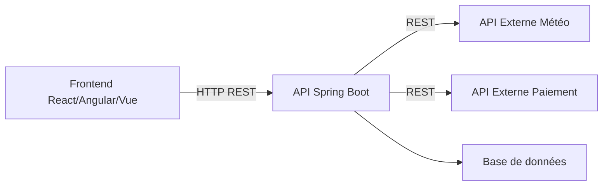
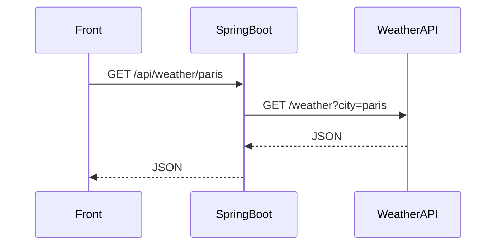
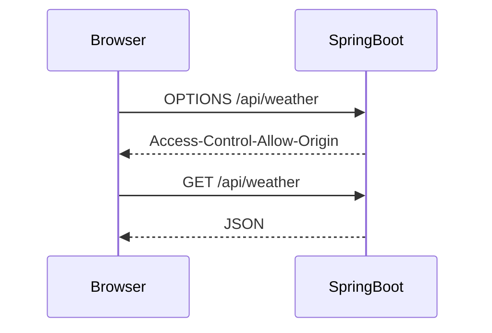
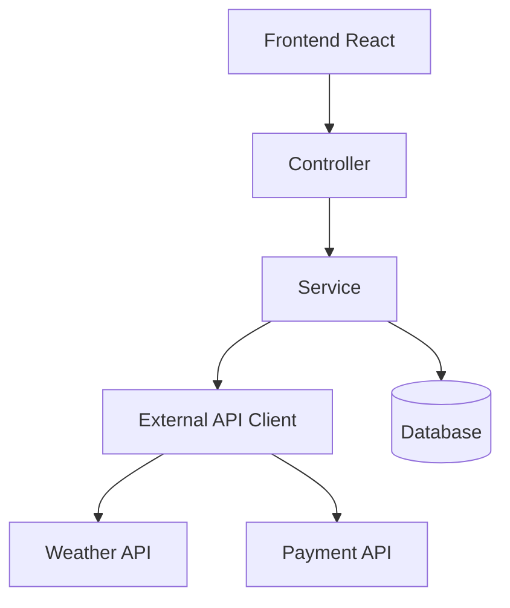

# Intégrer et consommer des API externes et internes avec Spring Boot

## Objectifs

À la fin de ce tutoriel, vous saurez :

- Consommer une API externe REST
- Exposer une API interne REST
- Configurer les clés API de manière sécurisée
- Comprendre le rôle de CORS
- Gérer les erreurs HTTP
- Centraliser la configuration
- Structurer correctement un projet Spring Boot
- Utiliser `RestClient` (Spring Boot 3+) et `WebClient`
- Sécuriser les échanges

---

# 1. Architecture générale



Le backend Spring Boot agit souvent comme :

- Producteur d'API (API interne)
- Consommateur d'API (API externe)

---

# 2. Dépendances Maven

## Spring Boot Web

```xml
<dependency>
    <groupId>org.springframework.boot</groupId>
    <artifactId>spring-boot-starter-web</artifactId>
</dependency>
```

## WebClient (optionnel)

```xml
<dependency>
    <groupId>org.springframework.boot</groupId>
    <artifactId>spring-boot-starter-webflux</artifactId>
</dependency>
```

---

# 3. Organisation recommandée

```text
src/main/java

com.example.demo

├── config
│   ├── ApiConfig.java
│   └── CorsConfig.java
│
├── controller
│   └── WeatherController.java
│
├── service
│   └── WeatherService.java
│
├── client
│   └── WeatherApiClient.java
│
├── dto
│   └── WeatherResponse.java
│
└── DemoApplication.java
```

---

# 4. Configuration des propriétés

## application.yml

```yaml
server:
  port: 8080

external:
  weather:
    url: https://api.weather.com
    api-key: ${WEATHER_API_KEY}
```

---

# 5. Où stocker les clés API ?

## Mauvaise pratique ❌

```yaml
api-key: abc123secret
```

Commitée dans Git.

---

## Bonne pratique ✅

Variable d'environnement :

```bash
export WEATHER_API_KEY=abc123secret
```

Puis :

```yaml
api-key: ${WEATHER_API_KEY}
```

---

## Alternative : fichier local ignoré

application-local.yml

```yaml
external:
  weather:
    api-key: abc123secret
```

.gitignore

```text
application-local.yml
```

---

# 6. Lire les propriétés

## Classe Configuration

```java
@ConfigurationProperties(prefix = "external.weather")
public record WeatherProperties(
        String url,
        String apiKey
) {}
```

Activation :

```java
@Configuration
@EnableConfigurationProperties(WeatherProperties.class)
public class ApiConfig {
}
```

---

# 7. Consommer une API externe avec RestClient

Depuis Spring Boot 3, `RestClient` est recommandé.

## Configuration

```java
@Configuration
public class RestClientConfig {

    @Bean
    RestClient restClient() {
        return RestClient.create();
    }
}
```

---

## Client API

```java
@Service
public class WeatherApiClient {

    private final RestClient restClient;
    private final WeatherProperties properties;

    public WeatherApiClient(
            RestClient restClient,
            WeatherProperties properties) {

        this.restClient = restClient;
        this.properties = properties;
    }

    public WeatherResponse getWeather(String city) {

        return restClient.get()
                .uri(properties.url() + "/weather?city=" + city)
                .header("X-API-KEY", properties.apiKey())
                .retrieve()
                .body(WeatherResponse.class);
    }
}
```

---

# 8. DTO de réponse

```java
public record WeatherResponse(
        String city,
        Double temperature
) {}
```

---

# 9. Service métier

```java
@Service
public class WeatherService {

    private final WeatherApiClient client;

    public WeatherService(WeatherApiClient client) {
        this.client = client;
    }

    public WeatherResponse getWeather(String city) {
        return client.getWeather(city);
    }
}
```

---

# 10. Exposer une API interne

## Contrôleur REST

```java
@RestController
@RequestMapping("/api/weather")
public class WeatherController {

    private final WeatherService service;

    public WeatherController(WeatherService service) {
        this.service = service;
    }

    @GetMapping("/{city}")
    public WeatherResponse weather(
            @PathVariable String city) {

        return service.getWeather(city);
    }
}
```

---

# 11. Flux complet



---

# 12. Gestion des erreurs

## Gestion simple

```java
public WeatherResponse getWeather(String city) {

    try {

        return restClient.get()
                .uri(...)
                .retrieve()
                .body(WeatherResponse.class);

    } catch (Exception e) {

        throw new RuntimeException(
                "Erreur API météo", e);

    }
}
```

---

## Gestion globale

```java
@RestControllerAdvice
public class GlobalExceptionHandler {

    @ExceptionHandler(Exception.class)
    public ResponseEntity<String> handle(
            Exception e) {

        return ResponseEntity
                .status(HttpStatus.INTERNAL_SERVER_ERROR)
                .body(e.getMessage());
    }
}
```

---

# 13. Ajouter automatiquement la clé API

Plutôt que dans chaque appel.

## Interceptor

```java
@Bean
RestClient restClient(
        WeatherProperties properties) {

    return RestClient.builder()
            .requestInterceptor(
                    (request, body, execution) -> {

                        request.getHeaders()
                                .add(
                                  "X-API-KEY",
                                  properties.apiKey()
                                );

                        return execution.execute(
                                request,
                                body
                        );
                    })
            .build();
}
```

---

# 14. Consommer plusieurs API

```yaml
external:

  weather:
    url: https://weather.com
    api-key: key1

  payment:
    url: https://payment.com
    api-key: key2
```

Créer :

```java
WeatherProperties
PaymentProperties
```

et un client dédié par API.

---

# 15. Utiliser WebClient (asynchrone)

## Configuration

```java
@Bean
WebClient webClient() {
    return WebClient.builder().build();
}
```

---

## Consommation

```java
public Mono<WeatherResponse> getWeather(
        String city) {

    return webClient.get()
            .uri(url + "/weather?city=" + city)
            .retrieve()
            .bodyToMono(
                    WeatherResponse.class
            );
}
```

---

# 16. RestClient vs WebClient

| Critère | RestClient | WebClient |
|----------|-----------|-----------|
| Synchrone | Oui | Non |
| Simplicité | Très simple | Moyenne |
| Réactivité | Non | Oui |
| Spring Boot 3 | Recommandé | Recommandé |
| Cas général | ✅ | ❌ |
| Très forte charge | ❌ | ✅ |

---

# 17. Comprendre CORS

## Qu'est-ce que CORS ?

CORS signifie :

```text
Cross-Origin Resource Sharing
```

Le navigateur interdit par défaut :

```text
Frontend : localhost:3000

↓

Backend : localhost:8080
```

car l'origine est différente.

---

## Exemple

Frontend :

```text
http://localhost:3000
```

Backend :

```text
http://localhost:8080
```

Le navigateur bloque :

```text
Access to fetch has been blocked by CORS policy
```

---

# 18. Comment fonctionne CORS



---

# 19. Configuration CORS globale

```java
@Configuration
public class CorsConfig {

    @Bean
    public WebMvcConfigurer corsConfigurer() {

        return new WebMvcConfigurer() {

            @Override
            public void addCorsMappings(
                    CorsRegistry registry) {

                registry.addMapping("/**")
                        .allowedOrigins(
                           "http://localhost:3000"
                        )
                        .allowedMethods(
                           "GET",
                           "POST",
                           "PUT",
                           "DELETE"
                        );
            }
        };
    }
}
```

---

# 20. Configuration CORS sur un contrôleur

```java
@CrossOrigin(
    origins = "http://localhost:3000"
)
@RestController
@RequestMapping("/api/weather")
public class WeatherController {
}
```

---

# 21. Headers CORS importants

```http
Access-Control-Allow-Origin

Access-Control-Allow-Methods

Access-Control-Allow-Headers

Access-Control-Allow-Credentials
```

---

# 22. Authentification par clé API

## Contrôleur

```java
@GetMapping
public String data(
        @RequestHeader("X-API-KEY")
        String apiKey) {

    if (!"secret".equals(apiKey)) {
        throw new RuntimeException("Forbidden");
    }

    return "OK";
}
```

---

## Appel

```http
GET /api/data

X-API-KEY: secret
```

---

# 23. Sécurisation recommandée

Ne jamais :

```text
Stocker une clé dans Git
```

Ne jamais :

```text
Exposer une clé dans le frontend
```

Toujours :

```text
Frontend
 ↓
Backend Spring
 ↓
API Externe
```

Le frontend ne connaît jamais la clé.

---

# 24. Timeout HTTP

Configuration RestClient :

```java
@Bean
RestClient restClient() {

    HttpClient httpClient =
            HttpClient.newBuilder()
                    .connectTimeout(
                        Duration.ofSeconds(5)
                    )
                    .build();

    return RestClient.builder().build();
}
```

---

# 25. Logging des appels API

```yaml
logging:
  level:
    org.springframework.web.client: DEBUG
```

---

# 26. Exemple complet d'architecture



---

# 27. Bonnes pratiques

## API interne

- Contrôleur léger
- Logique métier dans Service
- DTO dédiés
- Validation des entrées

## API externe

- Un client par API
- Gestion des erreurs
- Timeout
- Retry si nécessaire
- Clés API externalisées

## Sécurité

- HTTPS uniquement
- Variables d'environnement
- Jamais de secrets dans Git
- Rotation régulière des clés

## CORS

- Limiter les domaines autorisés
- Ne jamais utiliser `*` en production

Mauvais :

```java
.allowedOrigins("*")
```

Bon :

```java
.allowedOrigins(
    "https://monfrontend.com"
)
```

---

# Résumé

Pour intégrer correctement des API avec Spring Boot :

1. Créer un client dédié (`RestClient` ou `WebClient`)
2. Externaliser les URLs et clés API dans `application.yml`
3. Injecter les propriétés avec `@ConfigurationProperties`
4. Consommer l'API via une couche `Client`
5. Passer par une couche `Service`
6. Exposer les données via un `Controller`
7. Configurer CORS pour les applications web
8. Stocker les secrets dans des variables d'environnement
9. Ajouter timeout, logs et gestion d'erreurs
10. Ne jamais exposer les clés API côté frontend

Cette architecture est celle utilisée dans la majorité des applications Spring Boot professionnelles.
