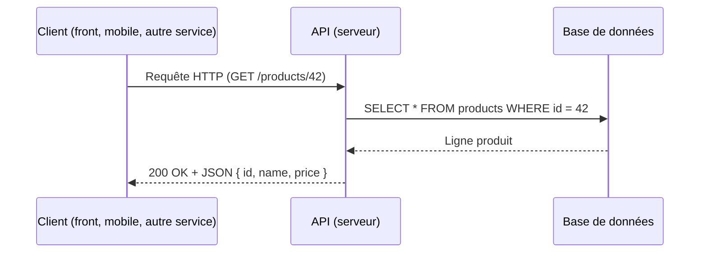
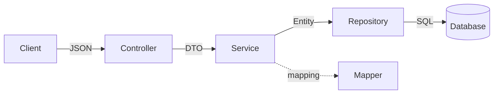
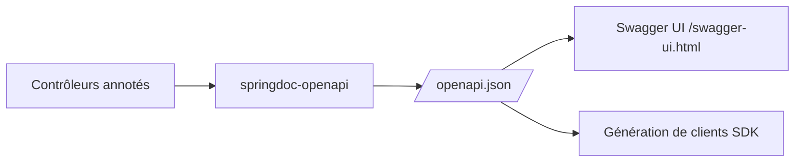
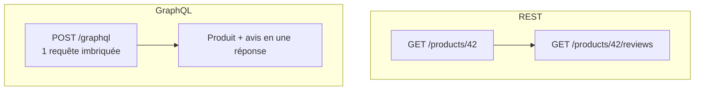
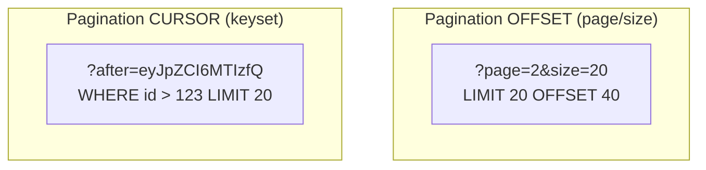
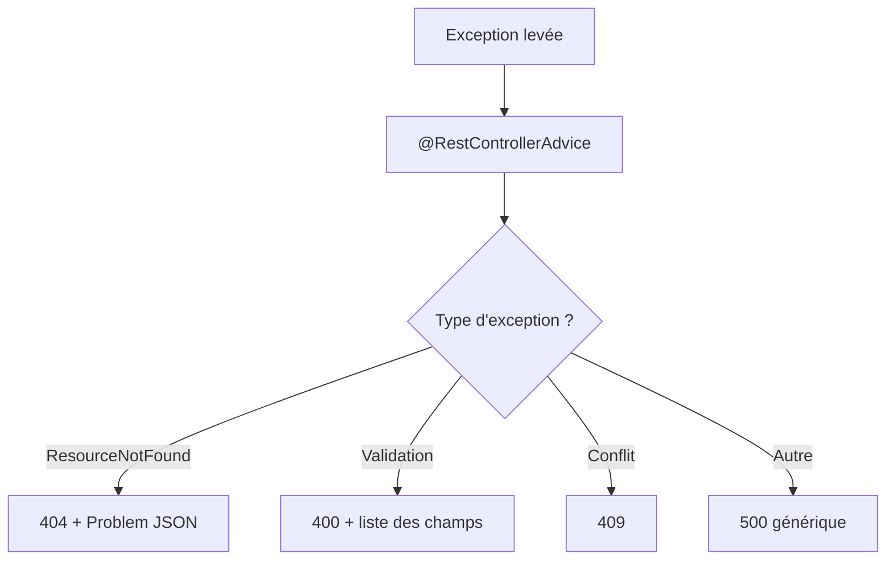
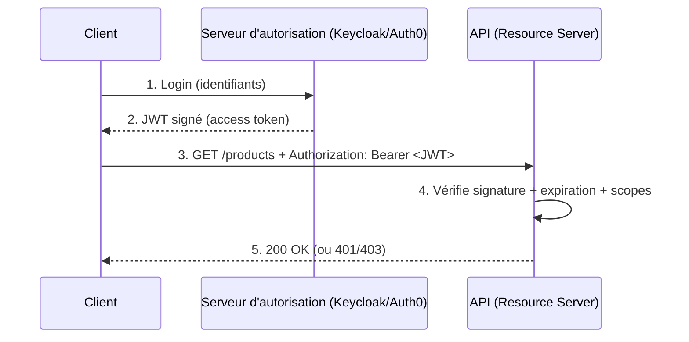
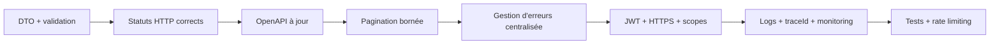

# Tutoriel complet sur les API (avec Spring Boot)

> Un guide pratique et progressif couvrant le REST, OpenAPI/Swagger, GraphQL, le versioning, la pagination, la gestion des erreurs et la sécurité — avec des exemples de code Spring Boot expliqués.

## Table des matières

1. [Introduction : qu'est-ce qu'une API ?](#1-introduction--quest-ce-quune-api-)
2. [REST API](#2-rest-api)
3. [OpenAPI / Swagger](#3-openapi--swagger)
4. [GraphQL](#4-graphql)
5. [Versioning d'API](#5-versioning-dapi)
6. [Pagination](#6-pagination)
7. [Gestion des erreurs](#7-gestion-des-erreurs)
8. [Authentification et autorisation](#8-authentification-et-autorisation)
9. [Récapitulatif des best practices](#9-récapitulatif-des-best-practices)

---

## 1. Introduction : qu'est-ce qu'une API ?

Une **API** (*Application Programming Interface*) est un contrat qui définit comment deux logiciels communiquent. Le client envoie une **requête** structurée, le serveur renvoie une **réponse** structurée, sans que le client ait besoin de connaître l'implémentation interne du serveur.



Les grands styles d'API que nous couvrons :

| Style | Transport | Format | Idéal pour |
|-------|-----------|--------|-----------|
| REST | HTTP | JSON | CRUD, ressources, services publics |
| GraphQL | HTTP (1 endpoint) | JSON | Clients aux besoins variés, sur-/sous-fetch |
| RPC/gRPC | HTTP/2 | Protobuf | Communication interne haute performance |

Ce tutoriel se concentre sur **REST** et **GraphQL**, les deux plus courants côté web.

### Pré-requis du projet Spring Boot

Toutes les dépendances utilisées dans ce guide (à ajouter au fur et à mesure) :

```xml
<dependencies>
    <!-- Web / REST -->
    <dependency>
        <groupId>org.springframework.boot</groupId>
        <artifactId>spring-boot-starter-web</artifactId>
    </dependency>
    <!-- JPA pour la persistance -->
    <dependency>
        <groupId>org.springframework.boot</groupId>
        <artifactId>spring-boot-starter-data-jpa</artifactId>
    </dependency>
    <!-- Validation (Jakarta Bean Validation) -->
    <dependency>
        <groupId>org.springframework.boot</groupId>
        <artifactId>spring-boot-starter-validation</artifactId>
    </dependency>
    <!-- Documentation OpenAPI/Swagger -->
    <dependency>
        <groupId>org.springdoc</groupId>
        <artifactId>springdoc-openapi-starter-webmvc-ui</artifactId>
        <version>2.6.0</version>
    </dependency>
    <!-- GraphQL -->
    <dependency>
        <groupId>org.springframework.boot</groupId>
        <artifactId>spring-boot-starter-graphql</artifactId>
    </dependency>
    <!-- Sécurité + OAuth2 Resource Server (JWT) -->
    <dependency>
        <groupId>org.springframework.boot</groupId>
        <artifactId>spring-boot-starter-security</artifactId>
    </dependency>
    <dependency>
        <groupId>org.springframework.boot</groupId>
        <artifactId>spring-boot-starter-oauth2-resource-server</artifactId>
    </dependency>
</dependencies>
```

---

## 2. REST API

REST (*REpresentational State Transfer*) est un style architectural fondé sur des **ressources** identifiées par des URI et manipulées via les **verbes HTTP**.

### 2.1 Les principes clés

- **Ressources et noms (pas de verbes dans l'URL)** : `/products`, `/products/42/reviews`, et non `/getProduct`.
- **Verbes HTTP porteurs de sens** : la méthode décrit l'action.
- **Sans état (*stateless*)** : chaque requête contient tout le nécessaire ; le serveur ne mémorise pas de session entre deux appels.
- **Codes de statut HTTP corrects** : ils font partie du contrat.
- **Représentations** : généralement JSON.

### 2.2 Verbes HTTP, idempotence et codes de statut

| Verbe | Usage | Idempotent | Sûr (sans effet de bord) | Succès typique |
|-------|-------|:----------:|:------------------------:|----------------|
| GET | Lire une/des ressource(s) | ✅ | ✅ | 200 |
| POST | Créer une ressource | ❌ | ❌ | 201 |
| PUT | Remplacer entièrement | ✅ | ❌ | 200 / 204 |
| PATCH | Modifier partiellement | ❌ | ❌ | 200 |
| DELETE | Supprimer | ✅ | ❌ | 204 |

> **Idempotent** = répéter la requête produit le même état final. Important pour les *retries* réseau.

Codes les plus utiles : `200 OK`, `201 Created`, `204 No Content`, `400 Bad Request`, `401 Unauthorized`, `403 Forbidden`, `404 Not Found`, `409 Conflict`, `422 Unprocessable Entity`, `500 Internal Server Error`.

### 2.3 Mettre en place les couches

Un bon découpage évite d'exposer directement les entités JPA. On sépare **entité** (persistance), **DTO** (contrat exposé) et **mapping**.



#### L'entité JPA

```java
// Entité de persistance : représente une ligne en base.
@Entity
@Table(name = "products")
public class Product {

    @Id
    @GeneratedValue(strategy = GenerationType.IDENTITY)
    private Long id;

    @Column(nullable = false)
    private String name;

    @Column(nullable = false)
    private BigDecimal price;

    private Integer stock;

    // getters / setters / constructeurs omis pour la lisibilité
}
```

#### Les DTO (contrat exposé au client)

On expose un DTO plutôt que l'entité : cela découple l'API de la base, évite de divulguer des champs internes et permet la validation.

```java
// DTO reçu en entrée (création / mise à jour).
// Les annotations de validation rejettent les données invalides avant le service.
public record ProductRequest(
        @NotBlank(message = "Le nom est obligatoire")
        String name,

        @NotNull @DecimalMin(value = "0.0", inclusive = false, message = "Le prix doit être > 0")
        BigDecimal price,

        @PositiveOrZero(message = "Le stock ne peut pas être négatif")
        Integer stock
) {}

// DTO renvoyé en sortie. On contrôle exactement ce qui sort.
public record ProductResponse(
        Long id,
        String name,
        BigDecimal price,
        Integer stock
) {}
```

#### Le mapper

```java
// Conversion Entity <-> DTO, isolée dans une classe dédiée.
@Component
public class ProductMapper {

    public Product toEntity(ProductRequest req) {
        Product p = new Product();
        p.setName(req.name());
        p.setPrice(req.price());
        p.setStock(req.stock());
        return p;
    }

    public ProductResponse toResponse(Product p) {
        return new ProductResponse(p.getId(), p.getName(), p.getPrice(), p.getStock());
    }
}
```

#### Le repository et le service

```java
public interface ProductRepository extends JpaRepository<Product, Long> {
}
```

```java
@Service
public class ProductService {

    private final ProductRepository repository;
    private final ProductMapper mapper;

    public ProductService(ProductRepository repository, ProductMapper mapper) {
        this.repository = repository;
        this.mapper = mapper;
    }

    public ProductResponse create(ProductRequest req) {
        Product saved = repository.save(mapper.toEntity(req));
        return mapper.toResponse(saved);
    }

    public ProductResponse findById(Long id) {
        Product product = repository.findById(id)
                // Exception métier traitée par le @ControllerAdvice (section 7)
                .orElseThrow(() -> new ResourceNotFoundException("Product", id));
        return mapper.toResponse(product);
    }

    public ProductResponse update(Long id, ProductRequest req) {
        Product product = repository.findById(id)
                .orElseThrow(() -> new ResourceNotFoundException("Product", id));
        product.setName(req.name());
        product.setPrice(req.price());
        product.setStock(req.stock());
        return mapper.toResponse(repository.save(product));
    }

    public void delete(Long id) {
        if (!repository.existsById(id)) {
            throw new ResourceNotFoundException("Product", id);
        }
        repository.deleteById(id);
    }
}
```

### 2.4 Le contrôleur REST complet

```java
@RestController
@RequestMapping("/api/v1/products") // préfixe versionné (voir section 5)
public class ProductController {

    private final ProductService service;

    public ProductController(ProductService service) {
        this.service = service;
    }

    // POST /api/v1/products -> 201 Created + Location: /api/v1/products/{id}
    @PostMapping
    public ResponseEntity<ProductResponse> create(@Valid @RequestBody ProductRequest req) {
        ProductResponse created = service.create(req);
        URI location = ServletUriComponentsBuilder
                .fromCurrentRequest()
                .path("/{id}")
                .buildAndExpand(created.id())
                .toUri();
        return ResponseEntity.created(location).body(created); // 201 + en-tête Location
    }

    // GET /api/v1/products/42 -> 200 OK
    @GetMapping("/{id}")
    public ProductResponse getOne(@PathVariable Long id) {
        return service.findById(id);
    }

    // PUT /api/v1/products/42 -> 200 OK (remplacement complet)
    @PutMapping("/{id}")
    public ProductResponse update(@PathVariable Long id,
                                  @Valid @RequestBody ProductRequest req) {
        return service.update(id, req);
    }

    // DELETE /api/v1/products/42 -> 204 No Content (pas de corps)
    @DeleteMapping("/{id}")
    public ResponseEntity<Void> delete(@PathVariable Long id) {
        service.delete(id);
        return ResponseEntity.noContent().build();
    }
}
```

**Points importants expliqués :**

- `@Valid` déclenche la validation Bean Validation sur le DTO ; en cas d'échec, Spring lève `MethodArgumentNotValidException` (gérée en section 7).
- `ResponseEntity.created(location)` renvoie **201** *et* l'en-tête `Location` pointant vers la nouvelle ressource — une bonne pratique REST.
- `DELETE` renvoie **204 No Content** : opération réussie, aucun corps à retourner.

---

## 3. OpenAPI / Swagger

**OpenAPI** est une spécification standard (format YAML/JSON) qui décrit votre API : endpoints, paramètres, schémas, codes de réponse. **Swagger UI** est l'interface web qui lit cette spécification et offre une documentation interactive (« essayer la requête »).



### 3.1 Activation

Il suffit d'ajouter la dépendance `springdoc-openapi-starter-webmvc-ui` (voir section 1). Sans aucune autre configuration, deux URL deviennent disponibles :

- `http://localhost:8080/v3/api-docs` — la spécification JSON.
- `http://localhost:8080/swagger-ui.html` — l'interface Swagger UI.

### 3.2 Métadonnées globales

```java
@Configuration
public class OpenApiConfig {

    @Bean
    public OpenAPI apiInfo() {
        return new OpenAPI()
                .info(new Info()
                        .title("API Catalogue Produits")
                        .version("1.0.0")
                        .description("API REST de gestion des produits")
                        .contact(new Contact().name("Équipe API").email("api@example.com")))
                // Déclare un schéma de sécurité JWT réutilisable dans la doc
                .components(new Components().addSecuritySchemes("bearer-jwt",
                        new SecurityScheme()
                                .type(SecurityScheme.Type.HTTP)
                                .scheme("bearer")
                                .bearerFormat("JWT")))
                .addSecurityItem(new SecurityRequirement().addList("bearer-jwt"));
    }
}
```

### 3.3 Documenter les endpoints

Les annotations `@Operation`, `@ApiResponse` et `@Schema` enrichissent la documentation générée.

```java
@RestController
@RequestMapping("/api/v1/products")
@Tag(name = "Produits", description = "Opérations CRUD sur les produits")
public class ProductController {

    @Operation(summary = "Récupérer un produit par son identifiant")
    @ApiResponses({
            @ApiResponse(responseCode = "200", description = "Produit trouvé"),
            @ApiResponse(responseCode = "404", description = "Produit introuvable",
                    content = @Content(schema = @Schema(implementation = ApiError.class)))
    })
    @GetMapping("/{id}")
    public ProductResponse getOne(
            @Parameter(description = "Identifiant du produit", example = "42")
            @PathVariable Long id) {
        return service.findById(id);
    }
}
```

On peut aussi documenter les schémas DTO :

```java
public record ProductRequest(
        @Schema(description = "Nom du produit", example = "Clavier mécanique")
        @NotBlank String name,

        @Schema(description = "Prix en euros", example = "89.90")
        @NotNull @DecimalMin(value = "0.0", inclusive = false) BigDecimal price,

        @Schema(description = "Quantité en stock", example = "120")
        @PositiveOrZero Integer stock
) {}
```

> **Best practice** : la documentation est générée à partir du code, donc toujours synchronisée. Versionnez la spec `api-docs` et utilisez-la pour générer des SDK clients (openapi-generator) ou pour des tests contractuels.

---

## 4. GraphQL

GraphQL expose **un seul endpoint** (`/graphql`). Le client décrit précisément les champs qu'il veut ; le serveur renvoie exactement cela. Cela résout l'*over-fetching* (trop de données) et l'*under-fetching* (devoir multiplier les appels) du REST.



### 4.1 Le schéma (SDL)

Spring for GraphQL lit les fichiers `.graphqls` dans `src/main/resources/graphql/`.

```graphql
# src/main/resources/graphql/schema.graphqls

type Product {
    id: ID!
    name: String!
    price: Float!
    stock: Int
    reviews: [Review!]!   # champ imbriqué, résolu à la demande
}

type Review {
    id: ID!
    rating: Int!
    comment: String
}

input ProductInput {
    name: String!
    price: Float!
    stock: Int
}

type Query {
    productById(id: ID!): Product
    products(page: Int = 0, size: Int = 20): [Product!]!
}

type Mutation {
    createProduct(input: ProductInput!): Product!
}
```

Le `!` signifie « non nul ». `[Review!]!` = liste non nulle de `Review` non nuls.

### 4.2 Les resolvers Spring

```java
@Controller
public class ProductGraphQlController {

    private final ProductService service;
    private final ReviewService reviewService;

    public ProductGraphQlController(ProductService service, ReviewService reviewService) {
        this.service = service;
        this.reviewService = reviewService;
    }

    // Mappe sur Query.productById
    @QueryMapping
    public ProductResponse productById(@Argument Long id) {
        return service.findById(id);
    }

    @QueryMapping
    public List<ProductResponse> products(@Argument int page, @Argument int size) {
        return service.findAll(page, size);
    }

    // Mappe sur Mutation.createProduct
    @MutationMapping
    public ProductResponse createProduct(@Argument("input") ProductRequest input) {
        return service.create(input);
    }

    // Resolver de champ : appelé UNIQUEMENT si le client demande "reviews".
    // @SchemaMapping relie le champ "reviews" du type "Product".
    @SchemaMapping(typeName = "Product", field = "reviews")
    public List<Review> reviews(ProductResponse product) {
        return reviewService.findByProductId(product.id());
    }
}
```

### 4.3 Exemple de requête client

```graphql
query {
  productById(id: 42) {
    name
    price
    reviews {        # le resolver reviews() n'est exécuté que grâce à cette ligne
      rating
      comment
    }
  }
}
```

> **Attention au problème N+1** : un resolver de champ exécuté par élément de liste peut déclencher une requête SQL par produit. Utilisez le *batching* via `@BatchMapping` (DataLoader) pour regrouper ces accès.

```java
// Résout les reviews de PLUSIEURS produits en une seule passe (évite le N+1)
@BatchMapping(typeName = "Product", field = "reviews")
public Map<ProductResponse, List<Review>> reviews(List<ProductResponse> products) {
    List<Long> ids = products.stream().map(ProductResponse::id).toList();
    Map<Long, List<Review>> byProduct = reviewService.findByProductIds(ids);
    return products.stream()
            .collect(Collectors.toMap(p -> p, p -> byProduct.getOrDefault(p.id(), List.of())));
}
```

---

## 5. Versioning d'API

Faire évoluer une API sans casser les clients existants impose une stratégie de version. Une nouvelle version est nécessaire dès qu'un changement est **incompatible** (renommer/supprimer un champ, changer un type, modifier la sémantique).

```mermaid
flowchart LR
    Clients[Anciens clients] --> V1[/api/v1/products]
    NewClients[Nouveaux clients] --> V2[/api/v2/products]
    V1 --> Service
    V2 --> Service
```

### 5.1 Les stratégies

| Stratégie | Exemple | Avantages | Inconvénients |
|-----------|---------|-----------|---------------|
| URI (la plus courante) | `/api/v1/products` | Simple, visible, cacheable | « pollue » l'URL |
| Paramètre de requête | `/api/products?version=1` | Facile | Peu propre, facile à oublier |
| En-tête custom | `X-API-Version: 1` | URL propre | Moins visible, à documenter |
| Negotiation de contenu | `Accept: application/vnd.api.v1+json` | Très RESTful | Complexe à tester |

> **Recommandation** : le **versioning par URI** est le plus simple à comprendre, mettre en cache et déboguer. C'est celui retenu dans ce tutoriel.

### 5.2 Exemple : versioning par URI

```java
@RestController
@RequestMapping("/api/v1/products")
public class ProductV1Controller {
    @GetMapping("/{id}")
    public ProductResponseV1 getOne(@PathVariable Long id) { /* ... */ }
}

@RestController
@RequestMapping("/api/v2/products")
public class ProductV2Controller {
    // v2 ajoute un champ "currency" et renomme "stock" en "availableStock"
    @GetMapping("/{id}")
    public ProductResponseV2 getOne(@PathVariable Long id) { /* ... */ }
}
```

### 5.3 Versioning par en-tête (alternative)

```java
@RestController
@RequestMapping("/api/products")
public class ProductController {

    // Ne répond que si l'en-tête X-API-Version vaut 1
    @GetMapping(value = "/{id}", headers = "X-API-Version=1")
    public ProductResponseV1 getV1(@PathVariable Long id) { /* ... */ }

    @GetMapping(value = "/{id}", headers = "X-API-Version=2")
    public ProductResponseV2 getV2(@PathVariable Long id) { /* ... */ }
}
```

**Bonnes pratiques de versioning :**

- N'incrémentez la version **majeure** que pour les changements cassants ; les ajouts rétro-compatibles (nouveau champ optionnel) ne nécessitent pas de nouvelle version.
- Documentez un **cycle de dépréciation** (en-tête `Deprecation` et `Sunset`) et prévenez les clients avant de retirer une version.
- Maintenez au plus 2 versions majeures simultanément pour limiter la charge de maintenance.

---

## 6. Pagination

Renvoyer des milliers d'enregistrements d'un coup est coûteux. La pagination découpe les résultats en pages.

### 6.1 Offset vs Cursor



| Critère | Offset (page/size) | Cursor (keyset) |
|---------|--------------------|-----------------|
| Simplicité | ✅ Très simple | ⚠️ Plus complexe |
| Performance sur gros volumes | ❌ Lent (OFFSET élevé) | ✅ Constant |
| Stabilité si insertions/suppressions | ❌ Doublons/sauts possibles | ✅ Stable |
| Aller à une page arbitraire | ✅ Oui | ❌ Non (séquentiel) |

### 6.2 Pagination offset avec Spring Data

Spring Data fournit `Pageable` et `Page` clé en main.

```java
public interface ProductRepository extends JpaRepository<Product, Long> {
    // Pas besoin d'écrire de méthode : findAll(Pageable) existe déjà.
}
```

```java
@Service
public class ProductService {

    private final ProductRepository repository;
    private final ProductMapper mapper;
    // constructeur omis

    public PagedResponse<ProductResponse> findAll(Pageable pageable) {
        Page<Product> page = repository.findAll(pageable);
        List<ProductResponse> content = page.getContent().stream()
                .map(mapper::toResponse)
                .toList();
        return new PagedResponse<>(
                content,
                page.getNumber(),
                page.getSize(),
                page.getTotalElements(),
                page.getTotalPages(),
                page.isLast()
        );
    }
}
```

```java
// Enveloppe de réponse paginée stable (on ne renvoie pas Page<> brut,
// dont la structure JSON n'est pas garantie entre versions de Spring).
public record PagedResponse<T>(
        List<T> content,
        int page,
        int size,
        long totalElements,
        int totalPages,
        boolean last
) {}
```

```java
@GetMapping
public PagedResponse<ProductResponse> list(
        // ?page=0&size=20&sort=price,desc -> injecté automatiquement
        @PageableDefault(size = 20, sort = "id", direction = Sort.Direction.ASC)
        Pageable pageable) {
    return service.findAll(pageable);
}
```

Appel : `GET /api/v1/products?page=1&size=20&sort=price,desc`.

### 6.3 Pagination cursor (keyset) pour les gros volumes

```java
public interface ProductRepository extends JpaRepository<Product, Long> {
    // On récupère les N éléments dont l'id est strictement supérieur au curseur.
    List<Product> findByIdGreaterThanOrderByIdAsc(Long id, Pageable pageable);
}
```

```java
public CursorPage<ProductResponse> findAfter(Long cursor, int size) {
    Long after = (cursor == null) ? 0L : cursor;
    List<Product> rows = repository.findByIdGreaterThanOrderByIdAsc(
            after, PageRequest.of(0, size));
    List<ProductResponse> content = rows.stream().map(mapper::toResponse).toList();
    // Le prochain curseur = id du dernier élément renvoyé
    Long next = rows.isEmpty() ? null : rows.get(rows.size() - 1).getId();
    return new CursorPage<>(content, next);
}
```

> **Best practice** : exposez aussi des liens de navigation (`next`, `prev`) dans la réponse ou via l'en-tête `Link`, et bornez `size` (ex. max 100) pour éviter les abus.

---

## 7. Gestion des erreurs

Une API professionnelle renvoie des erreurs **cohérentes, structurées et exploitables**. Le standard moderne est **RFC 9457 / RFC 7807 — *Problem Details*** (`application/problem+json`).



### 7.1 Le format d'erreur

```java
// Corps d'erreur uniforme renvoyé à TOUS les clients.
public record ApiError(
        Instant timestamp,
        int status,
        String error,        // libellé HTTP, ex. "Not Found"
        String message,      // message lisible
        String path,         // URI appelée
        List<FieldError> fieldErrors // détails de validation (optionnel)
) {
    public record FieldError(String field, String message) {}
}
```

### 7.2 Exceptions métier

```java
public class ResourceNotFoundException extends RuntimeException {
    public ResourceNotFoundException(String resource, Object id) {
        super("%s introuvable pour l'identifiant %s".formatted(resource, id));
    }
}
```

### 7.3 Le gestionnaire global

`@RestControllerAdvice` centralise la transformation des exceptions en réponses HTTP. **Un seul endroit** gère toutes les erreurs de l'application.

```java
@RestControllerAdvice
public class GlobalExceptionHandler {

    // 404 : ressource absente
    @ExceptionHandler(ResourceNotFoundException.class)
    public ResponseEntity<ApiError> handleNotFound(ResourceNotFoundException ex,
                                                   HttpServletRequest req) {
        ApiError body = new ApiError(Instant.now(), 404, "Not Found",
                ex.getMessage(), req.getRequestURI(), List.of());
        return ResponseEntity.status(HttpStatus.NOT_FOUND).body(body);
    }

    // 400 : validation @Valid échouée -> on liste chaque champ fautif
    @ExceptionHandler(MethodArgumentNotValidException.class)
    public ResponseEntity<ApiError> handleValidation(MethodArgumentNotValidException ex,
                                                     HttpServletRequest req) {
        List<ApiError.FieldError> fields = ex.getBindingResult().getFieldErrors().stream()
                .map(fe -> new ApiError.FieldError(fe.getField(), fe.getDefaultMessage()))
                .toList();
        ApiError body = new ApiError(Instant.now(), 400, "Bad Request",
                "La validation a échoué", req.getRequestURI(), fields);
        return ResponseEntity.badRequest().body(body);
    }

    // 409 : violation de contrainte (ex. unicité)
    @ExceptionHandler(DataIntegrityViolationException.class)
    public ResponseEntity<ApiError> handleConflict(DataIntegrityViolationException ex,
                                                   HttpServletRequest req) {
        ApiError body = new ApiError(Instant.now(), 409, "Conflict",
                "Conflit de données", req.getRequestURI(), List.of());
        return ResponseEntity.status(HttpStatus.CONFLICT).body(body);
    }

    // 500 : filet de sécurité. On ne fuit JAMAIS la stacktrace au client.
    @ExceptionHandler(Exception.class)
    public ResponseEntity<ApiError> handleUnexpected(Exception ex, HttpServletRequest req) {
        // log.error("Erreur inattendue", ex);  // <-- on logge en interne
        ApiError body = new ApiError(Instant.now(), 500, "Internal Server Error",
                "Une erreur interne est survenue", req.getRequestURI(), List.of());
        return ResponseEntity.status(HttpStatus.INTERNAL_SERVER_ERROR).body(body);
    }
}
```

### 7.4 Variante moderne avec `ProblemDetail` (Spring 6+)

Spring fournit nativement la classe `ProblemDetail` conforme à la RFC :

```java
@ExceptionHandler(ResourceNotFoundException.class)
public ProblemDetail handleNotFound(ResourceNotFoundException ex) {
    ProblemDetail pd = ProblemDetail.forStatusAndDetail(HttpStatus.NOT_FOUND, ex.getMessage());
    pd.setTitle("Ressource introuvable");
    pd.setType(URI.create("https://api.example.com/errors/not-found"));
    pd.setProperty("timestamp", Instant.now());
    return pd; // sérialisé en application/problem+json
}
```

**Règles d'or de la gestion d'erreurs :**

- Ne jamais renvoyer de stacktrace ou de détail technique au client (faille de sécurité).
- Loguer en interne avec un identifiant de corrélation (`traceId`) que l'on peut aussi renvoyer au client pour le support.
- Codes de statut exacts : `400` pour une mauvaise saisie client, `500` uniquement pour un bug serveur.

---

## 8. Authentification et autorisation

- **Authentification** = *qui es-tu ?* (vérifier l'identité).
- **Autorisation** = *as-tu le droit ?* (vérifier les permissions).

Pour une API REST sans état, le standard est le **token JWT** (souvent émis via OAuth2 / OpenID Connect). Le serveur d'API agit en **Resource Server** : il valide le JWT à chaque requête, sans session.



### 8.1 Configurer Spring Security en Resource Server JWT

```java
@Configuration
@EnableWebSecurity
@EnableMethodSecurity // active @PreAuthorize sur les méthodes
public class SecurityConfig {

    @Bean
    public SecurityFilterChain filterChain(HttpSecurity http) throws Exception {
        http
            // API stateless -> on désactive CSRF (pas de cookies de session)
            .csrf(csrf -> csrf.disable())
            .sessionManagement(s -> s.sessionCreationPolicy(SessionCreationPolicy.STATELESS))
            .authorizeHttpRequests(auth -> auth
                // endpoints publics
                .requestMatchers("/api/v1/auth/**", "/swagger-ui/**", "/v3/api-docs/**").permitAll()
                // lecture ouverte aux utilisateurs authentifiés
                .requestMatchers(HttpMethod.GET, "/api/v1/products/**").hasAuthority("SCOPE_read")
                // écriture réservée au scope write
                .requestMatchers(HttpMethod.POST, "/api/v1/products/**").hasAuthority("SCOPE_write")
                .anyRequest().authenticated()
            )
            // Active la validation du JWT (clé publique récupérée via le issuer)
            .oauth2ResourceServer(oauth -> oauth.jwt(Customizer.withDefaults()));
        return http.build();
    }
}
```

Configuration du *issuer* (le serveur d'autorisation qui signe les tokens) :

```yaml
# application.yml
spring:
  security:
    oauth2:
      resourceserver:
        jwt:
          # Spring télécharge automatiquement les clés publiques (JWKS) pour vérifier la signature
          issuer-uri: https://auth.example.com/realms/mon-app
```

### 8.2 Autorisation fine au niveau méthode

```java
@RestController
@RequestMapping("/api/v1/products")
public class ProductController {

    // Seuls les administrateurs peuvent supprimer
    @PreAuthorize("hasRole('ADMIN')")
    @DeleteMapping("/{id}")
    public ResponseEntity<Void> delete(@PathVariable Long id) {
        service.delete(id);
        return ResponseEntity.noContent().build();
    }

    // Accès aux infos du token courant
    @GetMapping("/me")
    public Map<String, Object> me(@AuthenticationPrincipal Jwt jwt) {
        return Map.of(
                "subject", jwt.getSubject(),
                "scopes", jwt.getClaimAsStringList("scope"),
                "email", jwt.getClaimAsString("email")
        );
    }
}
```

### 8.3 Mapper les rôles depuis le JWT (claim personnalisé)

Par défaut, Spring lit le claim `scope`. Si votre serveur place les rôles ailleurs (ex. `realm_access.roles` chez Keycloak), il faut un convertisseur :

```java
@Bean
public JwtAuthenticationConverter jwtAuthenticationConverter() {
    JwtGrantedAuthoritiesConverter scopes = new JwtGrantedAuthoritiesConverter();

    JwtAuthenticationConverter converter = new JwtAuthenticationConverter();
    converter.setJwtGrantedAuthoritiesConverter(jwt -> {
        Collection<GrantedAuthority> authorities = new ArrayList<>(scopes.convert(jwt));
        // Extraction des rôles Keycloak : realm_access.roles -> ROLE_*
        Map<String, Object> realm = jwt.getClaim("realm_access");
        if (realm != null && realm.get("roles") instanceof List<?> roles) {
            roles.forEach(r -> authorities.add(new SimpleGrantedAuthority("ROLE_" + r)));
        }
        return authorities;
    });
    return converter;
}
```

### 8.4 Best practices de sécurité

- **Toujours HTTPS** : un token transmis en clair est un token volé.
- **Tokens d'accès courts** (5–15 min) + **refresh token** pour renouveler sans re-login.
- **Ne stockez jamais** de mots de passe en clair ; côté serveur d'auth, utilisez `bcrypt`/`argon2`.
- **Principe du moindre privilège** : scopes/rôles aussi restreints que possible.
- **Validez tout** côté serveur (ne faites jamais confiance au client), y compris les autorisations métier (« cet utilisateur possède-t-il *cette* ressource ? »).
- **Rate limiting** et **CORS** explicites pour les API publiques.
- Ne mettez **aucune donnée sensible** dans le JWT (il est seulement signé, pas chiffré, donc lisible).

---

## 9. Récapitulatif des best practices

| Domaine | À faire | À éviter |
|---------|---------|----------|
| Design REST | Noms de ressources au pluriel, verbes HTTP corrects | Verbes dans l'URL (`/getProduct`) |
| Statuts | Codes précis (201, 204, 404, 422…) | Tout renvoyer en 200 |
| Contrat | Exposer des **DTO** validés | Exposer les entités JPA |
| Documentation | OpenAPI généré et versionné | Doc manuelle obsolète |
| GraphQL | `@BatchMapping` contre le N+1 | Resolvers naïfs sur les listes |
| Versioning | URI `/v1`, dépréciation annoncée | Casser sans prévenir |
| Pagination | Borner `size`, cursor sur gros volumes | Renvoyer toute la table |
| Erreurs | Format uniforme (Problem Details), log interne | Fuiter la stacktrace |
| Sécurité | HTTPS, JWT court, moindre privilège | Secrets dans le token, tout en clair |

### Checklist de mise en production



Avec ces fondations — ressources bien modélisées, contrat documenté, erreurs propres, pagination maîtrisée et sécurité par token — vous disposez d'une API REST/GraphQL Spring Boot robuste, évolutive et prête pour la production.
