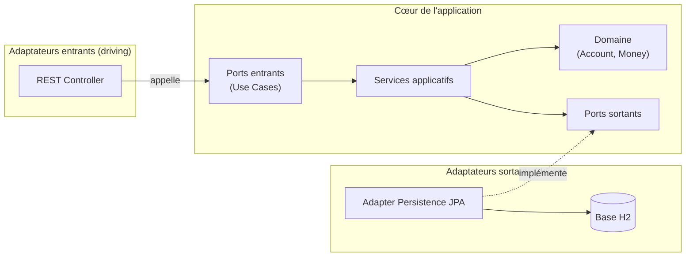
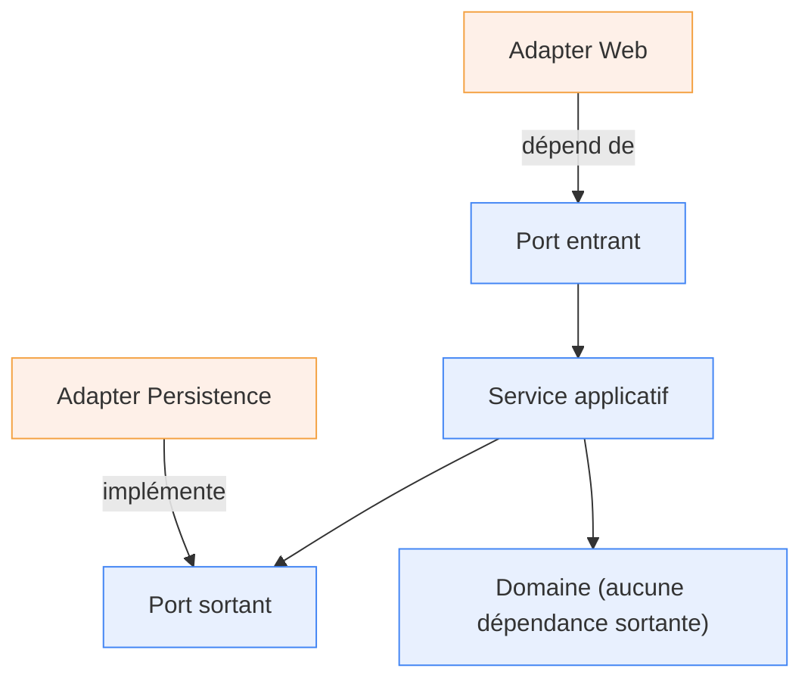
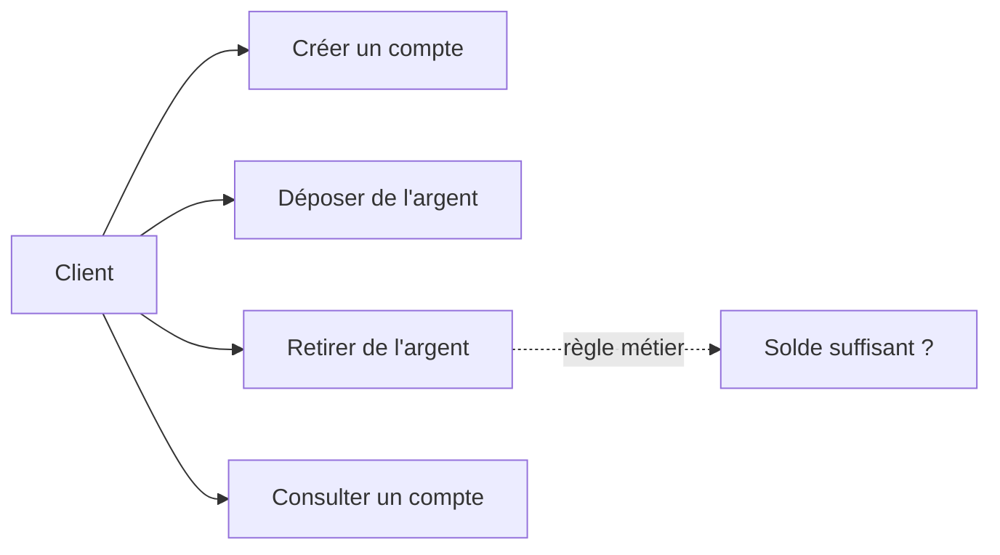
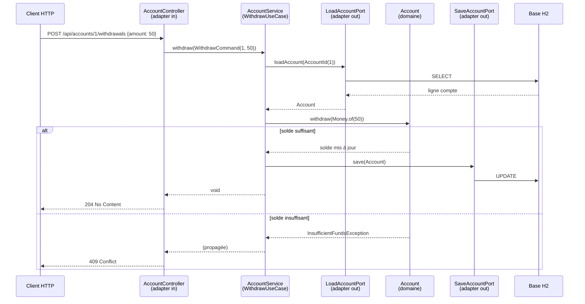

# Tutoriel complet : Architecture Hexagonale en Java / Spring Boot

> Projet fil rouge : un mini service de **gestion de comptes bancaires** (créer un compte, déposer, retirer, consulter). Ce domaine contient une vraie règle métier (« on ne peut pas retirer plus que le solde »), ce qui rend l'architecture hexagonale pertinente plutôt que décorative.

---

## 1. Comprendre l'architecture hexagonale

L'architecture hexagonale (aussi appelée **Ports & Adapters**, popularisée par Alistair Cockburn) répond à une question simple : *comment isoler la logique métier de la technique (HTTP, base de données, frameworks) ?*

L'idée centrale est la **règle de dépendance** : les dépendances pointent **vers l'intérieur**. Le domaine ne connaît ni Spring, ni JPA, ni HTTP. Ce sont les adaptateurs (le code « technique ») qui dépendent du cœur métier, jamais l'inverse.

### Vocabulaire

| Élément | Rôle |
|---|---|
| **Domaine** | Entités et règles métier pures (aucune annotation framework). |
| **Port entrant** (`in`) | Interface décrivant un cas d'usage. C'est l'API du cœur métier. |
| **Port sortant** (`out`) | Interface décrivant un besoin du cœur (ex. « charger un compte »). |
| **Service applicatif** | Orchestre le domaine, implémente les ports entrants, appelle les ports sortants. |
| **Adaptateur entrant** (*driving*) | Déclenche les cas d'usage (ex. contrôleur REST). |
| **Adaptateur sortant** (*driven*) | Implémente un port sortant (ex. persistence JPA). |

### Vue d'ensemble



### La règle de dépendance illustrée



Tout pointe vers le centre. Le domaine est au cœur et ne dépend de rien.

---

## 2. Le projet exemple

Quatre cas d'usage :



---

## 3. Structure du projet

L'organisation des packages **reflète l'architecture**. On regroupe par fonctionnalité (`account`), puis par couche.

```
src/main/java/com/example/banking/
├── BankingApplication.java
├── shared/
│   └── UseCase.java                         # méta-annotation
└── account/
    ├── domain/
    │   ├── model/
    │   │   ├── Account.java                 # entité (règles métier)
    │   │   ├── AccountId.java
    │   │   └── Money.java                   # value object
    │   └── exception/
    │       ├── AccountNotFoundException.java
    │       ├── InsufficientFundsException.java
    │       └── InvalidAmountException.java
    ├── application/
    │   ├── port/
    │   │   ├── in/
    │   │   │   ├── CreateAccountUseCase.java
    │   │   │   ├── CreateAccountCommand.java
    │   │   │   ├── DepositUseCase.java
    │   │   │   ├── DepositCommand.java
    │   │   │   ├── WithdrawUseCase.java
    │   │   │   ├── WithdrawCommand.java
    │   │   │   ├── GetAccountQuery.java
    │   │   │   └── AccountView.java
    │   │   └── out/
    │   │       ├── LoadAccountPort.java
    │   │       └── SaveAccountPort.java
    │   └── service/
    │       └── AccountService.java
    └── adapter/
        ├── in/web/
        │   ├── AccountController.java
        │   ├── dto/ ...
        │   └── RestExceptionHandler.java
        └── out/persistence/
            ├── AccountJpaEntity.java
            ├── SpringDataAccountRepository.java
            ├── AccountMapper.java
            └── AccountPersistenceAdapter.java
```

> **Règle d'or** : aucune classe de `domain/` ou `application/` n'importe quoi que ce soit de `adapter/`. La dépendance va toujours `adapter → application → domain`.

---

## 4. Configuration

### `pom.xml`

```xml
<?xml version="1.0" encoding="UTF-8"?>
<project xmlns="http://maven.apache.org/POM/4.0.0"
         xmlns:xsi="http://www.w3.org/2001/XMLSchema-instance"
         xsi:schemaLocation="http://maven.apache.org/POM/4.0.0
                             https://maven.apache.org/xsd/maven-4.0.0.xsd">
    <modelVersion>4.0.0</modelVersion>

    <parent>
        <groupId>org.springframework.boot</groupId>
        <artifactId>spring-boot-starter-parent</artifactId>
        <version>3.2.5</version>
        <relativePath/>
    </parent>

    <groupId>com.example</groupId>
    <artifactId>banking</artifactId>
    <version>1.0.0</version>

    <properties>
        <java.version>17</java.version>
    </properties>

    <dependencies>
        <dependency>
            <groupId>org.springframework.boot</groupId>
            <artifactId>spring-boot-starter-web</artifactId>
        </dependency>
        <dependency>
            <groupId>org.springframework.boot</groupId>
            <artifactId>spring-boot-starter-data-jpa</artifactId>
        </dependency>
        <dependency>
            <groupId>com.h2database</groupId>
            <artifactId>h2</artifactId>
            <scope>runtime</scope>
        </dependency>

        <!-- Tests -->
        <dependency>
            <groupId>org.springframework.boot</groupId>
            <artifactId>spring-boot-starter-test</artifactId>
            <scope>test</scope>
        </dependency>
        <!-- (optionnel) pour faire respecter l'architecture par des tests -->
        <dependency>
            <groupId>com.tngtech.archunit</groupId>
            <artifactId>archunit-junit5</artifactId>
            <version>1.3.0</version>
            <scope>test</scope>
        </dependency>
    </dependencies>

    <build>
        <plugins>
            <plugin>
                <groupId>org.springframework.boot</groupId>
                <artifactId>spring-boot-maven-plugin</artifactId>
            </plugin>
        </plugins>
    </build>
</project>
```

### `src/main/resources/application.yml`

```yaml
spring:
  datasource:
    url: jdbc:h2:mem:banking;DB_CLOSE_DELAY=-1
    username: sa
    password:
  jpa:
    hibernate:
      ddl-auto: create-drop      # génère le schéma au démarrage (dev uniquement)
    show-sql: true
  h2:
    console:
      enabled: true              # http://localhost:8080/h2-console
```

---

## 5. Le domaine

C'est le cœur. **Zéro annotation Spring/JPA**, du Java pur. C'est ici que vivent les règles métier.

### `Money.java` — un *value object*

On n'utilise jamais un `double` ou un `BigDecimal` nu pour de l'argent : on encapsule le concept dans un objet immuable qui porte ses propres opérations.

```java
package com.example.banking.account.domain.model;

import java.math.BigDecimal;
import java.util.Objects;

public record Money(BigDecimal amount) {

    public static final Money ZERO = new Money(BigDecimal.ZERO);

    // Validation à la construction (compact constructor)
    public Money {
        Objects.requireNonNull(amount, "Le montant ne peut pas être null");
    }

    public static Money of(long value) {
        return new Money(BigDecimal.valueOf(value));
    }

    public Money plus(Money other) {
        return new Money(this.amount.add(other.amount));
    }

    public Money minus(Money other) {
        return new Money(this.amount.subtract(other.amount));
    }

    public boolean isNegativeOrZero() {
        return amount.compareTo(BigDecimal.ZERO) <= 0;
    }

    public boolean isGreaterThan(Money other) {
        return this.amount.compareTo(other.amount) > 0;
    }
}
```

**Pourquoi un record ?** Immuabilité, `equals`/`hashCode` gratuits, et un *compact constructor* parfait pour la validation. Chaque opération (`plus`, `minus`) renvoie un nouvel objet : on ne mute jamais une somme d'argent.

### `AccountId.java` — un identifiant typé

```java
package com.example.banking.account.domain.model;

public record AccountId(Long value) {
}
```

Un type dédié évite de confondre un `Long` « id de compte » avec n'importe quel autre `Long` dans le code.

### Les exceptions métier

Elles appartiennent au **domaine**, pas à la couche web : c'est une règle métier qui est violée, indépendamment du protocole.

```java
package com.example.banking.account.domain.exception;

public class InsufficientFundsException extends RuntimeException {
    public InsufficientFundsException(String message) {
        super(message);
    }
}
```

```java
package com.example.banking.account.domain.exception;

public class InvalidAmountException extends RuntimeException {
    public InvalidAmountException(String message) {
        super(message);
    }
}
```

```java
package com.example.banking.account.domain.exception;

public class AccountNotFoundException extends RuntimeException {
    public AccountNotFoundException(String message) {
        super(message);
    }
}
```

### `Account.java` — l'entité racine

C'est ici que se trouve **toute** la logique métier. Le `deposit` et le `withdraw` protègent leurs invariants : impossible de mettre l'objet dans un état incohérent depuis l'extérieur.

```java
package com.example.banking.account.domain.model;

import com.example.banking.account.domain.exception.InsufficientFundsException;
import com.example.banking.account.domain.exception.InvalidAmountException;

public class Account {

    private final AccountId id;   // null tant que le compte n'est pas persisté
    private final String owner;
    private Money balance;

    private Account(AccountId id, String owner, Money balance) {
        this.id = id;
        this.owner = owner;
        this.balance = balance;
    }

    /** Crée un NOUVEAU compte (pas encore en base, donc sans identifiant). */
    public static Account create(String owner) {
        if (owner == null || owner.isBlank()) {
            throw new IllegalArgumentException("Le titulaire est obligatoire");
        }
        return new Account(null, owner, Money.ZERO);
    }

    /** Reconstitue un compte EXISTANT (ex. depuis la persistance). */
    public static Account restore(AccountId id, String owner, Money balance) {
        return new Account(id, owner, balance);
    }

    public void deposit(Money amount) {
        requirePositive(amount);
        this.balance = this.balance.plus(amount);
    }

    public void withdraw(Money amount) {
        requirePositive(amount);
        if (amount.isGreaterThan(this.balance)) {
            throw new InsufficientFundsException(
                "Solde insuffisant : solde=" + balance.amount()
                + ", demandé=" + amount.amount());
        }
        this.balance = this.balance.minus(amount);
    }

    private void requirePositive(Money amount) {
        if (amount.isNegativeOrZero()) {
            throw new InvalidAmountException("Le montant doit être strictement positif");
        }
    }

    public AccountId getId()    { return id; }
    public String getOwner()    { return owner; }
    public Money getBalance()   { return balance; }
}
```

**Points clés :**
- Deux fabriques distinctes : `create` (nouveau, id = `null`) et `restore` (existant). On distingue clairement « né dans le domaine » de « rechargé depuis la base ».
- La logique de retrait est **dans** l'entité, pas dans le service. Le service ne fait qu'orchestrer.

---

## 6. La couche application (ports + services)

### Ports entrants (les cas d'usage)

Chaque cas d'usage est une interface fine. C'est le **contrat** que le monde extérieur peut appeler.

```java
package com.example.banking.account.application.port.in;

import com.example.banking.account.domain.model.AccountId;

public interface CreateAccountUseCase {
    AccountId createAccount(CreateAccountCommand command);
}
```

Les **commandes** sont des objets de transport validés à la construction. Elles isolent le cas d'usage des DTO web.

```java
package com.example.banking.account.application.port.in;

public record CreateAccountCommand(String owner) {
    public CreateAccountCommand {
        if (owner == null || owner.isBlank()) {
            throw new IllegalArgumentException("Le titulaire est obligatoire");
        }
    }
}
```

```java
package com.example.banking.account.application.port.in;

public interface DepositUseCase {
    void deposit(DepositCommand command);
}
```

```java
package com.example.banking.account.application.port.in;

public record DepositCommand(Long accountId, long amount) {
    public DepositCommand {
        if (accountId == null) {
            throw new IllegalArgumentException("L'identifiant du compte est obligatoire");
        }
        if (amount <= 0) {
            throw new IllegalArgumentException("Le montant doit être strictement positif");
        }
    }
}
```

```java
package com.example.banking.account.application.port.in;

public interface WithdrawUseCase {
    void withdraw(WithdrawCommand command);
}
```

```java
package com.example.banking.account.application.port.in;

public record WithdrawCommand(Long accountId, long amount) {
    public WithdrawCommand {
        if (accountId == null) {
            throw new IllegalArgumentException("L'identifiant du compte est obligatoire");
        }
        if (amount <= 0) {
            throw new IllegalArgumentException("Le montant doit être strictement positif");
        }
    }
}
```

Pour la lecture, on sépare la **requête** (query) de la commande, et on renvoie une *vue* plate plutôt que l'entité domaine (pour ne pas exposer le modèle riche).

```java
package com.example.banking.account.application.port.in;

public interface GetAccountQuery {
    AccountView getAccount(Long accountId);
}
```

```java
package com.example.banking.account.application.port.in;

import java.math.BigDecimal;

public record AccountView(Long id, String owner, BigDecimal balance) {
}
```

### Ports sortants (les besoins du cœur)

Le cœur **décrit** ce dont il a besoin, sans savoir comment c'est réalisé.

```java
package com.example.banking.account.application.port.out;

import com.example.banking.account.domain.model.Account;
import com.example.banking.account.domain.model.AccountId;
import java.util.Optional;

public interface LoadAccountPort {
    Optional<Account> loadAccount(AccountId id);
}
```

```java
package com.example.banking.account.application.port.out;

import com.example.banking.account.domain.model.Account;

public interface SaveAccountPort {
    Account save(Account account);   // renvoie l'entité avec son id assigné
}
```

### Le service applicatif

Il implémente les ports entrants et s'appuie sur les ports sortants. C'est le **chef d'orchestre** : il charge, délègue au domaine, sauvegarde. **Aucune règle métier ici** — elles sont dans `Account`.

```java
package com.example.banking.account.application.service;

import com.example.banking.account.application.port.in.*;
import com.example.banking.account.application.port.out.LoadAccountPort;
import com.example.banking.account.application.port.out.SaveAccountPort;
import com.example.banking.account.domain.exception.AccountNotFoundException;
import com.example.banking.account.domain.model.Account;
import com.example.banking.account.domain.model.AccountId;
import com.example.banking.account.domain.model.Money;
import com.example.banking.shared.UseCase;
import org.springframework.transaction.annotation.Transactional;

@UseCase
@Transactional
public class AccountService
        implements CreateAccountUseCase, DepositUseCase, WithdrawUseCase, GetAccountQuery {

    private final LoadAccountPort loadAccountPort;
    private final SaveAccountPort saveAccountPort;

    public AccountService(LoadAccountPort loadAccountPort, SaveAccountPort saveAccountPort) {
        this.loadAccountPort = loadAccountPort;
        this.saveAccountPort = saveAccountPort;
    }

    @Override
    public AccountId createAccount(CreateAccountCommand command) {
        Account account = Account.create(command.owner());
        return saveAccountPort.save(account).getId();
    }

    @Override
    public void deposit(DepositCommand command) {
        Account account = loadOrThrow(new AccountId(command.accountId()));
        account.deposit(Money.of(command.amount()));
        saveAccountPort.save(account);
    }

    @Override
    public void withdraw(WithdrawCommand command) {
        Account account = loadOrThrow(new AccountId(command.accountId()));
        account.withdraw(Money.of(command.amount()));   // règle métier appliquée ici
        saveAccountPort.save(account);
    }

    @Override
    @Transactional(readOnly = true)
    public AccountView getAccount(Long accountId) {
        Account account = loadOrThrow(new AccountId(accountId));
        return new AccountView(
                account.getId().value(),
                account.getOwner(),
                account.getBalance().amount());
    }

    private Account loadOrThrow(AccountId id) {
        return loadAccountPort.loadAccount(id)
                .orElseThrow(() -> new AccountNotFoundException("Compte introuvable : " + id.value()));
    }
}
```

### La méta-annotation `@UseCase`

Pour garder la couche `application` aussi peu couplée que possible à Spring, on remplace `@Service` par une annotation maison qui exprime l'**intention métier**. Elle reste détectée par le scan de composants.

```java
package com.example.banking.shared;

import org.springframework.stereotype.Service;
import java.lang.annotation.*;

@Target(ElementType.TYPE)
@Retention(RetentionPolicy.RUNTIME)
@Service
public @interface UseCase {
}
```

> **Alternative 100 % pure** : si vous voulez zéro annotation Spring dans `application/`, supprimez `@UseCase` et déclarez le service via une classe `@Configuration` avec une méthode `@Bean`. Le choix est un curseur entre pragmatisme et pureté.

---

## 7. Les adaptateurs

### Adaptateur sortant : la persistance JPA

L'entité JPA est **distincte** de l'entité domaine. On ne pollue surtout pas `Account` avec `@Entity` : ça mélangerait contrainte de persistance et contrainte métier.

```java
package com.example.banking.account.adapter.out.persistence;

import jakarta.persistence.*;
import java.math.BigDecimal;

@Entity
@Table(name = "account")
class AccountJpaEntity {

    @Id
    @GeneratedValue(strategy = GenerationType.IDENTITY)
    private Long id;

    @Column(nullable = false)
    private String owner;

    @Column(nullable = false)
    private BigDecimal balance;

    protected AccountJpaEntity() { }   // requis par JPA

    AccountJpaEntity(Long id, String owner, BigDecimal balance) {
        this.id = id;
        this.owner = owner;
        this.balance = balance;
    }

    Long getId()           { return id; }
    String getOwner()      { return owner; }
    BigDecimal getBalance(){ return balance; }
}
```

Le repository Spring Data :

```java
package com.example.banking.account.adapter.out.persistence;

import org.springframework.data.jpa.repository.JpaRepository;

interface SpringDataAccountRepository extends JpaRepository<AccountJpaEntity, Long> {
}
```

Le mapper traduit dans les deux sens, domaine ⇄ entité JPA :

```java
package com.example.banking.account.adapter.out.persistence;

import com.example.banking.account.domain.model.Account;
import com.example.banking.account.domain.model.AccountId;
import com.example.banking.account.domain.model.Money;
import org.springframework.stereotype.Component;

@Component
class AccountMapper {

    Account toDomain(AccountJpaEntity entity) {
        return Account.restore(
                new AccountId(entity.getId()),
                entity.getOwner(),
                new Money(entity.getBalance()));
    }

    AccountJpaEntity toJpaEntity(Account account) {
        Long id = (account.getId() == null) ? null : account.getId().value();
        return new AccountJpaEntity(id, account.getOwner(), account.getBalance().amount());
    }
}
```

L'adaptateur **implémente les ports sortants**. C'est le seul à connaître JPA :

```java
package com.example.banking.account.adapter.out.persistence;

import com.example.banking.account.application.port.out.LoadAccountPort;
import com.example.banking.account.application.port.out.SaveAccountPort;
import com.example.banking.account.domain.model.Account;
import com.example.banking.account.domain.model.AccountId;
import org.springframework.stereotype.Component;
import java.util.Optional;

@Component
class AccountPersistenceAdapter implements LoadAccountPort, SaveAccountPort {

    private final SpringDataAccountRepository repository;
    private final AccountMapper mapper;

    AccountPersistenceAdapter(SpringDataAccountRepository repository, AccountMapper mapper) {
        this.repository = repository;
        this.mapper = mapper;
    }

    @Override
    public Optional<Account> loadAccount(AccountId id) {
        return repository.findById(id.value()).map(mapper::toDomain);
    }

    @Override
    public Account save(Account account) {
        AccountJpaEntity saved = repository.save(mapper.toJpaEntity(account));
        return mapper.toDomain(saved);
    }
}
```

> Notez la **double protection** : le cœur dépend de l'interface `SaveAccountPort` ; demain on remplace JPA par MongoDB ou un appel HTTP sans toucher une ligne du domaine.

### Adaptateur entrant : le contrôleur REST

Le contrôleur ne fait que **traduire** HTTP ↔ commandes. Il dépend des ports entrants, jamais du service concret.

Les DTO web (records) :

```java
package com.example.banking.account.adapter.in.web.dto;

public record CreateAccountRequest(String owner) { }
```

```java
package com.example.banking.account.adapter.in.web.dto;

public record CreateAccountResponse(Long id) { }
```

```java
package com.example.banking.account.adapter.in.web.dto;

public record AmountRequest(long amount) { }
```

```java
package com.example.banking.account.adapter.in.web.dto;

import java.math.BigDecimal;

public record AccountResponse(Long id, String owner, BigDecimal balance) { }
```

Le contrôleur :

```java
package com.example.banking.account.adapter.in.web;

import com.example.banking.account.adapter.in.web.dto.*;
import com.example.banking.account.application.port.in.*;
import com.example.banking.account.domain.model.AccountId;
import org.springframework.http.HttpStatus;
import org.springframework.http.ResponseEntity;
import org.springframework.web.bind.annotation.*;

@RestController
@RequestMapping("/api/accounts")
class AccountController {

    private final CreateAccountUseCase createAccountUseCase;
    private final DepositUseCase depositUseCase;
    private final WithdrawUseCase withdrawUseCase;
    private final GetAccountQuery getAccountQuery;

    AccountController(CreateAccountUseCase createAccountUseCase,
                      DepositUseCase depositUseCase,
                      WithdrawUseCase withdrawUseCase,
                      GetAccountQuery getAccountQuery) {
        this.createAccountUseCase = createAccountUseCase;
        this.depositUseCase = depositUseCase;
        this.withdrawUseCase = withdrawUseCase;
        this.getAccountQuery = getAccountQuery;
    }

    @PostMapping
    ResponseEntity<CreateAccountResponse> create(@RequestBody CreateAccountRequest request) {
        AccountId id = createAccountUseCase.createAccount(
                new CreateAccountCommand(request.owner()));
        return ResponseEntity
                .status(HttpStatus.CREATED)
                .body(new CreateAccountResponse(id.value()));
    }

    @PostMapping("/{id}/deposits")
    ResponseEntity<Void> deposit(@PathVariable Long id, @RequestBody AmountRequest request) {
        depositUseCase.deposit(new DepositCommand(id, request.amount()));
        return ResponseEntity.noContent().build();
    }

    @PostMapping("/{id}/withdrawals")
    ResponseEntity<Void> withdraw(@PathVariable Long id, @RequestBody AmountRequest request) {
        withdrawUseCase.withdraw(new WithdrawCommand(id, request.amount()));
        return ResponseEntity.noContent().build();
    }

    @GetMapping("/{id}")
    AccountResponse get(@PathVariable Long id) {
        AccountView view = getAccountQuery.getAccount(id);
        return new AccountResponse(view.id(), view.owner(), view.balance());
    }
}
```

Le gestionnaire d'exceptions traduit les exceptions **métier** en codes HTTP. C'est bien dans l'adaptateur web : la correspondance « solde insuffisant → 409 » est une décision de protocole.

```java
package com.example.banking.account.adapter.in.web;

import com.example.banking.account.domain.exception.AccountNotFoundException;
import com.example.banking.account.domain.exception.InsufficientFundsException;
import com.example.banking.account.domain.exception.InvalidAmountException;
import org.springframework.http.HttpStatus;
import org.springframework.http.ProblemDetail;
import org.springframework.web.bind.annotation.ExceptionHandler;
import org.springframework.web.bind.annotation.RestControllerAdvice;

@RestControllerAdvice
class RestExceptionHandler {

    @ExceptionHandler(AccountNotFoundException.class)
    ProblemDetail handleNotFound(AccountNotFoundException ex) {
        return ProblemDetail.forStatusAndDetail(HttpStatus.NOT_FOUND, ex.getMessage());
    }

    @ExceptionHandler(InsufficientFundsException.class)
    ProblemDetail handleInsufficientFunds(InsufficientFundsException ex) {
        return ProblemDetail.forStatusAndDetail(HttpStatus.CONFLICT, ex.getMessage());
    }

    @ExceptionHandler({InvalidAmountException.class, IllegalArgumentException.class})
    ProblemDetail handleBadRequest(RuntimeException ex) {
        return ProblemDetail.forStatusAndDetail(HttpStatus.BAD_REQUEST, ex.getMessage());
    }
}
```

---

## 8. Le point d'entrée Spring Boot

```java
package com.example.banking;

import org.springframework.boot.SpringApplication;
import org.springframework.boot.autoconfigure.SpringBootApplication;

@SpringBootApplication
public class BankingApplication {
    public static void main(String[] args) {
        SpringApplication.run(BankingApplication.class, args);
    }
}
```

Grâce au scan de composants (`@UseCase`, `@Component`, `@RestController`), Spring **câble automatiquement** les adaptateurs sur les ports. Le service reçoit l'`AccountPersistenceAdapter` injecté via l'interface `LoadAccountPort`/`SaveAccountPort` — sans jamais le connaître.

---

## 9. Le flux complet d'une requête

Exemple : un retrait.



Observez que le **domaine** (`Account`) ne parle ni à la base ni au client : il reçoit des objets et applique une règle. Tout le reste est de l'orchestration et de la traduction.

---

## 10. Les tests

L'un des grands bénéfices de l'hexagonal : le domaine et l'application se testent **sans Spring, sans base, sans serveur web**.

### Test du domaine — pur JUnit, ultra rapide

```java
package com.example.banking.account.domain.model;

import com.example.banking.account.domain.exception.InsufficientFundsException;
import com.example.banking.account.domain.exception.InvalidAmountException;
import org.junit.jupiter.api.Test;

import static org.assertj.core.api.Assertions.*;

class AccountTest {

    @Test
    void deposit_augmente_le_solde() {
        Account account = Account.create("Alice");
        account.deposit(Money.of(100));
        assertThat(account.getBalance()).isEqualTo(Money.of(100));
    }

    @Test
    void withdraw_diminue_le_solde() {
        Account account = Account.create("Alice");
        account.deposit(Money.of(100));
        account.withdraw(Money.of(40));
        assertThat(account.getBalance()).isEqualTo(Money.of(60));
    }

    @Test
    void withdraw_au_dela_du_solde_leve_une_exception() {
        Account account = Account.create("Alice");
        account.deposit(Money.of(30));

        assertThatThrownBy(() -> account.withdraw(Money.of(50)))
                .isInstanceOf(InsufficientFundsException.class);
    }

    @Test
    void deposit_negatif_est_refuse() {
        Account account = Account.create("Alice");
        assertThatThrownBy(() -> account.deposit(Money.of(-10)))
                .isInstanceOf(InvalidAmountException.class);
    }
}
```

### Test du service — Mockito sur les ports

On vérifie l'orchestration en remplaçant les ports sortants par des mocks.

```java
package com.example.banking.account.application.service;

import com.example.banking.account.application.port.in.WithdrawCommand;
import com.example.banking.account.application.port.out.LoadAccountPort;
import com.example.banking.account.application.port.out.SaveAccountPort;
import com.example.banking.account.domain.exception.AccountNotFoundException;
import com.example.banking.account.domain.model.Account;
import com.example.banking.account.domain.model.AccountId;
import com.example.banking.account.domain.model.Money;
import org.junit.jupiter.api.Test;
import org.junit.jupiter.api.extension.ExtendWith;
import org.mockito.InjectMocks;
import org.mockito.Mock;
import org.mockito.junit.jupiter.MockitoExtension;

import java.util.Optional;

import static org.assertj.core.api.Assertions.*;
import static org.mockito.ArgumentMatchers.any;
import static org.mockito.Mockito.*;

@ExtendWith(MockitoExtension.class)
class AccountServiceTest {

    @Mock LoadAccountPort loadAccountPort;
    @Mock SaveAccountPort saveAccountPort;
    @InjectMocks AccountService service;

    @Test
    void withdraw_charge_applique_la_regle_et_sauvegarde() {
        Account account = Account.restore(new AccountId(1L), "Alice", Money.of(100));
        when(loadAccountPort.loadAccount(new AccountId(1L))).thenReturn(Optional.of(account));

        service.withdraw(new WithdrawCommand(1L, 40));

        assertThat(account.getBalance()).isEqualTo(Money.of(60));
        verify(saveAccountPort).save(account);
    }

    @Test
    void withdraw_sur_compte_inexistant_leve_une_exception() {
        when(loadAccountPort.loadAccount(any())).thenReturn(Optional.empty());

        assertThatThrownBy(() -> service.withdraw(new WithdrawCommand(99L, 10)))
                .isInstanceOf(AccountNotFoundException.class);

        verify(saveAccountPort, never()).save(any());
    }
}
```

### Test de l'adaptateur de persistance — `@DataJpaTest`

On teste l'intégration JPA réelle sur la base H2, isolée du reste.

```java
package com.example.banking.account.adapter.out.persistence;

import com.example.banking.account.domain.model.Account;
import org.junit.jupiter.api.Test;
import org.springframework.beans.factory.annotation.Autowired;
import org.springframework.boot.test.autoconfigure.orm.jpa.DataJpaTest;
import org.springframework.context.annotation.Import;

import static org.assertj.core.api.Assertions.assertThat;

@DataJpaTest
@Import({AccountPersistenceAdapter.class, AccountMapper.class})
class AccountPersistenceAdapterTest {

    @Autowired AccountPersistenceAdapter adapter;

    @Test
    void save_puis_load_restitue_le_compte() {
        Account toSave = Account.create("Bob");
        toSave.deposit(com.example.banking.account.domain.model.Money.of(250));

        Account saved = adapter.save(toSave);

        assertThat(saved.getId()).isNotNull();
        Account reloaded = adapter.loadAccount(saved.getId()).orElseThrow();
        assertThat(reloaded.getOwner()).isEqualTo("Bob");
        assertThat(reloaded.getBalance().amount().intValue()).isEqualTo(250);
    }
}
```

### Test de l'adaptateur web — `@WebMvcTest`

On teste le contrôleur en isolant la couche web ; les ports entrants sont mockés.

```java
package com.example.banking.account.adapter.in.web;

import com.example.banking.account.application.port.in.*;
import com.example.banking.account.domain.model.AccountId;
import org.junit.jupiter.api.Test;
import org.springframework.beans.factory.annotation.Autowired;
import org.springframework.boot.test.autoconfigure.web.servlet.WebMvcTest;
import org.springframework.boot.test.mock.mockito.MockBean;
import org.springframework.test.web.servlet.MockMvc;

import static org.mockito.Mockito.when;
import static org.springframework.test.web.servlet.request.MockMvcRequestBuilders.post;
import static org.springframework.test.web.servlet.result.MockMvcResultMatchers.*;

@WebMvcTest(AccountController.class)
class AccountControllerTest {

    @Autowired MockMvc mockMvc;

    @MockBean CreateAccountUseCase createAccountUseCase;
    @MockBean DepositUseCase depositUseCase;
    @MockBean WithdrawUseCase withdrawUseCase;
    @MockBean GetAccountQuery getAccountQuery;

    @Test
    void create_renvoie_201_avec_id() throws Exception {
        when(createAccountUseCase.createAccount(new CreateAccountCommand("Alice")))
                .thenReturn(new AccountId(1L));

        mockMvc.perform(post("/api/accounts")
                        .contentType("application/json")
                        .content("{\"owner\":\"Alice\"}"))
                .andExpect(status().isCreated())
                .andExpect(jsonPath("$.id").value(1));
    }
}
```

### Bonus : faire respecter l'architecture avec ArchUnit

Un test qui **échoue** si quelqu'un fait dépendre le domaine d'un adaptateur.

```java
package com.example.banking.architecture;

import com.tngtech.archunit.core.importer.ClassFileImporter;
import com.tngtech.archunit.lang.ArchRule;
import org.junit.jupiter.api.Test;

import static com.tngtech.archunit.lang.syntax.ArchRuleDefinition.noClasses;

class HexagonalArchitectureTest {

    @Test
    void le_domaine_ne_depend_pas_des_adaptateurs() {
        var classes = new ClassFileImporter().importPackages("com.example.banking");

        ArchRule rule = noClasses()
                .that().resideInAPackage("..domain..")
                .should().dependOnClassesThat().resideInAnyPackage("..adapter..", "..application..");

        rule.check(classes);
    }
}
```

---

## 11. Lancer et tester l'application

```bash
mvn spring-boot:run
```

Puis, avec `curl` :

```bash
# 1) Créer un compte
curl -s -X POST http://localhost:8080/api/accounts \
  -H "Content-Type: application/json" \
  -d '{"owner":"Alice"}'
# -> {"id":1}

# 2) Déposer 200
curl -s -X POST http://localhost:8080/api/accounts/1/deposits \
  -H "Content-Type: application/json" \
  -d '{"amount":200}'
# -> 204 No Content

# 3) Retirer 50
curl -s -X POST http://localhost:8080/api/accounts/1/withdrawals \
  -H "Content-Type: application/json" \
  -d '{"amount":50}'
# -> 204 No Content

# 4) Consulter
curl -s http://localhost:8080/api/accounts/1
# -> {"id":1,"owner":"Alice","balance":150}

# 5) Retrait impossible (règle métier)
curl -s -X POST http://localhost:8080/api/accounts/1/withdrawals \
  -H "Content-Type: application/json" \
  -d '{"amount":99999}'
# -> 409 Conflict : "Solde insuffisant : solde=150, demandé=99999"
```

---

## 12. Récapitulatif, bonnes pratiques et pièges

### Ce que chaque couche a le droit de faire

| Couche | Connaît Spring ? | Connaît JPA/HTTP ? | Contient les règles métier ? |
|---|---|---|---|
| `domain` | ❌ | ❌ | ✅ (toutes) |
| `application` | minimal (`@UseCase`) | ❌ | ❌ (orchestration uniquement) |
| `adapter` | ✅ | ✅ | ❌ |

### Bonnes pratiques

- **Une entité JPA ≠ une entité domaine.** Le mapper paie un petit coût de duplication, mais protège le domaine de toute contrainte de persistance.
- **Les ports sont fins.** Préférez plusieurs petites interfaces (`LoadAccountPort`, `SaveAccountPort`) plutôt qu'un gros `AccountRepository` fourre-tout — c'est le principe de ségrégation des interfaces (ISP).
- **Commandes et DTO web distincts.** Le DTO sert le protocole HTTP, la commande sert le cas d'usage. Ils évoluent indépendamment.
- **Les exceptions métier vivent dans le domaine** ; leur traduction en HTTP vit dans l'adaptateur web.
- **Testez le cœur sans Spring.** Si vous avez besoin de `@SpringBootTest` pour tester une règle métier, c'est le signe que la règle a fui hors du domaine.

### Pièges courants

- ❌ Mettre une règle métier (`if balance < amount`) dans le service ou le contrôleur → elle doit être dans `Account`.
- ❌ Renvoyer directement l'entité domaine `Account` au client → exposez une vue/DTO.
- ❌ Faire dépendre le domaine du package `adapter` → utilisez ArchUnit pour l'interdire automatiquement.
- ❌ Annoter `Account` avec `@Entity` « pour aller vite » → vous couplez métier et persistance, le bénéfice de l'hexagonal disparaît.

---

## 13. Aller plus loin

- **Plusieurs adaptateurs sur un même port** : ajoutez un adaptateur entrant Kafka (consommateur de messages) qui appelle `DepositUseCase` — sans toucher au cœur.
- **Remplacer la persistance** : créez un `InMemoryAccountAdapter` (une `Map`) implémentant `LoadAccountPort`/`SaveAccountPort` pour des tests rapides, ou basculez vers un autre stockage.
- **Modules Maven séparés** : isolez `domain`, `application` et `adapters` dans des modules distincts pour que le compilateur lui-même empêche les dépendances interdites.
- **Événements de domaine** : `Account` pourrait publier un `MoneyWithdrawnEvent`, consommé par un adaptateur de notification.

L'architecture hexagonale a un coût initial (plus de classes, des mappers), justifié dès que la logique métier est non triviale et durable. Pour un CRUD purement technique sans règles, elle peut être surdimensionnée — choisissez en connaissance de cause.
