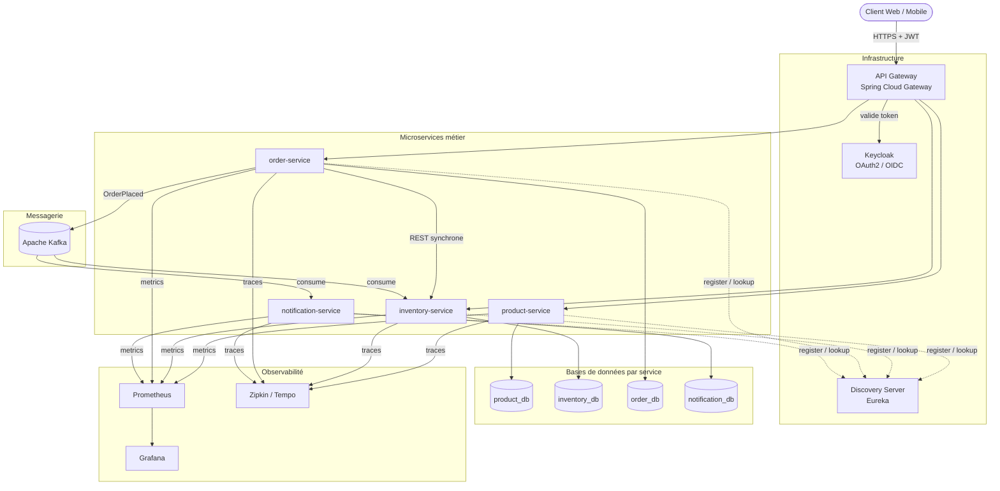
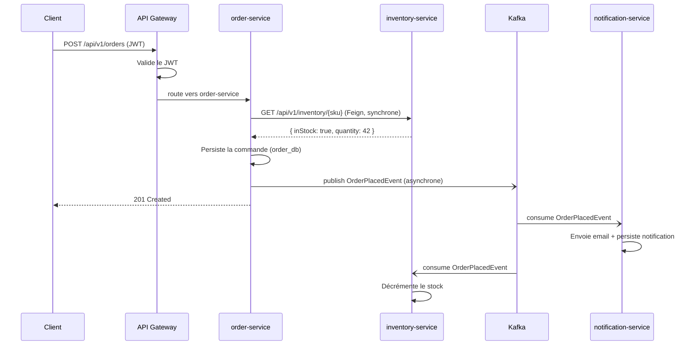
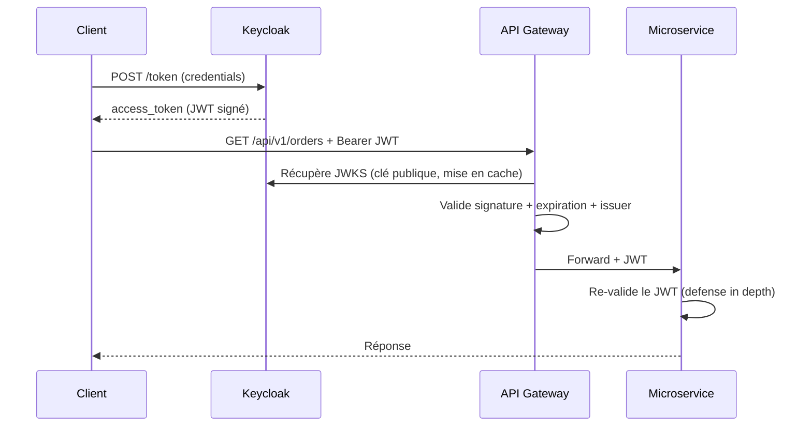
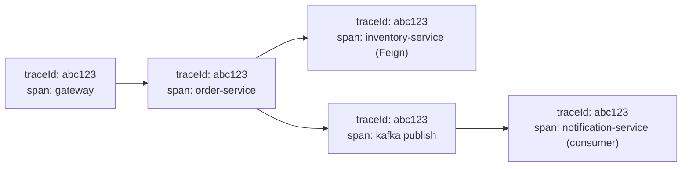
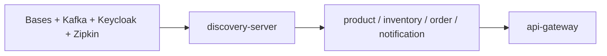

# Tutoriel complet : Architecture Microservices avec Java & Spring Boot

> Projet fil rouge : **« ShopFlow »**, une plateforme e-commerce minimaliste décomposée en microservices, avec API Gateway, service discovery, communication REST + Kafka, base de données par service, sécurité OAuth2/JWT, versionnage d'API, documentation OpenAPI et observabilité complète.

---

## 1. Vue d'ensemble de l'architecture

ShopFlow est composé de 4 microservices métier + 2 services d'infrastructure :

| Service | Rôle | Base de données | Communication |
|---|---|---|---|
| `discovery-server` | Annuaire (Eureka) | — | — |
| `api-gateway` | Point d'entrée unique, routage, sécurité | — | — |
| `product-service` | Catalogue produits | `product_db` | REST (exposé) |
| `inventory-service` | Gestion du stock | `inventory_db` | REST (appelé en synchrone) |
| `order-service` | Commandes | `order_db` | REST (appel Inventory) + Kafka (producteur) |
| `notification-service` | Notifications | `notification_db` | Kafka (consommateur) |

### 1.1 Diagramme d'architecture



### 1.2 Scénario métier : passer une commande



On illustre ici les deux modes de communication :
- **Synchrone (REST)** : `order-service` interroge `inventory-service` pour vérifier la disponibilité *avant* de valider la commande (réponse immédiate requise).
- **Asynchrone (Kafka)** : une fois la commande créée, un événement est publié. Les consommateurs (notification, décrément de stock) réagissent sans bloquer la réponse au client.

---

## 2. Stack technique & prérequis

| Composant | Version retenue |
|---|---|
| Java | 21 (LTS) |
| Spring Boot | 3.2.x |
| Spring Cloud | 2023.0.x (« Leyton ») |
| Maven | 3.9+ |
| PostgreSQL | 16 |
| Apache Kafka | 3.7 (mode KRaft) |
| Keycloak | 24+ |
| Micrometer Tracing + Zipkin | inclus dans Spring Boot 3 |
| SpringDoc OpenAPI | 2.5.x |

> ⚠️ Les versions de l'écosystème Spring évoluent vite. Vérifiez la matrice de compatibilité officielle Spring Cloud ↔ Spring Boot avant de figer vos versions, puis utilisez systématiquement le BOM `spring-cloud-dependencies`.

### Structure du dépôt (mono-repo Maven multi-modules)

```
shopflow/
├── pom.xml                    (parent : gère versions & modules)
├── docker-compose.yml
├── discovery-server/
├── api-gateway/
├── product-service/
├── inventory-service/
├── order-service/
├── notification-service/
└── common-events/             (DTOs d'événements Kafka partagés)
```

### `pom.xml` parent

```xml
<project xmlns="http://maven.apache.org/POM/4.0.0">
    <modelVersion>4.0.0</modelVersion>
    <groupId>com.shopflow</groupId>
    <artifactId>shopflow-parent</artifactId>
    <version>1.0.0</version>
    <packaging>pom</packaging>

    <parent>
        <groupId>org.springframework.boot</groupId>
        <artifactId>spring-boot-starter-parent</artifactId>
        <version>3.2.5</version>
        <relativePath/>
    </parent>

    <properties>
        <java.version>21</java.version>
        <spring-cloud.version>2023.0.1</spring-cloud.version>
        <springdoc.version>2.5.0</springdoc.version>
    </properties>

    <modules>
        <module>common-events</module>
        <module>discovery-server</module>
        <module>api-gateway</module>
        <module>product-service</module>
        <module>inventory-service</module>
        <module>order-service</module>
        <module>notification-service</module>
    </modules>

    <dependencyManagement>
        <dependencies>
            <dependency>
                <groupId>org.springframework.cloud</groupId>
                <artifactId>spring-cloud-dependencies</artifactId>
                <version>${spring-cloud.version}</version>
                <type>pom</type>
                <scope>import</scope>
            </dependency>
        </dependencies>
    </dependencyManagement>
</project>
```

> Le `dependencyManagement` importe le BOM Spring Cloud : tous les modules enfants héritent des versions cohérentes sans avoir à les spécifier.

---

## 3. Service Discovery — `discovery-server` (Eureka)

Le serveur de découverte est l'annuaire central : chaque service s'y enregistre au démarrage, et les autres résolvent les adresses par **nom logique** (`product-service`) plutôt que par IP/port figés.

### `discovery-server/pom.xml`

```xml
<dependencies>
    <dependency>
        <groupId>org.springframework.cloud</groupId>
        <artifactId>spring-cloud-starter-netflix-eureka-server</artifactId>
    </dependency>
</dependencies>
```

### Classe principale

```java
@SpringBootApplication
@EnableEurekaServer
public class DiscoveryServerApplication {
    public static void main(String[] args) {
        SpringApplication.run(DiscoveryServerApplication.class, args);
    }
}
```

### `application.yml`

```yaml
server:
  port: 8761

spring:
  application:
    name: discovery-server

eureka:
  client:
    # Un serveur Eureka ne s'enregistre pas lui-même
    register-with-eureka: false
    fetch-registry: false
  instance:
    hostname: localhost
```

Le tableau de bord Eureka est accessible sur `http://localhost:8761`.

### Configuration cliente commune (à ajouter dans CHAQUE microservice métier)

```yaml
eureka:
  client:
    service-url:
      defaultZone: http://localhost:8761/eureka
  instance:
    prefer-ip-address: true
```

---

## 4. `product-service` — un microservice complet de référence

On détaille **intégralement** ce service : il sert de modèle (base de données dédiée, versionnage, sécurité, documentation). Les autres services suivent la même mécanique.

### 4.1 Dépendances

```xml
<dependencies>
    <dependency>
        <groupId>org.springframework.boot</groupId>
        <artifactId>spring-boot-starter-web</artifactId>
    </dependency>
    <dependency>
        <groupId>org.springframework.boot</groupId>
        <artifactId>spring-boot-starter-data-jpa</artifactId>
    </dependency>
    <dependency>
        <groupId>org.springframework.boot</groupId>
        <artifactId>spring-boot-starter-validation</artifactId>
    </dependency>
    <dependency>
        <groupId>org.postgresql</groupId>
        <artifactId>postgresql</artifactId>
        <scope>runtime</scope>
    </dependency>

    <!-- Service discovery -->
    <dependency>
        <groupId>org.springframework.cloud</groupId>
        <artifactId>spring-cloud-starter-netflix-eureka-client</artifactId>
    </dependency>

    <!-- Sécurité : serveur de ressources OAuth2 (validation JWT) -->
    <dependency>
        <groupId>org.springframework.boot</groupId>
        <artifactId>spring-boot-starter-oauth2-resource-server</artifactId>
    </dependency>

    <!-- Documentation OpenAPI / Swagger UI -->
    <dependency>
        <groupId>org.springdoc</groupId>
        <artifactId>springdoc-openapi-starter-webmvc-ui</artifactId>
        <version>${springdoc.version}</version>
    </dependency>

    <!-- Observabilité -->
    <dependency>
        <groupId>org.springframework.boot</groupId>
        <artifactId>spring-boot-starter-actuator</artifactId>
    </dependency>
    <dependency>
        <groupId>io.micrometer</groupId>
        <artifactId>micrometer-registry-prometheus</artifactId>
    </dependency>
    <dependency>
        <groupId>io.micrometer</groupId>
        <artifactId>micrometer-tracing-bridge-brave</artifactId>
    </dependency>
    <dependency>
        <groupId>io.zipkin.reporter2</groupId>
        <artifactId>zipkin-reporter-brave</artifactId>
    </dependency>
</dependencies>
```

### 4.2 L'entité et le repository

```java
@Entity
@Table(name = "products")
public class Product {

    @Id
    @GeneratedValue(strategy = GenerationType.UUID)
    private UUID id;

    @Column(nullable = false, unique = true)
    private String sku;          // référence unique produit

    @Column(nullable = false)
    private String name;

    private String description;

    @Column(nullable = false)
    private BigDecimal price;

    // getters / setters / constructeurs omis
}
```

```java
public interface ProductRepository extends JpaRepository<Product, UUID> {
    Optional<Product> findBySku(String sku);
    boolean existsBySku(String sku);
}
```

### 4.3 Les DTO et le contrat d'API versionné

On ne **jamais** exposer directement l'entité JPA : on passe par des DTO. Cela découple le modèle interne du contrat public et permet de faire évoluer l'API.

```java
// Requête de création
public record CreateProductRequest(
        @NotBlank String sku,
        @NotBlank String name,
        String description,
        @NotNull @Positive BigDecimal price
) {}

// Réponse v1
public record ProductResponse(
        UUID id,
        String sku,
        String name,
        String description,
        BigDecimal price
) {
    public static ProductResponse from(Product p) {
        return new ProductResponse(p.getId(), p.getSku(), p.getName(),
                                   p.getDescription(), p.getPrice());
    }
}
```

### 4.4 La couche service

```java
@Service
@Transactional
public class ProductService {

    private final ProductRepository repository;

    public ProductService(ProductRepository repository) {
        this.repository = repository;
    }

    public ProductResponse create(CreateProductRequest req) {
        if (repository.existsBySku(req.sku())) {
            throw new DuplicateSkuException(req.sku());
        }
        Product product = new Product();
        product.setSku(req.sku());
        product.setName(req.name());
        product.setDescription(req.description());
        product.setPrice(req.price());
        return ProductResponse.from(repository.save(product));
    }

    @Transactional(readOnly = true)
    public ProductResponse getBySku(String sku) {
        return repository.findBySku(sku)
                .map(ProductResponse::from)
                .orElseThrow(() -> new ProductNotFoundException(sku));
    }

    @Transactional(readOnly = true)
    public List<ProductResponse> findAll() {
        return repository.findAll().stream().map(ProductResponse::from).toList();
    }
}
```

### 4.5 Le contrôleur REST versionné + documenté

Le **versionnage par URI** (`/api/v1/...`) est le plus lisible et le plus simple à router au niveau du gateway.

```java
@RestController
@RequestMapping("/api/v1/products")
@Tag(name = "Products", description = "Gestion du catalogue produits")
public class ProductControllerV1 {

    private final ProductService service;

    public ProductControllerV1(ProductService service) {
        this.service = service;
    }

    @PostMapping
    @Operation(summary = "Créer un produit")
    @ApiResponses({
        @ApiResponse(responseCode = "201", description = "Produit créé"),
        @ApiResponse(responseCode = "409", description = "SKU déjà existant")
    })
    public ResponseEntity<ProductResponse> create(
            @Valid @RequestBody CreateProductRequest request) {
        ProductResponse created = service.create(request);
        return ResponseEntity
                .created(URI.create("/api/v1/products/" + created.sku()))
                .body(created);
    }

    @GetMapping("/{sku}")
    @Operation(summary = "Récupérer un produit par SKU")
    public ProductResponse getBySku(@PathVariable String sku) {
        return service.getBySku(sku);
    }

    @GetMapping
    @Operation(summary = "Lister tous les produits")
    public List<ProductResponse> list() {
        return service.findAll();
    }
}
```

> **Stratégie de versionnage** : quand un changement *casse* le contrat (champ supprimé, type modifié), on crée un `ProductControllerV2` sous `/api/v2/products` avec ses propres DTO. Les deux versions cohabitent, ce qui laisse aux clients le temps de migrer. On documente les versions dépréciées via `@Deprecated` et l'en-tête `Deprecation` (RFC 8594).

### 4.6 Gestion centralisée des erreurs

Indispensable pour un contrat propre et homogène entre services.

```java
@RestControllerAdvice
public class GlobalExceptionHandler {

    public record ApiError(int status, String error, String message, Instant timestamp) {}

    @ExceptionHandler(ProductNotFoundException.class)
    public ResponseEntity<ApiError> handleNotFound(ProductNotFoundException ex) {
        return build(HttpStatus.NOT_FOUND, ex.getMessage());
    }

    @ExceptionHandler(DuplicateSkuException.class)
    public ResponseEntity<ApiError> handleDuplicate(DuplicateSkuException ex) {
        return build(HttpStatus.CONFLICT, ex.getMessage());
    }

    @ExceptionHandler(MethodArgumentNotValidException.class)
    public ResponseEntity<ApiError> handleValidation(MethodArgumentNotValidException ex) {
        String msg = ex.getBindingResult().getFieldErrors().stream()
                .map(e -> e.getField() + " : " + e.getDefaultMessage())
                .collect(Collectors.joining("; "));
        return build(HttpStatus.BAD_REQUEST, msg);
    }

    private ResponseEntity<ApiError> build(HttpStatus status, String message) {
        return ResponseEntity.status(status)
                .body(new ApiError(status.value(), status.getReasonPhrase(),
                                   message, Instant.now()));
    }
}
```

### 4.7 Sécurité — serveur de ressources OAuth2

Chaque service valide lui-même le JWT (defense in depth) en plus du contrôle au gateway. La clé de signature est récupérée automatiquement via l'URL JWKS de Keycloak.

```java
@Configuration
@EnableWebSecurity
@EnableMethodSecurity   // active @PreAuthorize
public class SecurityConfig {

    @Bean
    SecurityFilterChain filterChain(HttpSecurity http) throws Exception {
        http
            .csrf(AbstractHttpConfigurer::disable)
            .sessionManagement(s -> s.sessionCreationPolicy(SessionCreationPolicy.STATELESS))
            .authorizeHttpRequests(auth -> auth
                // Documentation et endpoints actuator ouverts
                .requestMatchers("/v3/api-docs/**", "/swagger-ui/**",
                                 "/actuator/**").permitAll()
                .requestMatchers(HttpMethod.GET, "/api/v1/products/**").permitAll()
                .requestMatchers(HttpMethod.POST, "/api/v1/products/**")
                    .hasRole("ADMIN")
                .anyRequest().authenticated())
            .oauth2ResourceServer(oauth -> oauth
                .jwt(jwt -> jwt.jwtAuthenticationConverter(jwtConverter())));
        return http.build();
    }

    // Convertit les rôles Keycloak (realm_access.roles) en GrantedAuthorities
    private JwtAuthenticationConverter jwtConverter() {
        JwtAuthenticationConverter converter = new JwtAuthenticationConverter();
        converter.setJwtGrantedAuthoritiesConverter(jwt -> {
            Map<String, Object> realmAccess = jwt.getClaim("realm_access");
            if (realmAccess == null) return List.of();
            @SuppressWarnings("unchecked")
            List<String> roles = (List<String>) realmAccess.getOrDefault("roles", List.of());
            return roles.stream()
                    .map(r -> new SimpleGrantedAuthority("ROLE_" + r))
                    .collect(Collectors.toList());
        });
        return converter;
    }
}
```

### 4.8 Documentation OpenAPI

```java
@Configuration
public class OpenApiConfig {

    @Bean
    public OpenAPI productOpenAPI() {
        final String schemeName = "bearerAuth";
        return new OpenAPI()
            .info(new Info()
                .title("Product Service API")
                .version("v1")
                .description("API de gestion du catalogue ShopFlow"))
            .addSecurityItem(new SecurityRequirement().addList(schemeName))
            .components(new Components().addSecuritySchemes(schemeName,
                new SecurityScheme()
                    .name(schemeName)
                    .type(SecurityScheme.Type.HTTP)
                    .scheme("bearer")
                    .bearerFormat("JWT")));
    }
}
```

Swagger UI : `http://localhost:8081/swagger-ui.html`.

### 4.9 `application.yml` de `product-service`

```yaml
server:
  port: 8081

spring:
  application:
    name: product-service
  datasource:
    url: jdbc:postgresql://localhost:5432/product_db
    username: product
    password: product_pwd
  jpa:
    hibernate:
      ddl-auto: validate     # en prod : utiliser Flyway/Liquibase, jamais 'update'
    properties:
      hibernate.dialect: org.hibernate.dialect.PostgreSQLDialect
  security:
    oauth2:
      resourceserver:
        jwt:
          issuer-uri: http://localhost:8080/realms/shopflow

eureka:
  client:
    service-url:
      defaultZone: http://localhost:8761/eureka

# Observabilité
management:
  endpoints:
    web:
      exposure:
        include: health, info, prometheus, metrics
  tracing:
    sampling:
      probability: 1.0       # 100% en dev ; 0.1 en prod
  zipkin:
    tracing:
      endpoint: http://localhost:9411/api/v2/spans

springdoc:
  swagger-ui:
    path: /swagger-ui.html
```

> 💡 **Migrations de schéma** : `ddl-auto: validate` impose que le schéma existe déjà. En production on gère le schéma avec **Flyway** (`db/migration/V1__init.sql`) — chaque service possède ses propres scripts, ce qui renforce l'isolation « une base par service ».

---

## 5. `inventory-service` — le service appelé en synchrone

Même squelette que `product-service`. On montre seulement les parties spécifiques : l'entité stock et l'endpoint interrogé par `order-service`.

### Entité & contrôleur

```java
@Entity
@Table(name = "inventory")
public class InventoryItem {
    @Id @GeneratedValue(strategy = GenerationType.UUID)
    private UUID id;
    @Column(nullable = false, unique = true)
    private String sku;
    @Column(nullable = false)
    private int quantity;
    // getters / setters
}
```

```java
@RestController
@RequestMapping("/api/v1/inventory")
@Tag(name = "Inventory")
public class InventoryControllerV1 {

    private final InventoryService service;

    public InventoryControllerV1(InventoryService service) {
        this.service = service;
    }

    // Réponse consommée par order-service
    public record StockStatus(String sku, boolean inStock, int quantity) {}

    @GetMapping("/{sku}")
    @Operation(summary = "Vérifier la disponibilité d'un SKU")
    public StockStatus check(@PathVariable String sku) {
        return service.checkStock(sku);
    }
}
```

`application.yml` : `server.port: 8082`, `spring.application.name: inventory-service`, base `inventory_db`. Le reste (sécurité, observabilité, Eureka) est identique à `product-service`.

---

## 6. `common-events` — le module partagé des événements Kafka

Pour garantir que producteur et consommateurs partagent **le même contrat d'événement**, on isole les DTO dans un module commun (sans dépendance Spring lourde, juste de simples records).

```java
// common-events/src/main/java/com/shopflow/events/OrderPlacedEvent.java
package com.shopflow.events;

import java.math.BigDecimal;
import java.time.Instant;
import java.util.List;

public record OrderPlacedEvent(
        String orderId,
        String customerEmail,
        List<OrderLine> lines,
        BigDecimal total,
        Instant placedAt
) {
    public record OrderLine(String sku, int quantity, BigDecimal unitPrice) {}
}
```

> ⚠️ **Attention au couplage** : partager des DTO entre services est pratique mais crée une dépendance. Limitez ce module aux **contrats d'événements** stables et versionnez-les (ex. ajout de champ optionnel uniquement, jamais de suppression). En contexte d'équipes distribuées, on préfère souvent un **Schema Registry** (Avro/Protobuf) à un module Java partagé.

---

## 7. `order-service` — REST synchrone (Feign) + Kafka producteur

C'est le cœur de la démonstration des deux modes de communication.

### 7.1 Dépendances spécifiques

```xml
<!-- Client REST déclaratif vers inventory-service -->
<dependency>
    <groupId>org.springframework.cloud</groupId>
    <artifactId>spring-cloud-starter-openfeign</artifactId>
</dependency>
<!-- Résilience : circuit breaker -->
<dependency>
    <groupId>org.springframework.cloud</groupId>
    <artifactId>spring-cloud-starter-circuitbreaker-resilience4j</artifactId>
</dependency>
<!-- Kafka -->
<dependency>
    <groupId>org.springframework.kafka</groupId>
    <artifactId>spring-kafka</artifactId>
</dependency>
<!-- Module d'événements partagé -->
<dependency>
    <groupId>com.shopflow</groupId>
    <artifactId>common-events</artifactId>
    <version>1.0.0</version>
</dependency>
```

### 7.2 Communication synchrone — client Feign

Feign résout `inventory-service` via Eureka : pas d'URL en dur, c'est le service discovery qui fournit l'adresse. On ajoute un **fallback** via circuit breaker pour la résilience.

```java
@FeignClient(name = "inventory-service", fallback = InventoryClientFallback.class)
public interface InventoryClient {

    @GetMapping("/api/v1/inventory/{sku}")
    StockStatus checkStock(@PathVariable("sku") String sku);

    record StockStatus(String sku, boolean inStock, int quantity) {}
}

@Component
class InventoryClientFallback implements InventoryClient {
    @Override
    public StockStatus checkStock(String sku) {
        // Stratégie de repli si inventory-service est indisponible
        return new StockStatus(sku, false, 0);
    }
}
```

Activation de Feign sur la classe principale :

```java
@SpringBootApplication
@EnableFeignClients
public class OrderServiceApplication {
    public static void main(String[] args) {
        SpringApplication.run(OrderServiceApplication.class, args);
    }
}
```

> Pour que le JWT du client soit **propagé** vers `inventory-service`, on ajoute un `RequestInterceptor` Feign qui réinjecte l'en-tête `Authorization` reçu :

```java
@Configuration
public class FeignConfig {
    @Bean
    RequestInterceptor authForwardingInterceptor() {
        return template -> {
            var attrs = (ServletRequestAttributes) RequestContextHolder.getRequestAttributes();
            if (attrs != null) {
                String auth = attrs.getRequest().getHeader(HttpHeaders.AUTHORIZATION);
                if (auth != null) template.header(HttpHeaders.AUTHORIZATION, auth);
            }
        };
    }
}
```

### 7.3 Configuration du producteur Kafka

```yaml
spring:
  kafka:
    bootstrap-servers: localhost:9092
    producer:
      key-serializer: org.apache.kafka.common.serialization.StringSerializer
      value-serializer: org.springframework.kafka.support.serializer.JsonSerializer
      acks: all                       # garantie de durabilité maximale
      properties:
        enable.idempotence: true      # évite les doublons en cas de retry

app:
  kafka:
    topic:
      order-placed: order-placed
```

Déclaration du topic (création automatique au démarrage) :

```java
@Configuration
public class KafkaTopicConfig {
    @Bean
    public NewTopic orderPlacedTopic() {
        return TopicBuilder.name("order-placed")
                .partitions(3)
                .replicas(1)   // 1 en dev ; >= 3 en prod
                .build();
    }
}
```

### 7.4 Service de commande : orchestration sync + async

```java
@Service
public class OrderService {

    private final OrderRepository repository;
    private final InventoryClient inventoryClient;
    private final KafkaTemplate<String, OrderPlacedEvent> kafkaTemplate;

    @Value("${app.kafka.topic.order-placed}")
    private String orderPlacedTopic;

    public OrderService(OrderRepository repository,
                        InventoryClient inventoryClient,
                        KafkaTemplate<String, OrderPlacedEvent> kafkaTemplate) {
        this.repository = repository;
        this.inventoryClient = inventoryClient;
        this.kafkaTemplate = kafkaTemplate;
    }

    @Transactional
    public OrderResponse placeOrder(CreateOrderRequest req) {
        // 1. APPEL SYNCHRONE : vérifier le stock pour chaque ligne
        for (var line : req.lines()) {
            var status = inventoryClient.checkStock(line.sku());
            if (!status.inStock() || status.quantity() < line.quantity()) {
                throw new OutOfStockException(line.sku());
            }
        }

        // 2. Persister la commande (order_db)
        Order order = Order.from(req);
        order.setStatus(OrderStatus.CONFIRMED);
        Order saved = repository.save(order);

        // 3. APPEL ASYNCHRONE : publier l'événement
        OrderPlacedEvent event = new OrderPlacedEvent(
                saved.getId().toString(),
                req.customerEmail(),
                req.lines().stream()
                    .map(l -> new OrderPlacedEvent.OrderLine(
                            l.sku(), l.quantity(), l.unitPrice()))
                    .toList(),
                saved.getTotal(),
                Instant.now());

        kafkaTemplate.send(orderPlacedTopic, saved.getId().toString(), event)
                     .whenComplete((res, ex) -> {
                         if (ex != null) {
                             // Log + stratégie de compensation (outbox, retry…)
                             log.error("Échec publication OrderPlacedEvent", ex);
                         }
                     });

        return OrderResponse.from(saved);
    }
}
```

> 🧩 **Cohérence transactionnelle** : persister en base puis publier dans Kafka n'est pas atomique. Si la publication échoue, la commande existe sans événement. En production, on utilise le **pattern Outbox** : l'événement est écrit dans une table `outbox` dans la *même* transaction JPA, puis un connecteur (Debezium) ou un job le publie vers Kafka. C'est le socle du pattern **Saga** pour gérer les transactions distribuées.

---

## 8. `notification-service` — consommateur Kafka

### 8.1 Configuration du consommateur

```yaml
spring:
  kafka:
    bootstrap-servers: localhost:9092
    consumer:
      group-id: notification-group
      auto-offset-reset: earliest
      key-deserializer: org.apache.kafka.common.serialization.StringDeserializer
      value-deserializer: org.springframework.kafka.support.serializer.JsonDeserializer
      properties:
        spring.json.trusted.packages: "com.shopflow.events"
        spring.json.value.default.type: "com.shopflow.events.OrderPlacedEvent"
```

### 8.2 Le listener

```java
@Component
public class OrderEventListener {

    private static final Logger log = LoggerFactory.getLogger(OrderEventListener.class);
    private final NotificationRepository repository;
    private final EmailSender emailSender;

    public OrderEventListener(NotificationRepository repository, EmailSender emailSender) {
        this.repository = repository;
        this.emailSender = emailSender;
    }

    @KafkaListener(topics = "order-placed", groupId = "notification-group")
    public void onOrderPlaced(OrderPlacedEvent event) {
        log.info("Notification : commande {} reçue pour {}",
                 event.orderId(), event.customerEmail());

        // Idempotence : ne pas traiter deux fois le même orderId
        if (repository.existsByOrderId(event.orderId())) {
            log.warn("Événement déjà traité, ignoré : {}", event.orderId());
            return;
        }

        emailSender.send(event.customerEmail(),
                "Commande confirmée",
                "Votre commande " + event.orderId() + " d'un montant de "
                        + event.total() + " € est confirmée.");

        Notification notification = new Notification(
                event.orderId(), event.customerEmail(), "EMAIL_SENT", Instant.now());
        repository.save(notification);   // persisté dans notification_db
    }
}
```

> **Idempotence et offsets** : Kafka garantit la livraison « au moins une fois » par défaut. Un même événement peut donc être livré deux fois (rebalancing, redémarrage). Le consommateur **doit** être idempotent — ici via `existsByOrderId`. Pour les échecs répétés, configurez un `DefaultErrorHandler` avec retries + **Dead Letter Topic** (`order-placed.DLT`).

`inventory-service` consomme le même topic (groupe `inventory-group`) pour décrémenter le stock — chaque groupe de consommateurs reçoit sa propre copie de chaque message.

---

## 9. `api-gateway` — point d'entrée unique

Le gateway centralise routage, sécurité de première ligne, CORS, rate limiting et agrégation de la documentation.

### 9.1 Dépendances

```xml
<dependency>
    <groupId>org.springframework.cloud</groupId>
    <artifactId>spring-cloud-starter-gateway</artifactId>
</dependency>
<dependency>
    <groupId>org.springframework.cloud</groupId>
    <artifactId>spring-cloud-starter-netflix-eureka-client</artifactId>
</dependency>
<dependency>
    <groupId>org.springframework.boot</groupId>
    <artifactId>spring-boot-starter-oauth2-resource-server</artifactId>
</dependency>
```

### 9.2 Configuration des routes

```yaml
server:
  port: 8222

spring:
  application:
    name: api-gateway
  cloud:
    gateway:
      discovery:
        locator:
          enabled: true          # routage automatique par nom de service
      routes:
        - id: product-service
          uri: lb://product-service     # lb:// = load-balancing via Eureka
          predicates:
            - Path=/api/v1/products/**
        - id: order-service
          uri: lb://order-service
          predicates:
            - Path=/api/v1/orders/**
        - id: inventory-service
          uri: lb://inventory-service
          predicates:
            - Path=/api/v1/inventory/**
      default-filters:
        - DedupeResponseHeader=Access-Control-Allow-Origin
  security:
    oauth2:
      resourceserver:
        jwt:
          issuer-uri: http://localhost:8080/realms/shopflow

eureka:
  client:
    service-url:
      defaultZone: http://localhost:8761/eureka
```

Le préfixe `lb://` (load-balanced) indique à Spring Cloud Gateway d'utiliser le service discovery pour résoudre et équilibrer la charge entre les instances.

### 9.3 Sécurité réactive du gateway

Le gateway est basé sur WebFlux (réactif), d'où une configuration différente des services métier (servlet).

```java
@Configuration
@EnableWebFluxSecurity
public class GatewaySecurityConfig {

    @Bean
    SecurityWebFilterChain springSecurityFilterChain(ServerHttpSecurity http) {
        http
            .csrf(ServerHttpSecurity.CsrfSpec::disable)
            .authorizeExchange(ex -> ex
                .pathMatchers("/eureka/**", "/actuator/**",
                              "/swagger-ui/**", "/v3/api-docs/**").permitAll()
                // Lecture publique du catalogue
                .pathMatchers(HttpMethod.GET, "/api/v1/products/**").permitAll()
                .anyExchange().authenticated())
            .oauth2ResourceServer(o -> o.jwt(Customizer.withDefaults()));
        return http.build();
    }
}
```

### 9.4 Filtre global de logging (cross-cutting)

```java
@Component
public class LoggingGlobalFilter implements GlobalFilter, Ordered {

    private static final Logger log = LoggerFactory.getLogger(LoggingGlobalFilter.class);

    @Override
    public Mono<Void> filter(ServerWebExchange exchange, GatewayFilterChain chain) {
        ServerHttpRequest req = exchange.getRequest();
        log.info("➡️  {} {}", req.getMethod(), req.getURI().getPath());
        return chain.filter(exchange).then(Mono.fromRunnable(() ->
            log.info("⬅️  {} -> {}", req.getURI().getPath(),
                     exchange.getResponse().getStatusCode())));
    }

    @Override
    public int getOrder() { return -1; }
}
```

### 9.5 Agrégation de la documentation OpenAPI

Le gateway peut regrouper les Swagger UI de tous les services dans une seule interface (`http://localhost:8222/swagger-ui.html`) :

```yaml
springdoc:
  swagger-ui:
    urls:
      - name: product-service
        url: /api/v1/products/v3/api-docs
      - name: order-service
        url: /api/v1/orders/v3/api-docs
      - name: inventory-service
        url: /api/v1/inventory/v3/api-docs
```

---

## 10. Sécurité — configuration Keycloak

Keycloak joue le rôle de **serveur d'autorisation OAuth2 / OIDC**. Il émet les JWT que le gateway et les services valident.

### Mise en place du realm

1. Démarrer Keycloak (voir docker-compose) puis se connecter à `http://localhost:8080` (admin/admin).
2. Créer un realm `shopflow`.
3. Créer un client `shopflow-app` (type *confidential* ou *public* selon le front).
4. Créer les rôles realm : `USER`, `ADMIN`.
5. Créer des utilisateurs et leur assigner des rôles.

### Flux d'obtention d'un token (Resource Owner Password — pour tests uniquement)

```bash
curl -X POST http://localhost:8080/realms/shopflow/protocol/openid-connect/token \
  -d "client_id=shopflow-app" \
  -d "client_secret=<secret>" \
  -d "username=alice" \
  -d "password=alice_pwd" \
  -d "grant_type=password"
```

On récupère un `access_token` (JWT) à passer dans `Authorization: Bearer <token>` sur chaque requête au gateway.



> En production, privilégiez le flow **Authorization Code + PKCE** pour les applications front, jamais le flow *password*.

---

## 11. Observabilité — métriques, traces, logs

L'observabilité repose sur trois piliers : **métriques** (Prometheus/Grafana), **traces distribuées** (Micrometer Tracing + Zipkin), **logs corrélés**.

### 11.1 Métriques (Prometheus + Grafana)

Chaque service expose `/actuator/prometheus` (via `micrometer-registry-prometheus`). Prometheus scrape ces endpoints :

```yaml
# prometheus.yml
global:
  scrape_interval: 5s

scrape_configs:
  - job_name: 'shopflow-services'
    metrics_path: '/actuator/prometheus'
    static_configs:
      - targets:
          - 'product-service:8081'
          - 'inventory-service:8082'
          - 'order-service:8083'
          - 'notification-service:8084'
          - 'api-gateway:8222'
```

Grafana se branche sur Prometheus comme source de données et propose des dashboards prêts à l'emploi (ID 4701 « JVM Micrometer », ID 11378 « Spring Boot »).

### 11.2 Métriques métier personnalisées

```java
@Service
public class OrderMetrics {
    private final Counter ordersPlaced;

    public OrderMetrics(MeterRegistry registry) {
        this.ordersPlaced = Counter.builder("shopflow.orders.placed")
                .description("Nombre total de commandes passées")
                .register(registry);
    }

    public void incrementOrdersPlaced() {
        ordersPlaced.increment();
    }
}
```

### 11.3 Traçabilité distribuée

Avec `micrometer-tracing-bridge-brave` + `zipkin-reporter-brave`, chaque requête se voit attribuer un **traceId** propagé automatiquement à travers le gateway, les appels Feign **et** les messages Kafka. On visualise le parcours complet d'une requête dans Zipkin (`http://localhost:9411`).



### 11.4 Logs corrélés

Spring Boot 3 injecte automatiquement `traceId` et `spanId` dans le MDC. On les inclut dans le pattern de log :

```yaml
logging:
  pattern:
    level: "%5p [${spring.application.name},%X{traceId:-},%X{spanId:-}]"
```

On peut alors filtrer tous les logs d'une même requête, à travers tous les services, par `traceId` — idéalement centralisés dans une stack **ELK/Loki**.

---

## 12. Orchestration locale — `docker-compose.yml`

```yaml
services:
  # --- Bases de données (une par service) ---
  product-db:
    image: postgres:16
    environment:
      POSTGRES_DB: product_db
      POSTGRES_USER: product
      POSTGRES_PASSWORD: product_pwd
    ports: ["5432:5432"]

  inventory-db:
    image: postgres:16
    environment:
      POSTGRES_DB: inventory_db
      POSTGRES_USER: inventory
      POSTGRES_PASSWORD: inventory_pwd
    ports: ["5433:5432"]

  order-db:
    image: postgres:16
    environment:
      POSTGRES_DB: order_db
      POSTGRES_USER: order
      POSTGRES_PASSWORD: order_pwd
    ports: ["5434:5432"]

  notification-db:
    image: postgres:16
    environment:
      POSTGRES_DB: notification_db
      POSTGRES_USER: notif
      POSTGRES_PASSWORD: notif_pwd
    ports: ["5435:5432"]

  # --- Kafka en mode KRaft (sans Zookeeper) ---
  kafka:
    image: confluentinc/cp-kafka:7.6.0
    ports: ["9092:9092"]
    environment:
      KAFKA_NODE_ID: 1
      KAFKA_PROCESS_ROLES: broker,controller
      KAFKA_CONTROLLER_QUORUM_VOTERS: 1@kafka:9093
      KAFKA_LISTENERS: PLAINTEXT://kafka:9092,CONTROLLER://kafka:9093
      KAFKA_ADVERTISED_LISTENERS: PLAINTEXT://localhost:9092
      KAFKA_CONTROLLER_LISTENER_NAMES: CONTROLLER
      KAFKA_OFFSETS_TOPIC_REPLICATION_FACTOR: 1
      CLUSTER_ID: "MkU3OEVBNTcwNTJENDM2Qk"

  # --- Sécurité ---
  keycloak:
    image: quay.io/keycloak/keycloak:24.0
    command: start-dev
    environment:
      KEYCLOAK_ADMIN: admin
      KEYCLOAK_ADMIN_PASSWORD: admin
    ports: ["8080:8080"]

  # --- Observabilité ---
  zipkin:
    image: openzipkin/zipkin:latest
    ports: ["9411:9411"]

  prometheus:
    image: prom/prometheus:latest
    volumes:
      - ./prometheus.yml:/etc/prometheus/prometheus.yml
    ports: ["9090:9090"]

  grafana:
    image: grafana/grafana:latest
    ports: ["3000:3000"]
    environment:
      GF_SECURITY_ADMIN_PASSWORD: admin
```

> Pour conteneuriser les services Spring, ajoutez un `Dockerfile` par module (ou utilisez `spring-boot:build-image` / buildpacks) et déclarez-les dans ce compose en pointant `bootstrap-servers`, `issuer-uri`, `datasource.url` vers les noms de services Docker (`kafka`, `keycloak`, `product-db`…) plutôt que `localhost`.

### Ordre de démarrage



---

## 13. Tester le système de bout en bout

### 13.1 Créer un produit (rôle ADMIN requis)

```bash
TOKEN=$(curl -s -X POST http://localhost:8080/realms/shopflow/protocol/openid-connect/token \
  -d "client_id=shopflow-app" -d "client_secret=<secret>" \
  -d "username=admin" -d "password=admin_pwd" -d "grant_type=password" \
  | jq -r .access_token)

curl -X POST http://localhost:8222/api/v1/products \
  -H "Authorization: Bearer $TOKEN" \
  -H "Content-Type: application/json" \
  -d '{"sku":"SKU-001","name":"Clavier mécanique","price":89.90}'
```

### 13.2 Passer une commande (déclenche REST + Kafka)

```bash
curl -X POST http://localhost:8222/api/v1/orders \
  -H "Authorization: Bearer $TOKEN" \
  -H "Content-Type: application/json" \
  -d '{
        "customerEmail": "alice@example.com",
        "lines": [{"sku":"SKU-001","quantity":2,"unitPrice":89.90}]
      }'
```

Résultat attendu :
1. `order-service` appelle `inventory-service` (synchrone, visible dans Zipkin).
2. La commande est persistée dans `order_db`.
3. Un `OrderPlacedEvent` part sur Kafka.
4. `notification-service` envoie l'email et persiste dans `notification_db`.
5. `inventory-service` décrémente le stock.

### 13.3 Test d'intégration (exemple)

```java
@SpringBootTest
@AutoConfigureMockMvc
class ProductControllerIntegrationTest {

    @Autowired MockMvc mockMvc;

    @Test
    @WithMockUser(roles = "ADMIN")
    void shouldCreateProduct() throws Exception {
        mockMvc.perform(post("/api/v1/products")
                .contentType(MediaType.APPLICATION_JSON)
                .content("""
                    {"sku":"SKU-TEST","name":"Test","price":10.0}
                    """))
            .andExpect(status().isCreated())
            .andExpect(jsonPath("$.sku").value("SKU-TEST"));
    }
}
```

> Pour des tests d'intégration réalistes avec Kafka et PostgreSQL réels, utilisez **Testcontainers** : il démarre des conteneurs éphémères pendant la phase de test.

---

## 14. Récapitulatif des bonnes pratiques

| Thème | Pratique recommandée |
|---|---|
| **Découverte** | Référencer les services par nom (`lb://`), jamais par IP. |
| **Versionnage** | URI versioning (`/api/v1`), cohabitation des versions, dépréciation annoncée. |
| **Sécurité** | Validation JWT au gateway **et** dans chaque service ; flow Authorization Code + PKCE côté front. |
| **Base de données** | Une base par service, schéma géré par Flyway/Liquibase, jamais `ddl-auto: update` en prod. |
| **Synchrone (REST)** | Feign + circuit breaker + fallback ; propager le JWT. |
| **Asynchrone (Kafka)** | Consommateurs idempotents, pattern Outbox, Dead Letter Topic, `acks=all` + idempotence producteur. |
| **Résilience** | Resilience4j (circuit breaker, retry, timeout, bulkhead). |
| **Observabilité** | Métriques Prometheus, traces Zipkin propagées (REST + Kafka), logs corrélés par `traceId`. |
| **Documentation** | OpenAPI par service, agrégée au gateway. |
| **Transactions distribuées** | Pattern Saga (chorégraphie via Kafka ou orchestration). |

---

## 15. Pour aller plus loin

- **Config centralisée** : ajouter un `config-server` (Spring Cloud Config) pour externaliser les `application.yml`.
- **Saga orchestrée** : introduire un orchestrateur (ex. Temporal, Camunda, ou un service dédié) pour les workflows multi-étapes avec compensation.
- **Schema Registry** : remplacer les records JSON partagés par Avro/Protobuf + Confluent Schema Registry pour une évolution de schéma contrôlée.
- **Déploiement Kubernetes** : Helm charts, `HorizontalPodAutoscaler`, service mesh (Istio/Linkerd) pour déléguer mTLS, retries et observabilité au niveau infrastructure.
- **Rate limiting distribué** : `RequestRateLimiter` du gateway adossé à Redis.

Ce projet ShopFlow couvre l'ensemble des briques demandées et constitue une base saine, extensible vers un déploiement de production.
