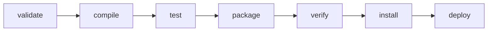
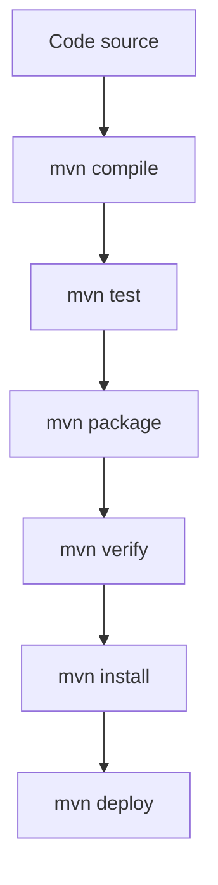
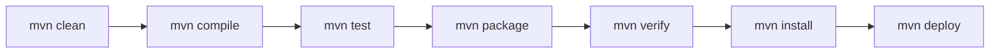

# 📦 Guide des principales commandes Maven

## Table des matières

- [Introduction](#introduction)
- [Cycle de vie Maven](#cycle-de-vie-maven)
- [Diagramme du cycle de vie](#diagramme-du-cycle-de-vie)
- [Glossaire des commandes Maven](#glossaire-des-commandes-maven)
- [Commandes de diagnostic](#commandes-de-diagnostic)
- [Résumé des commandes](#résumé-des-commandes)
- [Bonnes pratiques](#bonnes-pratiques)

---

# Introduction

**Apache Maven** est un outil d'automatisation de construction (Build Tool) principalement utilisé pour les projets Java.

Il permet de :

- compiler le code source ;
- gérer automatiquement les dépendances ;
- exécuter les tests ;
- créer des artefacts (JAR, WAR, EAR...) ;
- publier les livrables ;
- générer la documentation.

Toutes ces opérations s'appuient sur un **cycle de vie (Lifecycle)** composé de plusieurs phases.

---

# Cycle de vie Maven

Le cycle de vie par défaut est constitué des phases suivantes :

| Phase | Description |
|--------|-------------|
| validate | Vérifie que le projet est valide |
| compile | Compile le code source |
| test | Exécute les tests unitaires |
| package | Génère le livrable (JAR, WAR...) |
| verify | Vérifie les contrôles qualité |
| install | Installe l'artefact dans le dépôt local |
| deploy | Déploie l'artefact sur un dépôt distant |

> **Important**
>
> Lorsque vous exécutez une phase, Maven exécute automatiquement toutes les phases précédentes.

Par exemple :

```bash
mvn install
```

exécute automatiquement :

```
validate
↓
compile
↓
test
↓
package
↓
verify
↓
install
```

---

# Diagramme du cycle de vie



---

# Glossaire des commandes Maven

## 🧹 1. Nettoyer le projet

### Commande

```bash
mvn clean
```

### Description

Supprime le répertoire :

```
target/
```

afin de repartir d'une compilation propre.

### Utilisation

À lancer lorsque :

- des fichiers générés sont obsolètes ;
- une compilation échoue sans raison apparente ;
- on souhaite reconstruire entièrement le projet.

---

## ⚙️ 2. Compiler le projet

### Commande

```bash
mvn compile
```

### Description

Compile le code Java situé dans :

```
src/main/java
```

Les fichiers `.class` sont générés dans :

```
target/classes
```

---

## 🧪 3. Exécuter les tests

### Commande

```bash
mvn test
```

### Description

Compile puis exécute les tests présents dans :

```
src/test/java
```

Compatible avec :

- JUnit
- TestNG
- autres frameworks compatibles Maven

---

## 📦 4. Créer le package

### Commande

```bash
mvn package
```

### Description

Construit le livrable du projet.

Selon le type de projet :

| Packaging | Résultat |
|-----------|----------|
| jar | fichier `.jar` |
| war | fichier `.war` |
| ear | fichier `.ear` |

Cette commande exécute également :

- compile
- test

---

## 💾 5. Installer dans le dépôt local

### Commande

```bash
mvn install
```

### Description

Copie le package généré dans :

```
~/.m2/repository
```

Il devient alors disponible pour les autres projets Maven présents sur votre machine.

---

## 🚀 6. Déployer le projet

### Commande

```bash
mvn deploy
```

### Description

Publie l'artefact dans un dépôt Maven distant.

Exemples :

- Nexus
- Artifactory
- GitHub Packages
- Maven Central

Utilisé principalement dans les chaînes d'intégration continue (CI/CD).

---

## 📚 7. Générer la documentation

### Commande

```bash
mvn site
```

### Description

Produit un site HTML contenant :

- JavaDoc
- rapports de tests
- couverture de code
- analyse PMD
- Checkstyle
- SpotBugs
- informations sur le projet

Le site est généré dans :

```
target/site
```

---

## ✔️ 8. Vérifier le projet

### Commande

```bash
mvn verify
```

### Description

Exécute les vérifications supplémentaires après le package.

Exemples :

- tests d'intégration
- validation qualité
- vérification de signatures

---

## ▶️ 9. Exécuter une application Java

### Commande

```bash
mvn exec:java
```

### Description

Lance une classe Java directement depuis Maven.

Exemple :

```bash
mvn exec:java \
-Dexec.mainClass="com.demo.Application"
```

Très pratique pour :

- les démonstrations ;
- les applications console ;
- les outils internes.

---

# Commandes de diagnostic

---

## 🌳 10. Afficher les dépendances

### Commande

```bash
mvn dependency:tree
```

### Description

Affiche l'arbre complet des dépendances.

Exemple :

```
mon-projet
│
├── spring-boot
│
├── jackson
│
└── junit
```

Très utile pour :

- détecter les conflits de versions ;
- comprendre les dépendances transitives.

---

## 📄 11. Afficher le POM effectif

### Commande

```bash
mvn help:effective-pom
```

### Description

Affiche le **POM final** obtenu après fusion :

- du parent POM ;
- des profils ;
- des propriétés ;
- des valeurs par défaut de Maven.

Très utile pour le débogage.

---

## 🔍 12. Décrire un plugin

### Commande

```bash
mvn help:describe
```

Exemple :

```bash
mvn help:describe -Dplugin=compiler
```

### Description

Affiche :

- les objectifs (Goals)
- les paramètres
- les plugins disponibles
- les phases associées

---

# Diagramme simplifié d'un build Maven



---

# Résumé des commandes

| Commande | Fonction |
|----------|----------|
| `mvn clean` | Nettoie le projet |
| `mvn compile` | Compile le code |
| `mvn test` | Lance les tests |
| `mvn package` | Génère le JAR/WAR |
| `mvn verify` | Vérifie le projet |
| `mvn install` | Installe localement |
| `mvn deploy` | Déploie à distance |
| `mvn site` | Génère la documentation |
| `mvn exec:java` | Exécute une application |
| `mvn dependency:tree` | Affiche les dépendances |
| `mvn help:effective-pom` | Affiche le POM effectif |
| `mvn help:describe` | Décrit un plugin |

---

# Bonnes pratiques

✅ Toujours commencer un build complet par :

```bash
mvn clean install
```

✅ Vérifier les dépendances régulièrement :

```bash
mvn dependency:tree
```

✅ Générer la documentation avant une livraison :

```bash
mvn site
```

✅ Utiliser `verify` dans les pipelines CI/CD avant le déploiement.

---

# En résumé

Le flux de travail Maven le plus courant est :



Ce cycle couvre l'ensemble des étapes de développement, de validation et de publication d'un projet Java, tout en garantissant la reproductibilité des builds grâce à la gestion centralisée des dépendances et des plugins.
