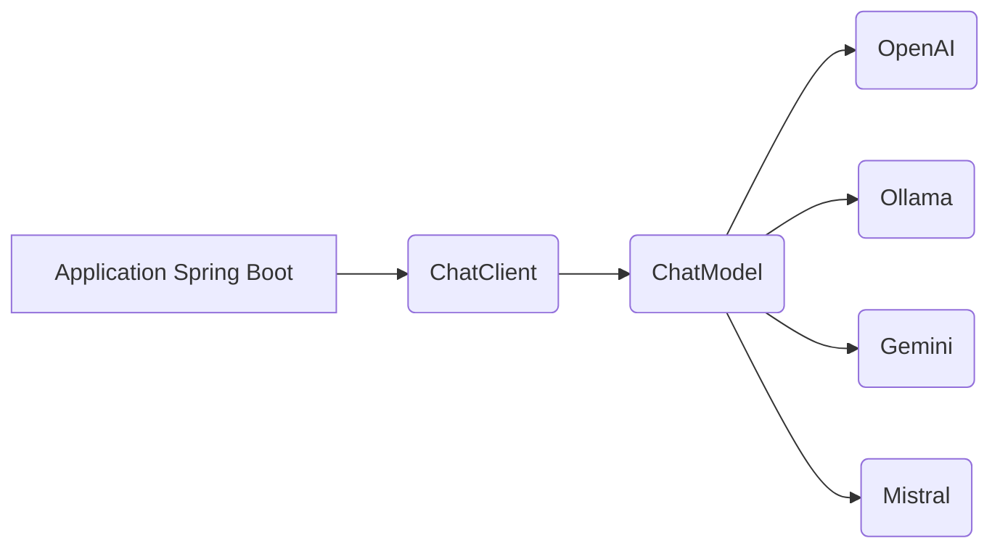
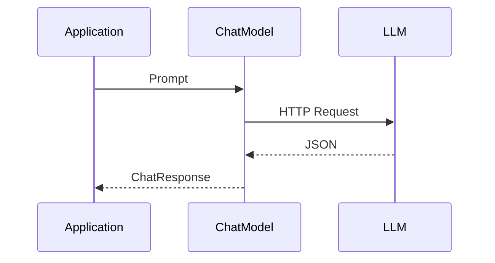
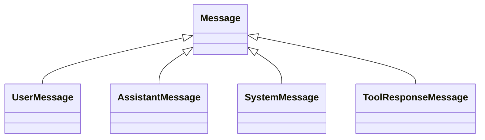
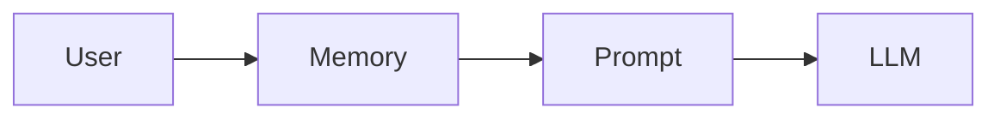
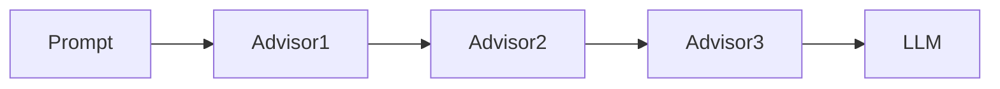
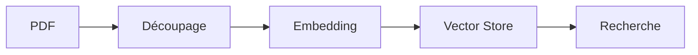
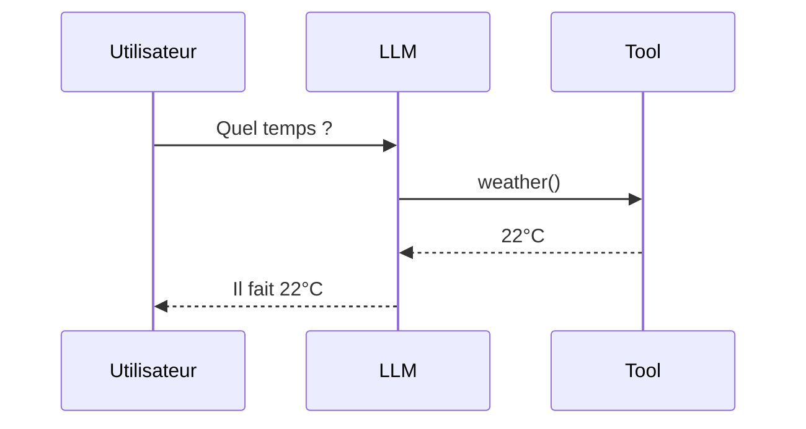
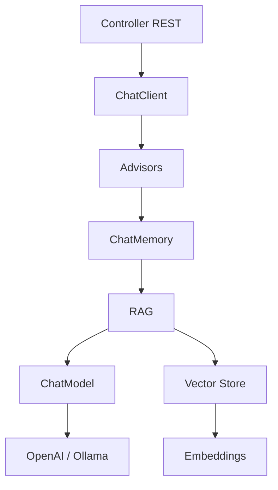

Excellente idée. Spring AI est relativement récent, et beaucoup de tutoriels se limitent à quelques exemples de `ChatClient`. En réalité, il y a une véritable architecture à comprendre pour produire des applications IA robustes.

Je vais te proposer un **cours complet**, similaire à ce que l'on pourrait trouver dans une formation professionnelle.

---

# Tutoriel complet Spring AI

## Sommaire

1. Introduction
2. L'architecture de Spring AI
3. Les dépendances Maven
4. Les modèles (ChatModel)
5. Le ChatClient
6. Les Prompt
7. Les Messages
8. Les Options du modèle
9. Les Conversations (Chat Memory)
10. Les Advisors
11. Les Structured Outputs
12. Les Embeddings
13. Le Vector Store
14. Le RAG (Retrieval Augmented Generation)
15. Les Function Calling / Tools
16. Les Images
17. Les Audio Models
18. Le Streaming
19. Les bonnes pratiques

---

# 1. Qu'est-ce que Spring AI ?

Spring AI est un projet Spring permettant d'intégrer des LLM (Large Language Models) exactement comme on intègre une base de données avec Spring Data.

Le but est de masquer les différences entre :

* OpenAI
* Anthropic
* Ollama
* Azure OpenAI
* Google Gemini
* Mistral
* HuggingFace
* Bedrock
* Vertex AI

L'application ne manipule plus directement les API REST des fournisseurs.

---

# Architecture générale



Le code métier ne connaît jamais le fournisseur.

---

# 2. Dépendances

Pour OpenAI :

```xml
<dependency>
    <groupId>org.springframework.ai</groupId>
    <artifactId>spring-ai-starter-model-openai</artifactId>
</dependency>
```

Pour Ollama :

```xml
<dependency>
    <groupId>org.springframework.ai</groupId>
    <artifactId>spring-ai-starter-model-ollama</artifactId>
</dependency>
```

Puis :

```properties
spring.ai.openai.api-key=xxxx
```

ou

```properties
spring.ai.ollama.base-url=http://localhost:11434
```

---

# 3. Le ChatModel

Le `ChatModel` est l'objet bas niveau.

Il représente directement un LLM.

```java
@Service
public class AiService {

    private final ChatModel chatModel;

    public AiService(ChatModel chatModel) {
        this.chatModel = chatModel;
    }

    public String ask(String question) {

        Prompt prompt = new Prompt(question);

        ChatResponse response =
                chatModel.call(prompt);

        return response.getResult()
                       .getOutput()
                       .getText();
    }

}
```

Schéma :



---

# 4. Le ChatClient

Le `ChatClient` est une couche plus haut niveau.

Il simplifie énormément le code.

```java
@Service
public class AiService {

    private final ChatClient chatClient;

    public AiService(ChatClient.Builder builder) {
        this.chatClient = builder.build();
    }

    public String ask(String question) {

        return chatClient.prompt()
                .user(question)
                .call()
                .content();

    }

}
```

Comparaison :

Sans ChatClient :

```java
Prompt

↓

ChatResponse

↓

Generation

↓

AssistantMessage

↓

Text
```

Avec ChatClient :

```java
String
```

---

# 5. Les Prompt

Un Prompt est simplement une requête.

Il peut contenir :

* messages
* paramètres
* options

Exemple :

```java
Prompt prompt = new Prompt(
        "Explique Java en 3 phrases"
);
```

Ou :

```java
Prompt prompt = new Prompt(
        List.of(
                new UserMessage("Bonjour")
        )
);
```

---

# 6. Les Messages

Spring AI manipule différents types de messages.



---

## UserMessage

```java
new UserMessage("Qui est Napoléon ?");
```

---

## AssistantMessage

Réponse du modèle.

```java
AssistantMessage answer = response
        .getResult()
        .getOutput();
```

---

## SystemMessage

Très important.

Il définit le comportement permanent.

```java
new SystemMessage("""
Tu es un expert Java.
Réponds toujours en français.
Sois concis.
""");
```

---

Exemple complet

```java
Prompt prompt = new Prompt(List.of(

        new SystemMessage("""
Tu es professeur Java.
"""),

        new UserMessage("""
Explique les Streams.
""")

));
```

---

# 7. Les Prompt Templates

Les prompts peuvent contenir des variables.

```java
PromptTemplate template =
        new PromptTemplate("""
Explique {topic}
pour un niveau {level}
""");
```

Puis :

```java
Prompt prompt =
        template.create(Map.of(

                "topic","Spring Boot",

                "level","débutant"

        ));
```

Produit :

```
Explique Spring Boot
pour un niveau débutant
```

---

# 8. Les Options du modèle

Chaque appel peut être configuré.

```java
OpenAiChatOptions options =
        OpenAiChatOptions.builder()

                .temperature(0.8)

                .maxTokens(1000)

                .model("gpt-4.1")

                .build();
```

Puis :

```java
Prompt prompt =
        new Prompt(message, options);
```

---

Les paramètres importants :

| Paramètre        | Rôle                         |
| ---------------- | ---------------------------- |
| temperature      | créativité                   |
| maxTokens        | longueur                     |
| topP             | diversité                    |
| frequencyPenalty | évite les répétitions        |
| presencePenalty  | encourage de nouveaux sujets |

---

# 9. Chat Memory

Sans mémoire :

```
Utilisateur :
Je m'appelle Pierre.

IA :
Enchanté.

Utilisateur :
Quel est mon prénom ?

IA :
Je ne sais pas.
```

Avec mémoire :

```
Utilisateur :
Je m'appelle Pierre.

Utilisateur :
Quel est mon prénom ?

IA :
Pierre.
```

Architecture :



Exemple :

```java
ChatClient chatClient =
        builder
                .defaultAdvisors(
                        new MessageChatMemoryAdvisor(
                                new InMemoryChatMemory()
                        )
                )
                .build();
```

---

# 10. Advisors

Les Advisors interceptent les requêtes.

Ils ressemblent énormément aux filtres Spring MVC.



Exemple :

* Logging
* Memory
* RAG
* Sécurité

---

# 11. Structured Output

Très utile.

Au lieu d'obtenir du texte :

```
Nom : Alice

Age : 24
```

On récupère directement un objet Java.

```java
record Person(

        String name,

        Integer age

){}
```

Puis :

```java
Person person =

chatClient.prompt()

.user("""
Invente une personne
""")

.call()

.entity(Person.class);
```

Le JSON est automatiquement converti.

---

# 12. Embeddings

Un embedding transforme un texte en vecteur.

```
"Bonjour"

↓

[0.12,
0.94,
0.34,
...]
```

Pourquoi ?

Pour mesurer la similarité entre textes.

---

Exemple :

```java
EmbeddingModel embeddingModel;
```

Puis :

```java
Embedding embedding =
        embeddingModel.embedForResponse(
                "Spring Boot"
        );
```

---

# 13. Vector Store

Les embeddings sont stockés dans une base vectorielle.

Exemples :

* PGVector
* Pinecone
* Milvus
* Redis
* Chroma

Architecture :



---

# 14. RAG

Retrieval Augmented Generation.

Principe :

```
Question utilisateur

↓

Embedding

↓

Recherche

↓

Documents

↓

LLM

↓

Réponse
```

Le modèle ne répond plus uniquement avec ses connaissances.

Il répond avec **tes documents**.

---

# Exemple

Tu charges :

```
Documentation Java

Documentation Spring

Documentation Kubernetes
```

Question :

```
Comment fonctionne mon API ?
```

Le LLM reçoit automatiquement :

```
Question

+

Extraits pertinents
```

---

# 15. Function Calling

Le LLM peut appeler du code Java.

Exemple :

```java
@Service
public class WeatherService {

    public String weather(String city){

        return "22°C";
    }

}
```

Déclaration comme outil.

Lorsque l'utilisateur demande :

```
Quel temps à Paris ?
```

Le modèle décide :

```
Appeler WeatherService
```

Puis répond :

```
Il fait 22°C.
```

Architecture :



---

# 16. Streaming

Sans streaming :

```
.............

Réponse complète
```

Avec streaming :

```
Bonjour

Bonjour je

Bonjour je vais

Bonjour je vais vous
```

Exemple :

```java
Flux<String> stream =

chatClient.prompt()

.user(question)

.stream()

.content();
```

---

# 17. Images

Spring AI supporte les modèles de génération d'images.

```java
ImageModel imageModel;
```

Puis :

```java
ImageResponse response =
        imageModel.call(

                new ImagePrompt(
                        "Un chat astronaute"
                )

        );
```

---

# 18. Audio

Même principe.

```
AudioModel

↓

Speech To Text

↓

Text
```

ou

```
Text

↓

Text To Speech

↓

Audio
```

---

# 19. Architecture complète



---

# Bonnes pratiques

## 1. Toujours utiliser un System Prompt

```text
Tu es un expert Java.

Réponds en français.

Utilise des exemples.

Ne réponds jamais en Markdown.
```

---

## 2. Préférer ChatClient

Le `ChatClient` réduit considérablement le code répétitif et fournit une API fluide, tandis que `ChatModel` reste utile lorsque tu as besoin d'un contrôle plus fin sur les requêtes et les réponses.

---

## 3. Utiliser des Structured Outputs

Évite de parser manuellement des réponses textuelles.

Préfère :

```java
record Customer(String name, int age) {}
```

plutôt que :

```text
Nom : ...

Age : ...
```

---

## 4. Utiliser le RAG pour les données métier

Ne mets pas des centaines de pages de documentation directement dans le prompt. Indexe-les dans un Vector Store et laisse Spring AI récupérer automatiquement les passages pertinents.

---

## 5. Garder les Tools spécialisés

Une bonne pratique consiste à déléguer au code Java les opérations déterministes (météo, calculs, accès aux bases de données, appels d'API, etc.) et à laisser le LLM se concentrer sur le raisonnement et la génération de texte.

---

# Ce qu'il faut retenir

L'architecture Spring AI peut se résumer ainsi :

```text
Utilisateur
      │
      ▼
ChatClient
      │
      ▼
Advisors (Memory, RAG, Logging…)
      │
      ▼
ChatModel
      │
      ▼
LLM (OpenAI, Ollama, Gemini…)
      │
      ▼
Réponse

En parallèle :
- EmbeddingModel → transforme les textes en vecteurs
- VectorStore → stocke et recherche les vecteurs
- Tools → permettent au LLM d'exécuter du code Java
```

Une fois ces briques maîtrisées (`ChatClient`, `Prompt`, `Messages`, `Memory`, `Structured Output`, `Embeddings`, `Vector Store`, `RAG` et `Tools`), tu disposes de l'essentiel pour concevoir des applications d'IA modernes avec Spring AI.
