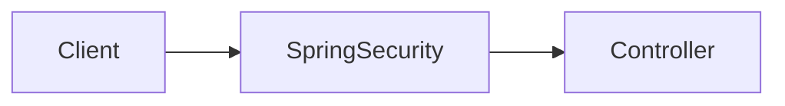
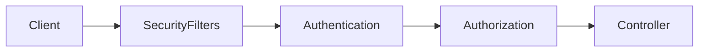
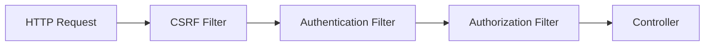
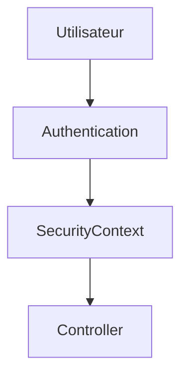
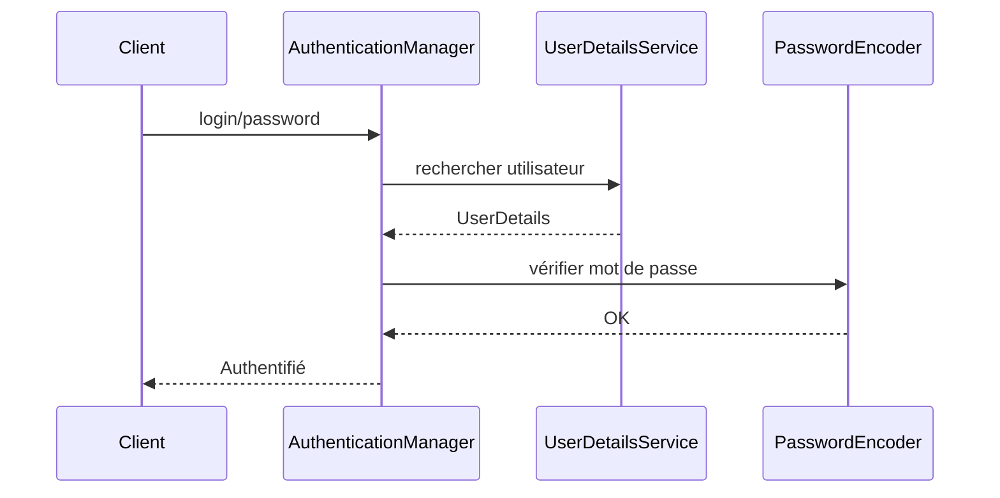
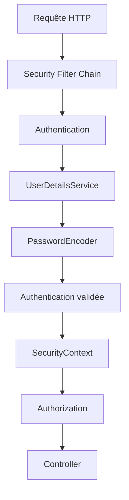

# Tutoriel : Les bases indispensables de Spring Security

Avant de développer une authentification avec JWT ou OAuth2, il est essentiel de comprendre **comment Spring Security fonctionne en interne**. Beaucoup de développeurs savent configurer Spring Security, mais ne comprennent pas pourquoi certaines configurations fonctionnent... ou échouent.

L'objectif de ce tutoriel est de construire des bases solides.

---

# 1. Qu'est-ce que Spring Security ?

**Spring Security** est le framework de sécurité officiel de Spring.

Il permet notamment de :

* authentifier les utilisateurs
* autoriser ou refuser l'accès aux ressources
* protéger les mots de passe
* gérer les rôles et permissions
* protéger contre plusieurs attaques (CSRF, Session Fixation, etc.)

Sans Spring Security :

```
Client
   │
   ▼
Controller
```

Avec Spring Security :



Toutes les requêtes passent d'abord par Spring Security.

---

# 2. Les deux concepts fondamentaux

C'est LA première chose à maîtriser.

## Authentication (Authentification)

Question :

> **Qui êtes-vous ?**

Exemple :

```
Login : alice

Mot de passe : secret123
```

Spring vérifie :

* le login
* le mot de passe

Si tout est correct :

```
Utilisateur authentifié
```

---

## Authorization (Autorisation)

Question :

> **Que pouvez-vous faire ?**

Exemple :

```
Utilisateur :

Alice

↓

ROLE_ADMIN

↓

Peut supprimer un utilisateur
```

Autre exemple :

```
Bob

↓

ROLE_USER

↓

Ne peut PAS supprimer un utilisateur
```

---

Résumé :

| Concept        | Question                |
| -------------- | ----------------------- |
| Authentication | Qui êtes-vous ?         |
| Authorization  | Que pouvez-vous faire ? |

---

# 3. Le cycle d'une requête

Quand un utilisateur appelle une API :

```
GET /courses
```

La requête ne va **jamais directement** dans le contrôleur.

Elle passe par plusieurs filtres.



Si une étape échoue :

```
401 Unauthorized
```

ou

```
403 Forbidden
```

Le contrôleur n'est jamais exécuté.

---

# 4. La Security Filter Chain

C'est le cœur de Spring Security.

Une **Filter Chain** est une succession de filtres exécutés dans un ordre précis.

Exemple simplifié :



Chaque filtre possède une responsabilité précise.

---

# 5. Les principaux filtres

Voici les plus connus.

## CSRF Filter

Protège contre les attaques CSRF.

---

## Authentication Filter

Vérifie l'identité de l'utilisateur.

Par exemple :

```
Basic Auth

JWT

OAuth2
```

---

## Authorization Filter

Vérifie les rôles.

Exemple :

```
ROLE_ADMIN

↓

Autorisé
```

ou

```
ROLE_USER

↓

Refusé
```

---

# 6. SecurityContext

Une fois authentifié, Spring doit mémoriser l'utilisateur.

Il utilise :

```
SecurityContext
```

Schéma :



Le contrôleur peut ensuite connaître l'utilisateur connecté.

Exemple :

```java
Authentication auth =
SecurityContextHolder.getContext().getAuthentication();

System.out.println(auth.getName());
```

---

# 7. Authentication

Dans Spring Security, l'utilisateur connecté est représenté par un objet :

```java
Authentication
```

Il contient :

* le nom
* les rôles
* les permissions
* les informations d'authentification

Schéma :

```text
Authentication

├── username
├── password
├── authorities
└── authenticated
```

---

# 8. Principal

Le **Principal** représente l'utilisateur.

Exemple :

```java
Authentication authentication =
SecurityContextHolder
.getContext()
.getAuthentication();

Object principal =
authentication.getPrincipal();
```

Souvent :

```
principal

↓

UserDetails
```

---

# 9. GrantedAuthority

Les droits sont représentés par :

```
GrantedAuthority
```

Exemple :

```
ROLE_ADMIN

ROLE_USER

COURSE_READ

COURSE_WRITE
```

Chaque autorité représente un droit.

---

# 10. Les rôles

Les rôles sont une façon simple de regrouper des permissions.

Exemple :

```
ROLE_ADMIN
```

peut signifier :

```
Créer utilisateur

Modifier utilisateur

Supprimer utilisateur
```

---

Autre exemple :

```
ROLE_STUDENT
```

peut seulement :

```
Voir les cours
```

---

# 11. Les permissions (Authorities)

Les permissions sont plus fines.

Exemple :

```
COURSE_READ

COURSE_CREATE

COURSE_UPDATE

COURSE_DELETE
```

On peut ensuite composer des rôles :

```text
ROLE_ADMIN

├── COURSE_READ
├── COURSE_CREATE
├── COURSE_UPDATE
└── COURSE_DELETE
```

---

# 12. UserDetails

Spring ne connaît pas vos utilisateurs.

Il a besoin d'un objet standard :

```java
UserDetails
```

Il contient :

```text
username

password

authorities

enabled

accountExpired

credentialsExpired

locked
```

---

# 13. UserDetailsService

Comment Spring retrouve un utilisateur ?

Grâce à :

```java
UserDetailsService
```

Exemple :

```java
@Service
public class CustomUserDetailsService
        implements UserDetailsService {

    @Override
    public UserDetails loadUserByUsername(String username) {

        User user = repository.findByUsername(username);

        return new org.springframework.security.core.userdetails.User(
                user.getUsername(),
                user.getPassword(),
                List.of(new SimpleGrantedAuthority("ROLE_USER"))
        );
    }
}
```

Spring appelle automatiquement cette méthode pendant l'authentification.

---

# 14. PasswordEncoder

Les mots de passe ne doivent **jamais** être stockés en clair.

❌ Mauvaise pratique :

```text
password

123456
```

✅ Bonne pratique :

```text
$2a$10$7shjshjsjdj...
```

Configuration :

```java
@Bean
PasswordEncoder passwordEncoder() {
    return new BCryptPasswordEncoder();
}
```

Encodage :

```java
String hash =
passwordEncoder.encode("secret");
```

Vérification :

```java
passwordEncoder.matches(
        "secret",
        hash
);
```

---

# 15. SecurityFilterChain

Depuis Spring Security 6, la configuration se fait avec `SecurityFilterChain`.

Exemple :

```java
@Bean
SecurityFilterChain security(HttpSecurity http)
        throws Exception {

    http
        .csrf(csrf -> csrf.disable())
        .authorizeHttpRequests(auth -> auth
            .requestMatchers("/public/**").permitAll()
            .requestMatchers("/admin/**").hasRole("ADMIN")
            .anyRequest().authenticated()
        );

    return http.build();
}
```

Cette configuration signifie :

* `/public/**` : accessible à tous.
* `/admin/**` : réservé aux administrateurs.
* tout le reste : nécessite une authentification.

---

# 16. AuthenticationManager

C'est le composant qui réalise l'authentification.

Schéma :



---

# 17. 401 vs 403

C'est une confusion très fréquente.

## 401 Unauthorized

L'utilisateur **n'est pas authentifié**.

Exemple :

```
Pas de JWT

↓

401
```

---

## 403 Forbidden

L'utilisateur est authentifié mais **n'a pas les droits**.

Exemple :

```
ROLE_USER

↓

Suppression utilisateur

↓

403
```

Résumé :

| Code | Signification                   |
| ---- | ------------------------------- |
| 401  | Non authentifié                 |
| 403  | Authentifié mais accès interdit |

---

# 18. Vue d'ensemble

Voici le fonctionnement global de Spring Security :



---

# À retenir

Avant d'aborder des sujets avancés comme **JWT**, **OAuth2**, **Refresh Tokens** ou les **permissions personnalisées**, il est important de maîtriser les éléments suivants :

* Comprendre la différence entre **Authentication** et **Authorization**.
* Savoir que chaque requête traverse la **Security Filter Chain**.
* Connaître le rôle du **SecurityContext**, qui conserve les informations de l'utilisateur authentifié.
* Comprendre les interfaces clés : **UserDetails**, **UserDetailsService**, **Authentication**, **GrantedAuthority** et **PasswordEncoder**.
* Savoir configurer les règles d'accès avec **SecurityFilterChain**.
* Distinguer clairement les erreurs **401 Unauthorized** (non authentifié) et **403 Forbidden** (authentifié mais sans autorisation).

Ces notions constituent le socle de Spring Security. Une fois acquises, les mécanismes comme JWT, OAuth2 ou les filtres personnalisés deviennent beaucoup plus faciles à comprendre, car ils s'intègrent tous dans cette architecture de base.
