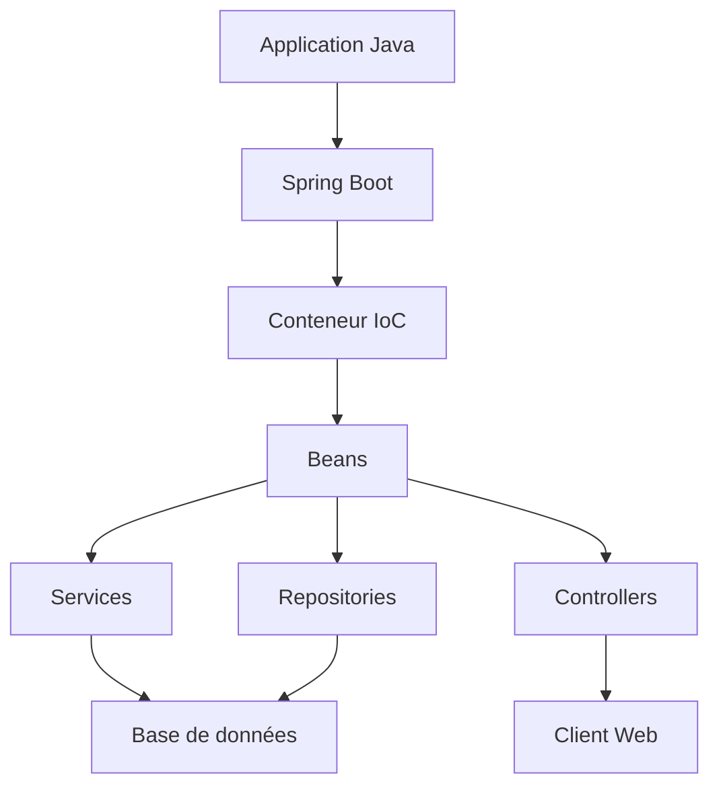
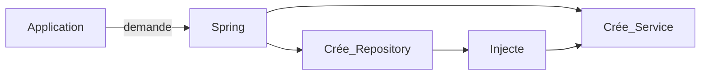
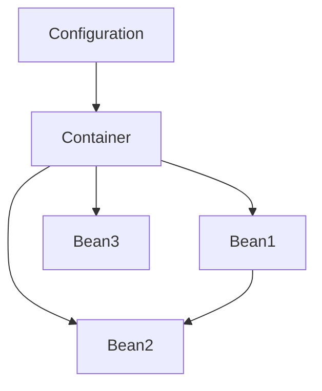
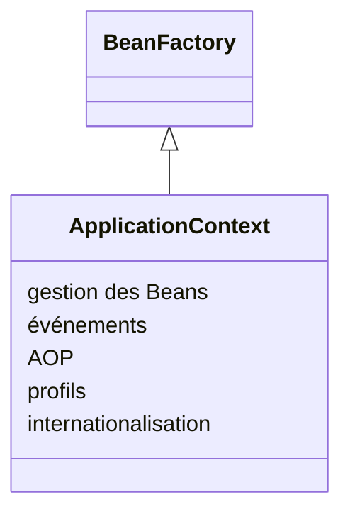
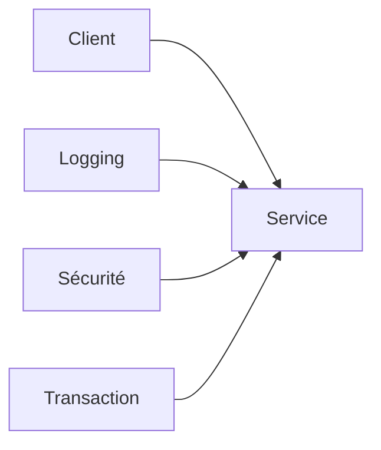
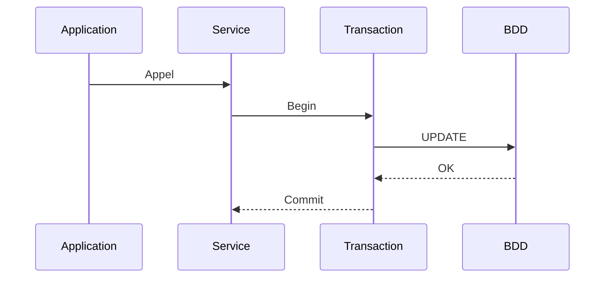
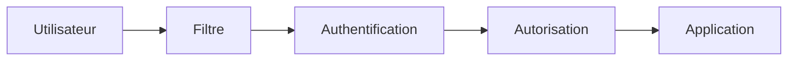
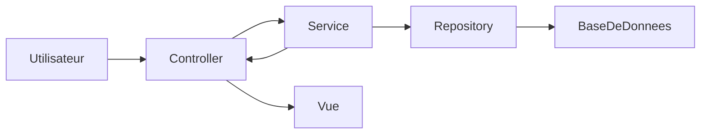
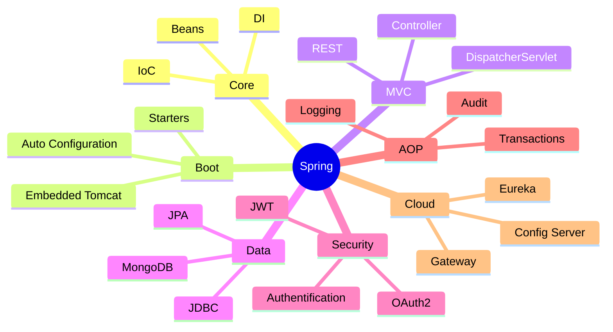

# 🌱 Guide des concepts fondamentaux de Spring Framework

> Spring est le framework Java de référence pour développer des applications **modulaires**, **maintenables**, **testables** et **évolutives**.
>
> Son principe fondamental repose sur **l'Inversion de Contrôle (IoC)** et **l'Injection de Dépendances (DI)**.

---

# Sommaire

- [Architecture générale de Spring](#architecture-générale-de-spring)
- [1. Inversion de Contrôle (IoC)](#1-inversion-de-contrôle-ioc)
- [2. Injection de Dépendances (DI)](#2-injection-de-dépendances-di)
- [3. Le conteneur IoC](#3-le-conteneur-ioc)
- [4. Beans et BeanFactory](#4-beans-et-beanfactory)
- [5. ApplicationContext](#5-applicationcontext)
- [6. Spring AOP](#6-spring-aop)
- [7. Les principales annotations](#7-les-principales-annotations)
- [8. Gestion des transactions](#8-gestion-des-transactions)
- [9. Spring Data](#9-spring-data)
- [10. Spring Security](#10-spring-security)
- [11. Spring Boot](#11-spring-boot)
- [12. Spring MVC](#12-spring-mvc)
- [13. Configuration Spring](#13-configuration-spring)
- [14. Profiles Spring](#14-profiles-spring)
- [Résumé des modules Spring](#résumé-des-modules-spring)

---

# Architecture générale de Spring



Le cœur de Spring est le **conteneur IoC**, chargé de créer et gérer les objets de l'application appelés **Beans**.

---

# 1. Inversion de Contrôle (IoC)

## Définition

L'Inversion de Contrôle (**IoC**) est un principe de conception dans lequel **la création et la gestion des objets sont confiées à Spring**.

Sans IoC :

```java
UserRepository repo = new UserRepository();
UserService service = new UserService(repo);
```

Avec Spring :

```java
@Service
public class UserService {

    private final UserRepository repository;

    public UserService(UserRepository repository){
        this.repository = repository;
    }
}
```

Spring crée automatiquement `UserRepository` puis l'injecte dans `UserService`.

---

## Schéma



---

# 2. Injection de Dépendances (DI)

La **Dependency Injection (DI)** est la manière dont Spring réalise l'IoC.

Il existe trois méthodes principales.

|Type|Recommandé|Description|
|---------|------------|----------------|
|Constructeur|⭐⭐⭐⭐⭐|La meilleure pratique|
|Setter|⭐⭐⭐|Pour les dépendances optionnelles|
|Champ (`@Autowired`)|⭐|À éviter dans les nouveaux projets|

---

## Injection par constructeur (recommandée)

```java
@Service
public class UserService {

    private final UserRepository repository;

    public UserService(UserRepository repository){
        this.repository = repository;
    }

}
```

Avantages :

- immutable
- facilement testable
- compatible avec les tests unitaires

---

# 3. Le conteneur IoC

Le conteneur Spring est responsable de :

- créer les objets
- injecter leurs dépendances
- gérer leur cycle de vie
- appliquer les aspects (AOP)
- gérer les événements



---

# 4. Beans et BeanFactory

## Bean

Un **Bean** est simplement un objet géré par Spring.

Exemple :

```java
@Service
public class ProductService {
}
```

Spring crée automatiquement une instance unique.

---

## BeanFactory

BeanFactory est le conteneur IoC minimal.

Fonctions :

- création des Beans
- gestion des dépendances
- lazy loading

Aujourd'hui, on utilise principalement **ApplicationContext**, plus complet.

---

# 5. ApplicationContext

ApplicationContext étend BeanFactory.

Il ajoute :

- internationalisation (i18n)
- gestion des événements
- AOP
- chargement automatique des Beans
- gestion des profils



---

# 6. Spring AOP

L'Aspect-Oriented Programming permet d'ajouter des traitements transverses sans modifier le code métier.

Exemples :

- Logging
- Sécurité
- Transactions
- Monitoring
- Audit



Exemple :

```java
@Aspect
@Component
public class LoggingAspect {

    @Before("execution(* com.demo.service.*.*(..))")
    public void log() {
        System.out.println("Méthode appelée");
    }

}
```

---

# 7. Les principales annotations

|Annotation|Rôle|
|-----------|------|
|@Component|Bean générique|
|@Service|Service métier|
|@Repository|Accès aux données|
|@Controller|Contrôleur MVC|
|@RestController|API REST|
|@Configuration|Classe de configuration|
|@Bean|Déclare un Bean|
|@Autowired|Injection automatique|
|@Qualifier|Choix d'un Bean précis|
|@Value|Injection d'une propriété|
|@Profile|Activation selon l'environnement|

---

# 8. Gestion des transactions

Spring simplifie la gestion transactionnelle grâce à :

```java
@Transactional
public void transfer() {

}
```

Spring se charge automatiquement de :

- Begin Transaction
- Commit
- Rollback en cas d'exception



---

# 9. Spring Data

Spring Data réduit énormément le code d'accès aux données.

Exemple :

```java
public interface UserRepository
        extends JpaRepository<User,Long> {

}
```

On obtient automatiquement :

- save()
- findAll()
- delete()
- findById()

sans écrire leur implémentation.

---

# 10. Spring Security

Spring Security fournit :

- Authentification
- Autorisation
- Protection CSRF
- Gestion des rôles
- OAuth2
- JWT

Architecture :



---

# 11. Spring Boot

Spring Boot simplifie énormément Spring.

Avant :

- XML
- nombreuses configurations
- serveur à installer

Avec Boot :

- configuration automatique
- serveur Tomcat embarqué
- starter dependencies
- exécution immédiate

Lancement :

```java
@SpringBootApplication
public class DemoApplication {

    public static void main(String[] args){

        SpringApplication.run(
            DemoApplication.class,args);

    }

}
```

---

# 12. Spring MVC

Spring MVC implémente le modèle **MVC**.



Exemple :

```java
@RestController
@RequestMapping("/users")
public class UserController {

    @GetMapping
    public List<User> all(){

    }

}
```

---

# 13. Configuration Spring

Trois possibilités :

## XML

```xml
<bean id="service"
      class="com.demo.Service"/>
```

---

## Annotations

```java
@Service
public class UserService {

}
```

---

## Java Config

```java
@Configuration
public class AppConfig {

    @Bean
    public UserService service(){

        return new UserService();

    }

}
```

Aujourd'hui, **Spring Boot privilégie les annotations et la configuration Java**.

---

# 14. Profiles Spring

Les profils permettent d'adapter la configuration selon l'environnement.

Exemples :

- dev
- test
- recette
- prod

```java
@Profile("dev")
@Service
public class FakeMailService {

}
```

Activation :

```properties
spring.profiles.active=dev
```

---

# Résumé des modules Spring

|Module|Fonction|
|-----------|----------------|
|Spring Core|IoC + DI|
|Spring Context|ApplicationContext|
|Spring Boot|Configuration automatique|
|Spring MVC|Applications Web|
|Spring Data|Accès aux données|
|Spring Security|Sécurité|
|Spring AOP|Programmation orientée aspect|
|Spring Test|Tests unitaires et d'intégration|
|Spring Batch|Traitement par lots|
|Spring Cloud|Microservices|

---

# Schéma global de l'écosystème Spring



---

# Conclusion

Les concepts essentiels de Spring reposent sur quelques principes fondamentaux :

- **IoC** : Spring contrôle la création des objets.
- **DI** : Les dépendances sont injectées automatiquement.
- **Beans** : Tous les composants sont gérés par le conteneur.
- **ApplicationContext** : Conteneur IoC avancé.
- **AOP** : Séparation des préoccupations transversales.
- **Spring Boot** : Simplifie le développement grâce à l'auto-configuration.
- **Spring MVC** : Développement d'applications Web et d'API REST.
- **Spring Data** : Simplifie l'accès aux bases de données.
- **Spring Security** : Gère l'authentification et l'autorisation.

En maîtrisant ces concepts, il devient possible de développer des applications Java modernes, robustes, testables et facilement maintenables.
