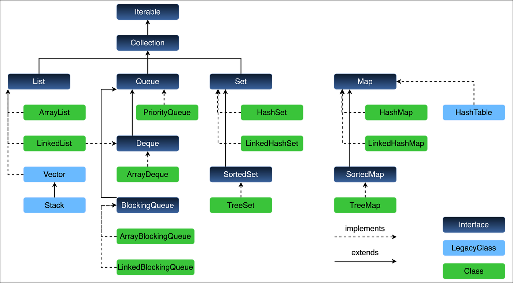
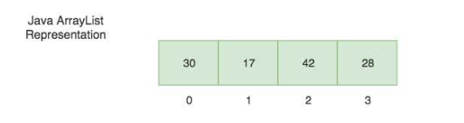
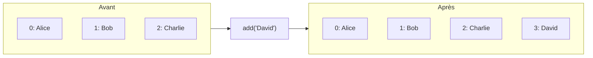
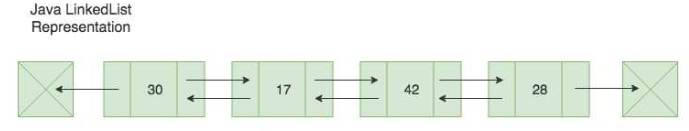
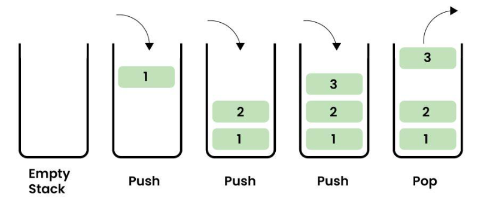
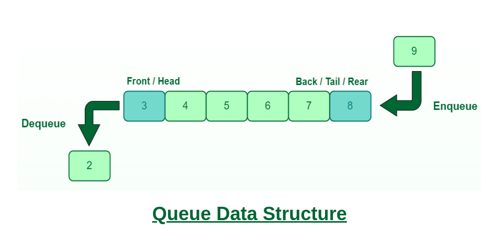
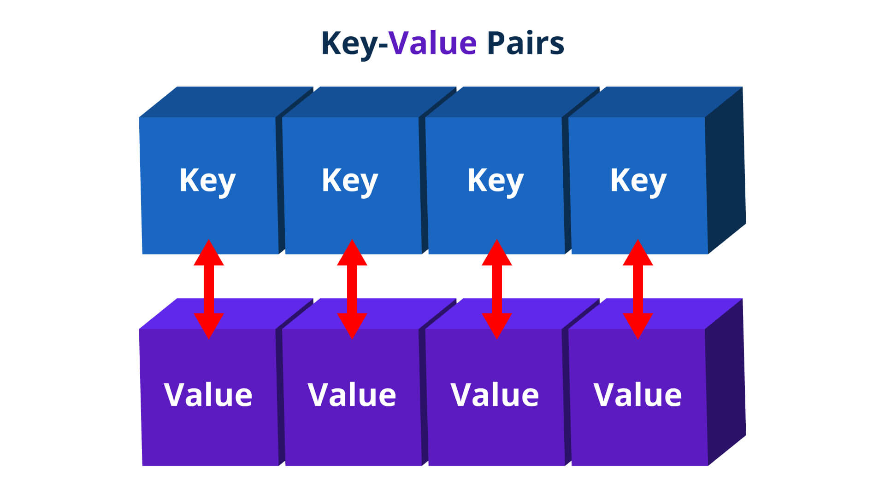
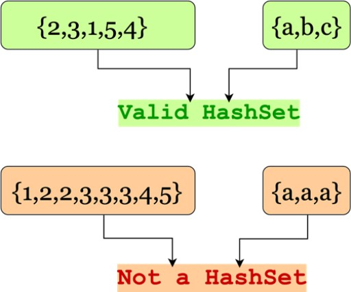

# 🧠 1. <ins>C’est quoi une structure de données ?</ins>
Une structure de données = une façon d’organiser des données en mémoire pour :
- les stocker
- les accéder
- les modifier efficacement

👉 Exemple simple :
- Une liste de courses → liste
- Un dictionnaire → clé → valeur
- Une pile d’assiettes → pile

# 📦 2. <ins>Les structures de données principales en Java</ins>
Java fournit tout dans le package :<br>
👉 ```java.util```

On va voir les plus importantes :<br>
<div align="center">
	
</div>

# 📚 3. <ins>Liste (ArrayList)</ins>
<div align="center">
	
</div>

✔️ **Idée**<br>
Une liste ordonnée d’éléments.

🧾 **Illustration**
```
Index :   0    1    2    3
Valeur: ["A", "B", "C", "D"]
```

👉 Tu accèdes avec un index.

💻 **Exemple Java**
```java 
ArrayList<String> liste = new ArrayList<>();

liste.add("A");
liste.add("B");
liste.add("C");

System.out.println(liste.get(1)); // B
```

⚡ **Caractéristiques**
- Accès rapide ✔️
- Insertion au milieu lente ❌
- Taille dynamique ✔️

# 🔗 4. <ins>Liste chaînée (LinkedList)</ins>
<div align="center">
	
</div>

✔️ **Idée**<br>
Chaque élément pointe vers le suivant.

🧾 **Illustration**
```
[A] -> [B] -> [C] -> [D] -> null
```

💻 **Exemple**
```java
LinkedList<String> liste = new LinkedList<>();

liste.add("A");
liste.add("B");
liste.add("C");
```

⚡ **Caractéristiques**
- Insertion rapide ✔️
- Accès lent (parcours) ❌

# 🥞 5. <ins>Pile (Stack)</ins>
<div align="center">
	
</div>

✔️ **Idée**<br>
LIFO = Last In, First Out

👉 comme une pile d’assiettes

🧾 **Illustration**
```
    [C]  ← sommet
    [B]
    [A]
```

💻 **Exemple**
```java
Stack<String> pile = new Stack<>();

pile.push("A");
pile.push("B");
pile.push("C");

System.out.println(pile.pop()); // C
```

⚡ **Règles**
- push() → ajouter
- pop() → retirer
- peek() → regarder

# 🚶 6. <ins>File (Queue)</ins>
<div align="center">
	
</div>

✔️ **Idée**<br>
FIFO = First In, First Out

👉 comme une file d’attente

🧾 **Illustration**
```
Entrée → [A] [B] [C] → Sortie
```

💻 **Exemple**
```java
Queue<String> file = new LinkedList<>();

file.add("A");
file.add("B");
file.add("C");

System.out.println(file.poll()); // A
```

⚡ **Règles**
- add() → entrer
- poll() → sortir

# 🗂️ 7. <ins>Map (HashMap)</ins>
<div align="center">
	
</div>

✔️ **Idée**<br>
Associer une clé → valeur

👉 comme un dictionnaire

🧾 **Illustration**
```
"nom"  → "Alice"
"age"  → 25
```

💻 **Exemple**
```java
HashMap<String, Integer> map = new HashMap<>();

map.put("Alice", 25);
map.put("Bob", 30);

System.out.println(map.get("Alice")); // 25
```

⚡ **Caractéristiques**
- Accès ultra rapide ✔️
- Pas d’ordre ❌

# 🌳 8. <ins>Set (HashSet)</ins>
<div align="center">
	
</div>

✔️ **Idée**<br>
Collection sans doublons

🧾 **Illustration**
```
[A, B, C]  ✔
[A, B, A]  ❌ → devient [A, B]
```

💻 **Exemple**
```java
HashSet<String> set = new HashSet<>();

set.add("A");
set.add("B");
set.add("A");

System.out.println(set); // [A, B]
```

# 🧩 9. <ins>Résumé visuel</ins>
| Structure  | Ordre | Doublons   | Accès rapide | Usage            |
| ---------- | ----- | ---------- | ------------ | ---------------- |
| ArrayList  | ✔️    | ✔️         | ✔️           | Liste simple     |
| LinkedList | ✔️    | ✔️         | ❌            | Insertion rapide |
| Stack      | ✔️    | ✔️         | ✔️           | LIFO             |
| Queue      | ✔️    | ✔️         | ✔️           | FIFO             |
| HashMap    | ❌     | clé unique | ✔️           | Dictionnaire     |
| HashSet    | ❌     | ❌          | ✔️           | Unicité          |


# 🎯 10. <ins>Comment choisir ?</ins>
👉 Pose-toi ces questions :
- Besoin d’un ordre ? → ```ArrayList```
- Besoin clé/valeur ? → ```HashMap```
- Pas de doublons ? → ```HashSet```
- Logique pile ? → ```Stack```
- Logique file ? → ```Queue```
- Beaucoup d’insertions ? → ```LinkedList```

### Tableau de décision rapide
| Besoin                                       | Structure                    | Cas d'usage concrets                                                                                                                                                                    |
| -------------------------------------------- | ---------------------------- | --------------------------------------------------------------------------------------------------------------------------------------------------------------------------------------- |
| Liste simple                                 | `ArrayList`                  | Liste de produits d'un catalogue<br> résultats de recherche<br> liste de commandes<br> données affichées dans un tableau UI<br> collection d'objets parcourue fréquemment                           |
| Nombreuses insertions/suppressions au milieu | `LinkedList`                 | Éditeur de texte (insertion entre caractères)<br> gestion de playlists modifiées fréquemment<br> simulation de files d'attente complexes<br> structures manipulées principalement par itérateurs |
| Éléments uniques                             | `HashSet`                    | Vérification d'unicité d'emails<br> liste d'utilisateurs connectés<br> déduplication de données importées<br> ensemble de permissions, détection de doublons                                     |
| Éléments uniques + ordre d'insertion         | `LinkedHashSet`              | Historique de recherches sans doublons<br> liste de tags conservant l'ordre de saisie<br> export de données dans l'ordre d'arrivée<br> favoris utilisateur                                       |
| Éléments uniques + tri automatique           | `TreeSet`                    | Classement de scores<br> liste triée de dates, dictionnaire de mots triés alphabétiquement<br> gestion d'intervalles<br> récupération rapide du minimum ou maximum                               |
| Accès clé → valeur rapide                    | `HashMap`                    | Cache d'objets<br> index utilisateur par ID<br> configuration applicative<br> dictionnaire de traductions<br> comptage de fréquences (`mot → nombre d'occurrences`)                                 |
| Map avec ordre d'insertion                   | `LinkedHashMap`              | Génération de rapports dans l'ordre d'ajout<br> conservation de l'ordre des paramètres<br> implémentation de cache LRU<br> journalisation d'événements                                           |
| Map triée                                    | `TreeMap`                    | Carnet d'ordres financiers<br> statistiques par date<br> classement d'utilisateurs<br> recherche de clés dans une plage de valeurs<br> navigation dans des données triées                           |
| FIFO                                         | `ArrayDeque` (comme `Queue`) | File de traitement de tâches<br> système de messagerie<br> gestion des requêtes en attente<br> parcours en largeur (BFS)<br> pipeline de traitement                                                 |
| LIFO (pile)                                  | `ArrayDeque`                 | Fonctionnalité Undo/Redo<br> navigation précédent/suivant<br> évaluation d'expressions mathématiques<br> parcours en profondeur (DFS)<br> gestion d'appels récursifs simulés                        |
| Priorités                                    | `PriorityQueue`              | Ordonnancement de tâches<br> gestion des urgences<br> algorithme de Dijkstra<br> moteur de recommandations basé sur un score<br> simulation d'événements chronologiques                             |

### Mémo rapide
| Si vous devez...                                | Utilisez généralement  |
| ----------------------------------------------- | ---------------------- |
| Stocker une liste d'objets                      | `ArrayList`            |
| Retrouver rapidement un objet par identifiant   | `HashMap`              |
| Vérifier l'existence d'un élément unique        | `HashSet`              |
| Garder les données triées en permanence         | `TreeSet` / `TreeMap`  |
| Gérer une file d'attente                        | `ArrayDeque` (`Queue`) |
| Gérer une pile                                  | `ArrayDeque`           |
| Extraire toujours l'élément le plus prioritaire | `PriorityQueue`        |
