# Tutoriel complet de System Design

> Guide progressif pour concevoir des systèmes distribués robustes, scalables et maintenables. Chaque concept est illustré par un diagramme Mermaid et/ou un exemple de code Java commenté.

---

## Table des matières

1. [Introduction : qu'est-ce que le system design ?](#1-introduction)
2. [Les concepts fondamentaux](#2-les-concepts-fondamentaux)
3. [Le théorème CAP](#3-le-théorème-cap)
4. [Les briques de base d'une architecture](#4-les-briques-de-base)
5. [Caching : théorie et implémentation Java](#5-caching)
6. [Bases de données : réplication et sharding](#6-bases-de-données)
7. [Communication asynchrone : les files de messages](#7-files-de-messages)
8. [Monolithe vs microservices](#8-monolithe-vs-microservices)
9. [Patterns de résilience (avec code Java)](#9-patterns-de-résilience)
10. [Méthodologie d'un exercice de system design](#10-méthodologie)
11. [Étude de cas complète : un raccourcisseur d'URL](#11-étude-de-cas-raccourcisseur-durl)
12. [Checklist finale](#12-checklist-finale)

---

## 1. Introduction

Le **system design** consiste à définir l'architecture, les composants, les interfaces et les flux de données d'un système pour répondre à des exigences précises. On distingue deux niveaux :

- **High-Level Design (HLD)** : la vue d'ensemble — quels services existent, comment ils communiquent, où sont les bases de données et les caches.
- **Low-Level Design (LLD)** : le détail — les classes, les schémas de tables, les algorithmes, les API.

Un bon design est toujours un **compromis** entre quatre dimensions concurrentes : performance, coût, complexité et fiabilité. Il n'existe pas de « bonne » réponse universelle, seulement des choix justifiés par des contraintes.

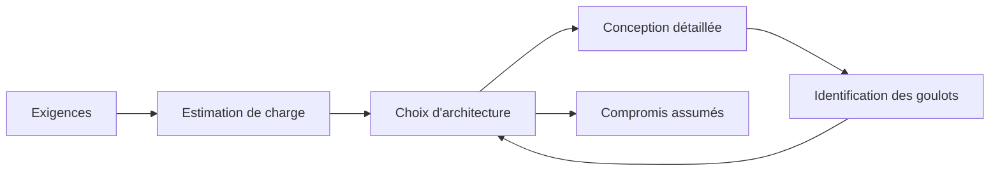

---

## 2. Les concepts fondamentaux

### 2.1 Scalabilité

La scalabilité est la capacité d'un système à absorber une charge croissante. On distingue deux stratégies :

- **Scalabilité verticale (scale up)** : on ajoute de la puissance à une seule machine (plus de CPU, de RAM). Simple mais plafonnée par le matériel et coûteuse.
- **Scalabilité horizontale (scale out)** : on ajoute des machines. Plus complexe (il faut répartir la charge et l'état), mais quasi illimitée.

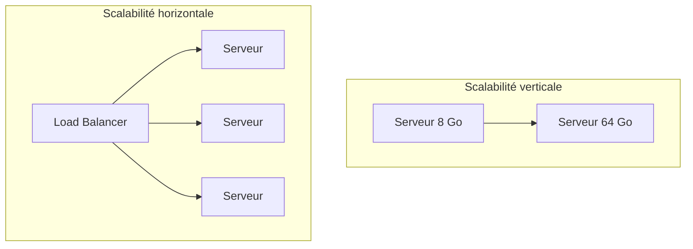

### 2.2 Disponibilité (availability)

La disponibilité mesure la fraction du temps pendant laquelle le système répond. On l'exprime en « neufs » :

| Disponibilité | Indisponibilité par an |
|---------------|------------------------|
| 99 % (deux neufs) | ~3,65 jours |
| 99,9 % (trois neufs) | ~8,76 heures |
| 99,99 % (quatre neufs) | ~52,6 minutes |
| 99,999 % (cinq neufs) | ~5,26 minutes |

On l'augmente par la **redondance** (pas de point unique de défaillance) et le **failover** (bascule automatique vers une réplique saine).

### 2.3 Latence vs débit

- **Latence** : temps pour traiter *une* requête (ex. 20 ms).
- **Débit (throughput)** : nombre de requêtes traitées par unité de temps (ex. 10 000 req/s).

Les deux ne vont pas toujours de pair : on peut augmenter le débit en parallélisant tout en dégradant la latence individuelle (files d'attente). On suit généralement les **percentiles** (p50, p95, p99) plutôt que la moyenne, car la moyenne masque les requêtes lentes qui dégradent l'expérience utilisateur.

### 2.4 Cohérence (consistency)

Quand des données sont répliquées, plusieurs copies existent. La cohérence décrit à quel point ces copies sont synchronisées :

- **Forte (strong)** : toute lecture renvoie la dernière écriture confirmée.
- **Éventuelle (eventual)** : les copies convergent « au bout d'un moment », mais une lecture peut renvoyer une valeur périmée.

---

## 3. Le théorème CAP

Le théorème CAP énonce qu'en présence d'une **partition réseau (P)**, un système distribué doit choisir entre la **cohérence (C)** et la **disponibilité (A)**. On ne peut garantir les trois simultanément.

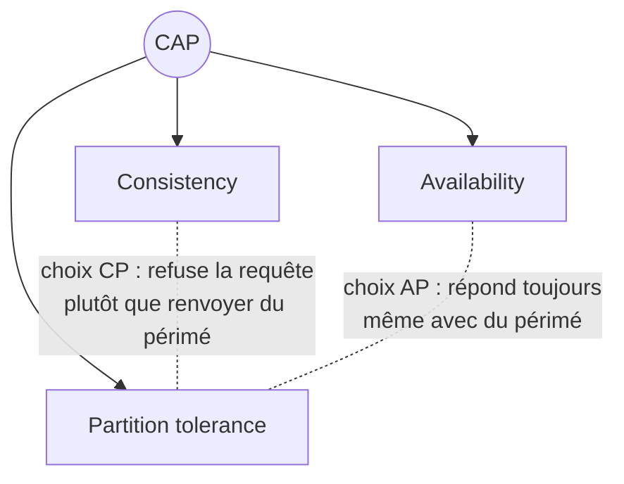

Comme les partitions réseau sont inévitables à grande échelle, le vrai choix se résume à **CP** ou **AP** :

- **CP** (ex. : HBase, MongoDB en configuration stricte) : on privilégie la justesse. Un nœud isolé refuse de répondre.
- **AP** (ex. : Cassandra, DynamoDB) : on privilégie la disponibilité. Le système répond toujours, quitte à servir une donnée légèrement obsolète.

> **Règle pratique** : une transaction bancaire exige CP ; un compteur de « likes » s'accommode très bien d'AP.

---

## 4. Les briques de base

Voici l'anatomie typique d'un système web à grande échelle. Chaque couche a un rôle précis.

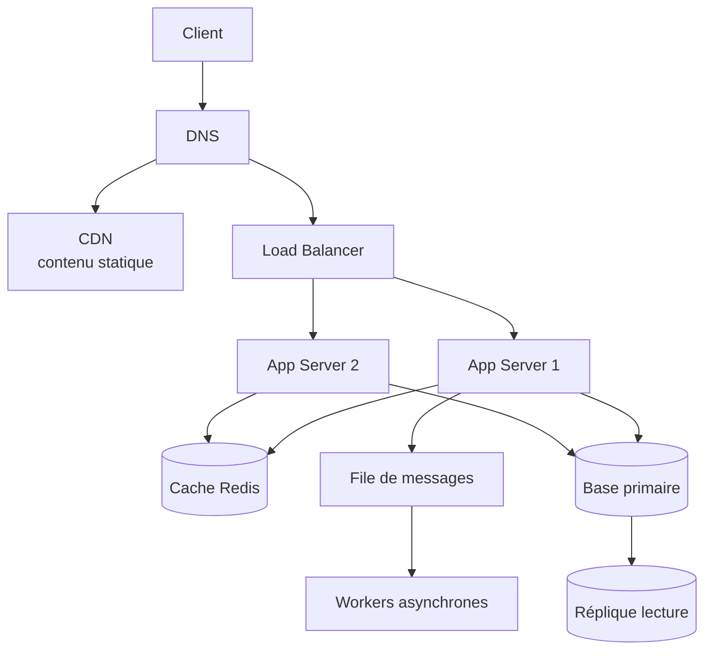

- **DNS** : traduit un nom de domaine en adresse IP.
- **CDN** : réseau de serveurs géographiquement distribués qui cachent le contenu statique au plus près de l'utilisateur (réduit la latence).
- **Load Balancer** : répartit le trafic entre les serveurs applicatifs et retire les nœuds défaillants.
- **App Servers** : exécutent la logique métier (sans état de préférence, pour faciliter le scale out).
- **Cache** : stocke en mémoire les données fréquemment lues.
- **Base de données** : la source de vérité persistante.
- **File de messages** : découple les traitements lents du chemin de réponse synchrone.

### Algorithmes de répartition de charge

Un load balancer applique une stratégie pour choisir le serveur cible. L'algorithme **Round Robin** est le plus simple ; voici une implémentation Java thread-safe.

```java
import java.util.List;
import java.util.concurrent.atomic.AtomicInteger;

/**
 * Load balancer Round Robin : distribue les requêtes de façon cyclique
 * et équitable entre les serveurs disponibles.
 */
public class RoundRobinLoadBalancer {

    private final List<String> servers;
    // AtomicInteger garantit l'incrémentation atomique en environnement multi-thread
    private final AtomicInteger counter = new AtomicInteger(0);

    public RoundRobinLoadBalancer(List<String> servers) {
        if (servers == null || servers.isEmpty()) {
            throw new IllegalArgumentException("La liste des serveurs ne peut être vide");
        }
        this.servers = servers;
    }

    /**
     * Renvoie le prochain serveur de façon cyclique.
     * getAndIncrement() lit puis incrémente atomiquement : aucun verrou nécessaire.
     */
    public String nextServer() {
        // On prend la valeur positive avant le modulo pour éviter un index négatif
        // lorsque le compteur dépasse Integer.MAX_VALUE et devient négatif.
        int index = Math.floorMod(counter.getAndIncrement(), servers.size());
        return servers.get(index);
    }
}
```

**Explication ligne à ligne :**
- `AtomicInteger` évite les conditions de course : deux threads simultanés ne recevront jamais le même index par erreur, sans avoir à poser un verrou explicite (plus performant).
- `getAndIncrement()` renvoie la valeur courante *puis* l'incrémente, en une seule opération atomique au niveau matériel.
- `Math.floorMod` est préférable à l'opérateur `%` car il renvoie toujours un résultat positif, ce qui protège contre l'overflow du compteur (`Integer.MAX_VALUE + 1` devient négatif).

---

## 5. Caching

Le cache stocke en mémoire vive les résultats coûteux à recalculer ou à relire depuis la base. C'est le levier de performance n°1.

### 5.1 Le pattern Cache-Aside (le plus courant)

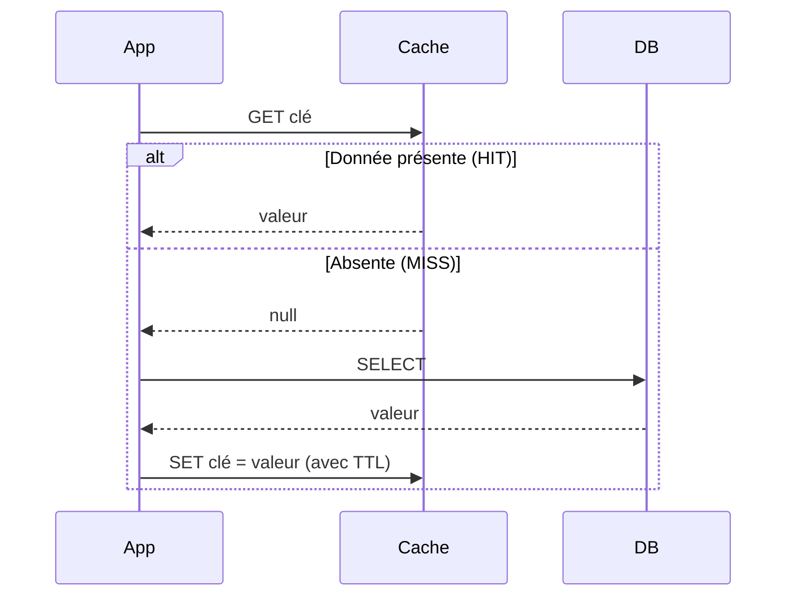

Dans ce pattern, l'application gère elle-même le cache : elle le lit d'abord, et ne va en base qu'en cas de défaut (MISS), en repeuplant le cache au passage.

### 5.2 Politiques d'éviction : implémenter un cache LRU

Quand le cache est plein, il faut décider quelle entrée supprimer. La stratégie **LRU (Least Recently Used)** évince l'élément le moins récemment utilisé. En Java, `LinkedHashMap` fournit nativement l'ordre d'accès, ce qui permet une implémentation élégante en O(1).

```java
import java.util.LinkedHashMap;
import java.util.Map;

/**
 * Cache LRU à capacité fixe.
 * Lecture et écriture en O(1) grâce à LinkedHashMap en mode "access order".
 */
public class LRUCache<K, V> extends LinkedHashMap<K, V> {

    private final int capacity;

    public LRUCache(int capacity) {
        // Paramètres : capacité initiale, facteur de charge,
        // et accessOrder = true → l'ordre suit les accès (get/put), pas les insertions.
        super(capacity, 0.75f, true);
        this.capacity = capacity;
    }

    /**
     * Méthode appelée automatiquement par LinkedHashMap après chaque insertion.
     * Si elle renvoie true, l'entrée la plus ancienne (eldest) est supprimée.
     */
    @Override
    protected boolean removeEldestEntry(Map.Entry<K, V> eldest) {
        return size() > capacity;
    }
}
```

**Exemple d'utilisation :**

```java
public class LRUDemo {
    public static void main(String[] args) {
        LRUCache<Integer, String> cache = new LRUCache<>(2); // capacité = 2

        cache.put(1, "A");
        cache.put(2, "B");
        cache.get(1);          // 1 redevient "récemment utilisé"
        cache.put(3, "C");     // capacité dépassée → on évince la clé 2 (la plus ancienne)

        System.out.println(cache.containsKey(2)); // false : 2 a été évincée
        System.out.println(cache.containsKey(1)); // true  : 1 a été préservée par le get()
    }
}
```

**Points clés :**
- Le constructeur avec `accessOrder = true` fait que tout `get` ou `put` déplace l'entrée en fin de liste (position « la plus récente »).
- `removeEldestEntry` est un *hook* : LinkedHashMap l'invoque après chaque insertion et supprime la tête de liste si l'on renvoie `true`.
- En production réelle, on utiliserait Redis ou Caffeine, mais comprendre ce mécanisme est essentiel pour les entretiens.

> ⚠️ Cette implémentation n'est **pas thread-safe**. Pour un usage concurrent, enveloppez-la dans `Collections.synchronizedMap` ou utilisez la bibliothèque **Caffeine**.

---

## 6. Bases de données

### 6.1 SQL vs NoSQL

| Critère | SQL (relationnel) | NoSQL |
|---------|-------------------|-------|
| Schéma | Fixe, rigide | Souple, dynamique |
| Transactions | ACID fortes | Souvent BASE (éventuelles) |
| Scalabilité | Plutôt verticale | Horizontale native |
| Cas d'usage | Données relationnelles, intégrité critique | Gros volumes, schéma évolutif, débit élevé |
| Exemples | PostgreSQL, MySQL | Cassandra, MongoDB, DynamoDB |

### 6.2 Réplication

La réplication copie les données sur plusieurs nœuds. Le schéma **primaire-réplique** dirige les écritures vers un nœud primaire, qui propage les changements aux répliques en lecture seule. Cela répartit la charge de lecture et fournit de la redondance.

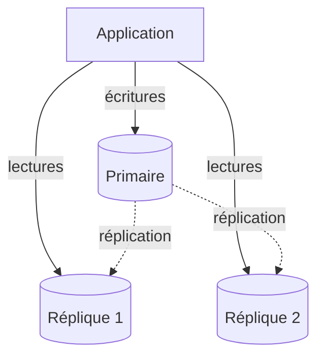

Compromis : la réplication asynchrone introduit un **lag** (les répliques peuvent être en retard), donc une lecture immédiatement après une écriture peut renvoyer une valeur périmée → cohérence éventuelle.

### 6.3 Sharding (partitionnement horizontal)

Quand une seule base ne suffit plus, on découpe les données en **shards** répartis sur plusieurs machines. Chaque shard contient un sous-ensemble des données, déterminé par une **clé de partition**.

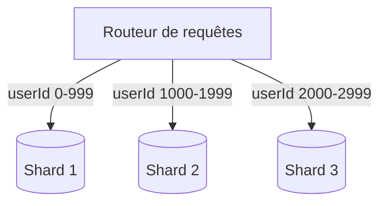

Le **hachage cohérent (consistent hashing)** est la technique de référence pour répartir les clés tout en minimisant les déplacements de données lors de l'ajout ou du retrait d'un nœud. Voici une implémentation pédagogique.

```java
import java.util.SortedMap;
import java.util.TreeMap;
import java.security.MessageDigest;
import java.nio.charset.StandardCharsets;

/**
 * Hachage cohérent avec nœuds virtuels (virtual nodes) pour répartir
 * uniformément les clés sur un anneau de hachage.
 */
public class ConsistentHashing {

    // L'anneau : associe une position de hachage → nom du nœud physique.
    private final SortedMap<Long, String> ring = new TreeMap<>();
    // Nombre de nœuds virtuels par nœud physique (lisse la distribution).
    private final int virtualNodes;

    public ConsistentHashing(int virtualNodes) {
        this.virtualNodes = virtualNodes;
    }

    /** Ajoute un nœud physique sous forme de plusieurs points sur l'anneau. */
    public void addNode(String node) {
        for (int i = 0; i < virtualNodes; i++) {
            ring.put(hash(node + "#" + i), node);
        }
    }

    /** Retire toutes les positions virtuelles d'un nœud physique. */
    public void removeNode(String node) {
        for (int i = 0; i < virtualNodes; i++) {
            ring.remove(hash(node + "#" + i));
        }
    }

    /**
     * Trouve le nœud responsable d'une clé : on cherche le premier point
     * de l'anneau situé dans le sens horaire après le hachage de la clé.
     */
    public String getNode(String key) {
        if (ring.isEmpty()) {
            return null;
        }
        long h = hash(key);
        // tailMap renvoie les positions >= h (sens horaire).
        SortedMap<Long, String> tail = ring.tailMap(h);
        // Si on dépasse la fin de l'anneau, on revient au début (anneau circulaire).
        Long target = tail.isEmpty() ? ring.firstKey() : tail.firstKey();
        return ring.get(target);
    }

    /** Fonction de hachage MD5 réduite à un long (suffisant pour l'exemple). */
    private long hash(String input) {
        try {
            MessageDigest md = MessageDigest.getInstance("MD5");
            byte[] digest = md.digest(input.getBytes(StandardCharsets.UTF_8));
            long h = 0;
            for (int i = 0; i < 8; i++) {
                h = (h << 8) | (digest[i] & 0xFF);
            }
            return h & 0x7FFFFFFFFFFFFFFFL; // force une valeur positive
        } catch (Exception e) {
            throw new RuntimeException(e);
        }
    }
}
```

**Pourquoi le hachage cohérent ?** Avec un simple `hash(key) % N`, changer `N` (ajout/retrait de serveur) re-mappe *presque toutes* les clés. Avec le hachage cohérent, seules les clés voisines du nœud modifié bougent (environ `1/N` des données), ce qui est crucial pour limiter les rééquilibrages massifs. Les **nœuds virtuels** corrigent les déséquilibres en distribuant chaque serveur physique sur de nombreux points de l'anneau.

---

## 7. Files de messages

Une file de messages (Kafka, RabbitMQ, SQS) **découple** producteurs et consommateurs. Le producteur dépose un message et n'attend pas ; le consommateur le traite à son rythme. Cela absorbe les pics de charge et améliore la résilience.

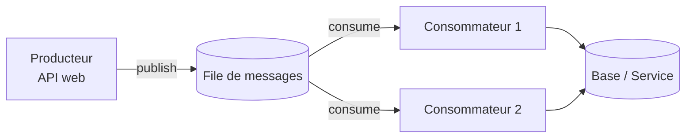

Cas typique : à l'inscription d'un utilisateur, l'API répond immédiatement « 200 OK » et publie un message « envoyer l'e-mail de bienvenue ». Un worker consomme ce message en arrière-plan. L'utilisateur n'attend pas l'envoi de l'e-mail.

**Garanties de livraison** à connaître :
- *At-most-once* : 0 ou 1 livraison (perte possible).
- *At-least-once* : 1 ou plus (doublons possibles → exiger l'idempotence côté consommateur).
- *Exactly-once* : exactement 1 (coûteux, souvent simulé par at-least-once + idempotence).

---

## 8. Monolithe vs microservices

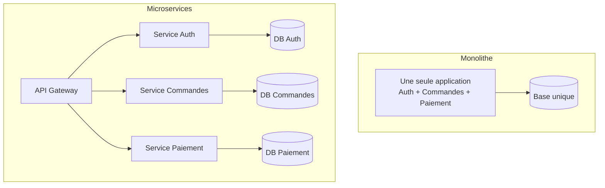

| Aspect | Monolithe | Microservices |
|--------|-----------|---------------|
| Démarrage projet | Rapide, simple | Lourd à mettre en place |
| Déploiement | Tout-ou-rien | Indépendant par service |
| Scalabilité | Globale | Ciblée par service |
| Complexité opérationnelle | Faible | Élevée (réseau, observabilité) |
| Cohérence des données | Transactions locales faciles | Transactions distribuées (saga) difficiles |

> **Conseil** : commencez monolithe, découpez en microservices uniquement quand la taille de l'équipe et la charge le justifient. Le découpage prématuré est une erreur fréquente.

---

## 9. Patterns de résilience

### 9.1 Rate limiting (Token Bucket)

Le **rate limiting** protège un service contre la surcharge ou les abus. L'algorithme **Token Bucket** autorise des rafales contrôlées : un seau se remplit de jetons à débit constant ; chaque requête consomme un jeton.

```java
/**
 * Limiteur de débit Token Bucket, thread-safe.
 * Autorise un débit moyen "refillRate" jetons/seconde,
 * avec des rafales jusqu'à "capacity" jetons.
 */
public class TokenBucketRateLimiter {

    private final long capacity;       // taille max du seau (rafale autorisée)
    private final double refillRate;   // jetons ajoutés par seconde
    private double tokens;             // jetons actuellement disponibles
    private long lastRefillTimestamp;  // dernier instant de recharge (en ns)

    public TokenBucketRateLimiter(long capacity, double refillRatePerSecond) {
        this.capacity = capacity;
        this.refillRate = refillRatePerSecond;
        this.tokens = capacity;        // le seau démarre plein
        this.lastRefillTimestamp = System.nanoTime();
    }

    /**
     * Tente de consommer un jeton.
     * @return true si la requête est autorisée, false si elle est bridée.
     */
    public synchronized boolean tryAcquire() {
        refill(); // on recharge d'abord en fonction du temps écoulé
        if (tokens >= 1) {
            tokens -= 1;
            return true;
        }
        return false;
    }

    /** Ajoute les jetons accumulés depuis le dernier appel, sans dépasser la capacité. */
    private void refill() {
        long now = System.nanoTime();
        double elapsedSeconds = (now - lastRefillTimestamp) / 1_000_000_000.0;
        double tokensToAdd = elapsedSeconds * refillRate;
        if (tokensToAdd > 0) {
            tokens = Math.min(capacity, tokens + tokensToAdd);
            lastRefillTimestamp = now;
        }
    }
}
```

**Explication :**
- Le seau se recharge **paresseusement** : on ne lance pas de tâche périodique, on calcule les jetons gagnés à chaque appel grâce au temps écoulé (`refill`). C'est efficace et précis.
- `capacity` borne la rafale : même après une longue inactivité, on ne peut pas accumuler plus de `capacity` jetons.
- `synchronized` rend la méthode thread-safe ; pour un débit très élevé, on remplacerait ce verrou par des primitives atomiques.

### 9.2 Circuit Breaker

Le **disjoncteur (circuit breaker)** empêche un service de marteler une dépendance défaillante. Il a trois états :

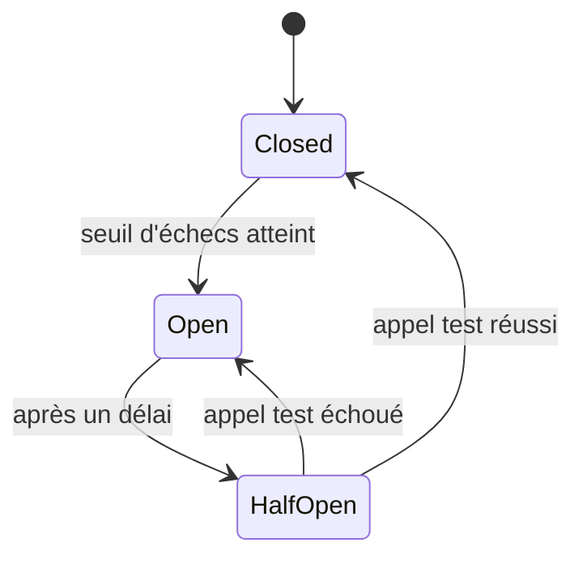

- **Closed** : tout passe ; on compte les échecs.
- **Open** : on rejette immédiatement les appels (fail fast) pendant un délai, laissant la dépendance se rétablir.
- **Half-Open** : on laisse passer un appel test ; selon son résultat, on referme ou on rouvre le circuit.

En production Java, on utilise **Resilience4j** plutôt que de réimplémenter ce mécanisme.

### 9.3 Idempotence

Une opération est **idempotente** si l'exécuter plusieurs fois produit le même résultat qu'une seule fois. C'est indispensable avec les files *at-least-once* et les retries réseau. On l'obtient typiquement avec une **clé d'idempotence** : le client envoie un identifiant unique par opération, et le serveur ignore les requêtes déjà traitées.

---

## 10. Méthodologie

Face à un exercice de system design (entretien ou projet réel), suivez cette démarche en 6 étapes :

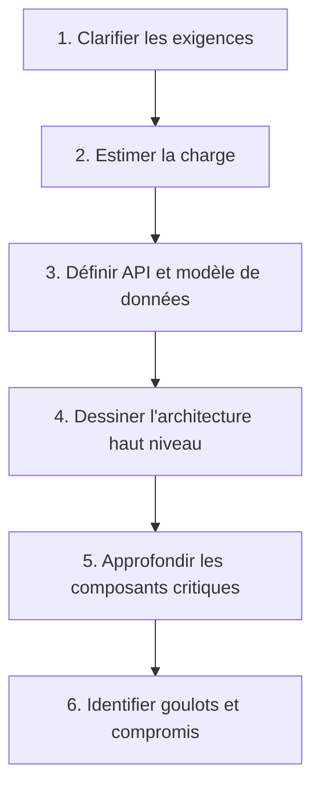

1. **Clarifier** : exigences fonctionnelles (ce que le système fait) et non fonctionnelles (latence, disponibilité, échelle). Ne supposez rien — posez des questions.
2. **Estimer** : nombre d'utilisateurs, requêtes/seconde, volume de stockage, bande passante. Ces ordres de grandeur dictent l'architecture.
3. **API et données** : définissez les endpoints et le schéma. C'est le contrat du système.
4. **Architecture HLD** : placez load balancer, services, caches, bases, files.
5. **Approfondir** : zoomez sur 1 ou 2 composants délicats (le sharding, le cache, la cohérence...).
6. **Compromis** : nommez explicitement ce que vous sacrifiez et pourquoi.

---

## 11. Étude de cas : raccourcisseur d'URL

Concevons un service type TinyURL/Bitly : transformer une longue URL en code court, et rediriger.

### 11.1 Exigences

- **Fonctionnelles** : créer un code court depuis une URL longue ; rediriger un code court vers l'URL d'origine.
- **Non fonctionnelles** : lectures (redirections) très majoritaires vs écritures (~100:1) ; latence faible ; haute disponibilité.

### 11.2 Estimation de charge (ordre de grandeur)

- 100 millions de nouvelles URL/mois → ~40 écritures/s en moyenne.
- Ratio lecture/écriture de 100:1 → ~4 000 lectures/s.
- Sur 5 ans : ~6 milliards d'URL → il faut un espace de codes suffisant.

Avec un alphabet **base62** (`a-z`, `A-Z`, `0-9`), un code de **7 caractères** offre 62⁷ ≈ 3 500 milliards de combinaisons : largement assez.

### 11.3 Modèle de données

| Colonne | Type | Description |
|---------|------|-------------|
| `id` | BIGINT (PK) | Identifiant numérique auto-incrémenté |
| `short_code` | VARCHAR(7) | Code base62 (indexé, unique) |
| `long_url` | TEXT | URL d'origine |
| `created_at` | TIMESTAMP | Date de création |

### 11.4 API

```
POST /api/v1/shorten
  Body : { "longUrl": "https://exemple.com/page/tres/longue" }
  → 201 { "shortUrl": "https://sho.rt/aB3xK9z" }

GET /{shortCode}
  → 301 Redirect vers longUrl
```

### 11.5 Architecture

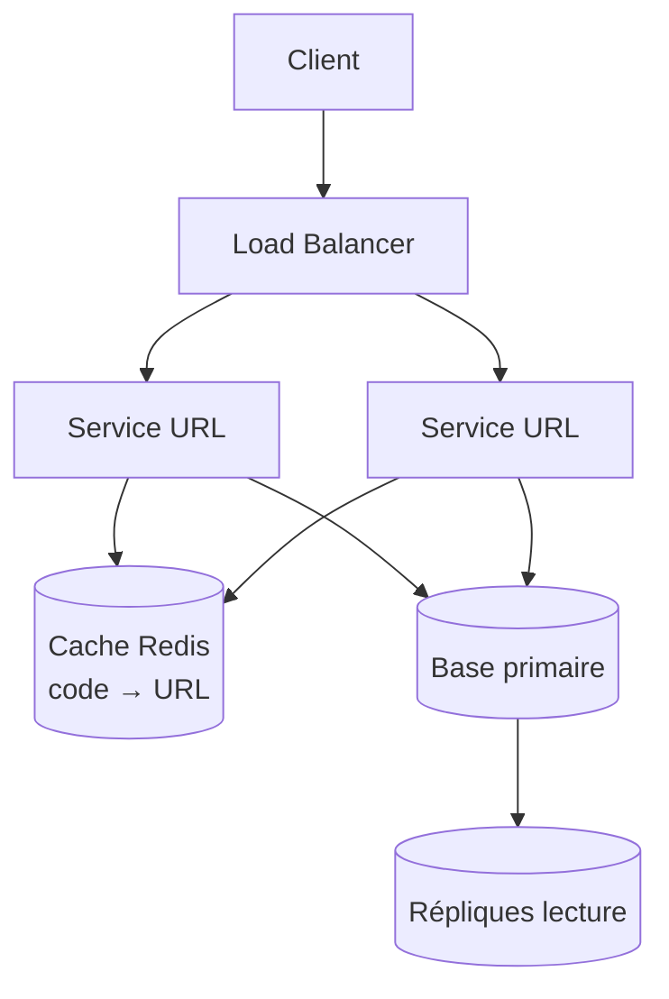

Le flux de lecture vérifie d'abord Redis (la majorité des redirections sont des HIT cache), évitant la base dans la quasi-totalité des cas.

### 11.6 Cœur de l'implémentation : encodage base62

La stratégie la plus robuste évite les collisions : on génère un `id` numérique unique (auto-incrément ou générateur distribué type Snowflake), puis on l'encode en base62. Pas de hachage, donc **zéro collision** par construction.

```java
/**
 * Encodeur/décodeur Base62 : convertit un identifiant numérique (long)
 * en code court alphanumérique, et inversement.
 */
public class Base62Encoder {

    private static final String ALPHABET =
        "0123456789abcdefghijklmnopqrstuvwxyzABCDEFGHIJKLMNOPQRSTUVWXYZ";
    private static final int BASE = ALPHABET.length(); // 62

    /** Encode un identifiant numérique en chaîne base62. */
    public static String encode(long id) {
        if (id == 0) {
            return String.valueOf(ALPHABET.charAt(0));
        }
        StringBuilder sb = new StringBuilder();
        while (id > 0) {
            int remainder = (int) (id % BASE);   // chiffre courant en base 62
            sb.append(ALPHABET.charAt(remainder));
            id /= BASE;                          // on passe au "chiffre" suivant
        }
        // Les restes sont calculés du moins au plus significatif : on inverse.
        return sb.reverse().toString();
    }

    /** Décode une chaîne base62 vers son identifiant numérique. */
    public static long decode(String code) {
        long id = 0;
        for (char c : code.toCharArray()) {
            int value = ALPHABET.indexOf(c);
            if (value == -1) {
                throw new IllegalArgumentException("Caractère invalide : " + c);
            }
            id = id * BASE + value; // schéma de Horner : reconstruit le nombre
        }
        return id;
    }
}
```

**Explication :**
- `encode` applique des divisions euclidiennes successives par 62. Chaque reste donne un caractère, du moins significatif au plus significatif ; d'où le `reverse()` final.
- `decode` applique le **schéma de Horner** : pour chaque caractère, on multiplie l'accumulateur par 62 puis on ajoute la valeur du chiffre. C'est l'inverse exact de l'encodage.
- Comme chaque `id` est unique et que la conversion est bijective, **deux URL différentes ne peuvent jamais produire le même code**.

### 11.7 Service applicatif

```java
import java.util.Optional;

/**
 * Service de raccourcissement d'URL appliquant le pattern cache-aside.
 * Les dépendances (repository, cache) sont des interfaces injectées,
 * ce qui facilite les tests et le découplage.
 */
public class UrlShortenerService {

    private final UrlRepository repository; // accès base (id auto-incrémenté)
    private final UrlCache cache;           // cache type Redis (code → URL)
    private final String domain;            // ex. "https://sho.rt/"

    public UrlShortenerService(UrlRepository repository, UrlCache cache, String domain) {
        this.repository = repository;
        this.cache = cache;
        this.domain = domain;
    }

    /** Crée un code court pour une URL longue. */
    public String shorten(String longUrl) {
        validate(longUrl);
        // 1. La base attribue un id numérique unique (auto-incrément).
        long id = repository.save(longUrl);
        // 2. On encode cet id en code court base62.
        String code = Base62Encoder.encode(id);
        // 3. On peuple le cache de façon proactive (write-through léger).
        cache.put(code, longUrl);
        return domain + code;
    }

    /** Résout un code court vers l'URL d'origine (pattern cache-aside). */
    public Optional<String> resolve(String code) {
        // 1. On tente le cache d'abord (cas le plus fréquent → faible latence).
        String cached = cache.get(code);
        if (cached != null) {
            return Optional.of(cached);
        }
        // 2. MISS : on décode l'id et on lit la base.
        long id = Base62Encoder.decode(code);
        Optional<String> longUrl = repository.findById(id);
        // 3. On repeuple le cache pour les prochaines requêtes.
        longUrl.ifPresent(url -> cache.put(code, url));
        return longUrl;
    }

    private void validate(String url) {
        if (url == null || url.isBlank() || !url.startsWith("http")) {
            throw new IllegalArgumentException("URL invalide : " + url);
        }
    }
}

/** Contrats (interfaces) des dépendances — implémentées par l'infrastructure. */
interface UrlRepository {
    long save(String longUrl);             // renvoie l'id généré
    Optional<String> findById(long id);
}

interface UrlCache {
    String get(String code);
    void put(String code, String longUrl);
}
```

**Ce que ce design illustre :**
- **Cache-aside** sur la lecture : on évite la base pour la quasi-totalité des redirections.
- **Injection de dépendances** par interfaces : `UrlShortenerService` ne sait pas si la base est PostgreSQL ni si le cache est Redis. On peut tout substituer en test.
- **Pas de collision** : l'unicité vient de l'`id` de la base, pas d'un hachage probabiliste.
- **Évolutivité** : pour répartir la génération d'id sur plusieurs nœuds sans base centralisée, on remplacerait l'auto-incrément par un générateur distribué (algorithme **Snowflake**).

---

## 12. Checklist finale

Avant de considérer un design comme abouti, vérifiez :

- [ ] **Exigences** clarifiées (fonctionnelles ET non fonctionnelles).
- [ ] **Charge estimée** : req/s, stockage, bande passante.
- [ ] **Pas de point unique de défaillance** : redondance à chaque couche.
- [ ] **Stratégie de cache** définie (pattern, TTL, éviction).
- [ ] **Choix de base** justifié (SQL/NoSQL) avec réplication et/ou sharding si nécessaire.
- [ ] **Traitements lourds** déportés en asynchrone via file de messages.
- [ ] **Résilience** : rate limiting, circuit breaker, idempotence, retries.
- [ ] **Compromis assumés** : la position CAP, la cohérence acceptée, les limites connues.
- [ ] **Observabilité** : logs, métriques, traces, alertes.

> Le system design n'est pas une recette mais un raisonnement. Justifiez chaque choix par une contrainte, mesurez, identifiez le goulot, itérez.
