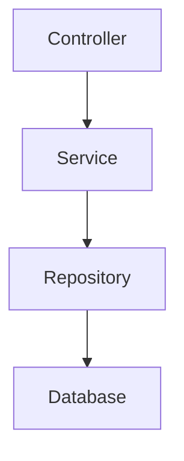
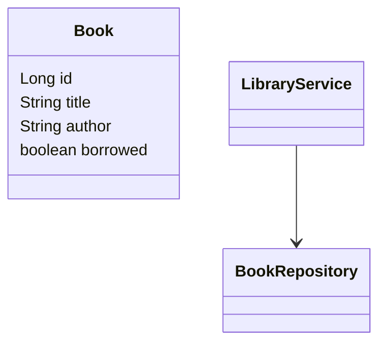
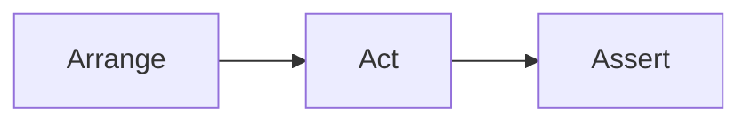
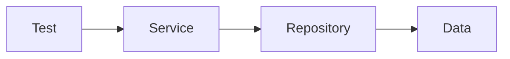
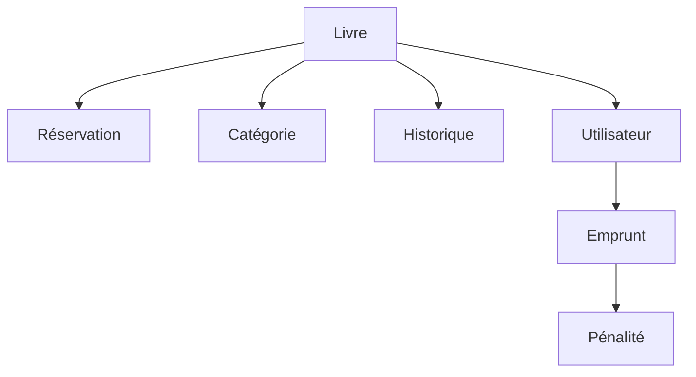

# Tutoriel Complet : Les Tests en Java avec JUnit 5, Mockito et Tests d’Intégration

## Objectif du tutoriel

Dans ce guide, nous allons construire **un projet complet de gestion de bibliothèque** et apprendre à tester chaque couche de l'application :

* Tests unitaires
* Tests paramétrés
* Tests d'exceptions
* Tests avec mocks (Mockito)
* Tests d'intégration
* Couverture de code
* Bonnes pratiques
* Organisation professionnelle des tests

Le projet servira de **fil rouge** du début à la fin.

---

# 1. Pourquoi tester ?

Un test vérifie automatiquement qu'un comportement fonctionne comme prévu.

Exemple :

```java
public int addition(int a, int b) {
    return a + b;
}
```

Test associé :

```java
@Test
void doitAdditionnerDeuxNombres() {
    Calculatrice calculatrice = new Calculatrice();

    int resultat = calculatrice.addition(2, 3);

    assertEquals(5, resultat);
}
```

Le test garantit que :

* 2 + 3 = 5
* une régression sera détectée immédiatement

---

# 2. Présentation du projet fil rouge

Nous allons développer une API de bibliothèque.

Fonctionnalités :

* ajouter un livre
* emprunter un livre
* retourner un livre
* rechercher un livre

---

## Architecture



---

## Modèle métier



---

# 3. Création du projet Maven

## pom.xml

```xml
<dependencies>

    <dependency>
        <groupId>org.junit.jupiter</groupId>
        <artifactId>junit-jupiter</artifactId>
        <version>5.12.0</version>
        <scope>test</scope>
    </dependency>

    <dependency>
        <groupId>org.mockito</groupId>
        <artifactId>mockito-core</artifactId>
        <version>5.18.0</version>
        <scope>test</scope>
    </dependency>

    <dependency>
        <groupId>org.mockito</groupId>
        <artifactId>mockito-junit-jupiter</artifactId>
        <version>5.18.0</version>
        <scope>test</scope>
    </dependency>

</dependencies>
```

---

# 4. Structure du projet

```text
src
├── main
│   └── java
│       ├── model
│       ├── repository
│       └── service
│
└── test
    └── java
        ├── service
        └── repository
```

---

# 5. Création du modèle Book

```java
public class Book {

    private Long id;
    private String title;
    private String author;
    private boolean borrowed;

    public Book(Long id,
                String title,
                String author,
                boolean borrowed) {
        this.id = id;
        this.title = title;
        this.author = author;
        this.borrowed = borrowed;
    }

    public Long getId() {
        return id;
    }

    public String getTitle() {
        return title;
    }

    public String getAuthor() {
        return author;
    }

    public boolean isBorrowed() {
        return borrowed;
    }

    public void setBorrowed(boolean borrowed) {
        this.borrowed = borrowed;
    }
}
```

---

# 6. Création du Repository

Pour simplifier nous utiliserons une Map.

```java
public class BookRepository {

    private final Map<Long, Book> books = new HashMap<>();

    public void save(Book book) {
        books.put(book.getId(), book);
    }

    public Optional<Book> findById(Long id) {
        return Optional.ofNullable(books.get(id));
    }
}
```

---

# 7. Création du Service

```java
public class LibraryService {

    private final BookRepository repository;

    public LibraryService(BookRepository repository) {
        this.repository = repository;
    }

    public void borrowBook(Long id) {

        Book book = repository.findById(id)
                .orElseThrow(() ->
                        new IllegalArgumentException("Book not found"));

        if (book.isBorrowed()) {
            throw new IllegalStateException("Already borrowed");
        }

        book.setBorrowed(true);
    }
}
```

---

# 8. Premier test unitaire

Créons notre premier test.

```java
class LibraryServiceTest {

    @Test
    void doitEmprunterUnLivreDisponible() {

        BookRepository repository = new BookRepository();

        Book book = new Book(
                1L,
                "Clean Code",
                "Robert Martin",
                false
        );

        repository.save(book);

        LibraryService service =
                new LibraryService(repository);

        service.borrowBook(1L);

        assertTrue(book.isBorrowed());
    }
}
```

---

# 9. Anatomie d'un test

Un test suit généralement le modèle AAA.



---

## Arrange

Préparer les données.

```java
Book book = new Book(...);
```

---

## Act

Exécuter l'action.

```java
service.borrowBook(1L);
```

---

## Assert

Vérifier le résultat.

```java
assertTrue(book.isBorrowed());
```

---

# 10. Les assertions principales

## assertEquals

```java
assertEquals(5, resultat);
```

---

## assertTrue

```java
assertTrue(book.isBorrowed());
```

---

## assertFalse

```java
assertFalse(book.isBorrowed());
```

---

## assertNull

```java
assertNull(value);
```

---

## assertNotNull

```java
assertNotNull(book);
```

---

## assertAll

```java
assertAll(
    () -> assertEquals(1L, book.getId()),
    () -> assertEquals("Clean Code", book.getTitle()),
    () -> assertFalse(book.isBorrowed())
);
```

---

# 11. Tester les exceptions

Le service doit lancer une exception si le livre n'existe pas.

Code :

```java
service.borrowBook(999L);
```

Test :

```java
@Test
void doitLeverUneExceptionSiLivreIntrouvable() {

    BookRepository repository = new BookRepository();

    LibraryService service =
            new LibraryService(repository);

    assertThrows(
            IllegalArgumentException.class,
            () -> service.borrowBook(999L)
    );
}
```

---

## Vérifier le message

```java
@Test
void doitVerifierLeMessageException() {

    IllegalArgumentException exception =
            assertThrows(
                    IllegalArgumentException.class,
                    () -> service.borrowBook(99L)
            );

    assertEquals(
            "Book not found",
            exception.getMessage()
    );
}
```

---

# 12. Introduction aux Mocks

Le service dépend du repository.

```java
LibraryService
      |
      V
BookRepository
```

Lors d'un test unitaire pur :

* on ne veut pas tester le repository
* on veut isoler le service

C'est le rôle des mocks.

---

# 13. Mockito

## Création d'un mock

```java
BookRepository repository =
        Mockito.mock(BookRepository.class);
```

---

## Avec annotations

```java
@ExtendWith(MockitoExtension.class)
class LibraryServiceTest {
}
```

---

# 14. Injection automatique

```java
@Mock
private BookRepository repository;

@InjectMocks
private LibraryService service;
```

Mockito crée automatiquement :

```java
service =
   new LibraryService(repository);
```

---

# 15. Simuler un comportement

```java
when(repository.findById(1L))
        .thenReturn(
            Optional.of(book)
        );
```

---

# 16. Test avec Mock

```java
@ExtendWith(MockitoExtension.class)
class LibraryServiceTest {

    @Mock
    BookRepository repository;

    @InjectMocks
    LibraryService service;

    @Test
    void doitEmprunterLivreDisponible() {

        Book book =
                new Book(
                        1L,
                        "Clean Code",
                        "Robert Martin",
                        false
                );

        when(repository.findById(1L))
                .thenReturn(Optional.of(book));

        service.borrowBook(1L);

        assertTrue(book.isBorrowed());
    }
}
```

---

# 17. Vérifier les interactions

Mockito peut vérifier qu'une méthode a été appelée.

```java
verify(repository)
        .findById(1L);
```

---

Test complet :

```java
service.borrowBook(1L);

verify(repository).findById(1L);
```

---

# 18. Vérifier le nombre d'appels

```java
verify(repository, times(1))
        .findById(1L);
```

---

```java
verify(repository, never())
        .save(any());
```

---

# 19. Tester un scénario d'erreur

```java
@Test
void doitRefuserLivreDejaEmprunte() {

    Book book =
            new Book(
                    1L,
                    "DDD",
                    "Eric Evans",
                    true
            );

    when(repository.findById(1L))
            .thenReturn(Optional.of(book));

    assertThrows(
            IllegalStateException.class,
            () -> service.borrowBook(1L)
    );
}
```

---

# 20. Tests paramétrés

Éviter la duplication.

---

## Exemple

```java
@ParameterizedTest
@ValueSource(strings = {
        "Clean Code",
        "DDD",
        "Refactoring"
})
void titreNeDoitPasEtreVide(String title) {

    assertFalse(title.isBlank());
}
```

---

# 21. Tests paramétrés complexes

```java
@ParameterizedTest
@CsvSource({
    "10,true",
    "0,false",
    "-1,false"
})
void validationId(long id,
                  boolean attendu) {

    boolean valide = id > 0;

    assertEquals(attendu, valide);
}
```

---

# 22. Organisation des tests

Convention recommandée :

```java
@Test
void shouldBorrowAvailableBook() {
}
```

ou

```java
@Test
void doitEmprunterLivreDisponible() {
}
```

---

# 23. Nested Tests

Permet de grouper les scénarios.

```java
@Nested
class BorrowBook {

    @Test
    void shouldBorrowBook() {
    }

    @Test
    void shouldFailIfAlreadyBorrowed() {
    }
}
```

---

# 24. DisplayName

```java
@DisplayName("Emprunt d'un livre")
class BorrowBookTest {
}
```

---

```java
@Test
@DisplayName("Doit refuser un livre déjà emprunté")
void test() {
}
```

---

# 25. Test Repository

Créons un test réel.

```java
class BookRepositoryTest {

    @Test
    void doitSauvegarderLivre() {

        BookRepository repository =
                new BookRepository();

        Book book =
                new Book(
                        1L,
                        "Clean Code",
                        "Robert Martin",
                        false
                );

        repository.save(book);

        Optional<Book> result =
                repository.findById(1L);

        assertTrue(result.isPresent());
    }
}
```

---

# 26. Test d'intégration

Un test d'intégration vérifie plusieurs couches ensemble.



---

Exemple :

```java
class LibraryIntegrationTest {

    @Test
    void empruntComplet() {

        BookRepository repository =
                new BookRepository();

        LibraryService service =
                new LibraryService(repository);

        Book book =
                new Book(
                        1L,
                        "Clean Code",
                        "Robert Martin",
                        false
                );

        repository.save(book);

        service.borrowBook(1L);

        assertTrue(
                repository.findById(1L)
                          .get()
                          .isBorrowed()
        );
    }
}
```

---

# 27. Cycle de vie des tests

```java
@BeforeEach
void setup() {
}
```

Exécuté avant chaque test.

---

```java
@AfterEach
void cleanup() {
}
```

Exécuté après chaque test.

---

Exemple :

```java
@BeforeEach
void setup() {

    repository = new BookRepository();

    service =
        new LibraryService(repository);
}
```

---

# 28. Réduction de duplication

Avant :

```java
@Test
void test1() {

    BookRepository repository =
            new BookRepository();

    LibraryService service =
            new LibraryService(repository);
}
```

Après :

```java
@BeforeEach
void setup() {

    repository = new BookRepository();

    service =
            new LibraryService(repository);
}
```

---

# 29. Fake vs Mock vs Stub

## Stub

Retourne des valeurs prédéfinies.

```java
when(repo.findById(1L))
      .thenReturn(Optional.of(book));
```

---

## Mock

Permet également la vérification.

```java
verify(repo).findById(1L);
```

---

## Fake

Implémentation simplifiée.

```java
class FakeRepository
        extends BookRepository {
}
```

---

# 30. Couverture de code

Outil populaire :

```text
JaCoCo
```

Configuration Maven :

```xml
<plugin>
    <groupId>org.jacoco</groupId>
    <artifactId>jacoco-maven-plugin</artifactId>
</plugin>
```

---

Rapport :

```text
target/site/jacoco/index.html
```

---

# 31. Ce qu'il faut tester

Tester :

* règles métier
* calculs
* validations
* transformations

---

Exemple :

```java
if (book.isBorrowed()) {
    throw new IllegalStateException();
}
```

À tester absolument.

---

# 32. Ce qu'il ne faut pas tester excessivement

Éviter :

```java
public String getTitle() {
    return title;
}
```

Tester tous les getters/setters apporte peu de valeur.

---

# 33. Tests robustes

Mauvais :

```java
assertEquals(
    "Clean Code",
    service.findBook(1L).getTitle()
);
```

si le titre peut évoluer.

---

Meilleur :

```java
assertNotNull(
    service.findBook(1L)
);
```

ou

```java
assertEquals(
    1L,
    service.findBook(1L).getId()
);
```

selon le besoin métier.

---

# 34. Structure professionnelle finale

```text
src
├── main
│
├── test
│   ├── unit
│   │   ├── service
│   │   └── repository
│   │
│   └── integration
│       └── library
```

---

# 35. Exemple de suite de tests complète

```java
@ExtendWith(MockitoExtension.class)
class LibraryServiceTest {

    @Mock
    BookRepository repository;

    @InjectMocks
    LibraryService service;

    @Test
    void shouldBorrowAvailableBook() {

        Book book =
            new Book(
                1L,
                "Clean Code",
                "Robert Martin",
                false
            );

        when(repository.findById(1L))
                .thenReturn(Optional.of(book));

        service.borrowBook(1L);

        assertTrue(book.isBorrowed());

        verify(repository)
                .findById(1L);
    }

    @Test
    void shouldThrowWhenBookMissing() {

        when(repository.findById(1L))
                .thenReturn(Optional.empty());

        assertThrows(
                IllegalArgumentException.class,
                () -> service.borrowBook(1L)
        );
    }

    @Test
    void shouldThrowWhenAlreadyBorrowed() {

        Book book =
            new Book(
                1L,
                "DDD",
                "Eric Evans",
                true
            );

        when(repository.findById(1L))
                .thenReturn(Optional.of(book));

        assertThrows(
                IllegalStateException.class,
                () -> service.borrowBook(1L)
        );
    }
}
```

---

# 36. Récapitulatif

À la fin de ce tutoriel, vous savez :

✅ Écrire des tests avec JUnit 5

✅ Utiliser les assertions

✅ Tester les exceptions

✅ Utiliser Mockito

✅ Créer des mocks et des stubs

✅ Vérifier les interactions

✅ Réaliser des tests paramétrés

✅ Écrire des tests d'intégration

✅ Organiser un projet professionnel

✅ Mesurer la couverture de code avec JaCoCo

---

# 37. Évolution possible du projet

Pour continuer à progresser, vous pouvez enrichir la bibliothèque avec :



Puis ajouter :

* Spring Boot Test
* Testcontainers
* H2
* WireMock
* RestAssured
* Architecture Hexagonale
* TDD (Test Driven Development)
* Mutation Testing (PIT)
* Tests de performance avec JMH

Ces outils représentent le niveau de test attendu dans des applications Java professionnelles modernes.
