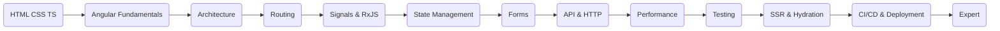
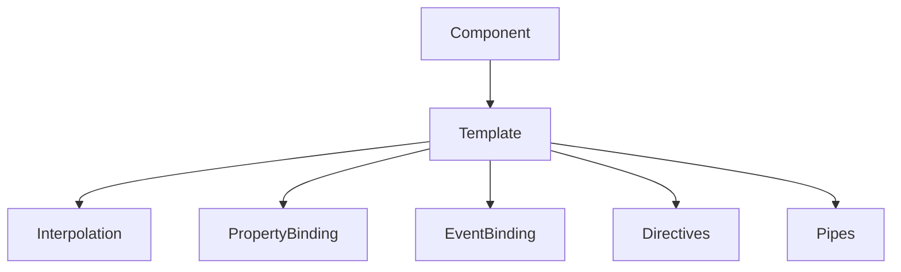
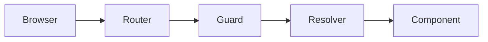
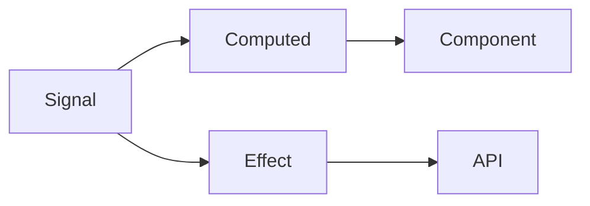
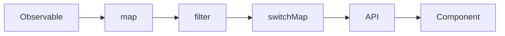
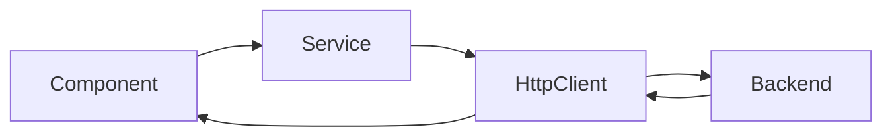
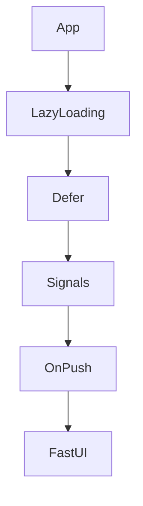
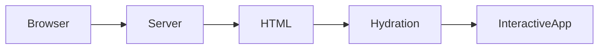
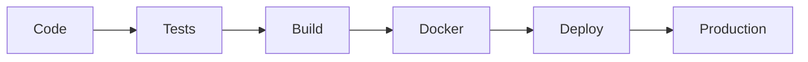
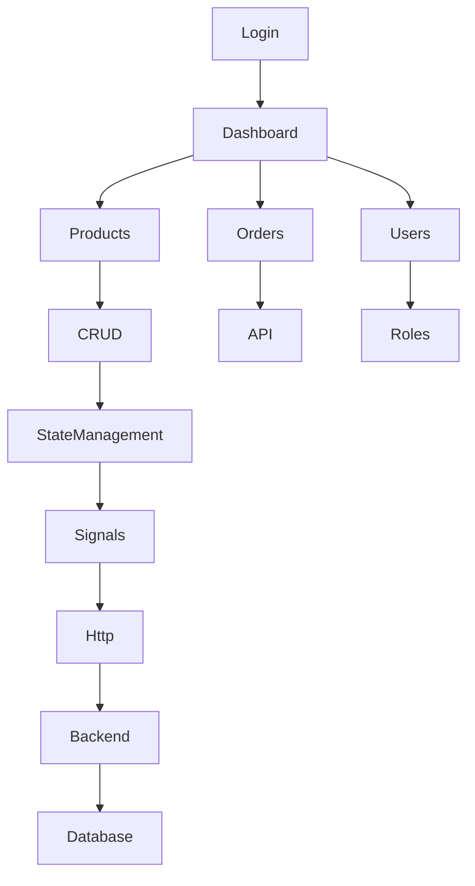

# ROADMAP DEVELOPPEUR ANGULAR 
youtube series :
- https://www.youtube.com/watch?v=vCeYU7dbfTU&list=PL8p2I9GklV46fsaD-oH-Av4Xu69B1UkKt&index=26
- https://www.youtube.com/watch?v=tiY9CL2YjgE&list=PLgYFT7gUQL8E6DmEySCcSdNvQlKVYfEd7&index=1

# Roadmap Angular 22 (2026)

Cette roadmap est pensée pour aller de **débutant à expert Angular 22**, avec un ordre d'apprentissage qui suit les besoins d'un projet réel.

---

# Vue d'ensemble



---

# Phase 0 — Les prérequis

Avant Angular il faut maîtriser :

* HTML5
* CSS3
* Flexbox
* Grid
* Responsive Design
* JavaScript ES2023+
* TypeScript

Objectifs :

* Classes
* Interfaces
* Generics
* Async / Await
* Promises
* Modules
* Decorators

Temps estimé :

**2 à 3 semaines**

---

# Phase 1 — Les fondamentaux Angular

À apprendre :

* Création d'un projet
* Angular CLI
* Structure d'un projet
* Components
* Templates
* Data Binding

  * Property Binding
  * Event Binding
  * Two-way Binding
* Directives
* Pipes

Exercice :

Créer une Todo List.

---

Diagramme



---

# Phase 2 — Architecture Angular

Comprendre :

* Standalone Components
* Feature Architecture
* Shared
* Core
* Layout
* Lazy Loading
* Dependency Injection
* Providers
* Injection Tokens

Architecture recommandée

```text
src/
 ├── core/
 ├── shared/
 ├── features/
 │      ├── auth/
 │      ├── users/
 │      ├── dashboard/
 │      └── products/
 ├── layouts/
 ├── assets/
 └── app.config.ts
```

---

# Phase 3 — Routing

Maîtriser :

* Routes
* Child Routes
* Lazy Loading
* Guards
* Resolve
* Route Data
* Route Params
* Query Params

Workflow



---

# Phase 4 — Signals (Angular 22)

C'est désormais le cœur du développement Angular moderne.

À apprendre :

* signal()
* computed()
* linkedSignal()
* effect()
* resources()
* input()
* output()
* model()

Comprendre :

* Réactivité
* Change Detection
* Zoneless Angular

Exercice :

Créer un panier e-commerce uniquement avec Signals.

---

Diagramme



---

# Phase 5 — RxJS

Même avec les Signals, RxJS reste indispensable.

À connaître :

* Observable
* Subject
* BehaviorSubject
* ReplaySubject
* Operators

Les plus utilisés :

* map
* filter
* switchMap
* mergeMap
* exhaustMap
* concatMap
* debounceTime
* distinctUntilChanged
* combineLatest
* forkJoin
* catchError

Diagramme



---

# Phase 6 — Les formulaires

Reactive Forms

À apprendre :

* FormGroup
* FormArray
* FormControl
* Validators
* Async Validators
* Dynamic Forms

Projet :

Créer un formulaire complexe avec validation.

---

# Phase 7 — HTTP

À connaître :

* HttpClient
* Interceptors
* Error Handling
* Retry
* Authentication
* Refresh Token
* Upload
* Download

Architecture



---

# Phase 8 — State Management

Petit projet :

Signals uniquement

Projet moyen :

Signal Store

Gros projet :

NgRx

À apprendre :

* Signal Store
* Store
* Actions
* Reducers
* Effects
* Selectors

---

# Phase 9 — Performance

Très important.

À maîtriser :

* OnPush
* Signals
* Lazy Loading
* Deferred Loading
* Virtual Scroll
* Track By
* Memoization
* Image Optimization

Workflow



---

# Phase 10 — Testing

Unit Testing

* Jasmine
* Karma (ou alternatives modernes selon le projet)
* Jest
* TestBed

E2E

* Playwright
* Cypress

Tester :

* Components
* Services
* Guards
* Pipes
* Directives

---

# Phase 11 — SSR

Angular 22 facilite énormément :

* Server Side Rendering
* Hydration
* Incremental Hydration
* SEO
* Prerender

Architecture



---

# Phase 12 — Build & Déploiement

CI/CD

* GitHub Actions
* Docker
* Nginx
* Azure
* AWS
* Firebase Hosting
* Vercel

Pipeline



---

# Phase 13 — Niveau Expert

Objectifs :

* Architecture hexagonale
* Clean Architecture
* Micro Frontends
* Module Federation
* Monorepo Nx
* Design System
* Storybook
* Angular Elements
* Web Components
* PWA
* Offline
* Web Workers
* IndexedDB
* Sécurité (CSP, XSS, CSRF)
* Accessibilité (WCAG)
* Internationalisation (i18n)

---

# Projet final



---

# Planning d'apprentissage (12 semaines)

| Semaine | Objectif                           |
| ------- | ---------------------------------- |
| 1       | HTML, CSS, TypeScript              |
| 2       | Fondamentaux Angular               |
| 3       | Components, Templates, Directives  |
| 4       | Routing, Services, DI              |
| 5       | Signals                            |
| 6       | RxJS                               |
| 7       | Forms                              |
| 8       | HTTP, API, Authentification        |
| 9       | State Management                   |
| 10      | Performance & Optimisation         |
| 11      | Testing                            |
| 12      | SSR, Déploiement et projet complet |

## Conseils pour Angular 22

* **Privilégiez les Standalone Components** : ils constituent désormais l'approche recommandée.
* **Utilisez les Signals** comme mécanisme de réactivité principal, et réservez **RxJS** aux flux asynchrones complexes (HTTP, WebSocket, événements, etc.).
* **Structurez vos applications par fonctionnalités (feature-first)** plutôt que par type de fichier.
* **Optimisez dès le départ** avec le lazy loading, le deferred loading et une gestion efficace de la détection de changements.
* **Automatisez** les tests et le déploiement via une chaîne CI/CD.
* **Construisez plusieurs projets complets** (tableau de bord, e-commerce, gestion de tâches, réseau social simplifié) pour consolider les concepts.

Cette progression couvre l'ensemble des compétences nécessaires pour développer des applications Angular 22 modernes, performantes et maintenables, depuis les bases jusqu'aux architectures d'entreprise.

