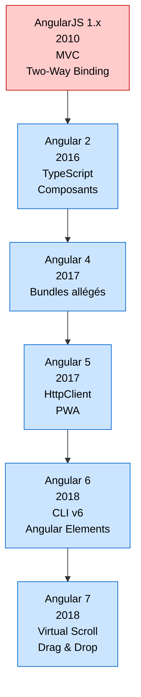
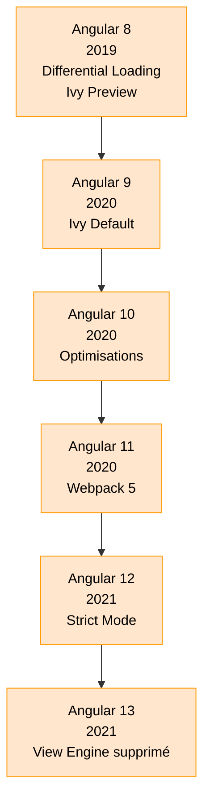
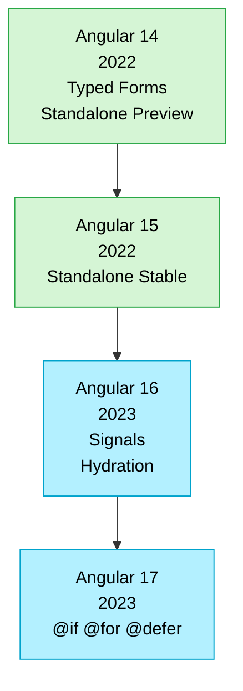
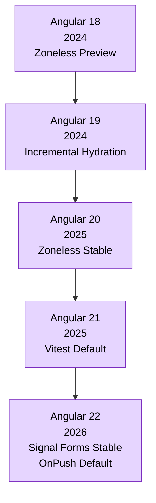
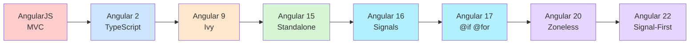
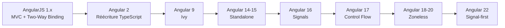

Voici un diagramme **Mermaid Timeline** retraçant l'évolution d'Angular depuis **AngularJS (v1)** jusqu'à **Angular 22**, avec les dates de sortie et les innovations majeures. Les dates récentes (v20 à v22) proviennent de la documentation officielle Angular. ([Angular][1])

```mermaid
timeline
    title Histoire d'Angular (2010 → 2026)

    2010 : AngularJS 1.0
         : Créé par Google
         : MVC
         : Two-way Data Binding
         : Dependency Injection

    2016 : Angular 2
         : Réécriture complète en TypeScript
         : Architecture composants
         : Mobile-first
         : RxJS

    2017 : Angular 4
         : Bundle plus léger
         : Améliorations AOT
         : Animations séparées

    2017 : Angular 5
         : HttpClient
         : Build Optimizer
         : Progressive Web Apps

    2018 : Angular 6
         : Angular CLI v6
         : Angular Elements
         : ng update

    2018 : Angular 7
         : Virtual Scrolling
         : CLI Prompts
         : Drag & Drop CDK

    2019 : Angular 8
         : Differential Loading
         : Ivy Preview
         : Web Workers

    2020 : Angular 9
         : Ivy par défaut
         : Compilation plus rapide
         : Bundle réduit

    2020 : Angular 10
         : TypeScript plus strict
         : Optimisations build
         : Meilleure compatibilité navigateur

    2020 : Angular 11
         : Webpack 5 preview
         : HMR amélioré
         : Build plus rapide

    2021 : Angular 12
         : Ivy partout
         : View Engine déprécié
         : Strict Mode

    2021 : Angular 13
         : Suppression View Engine
         : Ivy Only
         : Dynamic Components simplifiés

    2022 : Angular 14
         : Typed Forms
         : Standalone Components (preview)

    2022 : Angular 15
         : Standalone APIs stables
         : Directives standalone
         : Image directive

    2023 : Angular 16
         : Signals
         : Hydration SSR
         : DestroyRef
         : Required Inputs

    2023 : Angular 17
         : Built-in Control Flow (@if/@for)
         : Deferrable Views (@defer)
         : Nouveau branding angular.dev

    2024 : Angular 18
         : Zoneless (expérimental)
         : Material 3
         : Event Replay

    2024 : Angular 19
         : Incremental Hydration
         : Linked Signals
         : HMR amélioré

    2025 : Angular 20
         : Zoneless stable
         : Signal Forms (expérimental)

    2025 : Angular 21
         : Vitest par défaut
         : Signal Forms améliorés
         : Écosystème orienté IA

    2026 : Angular 22
         : Signal Forms stables
         : OnPush par défaut
         : Resources stables
         : Améliorations Signals
```

Oui, pour Mermaid il est souvent préférable de **découper la timeline en 4 périodes** et d'utiliser des **couleurs par génération technologique**. Cela reste lisible même dans Confluence, GitLab, GitHub ou Obsidian.

# Partie 1 — AngularJS → Angular 7 (Fondations)

---

# Partie 2 — Angular 8 → Angular 13 (Ère Ivy)

---

# Partie 3 — Angular 14 → Angular 17 (Révolution Standalone & Signals)

---

# Partie 4 — Angular 18 → Angular 22 (Architecture Signal-First)

---

# Vue d'ensemble (très lisible)

### Légende des couleurs

| Couleur   | Période                         |
| --------- | ------------------------------- |
| 🔴 Rouge  | AngularJS (1.x)                 |
| 🔵 Bleu   | Réécriture Angular moderne      |
| 🟠 Orange | Ère Ivy                         |
| 🟢 Vert   | Standalone Components           |
| 🔷 Cyan   | Signals & nouveau template      |
| 🟣 Violet | Angular Signal-First / Zoneless |

---

## Vue synthétique des grandes ruptures technologiques

---

## Les versions les plus marquantes

| Version     | Pourquoi elle est importante                       |
| ----------- | -------------------------------------------------- |
| AngularJS 1 | Naissance du framework SPA moderne                 |
| Angular 2   | Réécriture complète et rupture majeure             |
| Angular 9   | Ivy devient le moteur de rendu officiel            |
| Angular 14  | Typed Forms + début des Standalone Components      |
| Angular 15  | Fin progressive des NgModules                      |
| Angular 16  | Introduction des Signals                           |
| Angular 17  | Nouveau contrôle de flux (`@if`, `@for`, `@defer`) |
| Angular 20  | Zoneless stable                                    |
| Angular 22  | Architecture orientée Signals par défaut           |

Les versions 16 → 22 représentent probablement la plus grande transformation depuis Angular 2, avec la transition progressive d'un framework basé sur **Zone.js + RxJS** vers un framework **Signal-first, Zoneless et plus performant**. ([GrapesTech Solutions][2])

Si tu veux un diagramme **encore plus détaillé (type roadmap d'architecte avec les innovations Angular, TypeScript, RxJS, SSR, Standalone, Signals, Hydration, Zoneless, etc.)**, je peux te générer une version Mermaid de niveau conférence/formation.

[1]: https://angular.dev/reference/releases?utm_source=chatgpt.com "Versioning and releases • Angular"
[2]: https://www.grapestechsolutions.com/blog/angular-version-history/?utm_source=chatgpt.com "Angular Version History: Latest Angular Version 2026"
