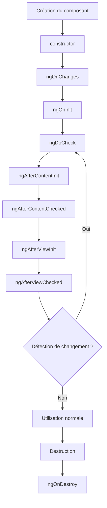
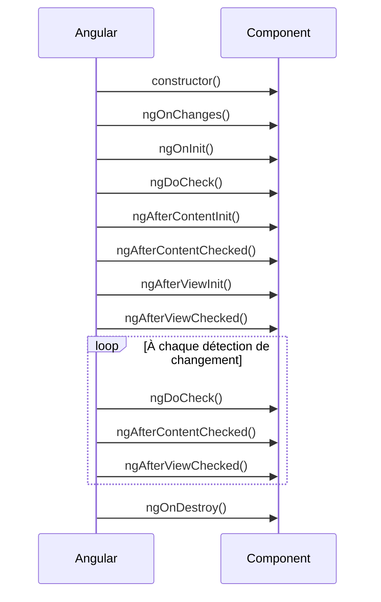

# Tutoriel complet : Le cycle de vie d'un composant Angular

Le **cycle de vie (Lifecycle)** d'un composant Angular représente les différentes étapes traversées par un composant, depuis sa création jusqu'à sa destruction.

Angular met à disposition plusieurs **hooks** (méthodes spéciales) qui permettent d'exécuter du code à des moments précis de cette vie.

---

# Vue d'ensemble

Voici le déroulement global.



---

# Ordre d'exécution

| Ordre | Hook                  | Nombre d'appels             |
| ----- | --------------------- | --------------------------- |
| 1     | constructor           | 1                           |
| 2     | ngOnChanges           | Plusieurs (si Input change) |
| 3     | ngOnInit              | 1                           |
| 4     | ngDoCheck             | Très souvent                |
| 5     | ngAfterContentInit    | 1                           |
| 6     | ngAfterContentChecked | Très souvent                |
| 7     | ngAfterViewInit       | 1                           |
| 8     | ngAfterViewChecked    | Très souvent                |
| 9     | ngOnDestroy           | 1                           |

---

# 1. constructor()

Le constructeur est appelé dès que l'objet est créé.

Il sert principalement à :

* injecter des dépendances (services)
* initialiser quelques variables simples

Exemple :

```typescript
constructor(private userService: UserService) {
  console.log("Constructor");
}
```

À éviter dans le constructeur :

* appels HTTP
* manipulation du DOM
* logique métier importante

Ces opérations sont mieux placées dans `ngOnInit()`.

---

# 2. ngOnChanges()

Ce hook est exécuté lorsqu'une propriété décorée avec `@Input()` change.

Exemple :

```typescript
@Input()
name!: string;

ngOnChanges(changes: SimpleChanges) {
    console.log(changes);
}
```

Si le parent modifie :

```html
<app-user [name]="username"></app-user>
```

Alors :

```
username = "Alice"
↓

ngOnChanges()

username = "Bob"
↓

ngOnChanges()
```

### Contenu de `changes`

```typescript
changes = {
  name: {
      previousValue: "Alice",
      currentValue: "Bob",
      firstChange: false
  }
}
```

---

# 3. ngOnInit()

C'est le hook le plus utilisé.

Il est exécuté une seule fois après l'initialisation du composant.

On y place généralement :

* appels API
* récupération de données
* initialisation métier
* abonnements (`subscribe()`)

Exemple :

```typescript
ngOnInit(): void {
    this.users = this.userService.getUsers();
}
```

---

# 4. ngDoCheck()

Angular exécute cette méthode à chaque cycle de détection des changements.

```typescript
ngDoCheck() {
    console.log("DoCheck");
}
```

Elle est utile lorsqu'on souhaite réaliser une détection personnalisée des modifications.

⚠️ Comme elle peut être appelée très fréquemment, évitez d'y placer des traitements coûteux.

---

# 5. ngAfterContentInit()

Le **Content** représente ce qui est projeté avec `<ng-content>`.

Exemple :

Parent :

```html
<app-card>
    Bonjour
</app-card>
```

Composant :

```html
<div class="card">
    <ng-content></ng-content>
</div>
```

Une fois le contenu projeté disponible :

```typescript
ngAfterContentInit() {
    console.log("Content prêt");
}
```

Ce hook est exécuté une seule fois.

---

# 6. ngAfterContentChecked()

Après chaque vérification du contenu projeté :

```typescript
ngAfterContentChecked() {
    console.log("Content Checked");
}
```

Il peut être appelé de nombreuses fois.

---

# 7. ngAfterViewInit()

La **View** correspond au template du composant.

Une fois que toute la vue est construite :

```typescript
ngAfterViewInit() {
    console.log("View prête");
}
```

C'est le bon endroit pour utiliser :

```typescript
@ViewChild()

@ViewChildren()
```

Exemple :

```typescript
@ViewChild('input')
input!: ElementRef;

ngAfterViewInit() {
    this.input.nativeElement.focus();
}
```

---

# 8. ngAfterViewChecked()

Après chaque vérification de la vue :

```typescript
ngAfterViewChecked() {
    console.log("View Checked");
}
```

Comme `ngDoCheck()`, ce hook peut être appelé très souvent.

---

# 9. ngOnDestroy()

Ce hook est exécuté juste avant la destruction du composant.

Il est indispensable pour nettoyer les ressources.

Exemple :

```typescript
subscription!: Subscription;

ngOnInit() {
    this.subscription = this.service.getData().subscribe();
}

ngOnDestroy() {
    this.subscription.unsubscribe();
}
```

On y ferme généralement :

* les abonnements RxJS
* les timers (`setInterval`)
* les écouteurs d'événements (`addEventListener`)
* les WebSockets

---

# Chronologie complète



---

# Exemple complet

```typescript
@Component({
  selector: 'app-demo',
  template: `<h1>Hello</h1>`
})
export class DemoComponent
implements
OnInit,
OnChanges,
DoCheck,
AfterContentInit,
AfterContentChecked,
AfterViewInit,
AfterViewChecked,
OnDestroy {

  constructor() {
    console.log("constructor");
  }

  ngOnChanges() {
    console.log("ngOnChanges");
  }

  ngOnInit() {
    console.log("ngOnInit");
  }

  ngDoCheck() {
    console.log("ngDoCheck");
  }

  ngAfterContentInit() {
    console.log("ngAfterContentInit");
  }

  ngAfterContentChecked() {
    console.log("ngAfterContentChecked");
  }

  ngAfterViewInit() {
    console.log("ngAfterViewInit");
  }

  ngAfterViewChecked() {
    console.log("ngAfterViewChecked");
  }

  ngOnDestroy() {
    console.log("ngOnDestroy");
  }
}
```

Console lors de la première création :

```text
constructor
ngOnChanges
ngOnInit
ngDoCheck
ngAfterContentInit
ngAfterContentChecked
ngAfterViewInit
ngAfterViewChecked
```

Puis, à chaque détection de changement :

```text
ngDoCheck
ngAfterContentChecked
ngAfterViewChecked
```

Enfin, lors de la destruction :

```text
ngOnDestroy
```

---

# Bonnes pratiques

| Hook                    | À faire                                                   | À éviter                                               |
| ----------------------- | --------------------------------------------------------- | ------------------------------------------------------ |
| `constructor`           | Injection de dépendances                                  | Appels HTTP, logique métier                            |
| `ngOnChanges`           | Réagir aux changements des `@Input()`                     | Calculs lourds                                         |
| `ngOnInit`              | Initialiser les données, lancer les appels API            | Manipuler le DOM                                       |
| `ngDoCheck`             | Détection personnalisée                                   | Traitements coûteux                                    |
| `ngAfterContentInit`    | Initialiser le contenu projeté                            | Modifications répétitives                              |
| `ngAfterContentChecked` | Vérifications légères                                     | Modifier des données (risque de boucle)                |
| `ngAfterViewInit`       | Accéder aux `@ViewChild`, manipuler le DOM                | Modifier des données liées au template sans précaution |
| `ngAfterViewChecked`    | Vérifications légères                                     | Calculs lourds ou modifications répétitives            |
| `ngOnDestroy`           | Libérer les ressources (`unsubscribe`, timers, écouteurs) | Oublier le nettoyage                                   |

---

# À retenir

* **`constructor`** : création de l'instance et injection des dépendances.
* **`ngOnChanges`** : déclenché à chaque changement d'un `@Input()`.
* **`ngOnInit`** : initialisation du composant (hook le plus courant).
* **`ngDoCheck`** : détection personnalisée des changements.
* **`ngAfterContentInit` / `ngAfterContentChecked`** : gestion du contenu projeté (`<ng-content>`).
* **`ngAfterViewInit` / `ngAfterViewChecked`** : gestion de la vue et des `@ViewChild`.
* **`ngOnDestroy`** : nettoyage des ressources avant la destruction du composant.

En pratique, dans la majorité des composants Angular, les hooks les plus utilisés sont **`ngOnInit`**, **`ngOnChanges`**, **`ngAfterViewInit`** et **`ngOnDestroy`**. Les autres interviennent surtout dans des cas avancés liés à la détection des changements, à la projection de contenu ou à la manipulation fine de la vue.
