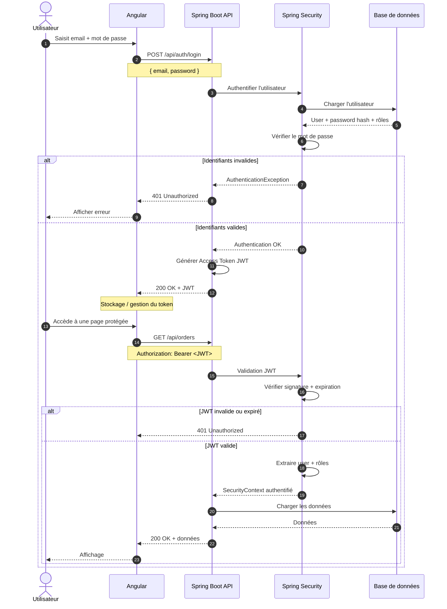
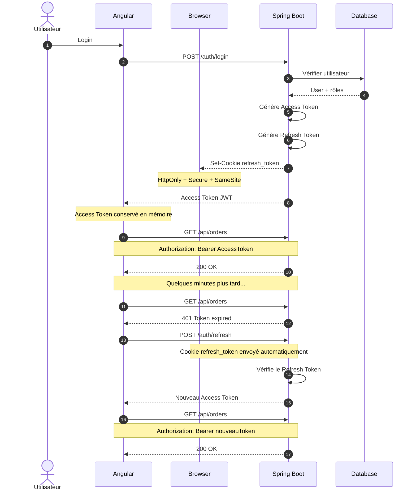
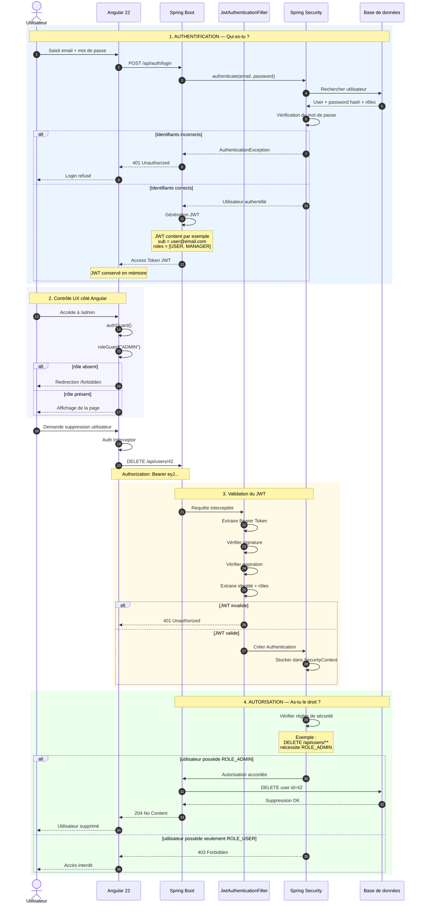

Oui. Dans une application **Angular 22 + Spring Boot**, le schéma classique est : Angular collecte les identifiants, Spring Security authentifie l'utilisateur, le backend émet un **access token JWT**, puis Angular l'envoie sur les appels protégés.

### Diagramme Mermaid



Il faut bien distinguer **authentification** et **autorisation** : le login prouve *qui tu es*, tandis que les rôles/permissions déterminent *ce que tu peux faire*.

## Et où stocker le JWT ?

Il existe principalement trois approches.

| Stockage                              | Sécurité XSS | CSRF           | Recommandation                    |
| ------------------------------------- | ------------ | -------------- | --------------------------------- |
| `localStorage`                        | ❌ Faible     | ✅ Peu concerné | ⚠️ À éviter pour une app sensible |
| `sessionStorage`                      | ❌ Faible     | ✅ Peu concerné | ⚠️ Pas beaucoup mieux             |
| Cookie `HttpOnly + Secure + SameSite` | ✅ Meilleur   | ⚠️ À gérer     | ✅ Recommandé                      |
| Access token uniquement en mémoire    | ✅ Très bon   | ✅              | ✅ Très intéressant                |

### 1. `localStorage` — simple mais vulnérable au XSS

On rencontre souvent :

```typescript
localStorage.setItem('access_token', token);
```

Puis un interceptor :

```typescript
export const authInterceptor: HttpInterceptorFn = (req, next) => {

  const token = localStorage.getItem('access_token');

  if (token) {
    req = req.clone({
      setHeaders: {
        Authorization: `Bearer ${token}`
      }
    });
  }

  return next(req);
};
```

Le problème majeur est qu'un JavaScript exécuté à cause d'une faille XSS peut faire :

```javascript
localStorage.getItem('access_token')
```

et potentiellement exfiltrer le JWT.

Pour une application bancaire ou contenant des données sensibles, je n'en ferais donc pas l'architecture cible.

---

## 2. Cookie `HttpOnly` — généralement préférable

Le backend Spring Boot peut retourner :

```http
Set-Cookie: refresh_token=xxxx;
HttpOnly;
Secure;
SameSite=Strict;
Path=/api/auth/refresh
```

Avec :

* `HttpOnly` → JavaScript ne peut pas lire le cookie ;
* `Secure` → cookie transmis uniquement via HTTPS ;
* `SameSite` → réduit fortement certains scénarios CSRF ;
* expiration contrôlée côté serveur.

Angular **ne récupère donc jamais directement le refresh token**.

C'est le navigateur qui gère le cookie.

Cela empêche par exemple :

```typescript
document.cookie
```

de récupérer un cookie marqué `HttpOnly`.

---

# Architecture que je recommande

Pour une application Angular + Spring Boot moderne, une architecture particulièrement intéressante est :

```text
                    ┌─────────────────────────┐
                    │       Angular 22        │
                    │                         │
                    │ Access Token            │
                    │ uniquement en mémoire   │
                    └───────────┬─────────────┘
                                │
                  Authorization: Bearer JWT
                                │
                                ▼
                    ┌─────────────────────────┐
                    │      Spring Boot        │
                    │    Spring Security      │
                    └───────────┬─────────────┘
                                │
                         valide le JWT
                                │
                                ▼
                    ┌─────────────────────────┐
                    │ APIs / Services / DB    │
                    └─────────────────────────┘


        Refresh Token
              │
              ▼
┌─────────────────────────────────────────────┐
│ Navigateur                                  │
│                                             │
│ Cookie                                      │
│ HttpOnly                                    │
│ Secure                                      │
│ SameSite                                    │
│                                             │
│ inaccessible au JavaScript Angular          │
└─────────────────────────────────────────────┘
```

Le principe est alors :

```text
ACCESS TOKEN
durée courte
ex: 5-15 minutes

        +

REFRESH TOKEN
durée longue
ex: plusieurs heures/jours
stocké dans cookie HttpOnly
```

## Le workflow devient



C'est une architecture très intéressante à implémenter dans un projet pédagogique, parce qu'elle permet de comprendre quasiment toute la chaîne.

### Côté Angular

Tu aurais typiquement :

```text
src/app/core/auth/
│
├── models/
│   ├── login-request.ts
│   ├── login-response.ts
│   └── user.ts
│
├── services/
│   ├── auth.service.ts
│   └── token.service.ts
│
├── interceptors/
│   ├── auth.interceptor.ts
│   └── refresh-token.interceptor.ts
│
├── guards/
│   ├── auth.guard.ts
│   └── role.guard.ts
│
└── auth.routes.ts
```

Le `TokenService` pourrait conserver l'access token **uniquement en mémoire**, par exemple avec un signal :

```typescript
@Injectable({
  providedIn: 'root'
})
export class TokenService {

  private readonly accessToken = signal<string | null>(null);

  setToken(token: string): void {
    this.accessToken.set(token);
  }

  getToken(): string | null {
    return this.accessToken();
  }

  clear(): void {
    this.accessToken.set(null);
  }
}
```

Puis ton interceptor :

```typescript
export const authInterceptor: HttpInterceptorFn = (req, next) => {

  const tokenService = inject(TokenService);

  const token = tokenService.getToken();

  if (!token) {
    return next(req);
  }

  const authenticatedRequest = req.clone({
    setHeaders: {
      Authorization: `Bearer ${token}`
    }
  });

  return next(authenticatedRequest);
};
```

### Côté Spring Boot

Tu retrouverais quelque chose comme :

```text
security/
├── SecurityConfig.java
├── JwtAuthenticationFilter.java
├── JwtService.java
├── CustomUserDetailsService.java
└── AuthenticationEntryPoint.java

auth/
├── AuthController.java
├── AuthService.java
├── LoginRequest.java
├── LoginResponse.java
└── RefreshTokenService.java
```

Et Spring Security suit alors approximativement :

```text
HTTP Request
     │
     ▼
JwtAuthenticationFilter
     │
     ├── récupérer Authorization
     │
     ├── extraire Bearer JWT
     │
     ├── vérifier signature
     │
     ├── vérifier expiration
     │
     ├── récupérer utilisateur
     │
     └── créer Authentication
                │
                ▼
         SecurityContext
                │
                ▼
         Controller
                │
       @PreAuthorize(...)
                │
                ▼
             Service
```

Il y a un point important à retenir : **Angular ne doit jamais être considéré comme responsable de la sécurité**. Un `roleGuard` Angular qui empêche un utilisateur d'ouvrir `/admin` améliore l'UX, mais ce n'est pas une véritable protection. L'autorisation doit toujours être réappliquée dans Spring Boot, par exemple avec `@PreAuthorize("hasRole('ADMIN')")`.

Pour ton projet d'apprentissage Angular 22 / Spring Boot, je te conseillerais donc d'implémenter successivement **login → JWT → interceptor → Spring Security filter → guards → rôles/permissions → expiration → refresh token HttpOnly → logout → révocation/rotation du refresh token**. C'est ce parcours qui te donnera une vision complète de l'authentification moderne.

---

Dans le diagramme précédent, l’autorisation était seulement évoquée avec les rôles et `@PreAuthorize`, mais **pas réellement détaillée**. Voici un diagramme complet qui enchaîne **authentification + autorisation**, avec ce qui se passe côté Angular et surtout côté Spring Security.



La distinction fondamentale est donc :

```text
AUTHENTIFICATION
       │
       │ "Qui es-tu ?"
       ▼
email/password
       │
       ▼
   JWT valide
       │
       ▼
Authentication
       │
       ▼
SecurityContext
       │
       │
       ▼
AUTORISATION
       │
       │ "As-tu le droit de faire ça ?"
       ▼
Roles / Permissions
       │
       ├── autorisé ─────► Controller / Service
       │
       └── interdit ─────► 403 Forbidden
```

### Exemple concret avec trois utilisateurs

Imaginons que ton application possède :

```text
Alice
roles = [USER]

Bob
roles = [USER, MANAGER]

Charles
roles = [USER, ADMIN]
```

Et les règles suivantes :

```text
GET    /api/profile         → USER, MANAGER, ADMIN
GET    /api/users           → MANAGER, ADMIN
DELETE /api/users/{id}      → ADMIN uniquement
```

Alice peut donc consulter son profil, mais pas la liste des utilisateurs. Bob peut consulter la liste mais ne peut pas supprimer un utilisateur. Charles peut faire les trois.

Côté Spring Boot, cela peut être défini globalement :

```java
@Bean
SecurityFilterChain securityFilterChain(HttpSecurity http) throws Exception {

    return http
        .authorizeHttpRequests(auth -> auth

            // Public
            .requestMatchers("/api/auth/**")
            .permitAll()

            // ADMIN uniquement
            .requestMatchers(HttpMethod.DELETE, "/api/users/**")
            .hasRole("ADMIN")

            // MANAGER ou ADMIN
            .requestMatchers(HttpMethod.GET, "/api/users/**")
            .hasAnyRole("MANAGER", "ADMIN")

            // Tout utilisateur authentifié
            .requestMatchers("/api/profile/**")
            .authenticated()

            // Tout le reste interdit
            .anyRequest()
            .denyAll()
        )
        .build();
}
```

Mais tu peux également protéger directement les méthodes :

```java
@PreAuthorize("hasRole('ADMIN')")
@DeleteMapping("/{id}")
public void deleteUser(@PathVariable Long id) {
    userService.delete(id);
}
```

Ou avec plusieurs rôles :

```java
@PreAuthorize("hasAnyRole('ADMIN', 'MANAGER')")
@GetMapping
public List<UserDto> findAll() {
    return userService.findAll();
}
```

Et tu peux aller plus loin que les **rôles** en utilisant des **permissions** :

```java
@PreAuthorize("hasAuthority('USER_DELETE')")
public void deleteUser(Long id) {
    // ...
}
```

Tu arrives alors à une organisation du type :

```text
ADMIN
 ├── USER_READ
 ├── USER_CREATE
 ├── USER_UPDATE
 └── USER_DELETE

MANAGER
 ├── USER_READ
 └── USER_UPDATE

USER
 └── PROFILE_READ
```

C'est souvent plus flexible que de coder uniquement des `ROLE_ADMIN`, `ROLE_MANAGER`, etc.

### Et Angular dans tout ça ?

Angular peut également connaître les rôles :

```typescript
interface CurrentUser {
  id: number;
  email: string;
  roles: string[];
}
```

Puis avoir un guard :

```typescript
export const adminGuard: CanActivateFn = () => {

  const authService = inject(AuthService);
  const router = inject(Router);

  if (authService.hasRole('ADMIN')) {
    return true;
  }

  return router.createUrlTree(['/forbidden']);
};
```

Et :

```typescript
{
  path: 'admin',
  canActivate: [authGuard, adminGuard],
  loadComponent: () =>
    import('./admin/admin.component')
      .then(c => c.AdminComponent)
}
```

Mais le point **le plus important de tout le système** est :

> **Un Guard Angular n'est pas une mesure de sécurité.**

Quelqu'un peut complètement ignorer Angular et appeler directement :

```bash
DELETE /api/users/42
Authorization: Bearer <JWT>
```

La vraie protection doit donc toujours être :

```text
Angular
   │
   ├── Guard
   │      └── UX / navigation
   │
   ▼
Spring Boot
   │
   ├── JwtAuthenticationFilter
   │
   ├── SecurityContext
   │
   ├── SecurityFilterChain
   │
   └── @PreAuthorize
   │
   ▼
VRAIE SÉCURITÉ
```

Enfin, retiens aussi la différence HTTP essentielle : **401 Unauthorized** signifie en pratique « je ne peux pas t'authentifier » — token absent, invalide ou expiré — tandis que **403 Forbidden** signifie « je sais qui tu es, mais tu n'as pas le droit de faire cette action ». C'est précisément le passage de l'**authentification** à l'**autorisation**.
