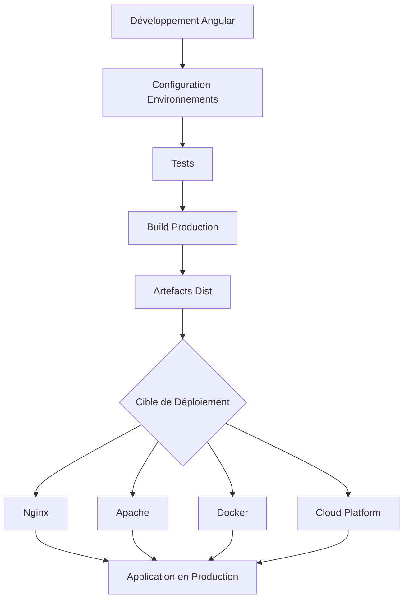
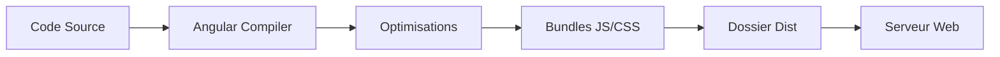
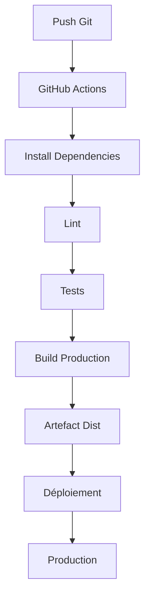
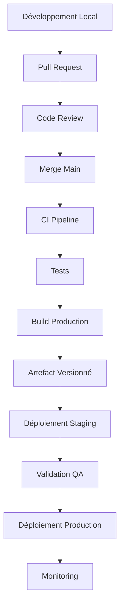

# Build et Déploiement d'une Application Angular

## Objectif

À la fin de ce guide, vous saurez :

* Créer une application Angular prête pour la production.
* Configurer les environnements.
* Construire (build) l'application.
* Déployer sur différents hébergements.
* Mettre en place un pipeline CI/CD.
* Diagnostiquer les erreurs courantes.

---

# Vue d'ensemble du processus



---

# Prérequis

## Installer Node.js

Vérifier l'installation :

```bash
node -v
npm -v
```

Versions recommandées :

* Node.js LTS
* npm récent

---

## Installer Angular CLI

```bash
npm install -g @angular/cli
```

Vérification :

```bash
ng version
```

---

# Structure d'une Application Angular

Exemple :

```text
my-app/
│
├── src/
│   ├── app/
│   ├── assets/
│   ├── environments/
│   └── index.html
│
├── angular.json
├── package.json
├── tsconfig.json
└── node_modules/
```

Les fichiers importants :

| Fichier      | Rôle                      |
| ------------ | ------------------------- |
| angular.json | Configuration du build    |
| package.json | Dépendances               |
| environments | Variables d'environnement |
| src/assets   | Fichiers statiques        |

---

# Gestion des Environnements

Angular permet plusieurs environnements.

## Environnement Développement

```typescript
// environment.ts

export const environment = {
  production: false,
  apiUrl: 'http://localhost:3000'
};
```

---

## Environnement Production

```typescript
// environment.prod.ts

export const environment = {
  production: true,
  apiUrl: 'https://api.monsite.com'
};
```

---

## Utilisation

```typescript
import { environment } from '../environments/environment';

this.http.get(`${environment.apiUrl}/users`);
```

---

# Vérifier l'Application Avant Build

## Lancer les tests unitaires

```bash
ng test
```

---

## Lancer les tests end-to-end

Selon l'outil utilisé :

```bash
npm run e2e
```

ou

```bash
npx cypress run
```

---

## Analyse de qualité

```bash
npm run lint
```

---

# Build Angular

## Build Développement

```bash
ng build
```

Résultat :

```text
dist/
```

---

## Build Production

```bash
ng build --configuration production
```

ou

```bash
ng build --prod
```

(selon la version Angular)

---

## Ce que fait le Build Production

Angular applique automatiquement :

* Minification JavaScript
* Compression CSS
* Tree Shaking
* Optimisation des bundles
* Suppression du code mort
* Hashing des fichiers

---

# Comprendre le Dossier Dist

Après le build :

```text
dist/
└── my-app/
    ├── browser/
    │   ├── index.html
    │   ├── main.xxx.js
    │   ├── styles.xxx.css
    │   └── assets/
```

Le contenu de ce dossier est ce qui sera déployé.

---

# Workflow de Build



---

# Déploiement sur Nginx

## Installation

```bash
sudo apt update
sudo apt install nginx
```

---

## Copier les fichiers

```bash
scp -r dist/my-app/* server:/var/www/my-app
```

---

## Configuration Nginx

```nginx
server {
    listen 80;

    server_name monsite.com;

    root /var/www/my-app;

    index index.html;

    location / {
        try_files $uri $uri/ /index.html;
    }
}
```

---

## Recharger Nginx

```bash
sudo nginx -t
sudo systemctl reload nginx
```

---

# Déploiement sur Apache

## Activer le module Rewrite

```bash
sudo a2enmod rewrite
```

---

## Créer un fichier .htaccess

```apache
<IfModule mod_rewrite.c>
RewriteEngine On
RewriteBase /

RewriteRule ^index\.html$ - [L]

RewriteCond %{REQUEST_FILENAME} !-f
RewriteCond %{REQUEST_FILENAME} !-d

RewriteRule . /index.html [L]
</IfModule>
```

---

# Déploiement avec Docker

## Dockerfile

```dockerfile
# Build Angular

FROM node:22 AS build

WORKDIR /app

COPY package*.json ./

RUN npm install

COPY . .

RUN npm run build

# Serveur Nginx

FROM nginx:alpine

COPY --from=build /app/dist/my-app/browser /usr/share/nginx/html

EXPOSE 80
```

---

## Construire l'image

```bash
docker build -t angular-app .
```

---

## Lancer le conteneur

```bash
docker run -d -p 80:80 angular-app
```

---

# Déploiement sur GitHub Pages

## Installation

```bash
npm install -g angular-cli-ghpages
```

---

## Build

```bash
ng build \
--configuration production \
--base-href "https://username.github.io/repository/"
```

---

## Déploiement

```bash
npx angular-cli-ghpages \
--dir=dist/my-app/browser
```

---

# Déploiement sur Firebase Hosting

## Installation

```bash
npm install -g firebase-tools
```

---

## Connexion

```bash
firebase login
```

---

## Initialisation

```bash
firebase init hosting
```

Réponses :

```text
Public Directory : dist/my-app/browser
Single Page App : Yes
```

---

## Déploiement

```bash
firebase deploy
```

---

# Déploiement sur AWS S3 + CloudFront

## Étape 1 : Créer un bucket S3

Exemple :

```text
my-angular-app
```

---

## Étape 2 : Upload du contenu Dist

```bash
aws s3 sync dist/my-app/browser s3://my-angular-app
```

---

## Étape 3 : Configurer CloudFront

Configurer :

```text
Default Root Object = index.html
```

---

## Gestion SPA

Configurer les erreurs :

| Code | Redirection |
| ---- | ----------- |
| 403  | /index.html |
| 404  | /index.html |

---

# Déploiement sur Azure Static Web Apps

## Build

```bash
ng build --configuration production
```

---

## Upload via GitHub

Workflow automatique :

```yaml
name: Azure Static Web Apps

on:
  push:
    branches:
      - main

jobs:
  build_and_deploy:
    runs-on: ubuntu-latest

    steps:
      - uses: actions/checkout@v4

      - uses: Azure/static-web-apps-deploy@v1
```

---

# Pipeline CI/CD Complet



---

# Exemple GitHub Actions Angular

```yaml
name: Angular CI/CD

on:
  push:
    branches:
      - main

jobs:
  build:

    runs-on: ubuntu-latest

    steps:

      - uses: actions/checkout@v4

      - name: Setup Node
        uses: actions/setup-node@v4
        with:
          node-version: 22

      - name: Install
        run: npm ci

      - name: Lint
        run: npm run lint

      - name: Test
        run: npm run test -- --watch=false

      - name: Build
        run: ng build --configuration production
```

---

# Optimisations de Production

## Lazy Loading

Mauvais :

```typescript
imports: [
  AdminModule
]
```

Bon :

```typescript
{
  path: 'admin',
  loadChildren: () =>
    import('./admin/admin.module')
      .then(m => m.AdminModule)
}
```

---

## Compression GZIP

Nginx :

```nginx
gzip on;
gzip_types
text/plain
text/css
application/json
application/javascript;
```

---

## Cache Longue Durée

```nginx
location ~* \.(js|css|png|jpg|svg)$ {
    expires 1y;
    add_header Cache-Control "public";
}
```

---

# Vérification Après Déploiement

## Contrôler les bundles

```bash
ng build --stats-json
```

Puis :

```bash
npx webpack-bundle-analyzer dist/my-app/stats.json
```

---

## Vérifier Lighthouse

Critères :

* Performance
* Accessibility
* Best Practices
* SEO

Objectif :

```text
90+
```

---

# Erreurs Courantes

## Page Blanche Après Déploiement

Cause :

```text
Mauvaise configuration des routes Angular
```

Solution :

```nginx
try_files $uri $uri/ /index.html;
```

---

## Erreur 404 Sur Refresh

Cause :

```text
Angular Router + serveur mal configuré
```

Solution :

Rediriger vers :

```text
index.html
```

---

## API Introuvable

Cause :

```text
Variables d'environnement incorrectes
```

Vérifier :

```typescript
environment.prod.ts
```

---

## Assets Non Chargés

Cause :

```text
baseHref incorrect
```

Corriger :

```bash
ng build --base-href /
```

---

# Processus Recommandé en Entreprise



---

# Checklist Finale Avant Mise en Production

* [ ] Toutes les dépendances sont à jour
* [ ] Les tests passent
* [ ] Le lint est propre
* [ ] Les variables d'environnement sont correctes
* [ ] Le build production est généré
* [ ] Les routes SPA sont configurées
* [ ] HTTPS est activé
* [ ] Compression GZIP/Brotli activée
* [ ] Cache navigateur configuré
* [ ] Monitoring en place
* [ ] Logs accessibles
* [ ] Rollback prévu

---

# Résumé

Le cycle complet de déploiement Angular suit généralement ce flux :

```text
Développement
→ Tests
→ Build Production
→ Génération du dossier dist
→ Déploiement (Nginx / Apache / Docker / Cloud)
→ Vérification
→ Monitoring
```

Le dossier `dist/` constitue l'artefact final. Quel que soit l'hébergeur utilisé, le principe reste identique : construire l'application avec `ng build --configuration production`, puis publier le contenu généré sur un serveur capable de servir correctement une Single Page Application (SPA).
