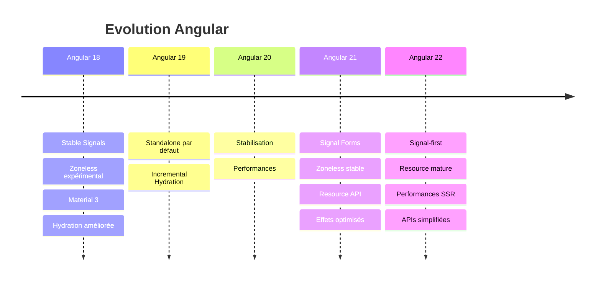
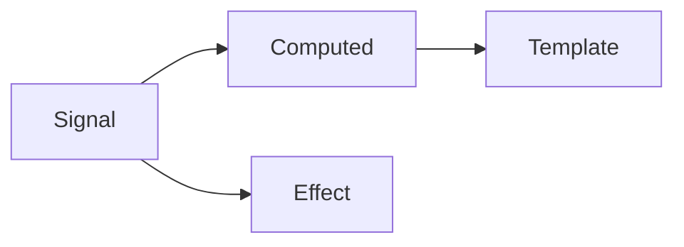
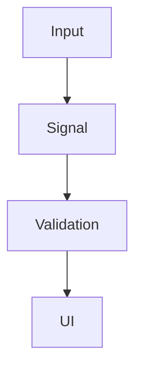
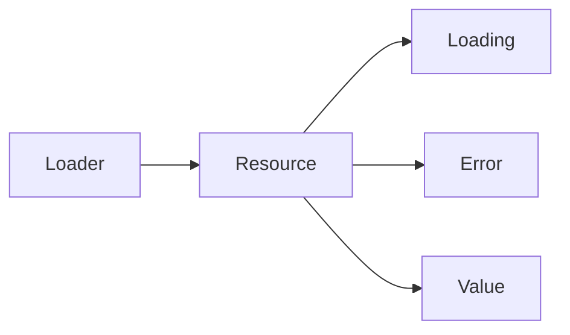
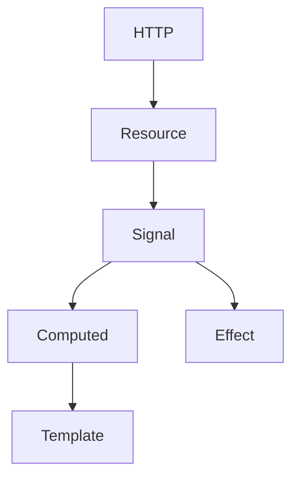
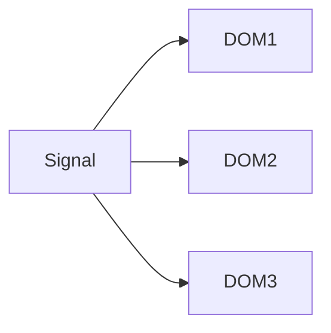
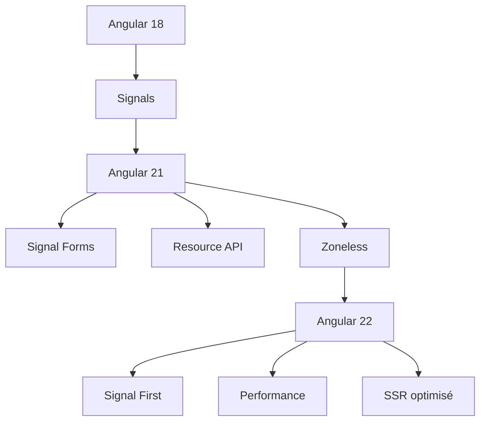
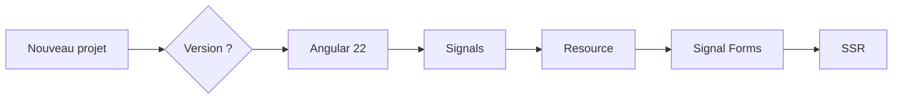

# Tutoriel : Comprendre les différences entre Angular 18, Angular 21 et Angular 22

> **Objectif** : comprendre les évolutions majeures d'Angular, savoir ce qui change pour un développeur et comment migrer progressivement.

---

# Vue d'ensemble

Angular évolue désormais très rapidement (2 versions majeures par an environ).

Les versions 18 → 21 → 22 montrent surtout une transition vers :

* plus de **réactivité**
* moins de **Zone.js**
* davantage de **Signal**
* un rendu **SSR/Hydration** plus performant
* des APIs plus simples
* une meilleure expérience développeur.

---

# Chronologie



---

# Comparaison rapide

| Fonctionnalité | Angular 18 | Angular 21     | Angular 22        |
| -------------- | ---------- | -------------- | ----------------- |
| Standalone     | ✅          | ✅              | ✅                 |
| Signals        | ✅ Stable   | ✅ Plus complet | ⭐ API principale  |
| Signal Forms   | ❌          | ✅              | ✅                 |
| Resource API   | ❌          | ✅              | ✅ améliorée       |
| Zone.js        | requis     | optionnel      | quasiment inutile |
| SSR            | bon        | meilleur       | excellent         |
| Hydration      | complète   | incrémentale   | optimisée         |
| Performance    | ++         | +++            | ++++              |

---

# Angular 18

Angular 18 est la première version où les **Signals** deviennent réellement utilisables en production.

Avant Angular 18, une application ressemblait souvent à ceci :

```text
Component

↓

Observable

↓

Async Pipe

↓

Template
```

Avec Angular 18 :

```text
Component

↓

Signal()

↓

Template
```

On remplace progressivement RxJS pour la gestion de l'état local.

Exemple :

```ts
count = signal(0);

increment() {
  this.count.update(v => v + 1);
}
```

Template :

```html
{{ count() }}
```

Plus besoin de :

* BehaviorSubject
* async pipe
* subscribe

pour les cas simples.

---

## Les effets (effect)

```ts
effect(() => {
    console.log(this.count());
});
```

L'effet se relance automatiquement dès que le signal change.

---

## Computed

Avant :

```ts
get total() {
    return this.price * this.qty;
}
```

Maintenant :

```ts
total = computed(() =>
    this.price() * this.qty()
);
```

Le calcul est mémorisé automatiquement.

---

# Les Signals

Diagramme :



Un changement d'un Signal entraîne uniquement le recalcul nécessaire.

---

# Angular 21

Angular 21 marque un changement plus profond.

Le framework devient **Signal-first**.

Les nouveautés principales :

* Signal Forms
* Resource API
* Zoneless stable
* amélioration des performances

---

# 1. Signal Forms

Avant :

```ts
FormGroup
FormControl
Validators
valueChanges
```

Maintenant :

```text
Signal

↓

Champ

↓

Template
```

Exemple simplifié :

```ts
const login = signal({
    username: '',
    password: ''
});
```

Chaque champ est un Signal.

Plus besoin de :

```ts
valueChanges.subscribe(...)
```

---

Diagramme :



---

# 2. Resource API

Avant :

```ts
ngOnInit()

↓

HTTP

↓

subscribe()

↓

loading

↓

error

↓

success
```

Beaucoup de code répétitif.

Avec Resource :

```ts
user = resource({
    loader: () => this.http.get(...)
});
```

Angular gère :

* loading
* erreur
* cache
* rafraîchissement

automatiquement.

---

Diagramme



---

# 3. Zoneless devient stable

Pendant des années Angular reposait sur :

```
Zone.js
```

qui détectait automatiquement tous les changements.

En Angular 21 on peut utiliser :

```text
Signals

↓

Change Detection

↓

Template
```

sans Zone.js.

Résultat :

* moins de mémoire
* moins de CPU
* moins de déclenchements inutiles

---

# Angular 22

Angular 22 pousse encore plus loin cette philosophie.

Le framework considère désormais que :

> Les Signals sont la façon naturelle de développer une application Angular.

---

# Architecture recommandée



On remarque que :

* Observable disparaît souvent
* subscribe disparaît
* Subject disparaît

---

# Les performances

Les mises à jour deviennent beaucoup plus fines.

Avant :

```text
Modification

↓

Zone.js

↓

Tout le composant est vérifié
```

Aujourd'hui :

```text
Modification

↓

Signal concerné

↓

Seulement le morceau du DOM concerné
```

---

Diagramme



Chaque Signal ne met à jour que ce qu'il utilise.

---

# SSR et Hydration

Angular 18

```
Serveur

↓

HTML

↓

Hydration
```

Angular 21

```
Serveur

↓

Hydration incrémentale
```

Angular 22

```
Serveur

↓

Hydration intelligente

↓

Chargement progressif
```

Le temps d'affichage diminue considérablement.

---

# Les APIs qui disparaissent progressivement

De nombreuses pratiques restent supportées mais sont moins mises en avant.

| Ancienne pratique    | Nouvelle pratique |
| -------------------- | ----------------- |
| BehaviorSubject      | Signal            |
| Subject              | Signal            |
| AsyncPipe            | Signal            |
| ngOnInit + subscribe | Resource          |
| valueChanges         | Signal Forms      |
| Zone.js              | Signals           |

Attention : **RxJS n'est pas supprimé**. Il reste très utile pour les flux complexes (WebSocket, événements, opérateurs de transformation, etc.), mais il est moins nécessaire pour l'état local d'un composant.

---

# Évolution de l'architecture Angular



---

# Exemple concret

## Angular 18

```ts
count = signal(0);

double = computed(() => this.count() * 2);

effect(() => console.log(this.double()));
```

---

## Angular 21

```ts
user = resource({
    loader: () => this.http.get('/api/user')
});
```

Plus besoin de gérer manuellement les états de chargement et d'erreur dans de nombreux cas.

---

## Angular 22

```ts
const cart = signal([]);

const total = computed(() =>
    cart().reduce((t, p) => t + p.price, 0)
);
```

L'application est pensée autour des Signals, avec un minimum de code impératif.

---

# Quelle version choisir ?



* **Angular 18** : bon choix pour comprendre les fondations des Signals et moderniser progressivement une application existante.
* **Angular 21** : étape importante avec la stabilisation du développement sans Zone.js, les Signal Forms et la Resource API.
* **Angular 22** : recommandé pour les nouveaux projets, avec une approche "Signal-first", des performances améliorées et des APIs plus cohérentes.

# Résumé

| Version        | Ce qu'elle apporte                                                                                                    |
| -------------- | --------------------------------------------------------------------------------------------------------------------- |
| **Angular 18** | Signals stables, Hydration améliorée, premières bases du mode sans Zone.js.                                           |
| **Angular 21** | Signal Forms, Resource API, Zoneless stable, meilleures performances et DX.                                           |
| **Angular 22** | Approche Signal-first, maturation des nouvelles APIs, optimisations SSR/Hydration et simplification du développement. |

En pratique, l'évolution entre ces versions ne consiste pas à remplacer totalement RxJS ou les anciennes APIs, mais à privilégier des abstractions plus simples pour les cas courants. Les applications Angular modernes tendent vers une architecture centrée sur les **Signals**, où les données circulent de manière plus explicite et où le framework effectue des mises à jour plus ciblées du DOM.
