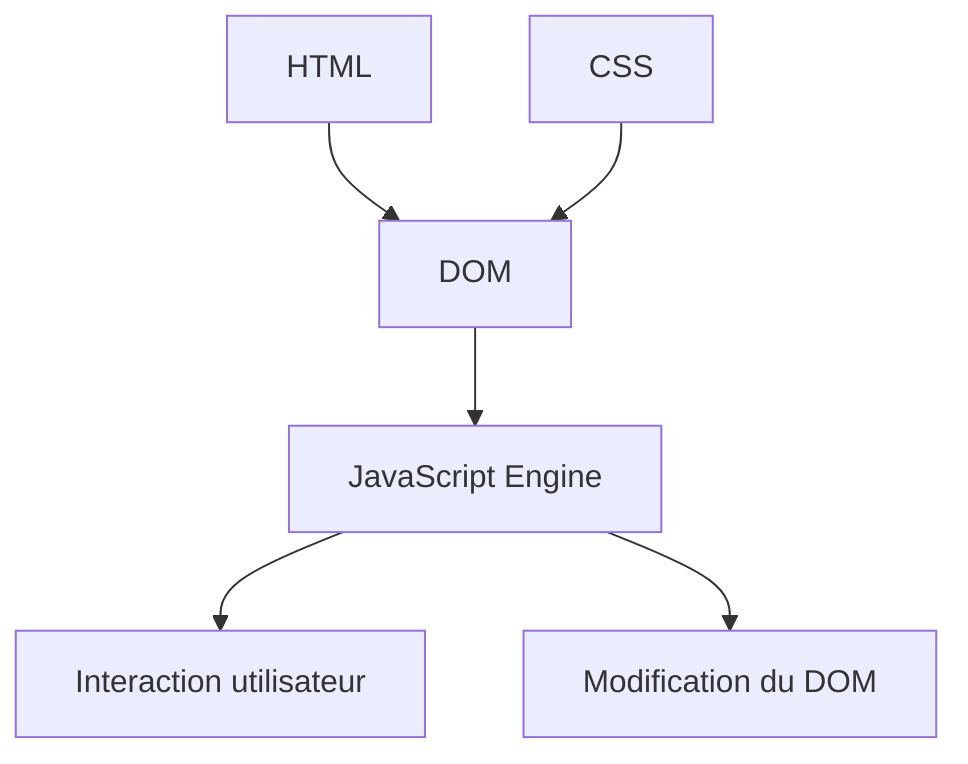
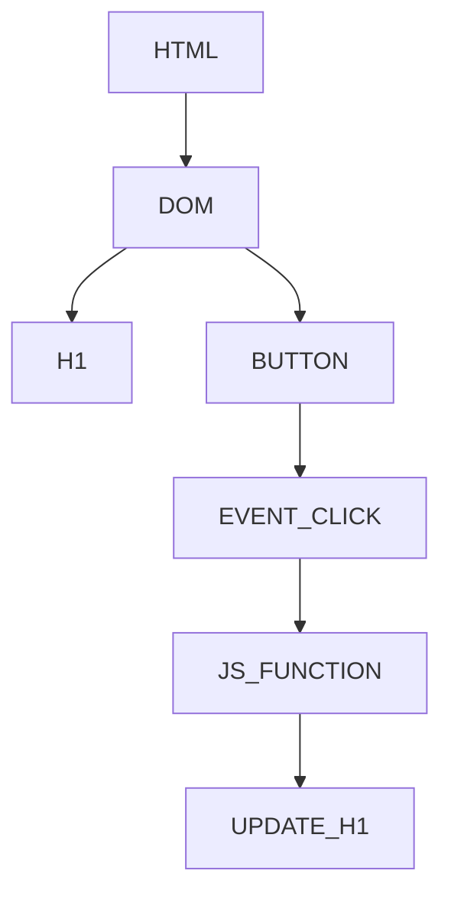
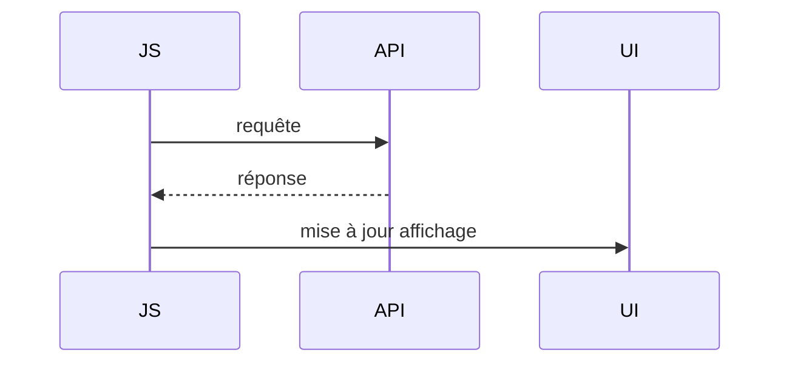
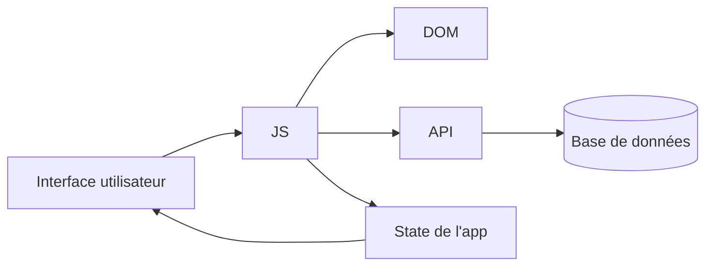

Voici un **tutoriel complet et structuré sur JavaScript**, avec des exemples concrets, du code clair et des diagrammes Mermaid pour visualiser les concepts importants.

---

# 🚀 1. JavaScript : c’est quoi ?

JavaScript est un **langage de programmation côté client et serveur** (avec Node.js) qui permet de rendre les pages web interactives.

👉 Il agit sur :

* le HTML (structure)
* le CSS (style)
* les interactions utilisateur (clics, formulaires, animations)
* les données (API, serveurs)

---

# 🧠 2. Comment JavaScript fonctionne ?

## ⚙️ Dans le navigateur



👉 Le DOM = représentation de la page en objets manipulables.

---

# ✍️ 3. Syntaxe de base

## 📌 Variables

```js
let age = 25;
const nom = "Alice";
var ancien = true;
```

### Différences :

* `let` → modifiable
* `const` → constant
* `var` → ancien (éviter)

---

## 📌 Types de données

```js
let texte = "Bonjour";
let nombre = 42;
let decimal = 3.14;
let bool = true;
let vide = null;
let indefini;
```

---

# 🔁 4. Conditions

```js
let age = 18;

if (age >= 18) {
  console.log("Majeur");
} else {
  console.log("Mineur");
}
```

## 🔀 switch

```js
let jour = "lundi";

switch (jour) {
  case "lundi":
    console.log("Début de semaine");
    break;
  case "vendredi":
    console.log("Bientôt week-end");
    break;
  default:
    console.log("Jour normal");
}
```

---

# 🔄 5. Boucles

## 🔁 for

```js
for (let i = 0; i < 5; i++) {
  console.log(i);
}
```

## 🔁 while

```js
let i = 0;

while (i < 5) {
  console.log(i);
  i++;
}
```

## 🔁 forEach

```js
let fruits = ["pomme", "banane", "orange"];

fruits.forEach(fruit => {
  console.log(fruit);
});
```

---

# 🧩 6. Fonctions

## 📌 Fonction classique

```js
function addition(a, b) {
  return a + b;
}

console.log(addition(2, 3));
```

## 📌 Fonction fléchée

```js
const addition = (a, b) => a + b;

console.log(addition(2, 3));
```

---

# 🧱 7. Objets

```js
let personne = {
  nom: "Alice",
  age: 25,
  parler: function () {
    console.log("Bonjour !");
  }
};

console.log(personne.nom);
personne.parler();
```

---

# 📦 8. Tableaux

```js
let nombres = [1, 2, 3, 4];

nombres.push(5);
nombres.pop();

console.log(nombres);
```

---

# 🌐 9. DOM (très important)

Le DOM permet de manipuler une page HTML.

## 📄 Exemple HTML

```html
<h1 id="titre">Bonjour</h1>
<button id="btn">Clique-moi</button>
```

## ⚡ JavaScript

```js
let titre = document.getElementById("titre");
let btn = document.getElementById("btn");

btn.addEventListener("click", () => {
  titre.textContent = "Tu as cliqué !";
});
```

---

## 🧠 Schéma DOM



---

# ⏳ 10. Asynchrone (très important)

JavaScript est **non bloquant**.

## 📌 setTimeout

```js
console.log("Début");

setTimeout(() => {
  console.log("Après 2 secondes");
}, 2000);

console.log("Fin");
```

---

## 📌 Promesses

```js
let promesse = new Promise((resolve, reject) => {
  let succes = true;

  if (succes) {
    resolve("OK !");
  } else {
    reject("Erreur");
  }
});

promesse
  .then(result => console.log(result))
  .catch(error => console.log(error));
```

---

## 📌 async / await

```js
async function test() {
  let result = await promesse;
  console.log(result);
}

test();
```

---

## 🔄 Cycle asynchrone



---

# 🌍 11. Fetch API (requêtes internet)

```js
fetch("https://jsonplaceholder.typicode.com/posts/1")
  .then(response => response.json())
  .then(data => console.log(data))
  .catch(error => console.error(error));
```

## version async

```js
async function getData() {
  let response = await fetch("https://jsonplaceholder.typicode.com/posts/1");
  let data = await response.json();
  console.log(data);
}

getData();
```

---

# 🧱 12. Classes (POO)

```js
class Animal {
  constructor(nom) {
    this.nom = nom;
  }

  parler() {
    console.log(this.nom + " fait du bruit");
  }
}

let chien = new Animal("Rex");
chien.parler();
```

---

# 📚 13. Modules

## export

```js
export function addition(a, b) {
  return a + b;
}
```

## import

```js
import { addition } from "./math.js";

console.log(addition(2, 3));
```

---

# 🧠 14. Scope (portée)

```js
let global = "je suis global";

function test() {
  let local = "je suis local";
  console.log(global);
}
```

---

# ⚠️ 15. Erreurs fréquentes

```js
try {
  let x = y + 1; // erreur
} catch (error) {
  console.log("Erreur :", error.message);
}
```

---

# 🧪 16. Bonnes pratiques

✔ utiliser `const` par défaut
✔ éviter `var`
✔ écrire des fonctions courtes
✔ nommer clairement les variables
✔ utiliser async/await plutôt que .then()

---

# 🧭 17. Architecture globale d’une app JS



---

# 🚀 Conclusion

JavaScript repose sur 5 piliers majeurs :

* 🧱 Syntaxe (variables, fonctions)
* 🌐 DOM (interaction page web)
* ⏳ Asynchrone (API, fetch)
* 📦 Structures (objets, tableaux)
* 🧠 Programmation avancée (classes, modules)


