Oui. Je te propose une version **plus professionnelle, pédagogique et visuelle**, avec :

* 📚 Sommaire
* 🎯 Encarts "À retenir"
* 📊 Diagrammes Mermaid
* 🏗️ Schémas d'architecture
* 📦 Arborescences améliorées
* 🚀 Mise en forme type documentation technique (GitHub/GitLab/Obsidian)

Voici quelques exemples de sections que tu peux intégrer dans ton document.

---

# 🟢 Node.js

## 📚 Ressources

### Formations & Tutoriels

* [https://grafikart.fr/formations/formation-javascript](https://grafikart.fr/formations/formation-javascript)
* [https://apprendre-nodejs.fr/v1/](https://apprendre-nodejs.fr/v1/)
* [https://adrienjoly.com/cours-nodejs/](https://adrienjoly.com/cours-nodejs/)
* [https://www.w3schools.com/nodejs/](https://www.w3schools.com/nodejs/)

### Projets

* [https://projectworlds.com/nodejs-projects-with-source-code/](https://projectworlds.com/nodejs-projects-with-source-code/)

### Vidéos

* Playlist YouTube (13 vidéos) :
  [https://www.youtube.com/watch?v=hMbB0rViuMA&list=PLT2KSPhMMiqq5VCDawcDMS_pQOhU77wl-&index=4](https://www.youtube.com/watch?v=hMbB0rViuMA&list=PLT2KSPhMMiqq5VCDawcDMS_pQOhU77wl-&index=4)

---

# 📑 Sommaire

1. Qu'est-ce que Node.js ?
2. Pourquoi utiliser Node.js ?
3. Cas d'usage
4. Entreprises utilisant Node.js
5. Installation
6. Architecture Node.js
7. Serveur HTTP
8. NPM
9. Structure de projet
10. Frameworks populaires
11. Projets pratiques

---

# 🚀 Qu'est-ce que Node.js ?

Node.js est un environnement d'exécution JavaScript permettant d'exécuter du code JavaScript en dehors du navigateur.

Il repose sur :

* le moteur V8 de Google Chrome
* un modèle asynchrone
* une boucle d'événements (Event Loop)
* des entrées/sorties non bloquantes

---

## 🏗️ Architecture simplifiée

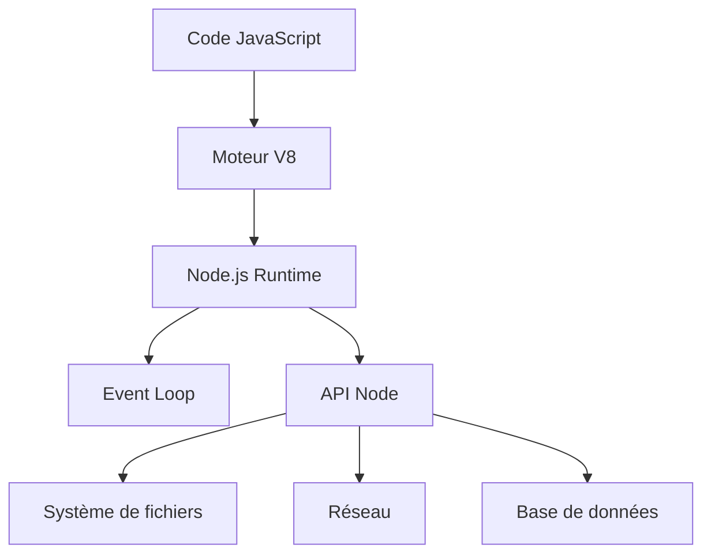

---

## 🎯 À retenir

Node.js permet de :

* créer des APIs
* développer des serveurs Web
* créer des outils CLI
* automatiser des tâches
* développer des applications temps réel

---

# ⚡ Pourquoi Node.js est-il rapide ?

La plupart des serveurs traditionnels fonctionnent selon un modèle bloquant :

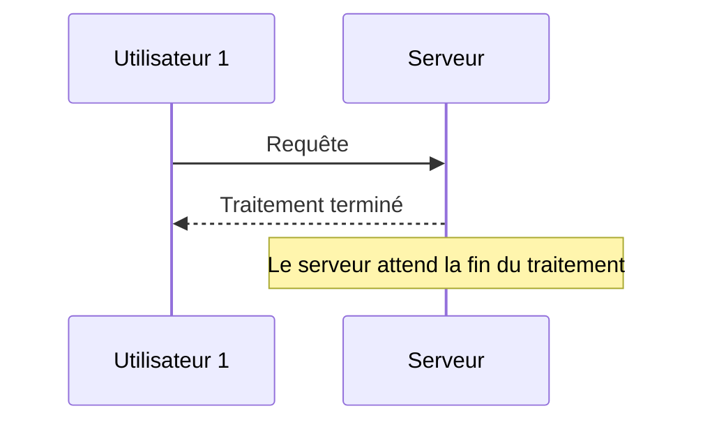

---

## Modèle Node.js

Node ne bloque jamais l'exécution.

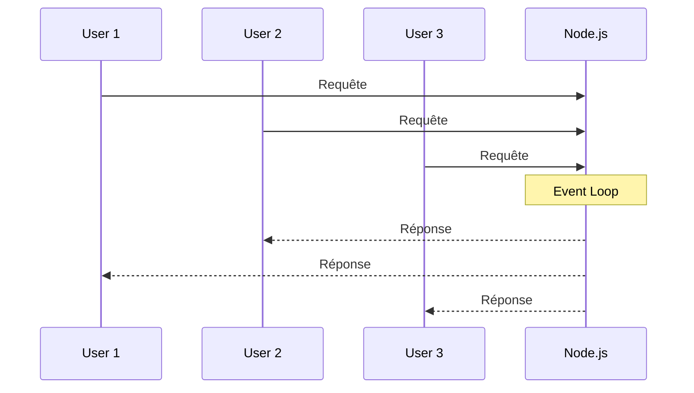

---

## 🔄 Fonctionnement de l'Event Loop

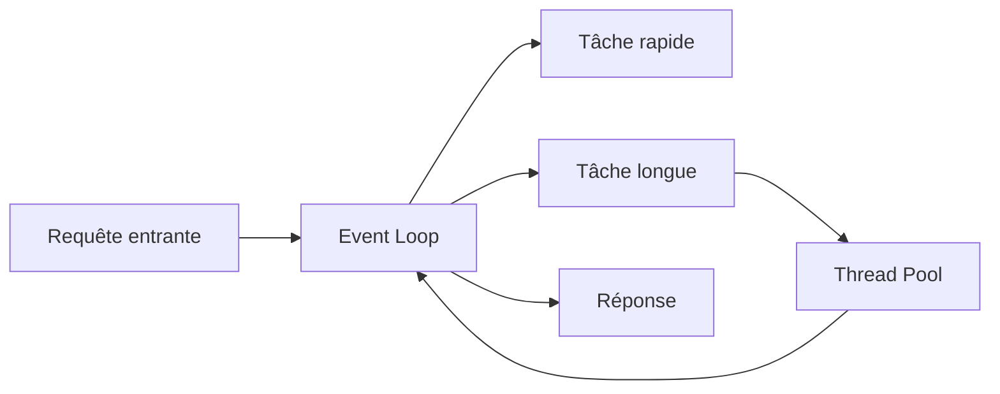

---

# 🎯 Cas d'utilisation de Node.js

## APIs REST

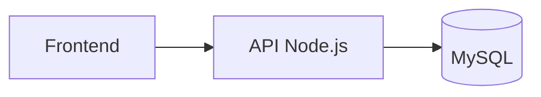

Technologies :

* Express.js
* Fastify
* NestJS

---

## Temps réel

Applications :

* Chat
* Notifications
* Jeux multijoueurs
* Outils collaboratifs

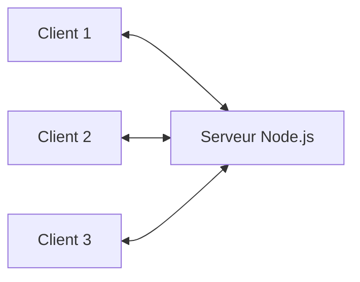

Technologies :

* Socket.IO
* WebSocket
* Colyseus

---

## Microservices

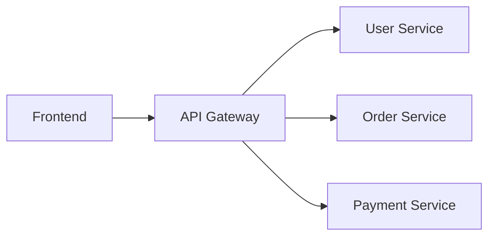

Technologies :

* NestJS
* Moleculer
* Seneca

---

# 🌍 Grandes entreprises utilisant Node.js

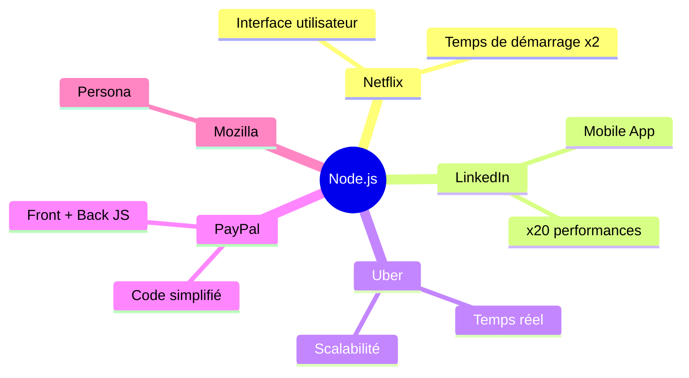

---

# 💻 Installation

## 1. Télécharger Node.js

👉 [https://nodejs.org](https://nodejs.org)

Choisir :

* LTS (recommandé)
* Current (dernières nouveautés)

---

## 2. Vérification

```bash
node -v
npm -v
```

---

# 🎉 Premier programme

```js
console.log("Bonjour, ceci est mon premier programme Node.js !");
```

Exécution :

```bash
node app.js
```

---

# 📦 Modules natifs Node.js

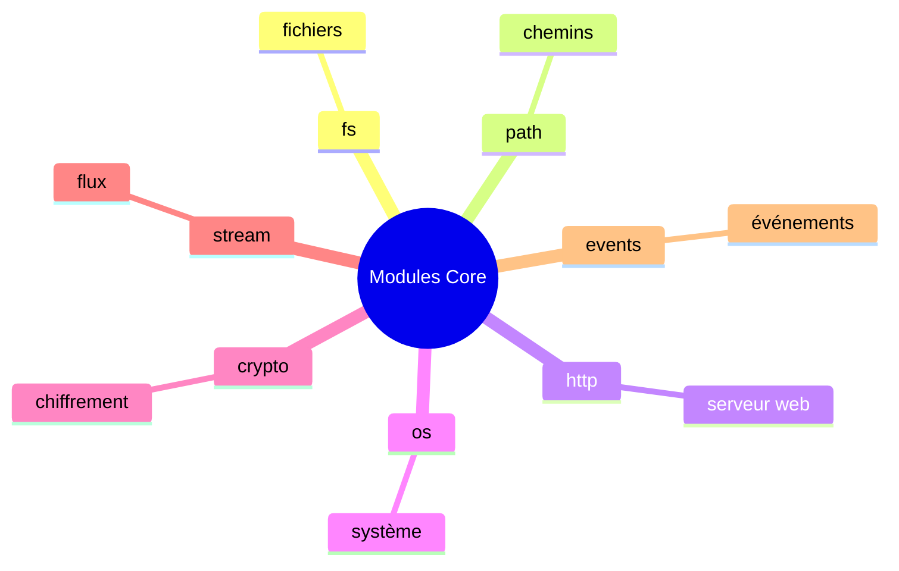

---

# 🌐 Premier serveur HTTP

```js
const http = require("http");

const serveur = http.createServer((req, res) => {
  res.writeHead(200, {
    "Content-Type": "text/plain"
  });

  res.end("Bienvenue sur mon premier serveur Node.js !");
});

serveur.listen(3000);
```

---

## Cycle d'une requête

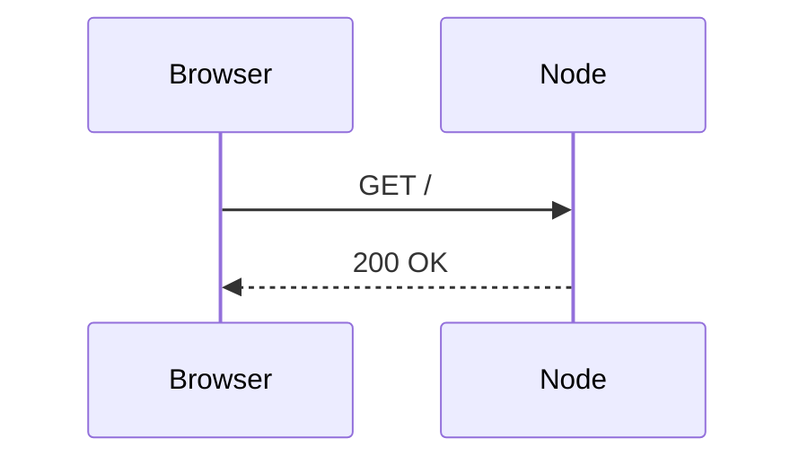

---

# 📦 Le rôle de NPM

NPM est le gestionnaire officiel de paquets Node.js.

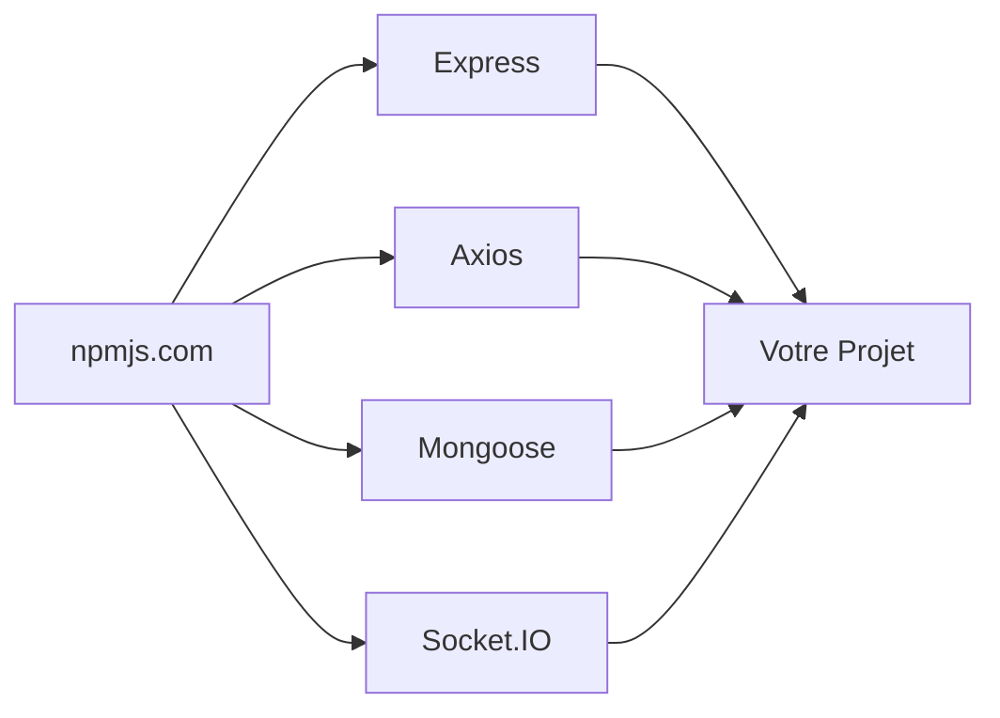

---

## Initialisation d'un projet

```bash
npm init -y
```

---

## Installation d'Express

```bash
npm install express
```

---

# 🏗️ Structure de projet recommandée

```text
my-express-app/

├── config/
│   ├── db.js
│   └── env.js
│
├── controllers/
├── middleware/
├── models/
├── routes/
├── services/
├── tests/
│
├── public/
│
├── .env
├── .gitignore
├── app.js
└── package.json
```

---

## Architecture MVC

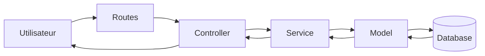

---

# 🚀 Top Frameworks Node.js

| Framework  | Utilisation             |
| ---------- | ----------------------- |
| Express.js | APIs REST               |
| Fastify    | Performance             |
| NestJS     | Architecture Enterprise |
| Next.js    | Fullstack React         |
| Socket.IO  | Temps réel              |
| Hapi       | Sécurité                |

---

## Comparaison visuelle

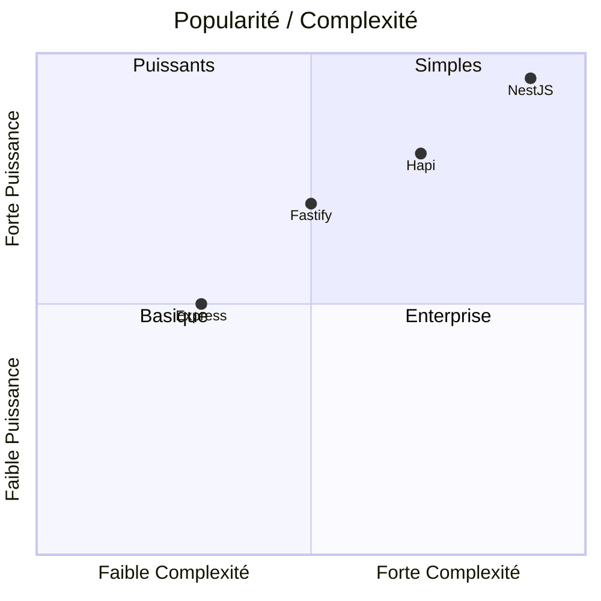

---

# 🎯 Projets à réaliser

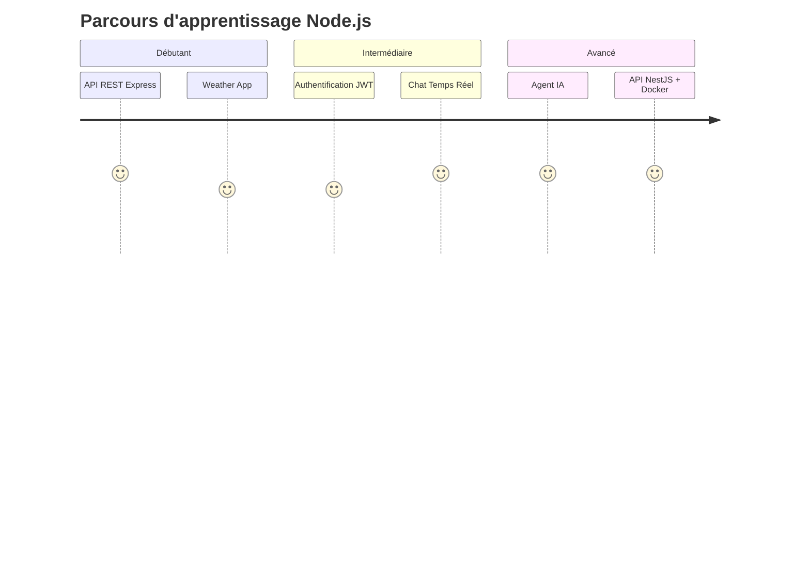

### ✅ API REST avec Express

* CRUD
* Middleware
* Validation

### ✅ Chat Temps Réel

* Socket.IO
* Rooms
* Notifications

### ✅ Agent IA

* OpenAI API
* LangChain
* RAG

### ✅ NestJS + Docker

* Architecture scalable
* TypeScript
* CI/CD

---

# 📝 Conclusion

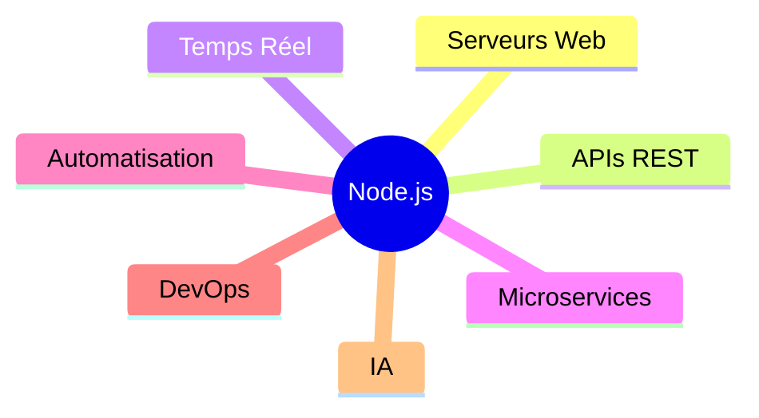

**Node.js est aujourd'hui l'une des technologies backend les plus utilisées au monde grâce à son modèle asynchrone, ses performances et son immense écosystème NPM.**
