# La Programmation Asynchrone en JavaScript

## 🚀 1. Pourquoi la programmation asynchrone existe en JavaScript ?

JavaScript est **monothread** : il n’exécute qu’une seule instruction à la fois.

```text
=> Si une opération est lente (lecture de fichier, appel API, requête BDD),
elle bloquerait tout le programme.
```

L’asynchrone sert à :

- ne pas bloquer le programme
- exécuter des tâches en arrière-plan
- continuer le code pendant que d’autres opérations se terminent

### Sans asynchrone

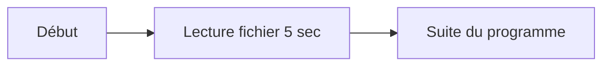

⚠️ Pendant les 5 secondes, tout est bloqué.

### Avec asynchrone

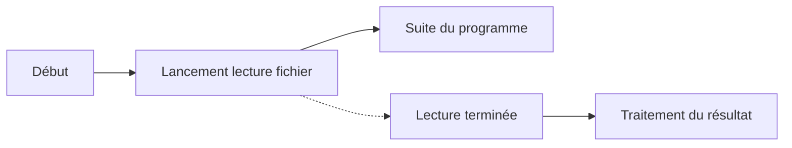

Le programme continue pendant que l'opération se déroule en arrière-plan.

---

# 🧠 2. Le principe de l’Event Loop

La magie vient de l'**Event Loop** :

* Le code rapide s'exécute dans le thread principal
* Les tâches lentes sont déléguées à l'environnement (Node.js ou navigateur)
* Une fois terminées, elles sont placées dans une file d'attente
* L'Event Loop les réinjecte quand le thread est libre

## Architecture simplifiée

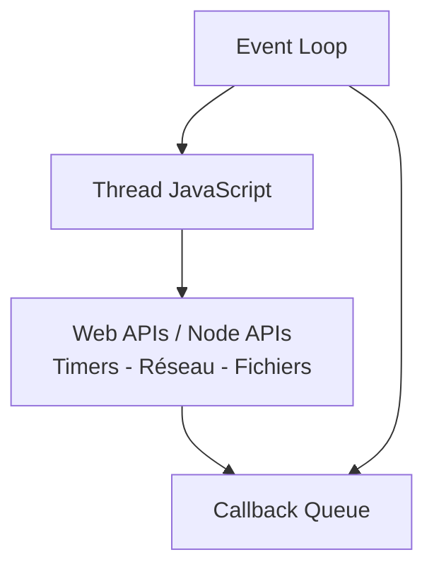

## Exemple avec `setTimeout`

```js
console.log("A");

setTimeout(() => {
  console.log("B");
}, 0);

console.log("C");
```

### Ordre réel d'exécution

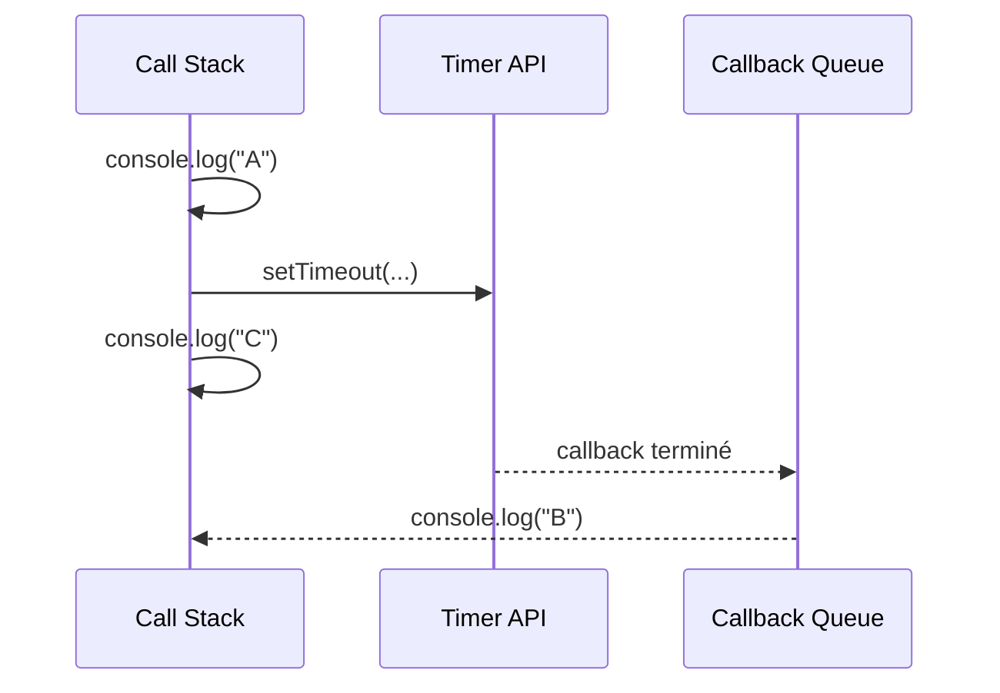

Résultat :

```text
A
C
B
```

📌 Même avec `0ms`, le callback ne passe qu'après la fin du code courant.

---

# 🪢 3. Les Callbacks (1ère façon de faire de l’asynchrone)

Un callback est une fonction passée en argument à une autre fonction.

Il est exécuté lorsque la tâche asynchrone est terminée.

## Exemple

```js
function getUser(callback) {
  setTimeout(() => {
    callback(null, { id: 1, name: "Alice" });
  }, 1000);
}

getUser((err, user) => {
  if (err) return console.error(err);

  console.log(user);
});
```

### Diagramme d'exécution

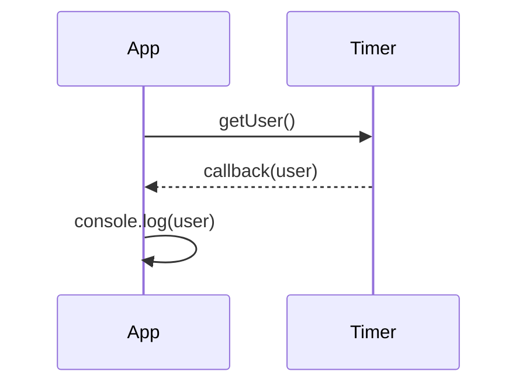

---

## ❌ Le Callback Hell

Lorsque plusieurs opérations dépendent les unes des autres :

```js
doA(() => {
  doB(() => {
    doC(() => {
      doD(() => {
        console.log("Enfer !");
      });
    });
  });
});
```

### Représentation visuelle

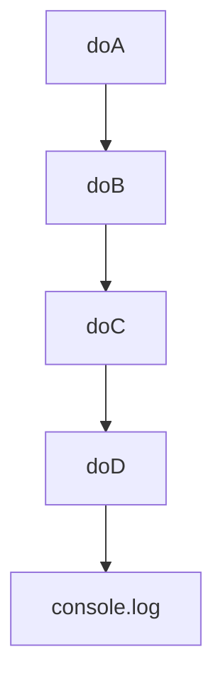

Cela devient :

* difficile à lire
* difficile à tester
* difficile à maintenir

---

# 🔮 4. Les Promises (solution moderne)

Une Promise représente une valeur qui sera disponible plus tard.

## Cycle de vie d'une Promise

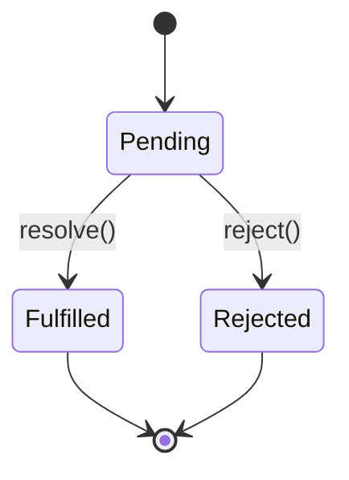

### États

* **Pending** → en attente
* **Fulfilled** → réussite
* **Rejected** → échec

---

## Exemple simple

```js
function getUser() {
  return new Promise((resolve, reject) => {
    setTimeout(() => {
      resolve({ id: 1, name: "Alice" });
    }, 1000);
  });
}

getUser()
  .then(user => console.log(user))
  .catch(err => console.error(err));
```

### Flux d'exécution

```mermaid
flowchart TD
    A[getUser()] --> B[Promise Pending]

    B --> C[resolve()]
    B --> D[reject()]

    C --> E[then()]
    D --> F[catch()]
```

---

## Chaining

Une Promise peut être chaînée :

```js
getUser()
  .then(user => getOrders(user.id))
  .then(orders => getInvoice(orders))
  .then(invoice => console.log(invoice))
  .catch(err => console.error(err));
```

### Visualisation

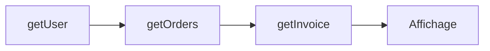

👍 Avantages :

* Plus lisible
* Chaînage naturel
* Gestion d'erreur centralisée

---

# 🌀 5. Async/Await (la syntaxe la plus moderne)

Async/Await repose entièrement sur les Promises.

## Exemple

```js
async function run() {
  try {
    const user = await getUser();

    console.log(user);
  } catch (err) {
    console.error(err);
  }
}

run();
```

---

## Que fait réellement `await` ?

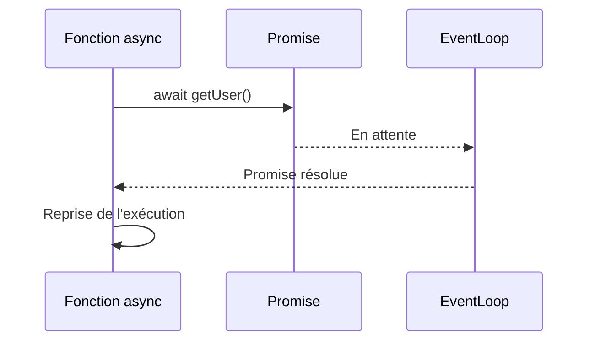

Important :

```text
await ne bloque PAS JavaScript.
Il suspend uniquement la fonction courante.
```

---

## Plusieurs await

### Exécution séquentielle

```js
const user = await getUser();
const orders = await getOrders();
```

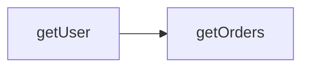

Temps total :

```text
Temps = A + B
```

---

### Exécution parallèle

```js
const [user, orders] = await Promise.all([
  getUser(),
  getOrders()
]);
```

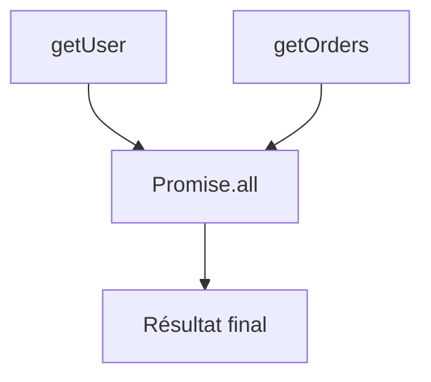

Temps total :

```text
Temps = max(A,B)
```

🚀 Beaucoup plus performant lorsque les tâches sont indépendantes.

---

# 📊 Résumé de l'évolution

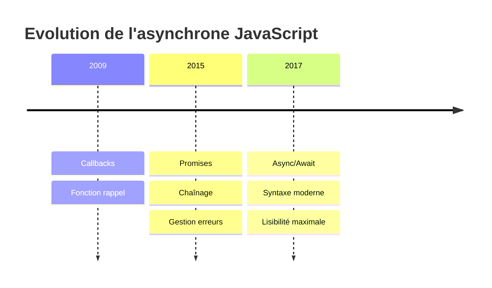

---

# ⚖️ Comparatif

| Méthode         | Avantages                    | Inconvénients                     |
| --------------- | ---------------------------- | --------------------------------- |
| **Callbacks**   | Simple, natif                | Callback Hell                     |
| **Promises**    | Chaining, `.catch()`         | Plus verbeux                      |
| **Async/Await** | Lisible, simple, `try/catch` | Attention aux `await` séquentiels |

---

# 🎯 À retenir

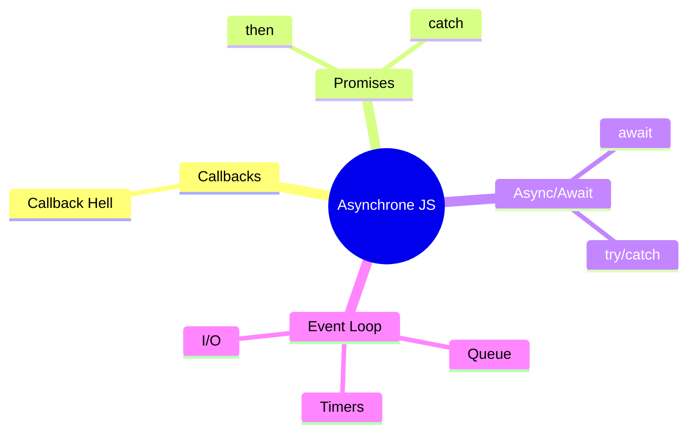

### En une phrase

👉 **Callbacks** = « Je te rappelle quand c'est prêt »
👉 **Promises** = « Je te promets une réponse plus tard »
👉 **Async/Await** = « J'attends le résultat sans bloquer l'application »

---

## 🏆 Règle moderne à retenir

```text
Event Loop
      ↓
Promises
      ↓
Async/Await
      ↓
Promise.all() quand plusieurs tâches sont indépendantes
```

C'est aujourd'hui la manière la plus utilisée et recommandée pour écrire du JavaScript asynchrone en production.
