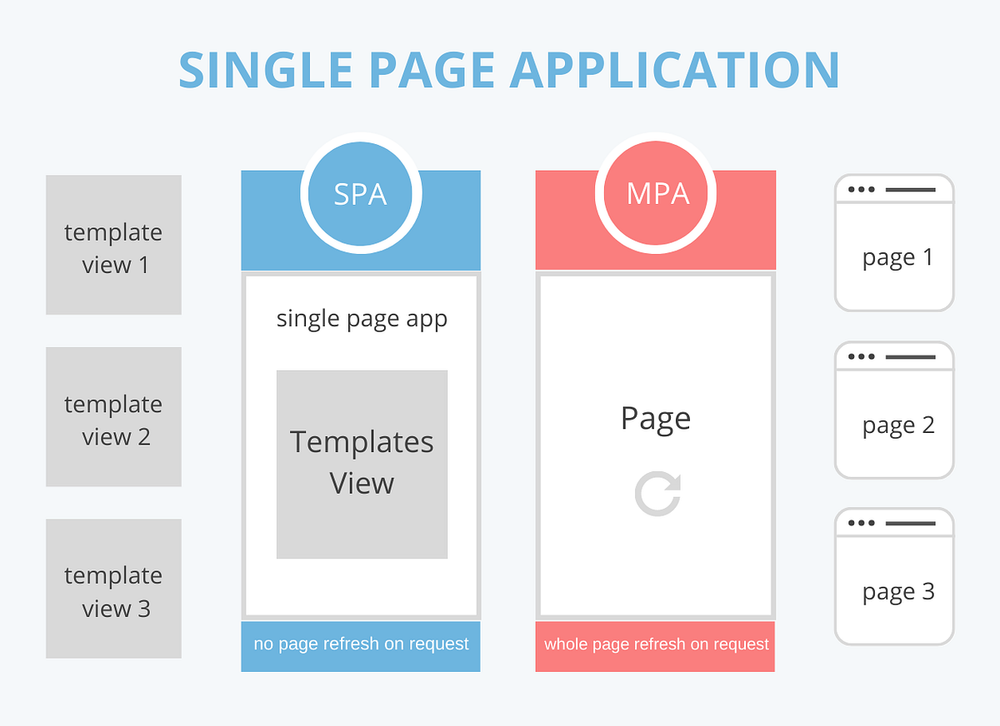

> La différence entre une Single Page Application (SPA) et une Multi Page Application (MPA) tient surtout à la manière dont les pages sont chargées et affichées dans le navigateur.

	

# 🔹 <ins>Single Page Application (SPA)</ins>
Une SPA charge une seule page HTML au départ, puis met à jour le contenu dynamiquement sans recharger toute la page.

## ⚙️ Fonctionnement
- Le navigateur charge une seule page.
- Ensuite, le JavaScript (souvent avec des frameworks comme React, Vue.js ou Angular) modifie le contenu.
- Les interactions utilisateur (clics, navigation) ne rechargent pas la page entière.

## ✅ Avantages
- Navigation rapide et fluide (pas de rechargement complet)
- Expérience proche d’une application mobile
- Moins de requêtes serveur après le chargement initial

## ❌ Inconvénients
- Chargement initial parfois plus lent
- SEO plus complexe (mais ça s’améliore aujourd’hui)
- Plus dépendant de JavaScript

## 🔹 Exemples célèbres de SPA (Single Page Applications)
Ces applications fonctionnent presque entièrement sans rechargement de page :

📱 **Apps web très interactives**
- Facebook → le fil d’actualité se recharge dynamiquement
- Twitter (ou X) → scroll infini, navigation fluide
- Instagram → interactions rapides sans reload

💼 **Outils et plateformes**
- Trello → drag & drop en temps réel
- Slack → discussions instantanées
- Notion → édition en direct

🎬 **Streaming & contenu**
- Netflix → navigation rapide entre contenus
- YouTube → lecture et navigation sans rechargement complet

👉 Point commun : expérience fluide, comme une app mobile.

# 🔹 <ins>Multi Page Application (MPA)</ins>
Une MPA fonctionne de manière plus classique : chaque action charge une nouvelle page HTML.

## ⚙️ Fonctionnement
- Chaque clic (ex : lien ou formulaire) → requête au serveur
- Le serveur renvoie une nouvelle page complète

## ✅ Avantages
- SEO plus simple et naturel
- Structure claire (chaque page a une URL)
- Moins dépendant du JavaScript

## ❌ Inconvénients
- Navigation plus lente (rechargement à chaque page)
- Expérience utilisateur moins fluide

## 🔹 Exemples célèbres de MPA (Multi Page Applications)
Ces sites rechargent une nouvelle page complète à chaque navigation :

🛒 **E-commerce**
- Amazon → changement de page pour chaque produit
- eBay → navigation classique entre pages

📰 **Sites d'information**
- Le Monde → chaque article est une page
- BBC → navigation page par page

🌐 **Sites institutionnels / classiques**
- Wikipedia → une page par sujet
- Airbnb → navigation avec rechargements (même s’ils utilisent aussi du JS)

👉 Point commun : structure en pages distinctes, bon pour le SEO.

# 🆚 Résumé rapide
| Critère     | SPA                     | MPA                  |
| ----------- | ----------------------- | -------------------- |
| Chargement  | Une seule page          | Plusieurs pages      |
| Navigation  | Dynamique (sans reload) | Reload à chaque page |
| Performance | Rapide après chargement | Plus lent            |
| SEO         | Plus complexe           | Plus simple          |
| UX          | Très fluide             | Classique            |

# 🧠 Exemple concret
- Une app comme Gmail → SPA (tout se met à jour sans recharger)
- Un site comme Amazon → plutôt MPA (même si aujourd’hui ils mélangent les deux)

# 👉 En pratique aujourd’hui
Beaucoup de sites modernes utilisent une approche hybride (ex : avec Next.js ou Nuxt.js) :
- certaines pages en SPA
- d’autres rendues côté serveur (SSR)