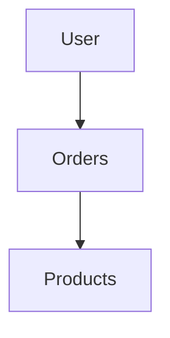
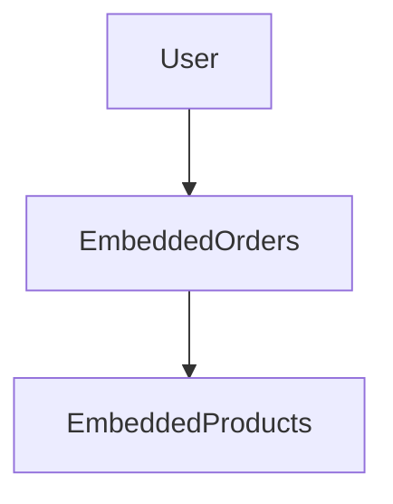
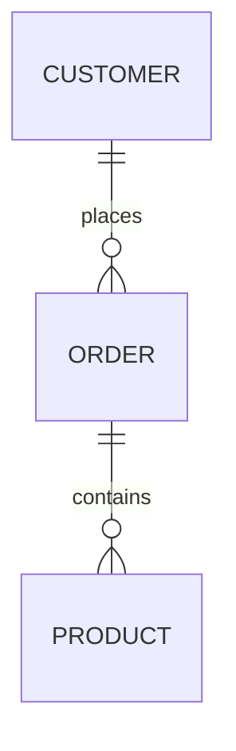
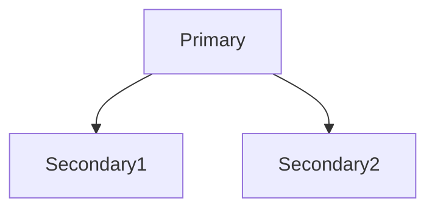
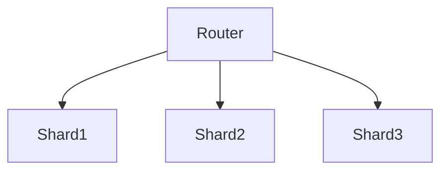
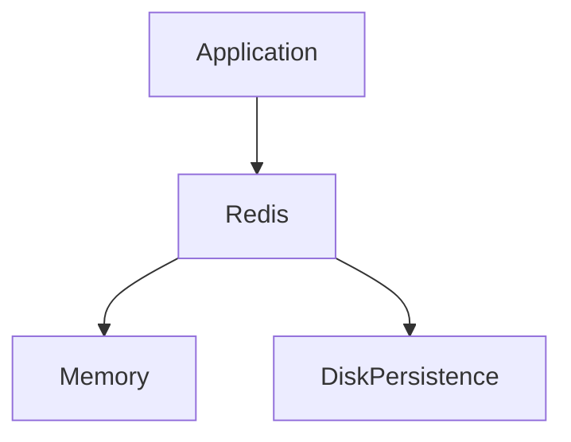
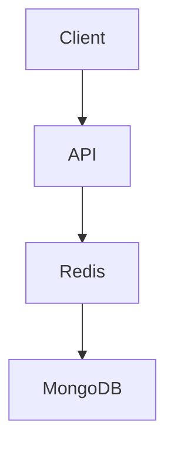
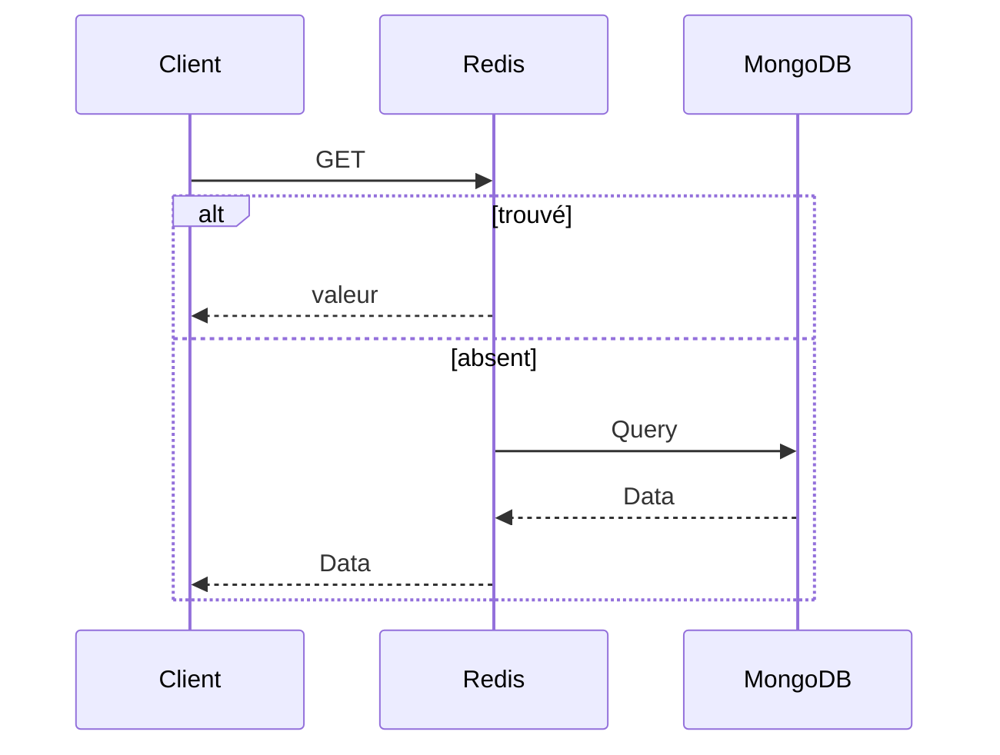
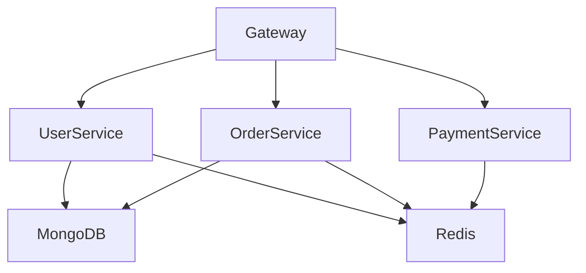
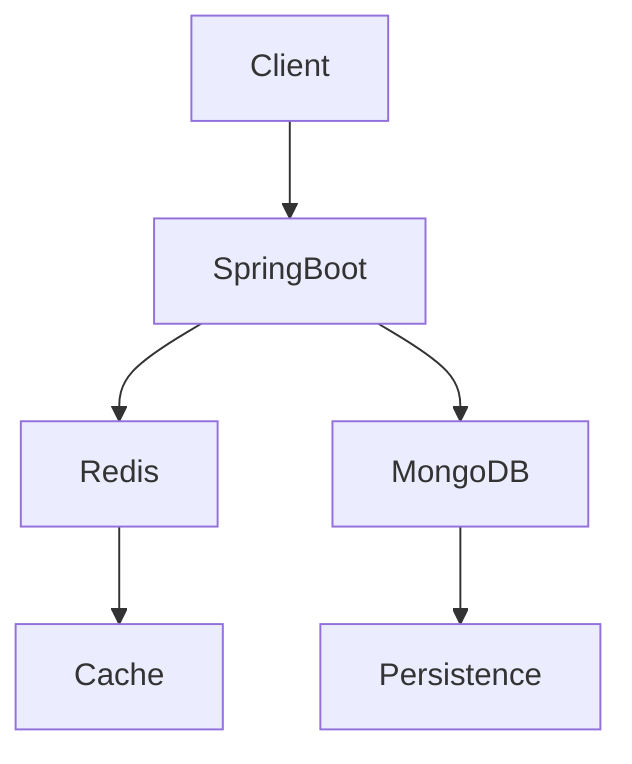

# Cours Magistral : NoSQL avec MongoDB et Redis
## Architectures modernes, modélisation, performances et implémentation Java Spring Boot

---

# Table des matières

1. Introduction au NoSQL
2. Pourquoi le NoSQL est apparu ?
3. Les limites du modèle relationnel
4. Les différentes familles NoSQL
5. Théorème CAP
6. BASE vs ACID
7. MongoDB : Architecture et concepts
8. Modélisation MongoDB
9. MongoDB avec Spring Boot
10. Redis : Architecture et concepts
11. Cas d'usage Redis
12. Redis avec Spring Boot
13. MongoDB vs Redis
14. Architecture combinée MongoDB + Redis
15. Patterns avancés
16. Bonnes pratiques
17. Conclusion

---

# 1. Introduction au NoSQL

NoSQL signifie :

> Not Only SQL

Le terme regroupe plusieurs familles de bases de données conçues pour résoudre les problèmes de :

- Scalabilité horizontale
- Big Data
- Faible latence
- Haute disponibilité
- Flexibilité du schéma

Contrairement aux SGBDR classiques :

- MySQL
- PostgreSQL
- Oracle
- SQL Server

les bases NoSQL privilégient généralement :

- la performance
- la distribution
- la tolérance aux pannes

---

# 2. Pourquoi le NoSQL est apparu ?

Avec l'arrivée :

- Facebook
- Google
- Amazon
- Netflix
- LinkedIn

les systèmes relationnels sont devenus difficiles à faire évoluer.

---

## Exemple

Imaginez :

```text
100 millions d'utilisateurs
5 milliards de messages
20 milliards de likes
```

Un unique serveur SQL devient rapidement un goulot d'étranglement.

---

# Solution : Scale Out

SQL classique :

```text
          +-----------+
          | PostgreSQL|
          +-----------+
                |
             Vertical
             Scaling
```

NoSQL :

```text
+---------+  +---------+  +---------+
| Node 1  |  | Node 2  |  | Node 3  |
+---------+  +---------+  +---------+

      Horizontal Scaling
```

---

# 3. Limites du modèle relationnel

## Jointures coûteuses

```sql
SELECT *
FROM users u
JOIN orders o
ON u.id = o.user_id
JOIN payments p
ON p.order_id = o.id;
```

Sur plusieurs milliards de lignes :

- très coûteux
- difficile à distribuer

---

## Schéma rigide

```sql
ALTER TABLE users
ADD COLUMN twitter VARCHAR(255);
```

Peut devenir complexe sur plusieurs To de données.

---

# 4. Les familles NoSQL

---

## Key-Value

Exemples :

- Redis
- DynamoDB

Structure :

```json
{
  "user:123": "{...}"
}
```

---

## Document

Exemples :

- MongoDB
- CouchDB

Structure :

```json
{
  "_id": 123,
  "name": "John",
  "email": "john@mail.com"
}
```

---

## Column Family

Exemples :

- Cassandra
- HBase

Optimisé pour :

- analytics
- très gros volumes

---

## Graph

Exemples :

- Neo4j
- JanusGraph

Pour :

- réseaux sociaux
- recommandations

---

# 5. Théorème CAP

Eric Brewer (2000)

Une base distribuée ne peut garantir simultanément :

```text
C = Consistency
A = Availability
P = Partition Tolerance
```

---

## Représentation

```text
         CAP

          C
         / \
        /   \
       /     \
      A-------P
```

---

## MongoDB

Choix principal :

```text
CP
```

---

## Redis Cluster

Choix principal :

```text
AP
```

---

# 6. ACID vs BASE

## ACID

SQL traditionnel

```text
Atomicity
Consistency
Isolation
Durability
```

---

## BASE

NoSQL

```text
Basically Available
Soft State
Eventually Consistent
```

---

# 7. MongoDB

---

## Présentation

MongoDB est une base :

- orientée document
- distribuée
- open source

Les données sont stockées au format :

```json
BSON
```

(Binary JSON)

---

# Structure MongoDB

```text
Database
 ├── Collection
 │      ├── Document
 │      ├── Document
 │      └── Document
```

---

## Exemple

Collection :

```text
users
```

Document :

```json
{
  "_id": "1",
  "name": "John",
  "email": "john@mail.com",
  "age": 25
}
```

---

# MongoDB vs SQL

SQL :

```sql
TABLE USERS
```

MongoDB :

```json
COLLECTION USERS
```

---

SQL :

```sql
ROW
```

MongoDB :

```json
DOCUMENT
```

---

# Exemple relationnel

```text
User
 └── Orders
      └── Products
```

---

SQL

```sql
users
orders
products
```

avec jointures.

---

MongoDB

```json
{
  "_id": 1,
  "name": "John",
  "orders": [
    {
      "id": 100,
      "total": 120
    }
  ]
}
```

Données embarquées.

---

# Schéma MongoDB



Document unique :



---

# 8. Modélisation MongoDB

---

## Embedding

```json
{
  "_id": 1,
  "name": "John",
  "address": {
    "city": "Paris",
    "country": "France"
  }
}
```

---

### Avantages

- lecture rapide
- pas de jointure

---

## Referencing

```json
{
  "_id": 1,
  "customerId": 100
}
```

---

### Avantages

- moins de duplication
- documents plus légers

---

# Exemple e-commerce



---

MongoDB embarqué :

```json
{
  "_id": "customer1",
  "name": "John",
  "orders": [
    {
      "id": 1,
      "products": [
        {
          "name": "Laptop"
        }
      ]
    }
  ]
}
```

---

# MongoDB Spring Boot

---

## Dépendance Maven

```xml
<dependency>
    <groupId>org.springframework.boot</groupId>
    <artifactId>
        spring-boot-starter-data-mongodb
    </artifactId>
</dependency>
```

---

## application.yml

```yaml
spring:
  data:
    mongodb:
      uri: mongodb://localhost:27017/shopdb
```

---

# Entité

```java
@Document(collection = "users")
public class User {

    @Id
    private String id;

    private String name;

    private String email;

    private Integer age;

}
```

---

# Repository

```java
@Repository
public interface UserRepository
    extends MongoRepository<User, String> {

    Optional<User> findByEmail(String email);

    List<User> findByAgeGreaterThan(int age);

}
```

---

# Service

```java
@Service
@RequiredArgsConstructor
public class UserService {

    private final UserRepository repository;

    public User create(User user) {
        return repository.save(user);
    }

    public List<User> findAll() {
        return repository.findAll();
    }
}
```

---

# Controller

```java
@RestController
@RequestMapping("/users")
@RequiredArgsConstructor
public class UserController {

    private final UserService service;

    @PostMapping
    public User create(
        @RequestBody User user) {

        return service.create(user);
    }

    @GetMapping
    public List<User> getAll() {
        return service.findAll();
    }
}
```

---

# MongoTemplate

Pour les requêtes avancées.

```java
@Service
@RequiredArgsConstructor
public class UserQueryService {

    private final MongoTemplate mongoTemplate;

    public List<User> adults() {

        Query query = new Query();

        query.addCriteria(
            Criteria.where("age").gte(18)
        );

        return mongoTemplate.find(
            query,
            User.class
        );
    }
}
```

---

# Agrégation MongoDB

```java
Aggregation aggregation =
Aggregation.newAggregation(

    Aggregation.match(
        Criteria.where("status")
            .is("PAID")
    ),

    Aggregation.group("customerId")
        .sum("total")
        .as("amount")
);

mongoTemplate.aggregate(
    aggregation,
    "orders",
    Document.class
);
```

---

# Index MongoDB

```java
@Indexed(unique = true)
private String email;
```

---

# Index composé

```java
@CompoundIndex(
    name = "email_age_idx",
    def = "{'email':1,'age':1}"
)
```

---

# Transactions MongoDB

```java
@Transactional
public void process() {

    orderRepository.save(order);

    paymentRepository.save(payment);
}
```

---

# Replica Set



---

# Sharding



---

# 9. Redis

---

## Présentation

Redis signifie :

```text
REmote DIctionary Server
```

Base :

- In Memory
- Ultra rapide
- Key Value

---

# Temps d'accès

```text
MongoDB : millisecondes

Redis : microsecondes
```

---

# Structures Redis

---

## String

```text
SET user:1 "John"
```

---

## Hash

```text
HSET user:1
name John
age 25
```

---

## List

```text
LPUSH queue job1
```

---

## Set

```text
SADD roles admin
```

---

## Sorted Set

```text
ZADD ranking 100 user1
```

---

# Architecture Redis



---

# Cas d'usage Redis

---

## Cache

```text
DB → Redis → API
```

---

## Session Store

```text
session:123
```

---

## Rate Limiting

```text
IP → compteur
```

---

## Leaderboard

```text
Classement jeux
```

---

## Queue

```text
Traitement asynchrone
```

---

# Redis Spring Boot

---

## Dépendance

```xml
<dependency>
 <groupId>
     org.springframework.boot
 </groupId>
 <artifactId>
     spring-boot-starter-data-redis
 </artifactId>
</dependency>
```

---

## Configuration

```yaml
spring:
  data:
    redis:
      host: localhost
      port: 6379
```

---

# Configuration Bean

```java
@Configuration
public class RedisConfig {

    @Bean
    public RedisTemplate<String, Object>
        redisTemplate(
            RedisConnectionFactory factory
        ) {

        RedisTemplate<String, Object>
            template = new RedisTemplate<>();

        template.setConnectionFactory(factory);

        return template;
    }
}
```

---

# Stockage simple

```java
@Service
@RequiredArgsConstructor
public class CacheService {

    private final RedisTemplate<String,Object>
        redisTemplate;

    public void save() {

        redisTemplate.opsForValue()
            .set("user:1", "John");
    }

    public String get() {

        return (String)
            redisTemplate.opsForValue()
            .get("user:1");
    }
}
```

---

# Expiration TTL

```java
redisTemplate
    .opsForValue()
    .set(
        "token",
        "ABC123",
        Duration.ofMinutes(30)
    );
```

---

# Hash Redis

```java
redisTemplate.opsForHash()
    .put(
        "user:1",
        "name",
        "John"
    );
```

---

# Liste Redis

```java
redisTemplate
    .opsForList()
    .leftPush(
        "queue",
        "job1"
    );
```

---

# Pub/Sub Redis

Publisher :

```java
@Service
@RequiredArgsConstructor
public class Publisher {

    private final RedisTemplate<String,Object>
        redisTemplate;

    public void publish() {

        redisTemplate
            .convertAndSend(
                "orders",
                "NEW_ORDER"
            );
    }
}
```

---

Subscriber :

```java
@Component
public class OrderSubscriber
implements MessageListener {

    @Override
    public void onMessage(
        Message message,
        byte[] pattern
    ) {

        System.out.println(
            new String(
                message.getBody()
            )
        );
    }
}
```

---

# Cache Spring Native

```java
@EnableCaching
@Configuration
public class CacheConfig {
}
```

---

## Service

```java
@Cacheable("users")
public User findById(String id) {

    return repository.findById(id)
        .orElseThrow();
}
```

---

## Eviction

```java
@CacheEvict(
    value = "users",
    key = "#id"
)
public void delete(String id) {
}
```

---

# Redis Distributed Lock

Dépendance :

```xml
<dependency>
 <groupId>org.redisson</groupId>
 <artifactId>redisson</artifactId>
</dependency>
```

---

Utilisation :

```java
RLock lock =
    redissonClient
        .getLock("payment-lock");

lock.lock();

try {

    processPayment();

}
finally {

    lock.unlock();
}
```

---

# 10. MongoDB vs Redis

| Critère | MongoDB | Redis |
|----------|----------|--------|
| Stockage | Document | Key/Value |
| Persistance | Oui | Oui |
| RAM obligatoire | Non | Oui |
| Requêtes complexes | Oui | Limité |
| Agrégation | Oui | Non |
| Full Text Search | Oui | Partiel |
| Cache | Moyen | Excellent |
| Latence | ms | µs |
| Transactions | Oui | Limité |

---

# Architecture Moderne

MongoDB + Redis



---

# Pattern Cache Aside

Lecture :



---

# Implémentation Cache Aside

```java
public User getUser(String id) {

    String key = "user:" + id;

    User cached =
        (User) redisTemplate
            .opsForValue()
            .get(key);

    if(cached != null)
        return cached;

    User user =
        mongoRepository
            .findById(id)
            .orElseThrow();

    redisTemplate.opsForValue()
        .set(
            key,
            user,
            Duration.ofMinutes(30)
        );

    return user;
}
```

---

# Architecture Microservices



---

# Bonnes pratiques MongoDB

✅ Créer des index

✅ Favoriser l'embedding lorsque pertinent

✅ Limiter la taille des documents

✅ Éviter les tableaux gigantesques

✅ Utiliser les agrégations

✅ Sharder les collections massives

---

# Bonnes pratiques Redis

✅ Utiliser des TTL

✅ Surveiller la mémoire

✅ Éviter les clés trop longues

✅ Utiliser Redis pour le cache

✅ Configurer l'éviction mémoire

```text
allkeys-lru
```

---

# Cas réel : E-commerce

MongoDB :

```text
Products
Orders
Customers
```

Redis :

```text
Cache produit
Session utilisateur
Panier
Token JWT blacklist
Leaderboard promotions
```

---

# Conclusion

MongoDB et Redis sont complémentaires.

MongoDB excelle pour :

- les données métier
- les requêtes complexes
- les agrégations
- la persistance durable

Redis excelle pour :

- le cache
- les sessions
- les compteurs
- les files d'attente
- les verrous distribués
- les accès ultra rapides

L'architecture la plus répandue aujourd'hui dans les systèmes à forte charge est :



**Règle d'or :**

> MongoDB stocke la vérité métier.
>
> Redis accélère l'accès à cette vérité.
