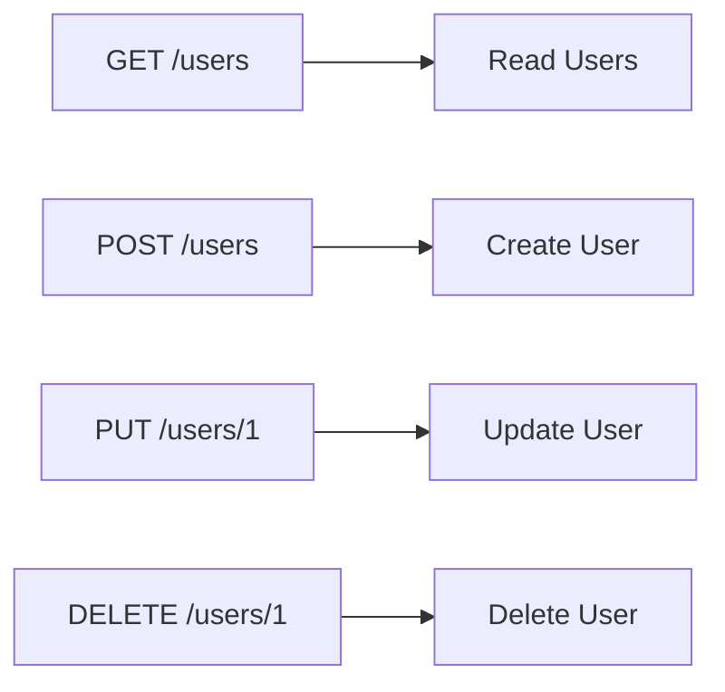
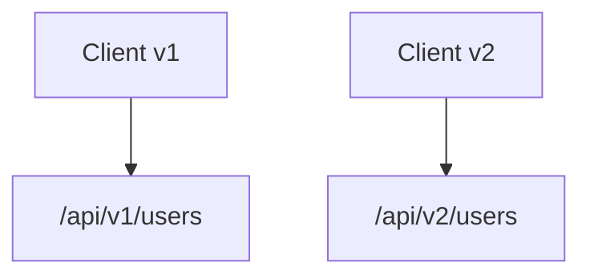
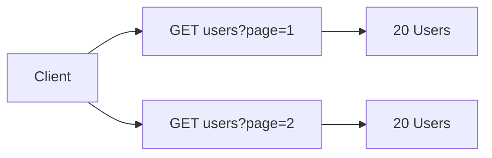
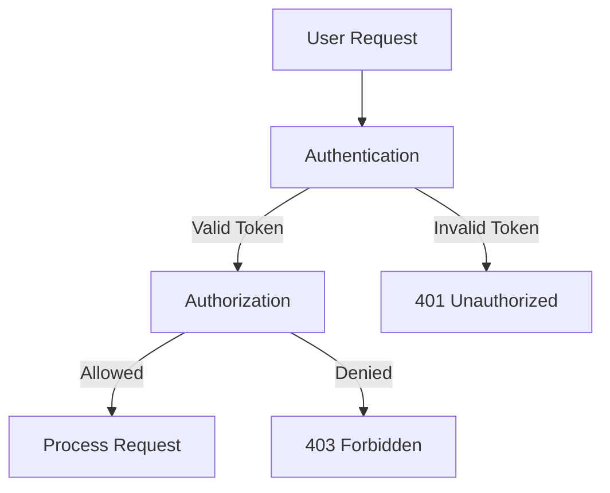
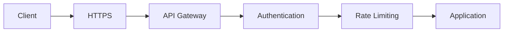
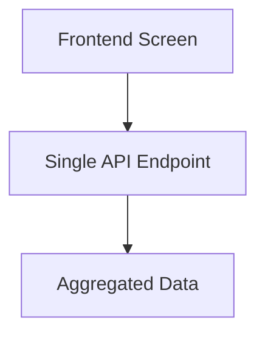

# Stop Designing REST APIs the Wrong Way

Designing a REST API is not just about exposing data. A well-designed API should be intuitive, scalable, secure, and consistent. Here are 10 common mistakes developers make and how to avoid them.

---

# 1. Stop Using Verbs in URLs

REST APIs should focus on **resources (nouns)** rather than actions (verbs).

❌ Bad

```http
GET /getUsers
POST /createUser
DELETE /deleteUser/123
```

✅ Good

```http
GET /users
POST /users
DELETE /users/123
```

The HTTP method already describes the action:

| Method | Action   |
| ------ | -------- |
| GET    | Retrieve |
| POST   | Create   |
| PUT    | Replace  |
| PATCH  | Update   |
| DELETE | Remove   |



---

# 2. Stop Ignoring HTTP Status Codes

Many APIs return `200 OK` for everything, including errors.

Use appropriate status codes to help clients understand what happened.

| Code | Meaning               |
| ---- | --------------------- |
| 200  | Success               |
| 201  | Resource Created      |
| 204  | No Content            |
| 400  | Bad Request           |
| 401  | Unauthorized          |
| 403  | Forbidden             |
| 404  | Not Found             |
| 409  | Conflict              |
| 422  | Validation Error      |
| 500  | Internal Server Error |

❌ Bad

```json
{
  "success": false,
  "message": "User not found"
}
```

Response:

```http
200 OK
```

✅ Good

```http
404 Not Found
```

```json
{
  "error": "USER_NOT_FOUND",
  "message": "User not found"
}
```

---

# 3. Stop Returning Inconsistent JSON

Consistency improves developer experience.

❌ Bad

Endpoint A

```json
{
  "userName": "John"
}
```

Endpoint B

```json
{
  "name": "John"
}
```

Endpoint C

```json
{
  "username": "John"
}
```

✅ Good

Use a standard response format.

```json
{
  "data": {
    "id": 1,
    "username": "John"
  }
}
```

Error responses should also follow a common structure.

```json
{
  "error": {
    "code": "VALIDATION_ERROR",
    "message": "Email is required"
  }
}
```

---

# 4. Stop Ignoring API Versioning

APIs evolve over time. Without versioning, breaking changes can impact existing clients.

Common approaches:

### URI Versioning

```http
/api/v1/users
/api/v2/users
```

### Header Versioning

```http
Accept: application/vnd.company.v2+json
```

```mermaid
graph TD
A[Client v1] --> B[/api/v1/users]
C[Client v2] --> D[/api/v2/users]
```


Benefits:

* Backward compatibility
* Easier migrations
* Controlled evolution

---

# 5. Stop Returning Everything (Stop Ignoring Pagination)

Returning thousands of records in a single request hurts performance.

❌ Bad

```http
GET /users
```

Response:

```json
[
  ...100000 users...
]
```

✅ Good

```http
GET /users?page=1&limit=20
```

Response:

```json
{
  "data": [],
  "pagination": {
    "page": 1,
    "limit": 20,
    "total": 5000,
    "pages": 250
  }
}
```



---

# 6. Stop Mixing Authentication & Authorization

These concepts are different.

### Authentication

Who are you?

Example:

```http
Authorization: Bearer eyJhb...
```

### Authorization

What are you allowed to do?

Example:

* Admin can delete users
* Customer cannot delete users



---

# 7. Stop Ignoring Error Structure

Error responses should be predictable.

❌ Bad

```json
{
  "msg": "something wrong"
}
```

✅ Good

```json
{
  "error": {
    "code": "EMAIL_ALREADY_EXISTS",
    "message": "The email is already registered",
    "details": {
      "field": "email"
    }
  }
}
```

Benefits:

* Easier debugging
* Better frontend integration
* Better monitoring

---

# 8. Stop Ignoring Filtering & Sorting Standards

Users often need subsets of data.

❌ Bad

```http
GET /activeUsers
GET /sortedUsers
```

✅ Good

Filtering:

```http
GET /users?status=active
```

Sorting:

```http
GET /users?sort=name
GET /users?sort=-createdAt
```

Multiple filters:

```http
GET /users?status=active&country=FR
```

Advanced example:

```http
GET /products?category=laptop&price_lt=1500
```

This keeps APIs flexible and reduces endpoint proliferation.

---

# 9. Stop Ignoring Security

Security must be considered from day one.

Essential practices:

### Use HTTPS

❌

```http
http://api.company.com
```

✅

```http
https://api.company.com
```

### Validate Inputs

Never trust user input.

### Rate Limiting

Prevent abuse:

```http
100 requests/minute
```

### Use Secure Authentication

* OAuth2
* OpenID Connect
* JWT (when appropriate)

### Protect Sensitive Data

Never expose:

* Passwords
* Secret keys
* Internal IDs when avoidable



---

# 10. Stop Designing APIs Around Your Database

A REST API is a product for consumers, not a mirror of your database schema.

❌ Database-driven design

```http
/users
/orders
/order_items
/user_addresses
```

Clients may need multiple requests to build a single screen.

❌

```text
GET /users/1
GET /orders?userId=1
GET /addresses?userId=1
```

✅ Consumer-driven design

```http
GET /users/1/profile
```

Response:

```json
{
  "id": 1,
  "name": "John",
  "address": {},
  "recentOrders": []
}
```



Design APIs around business use cases, not database tables.

---

# Final Thoughts

A good REST API should be:

* Resource-oriented
* Consistent
* Versioned
* Secure
* Easy to consume
* Performance-conscious
* Backward compatible

Before publishing an endpoint, ask yourself:

> "Does this API make sense for the consumer, or only for the backend implementation?"

If the answer is "only for the backend", redesign it.

Tu peux également ajouter une section bonus sur les bonnes pratiques modernes (HATEOAS, idempotence, OpenAPI/Swagger, API Gateway, observabilité et métriques) pour rendre l'article encore plus complet.
