# 🚀 API (Application Programming Interface)

## 🧩 Kesako ?

<div align="center">
	
</div>

> Une API (*Application Programming Interface*) est une interface qui permet à deux applications de communiquer entre elles.

Une API sert de **pont standardisé** entre systèmes :

* échange de données
* appel de fonctionnalités
* intégration de services externes

👉 Elle permet de **réutiliser des systèmes existants sans tout reconstruire**.

---

### 🔁 Schéma global d’une API

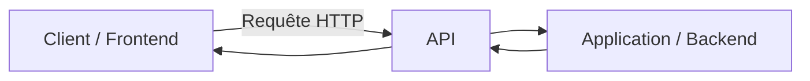

---

## 🧠 Modèles d’API

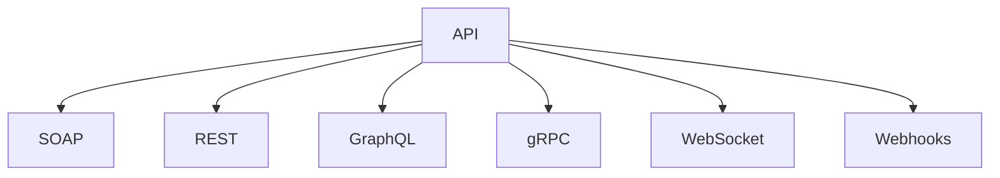

---

## 🧼 SOAP (ancien mais robuste)

<div align="center">
	
</div>

* Protocole standardisé (W3C)
* Format XML strict
* Contrat via WSDL

### ✔️ Caractéristiques

* très structuré
* sécurisé (WS-Security)
* compatible multi-protocoles (HTTP, SMTP…)

### 📌 Usage

* banques
* systèmes critiques
* environnements legacy

---

## 🌐 REST (le standard moderne)

<div align="center">
	
</div>

### 📡 Principe

REST repose sur des ressources accessibles via HTTP :

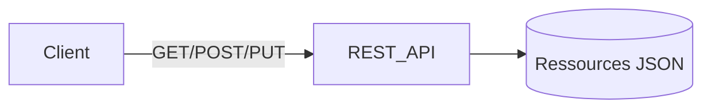

### 🔑 Concepts clés

* stateless
* ressources identifiées par URL
* verbes HTTP (GET, POST, PUT, DELETE)
* format JSON majoritaire

### ⚙️ HATEOAS

Le client découvre les actions possibles via les réponses API.

---

## 📊 GraphQL (flexibilité côté client)

<div align="center">
	
</div>

### 💡 Principe

Le client demande **exactement ce dont il a besoin** :

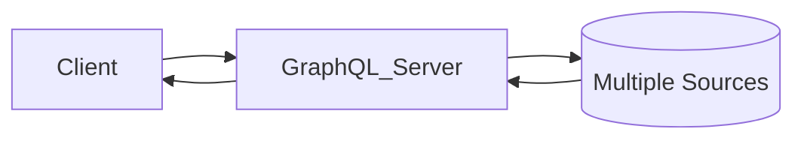

### ✔️ Avantages

* moins de sur-fetching
* une seule endpoint
* flexible pour frontend complexe

### ⚠️ Limites

* complexité serveur
* caching plus difficile

---

## 🔀 API vs WebService vs Microservice

| Concept      | Définition                 | Rôle         |
| ------------ | -------------------------- | ------------ |
| API          | Interface de communication | Contrat      |
| WebService   | API via réseau (HTTP)      | Transport    |
| Microservice | Architecture applicative   | Organisation |

---

## 🧭 API Management

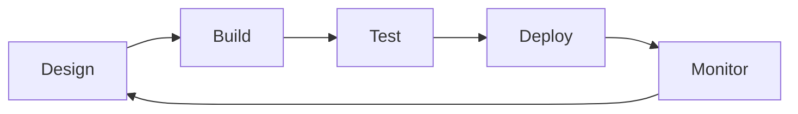

### 🎯 Objectifs

* gérer le cycle de vie des API
* sécuriser les accès
* analyser les usages

### 🧰 Fonctions clés

* design & documentation
* sécurité (OAuth, API keys)
* monitoring
* throttling / rate limiting

---

## 📊 KPIs API

* disponibilité (uptime)
* consommation (trafic)
* scalabilité (charge supportée)

---

## 🧪 Postman

### Cas d’usage principaux

* tests API
* automatisation
* environnements (dev/staging/prod)
* documentation
* mocks
* CI/CD

---

# 📡 Codes de retour HTTP

## 🧭 Vue globale

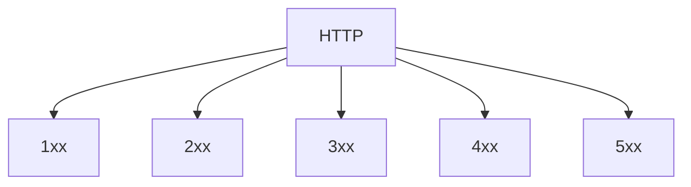

---

## 📌 Résumé

| Code | Signification  |
| ---- | -------------- |
| 2xx  | Succès         |
| 3xx  | Redirection    |
| 4xx  | Erreur client  |
| 5xx  | Erreur serveur |

---

# 🌐 Verbes HTTP

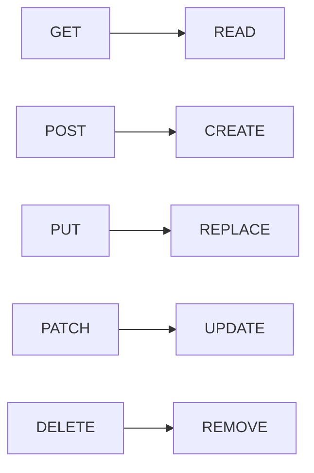

---

# 🔐 Quelques astuces pour sécuriser ses API

## 🔒 Astuce 1 — Utiliser HTTPS

Toutes les communications doivent être chiffrées via TLS.

👉 Empêche :

* interception de données
* attaques MITM

---

## 🔑 Astuce 2 — OAuth2

Protocole d’autorisation moderne.

✔ Permet :

* accès limité
* tokens temporaires
* délégation (Google, GitHub login)

---

## 🔐 Astuce 3 — WebAuthn

Authentification forte sans mot de passe.

✔ Basé sur :

* biométrie
* clés matérielles

---

## 🔑 Astuce 4 — API Keys avec niveaux

Ne jamais utiliser une clé unique globale.

✔ Bonnes pratiques :

* clé par utilisateur
* clé par environnement
* permissions limitées

---

## 🛂 Astuce 5 — Authorization stricte

Différencier :

* authentification (qui es-tu ?)
* autorisation (as-tu le droit ?)

---

## 🚦 Astuce 6 — Rate Limiting

Limiter le nombre de requêtes :

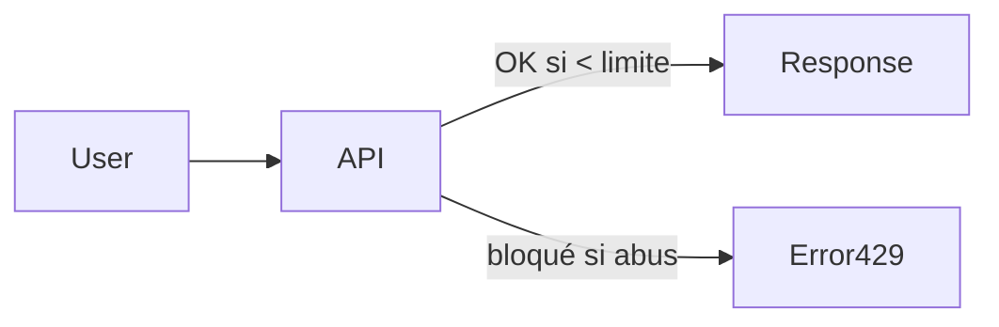

✔ Protège contre :

* brute force
* DDoS
* abus API

---

## 🔁 Astuce 7 — Versioning API

Exemple :

* `/api/v1/users`
* `/api/v2/users`

✔ Permet :

* évolution sans casser les clients

---

## 🧾 Astuce 8 — Allowlisting

Ne pas bloquer ce qui est dangereux → mais autoriser uniquement ce qui est connu.

✔ Très efficace pour :

* endpoints internes
* microservices

---

## 🛡️ Astuce 9 — OWASP API Security

### ⚠️ Principaux risques

* BOLA (Broken Object Level Authorization)
* Broken Authentication
* Excessive Data Exposure
* Rate Limit insuffisant
* SSRF

---

### 🔥 Vue structurée

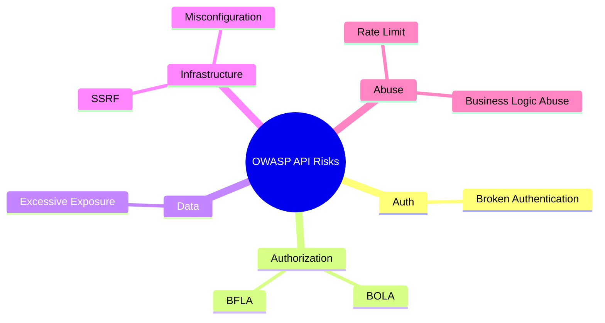

---

## 🛡️ Astuce 10 — API Gateway

Point d’entrée unique :

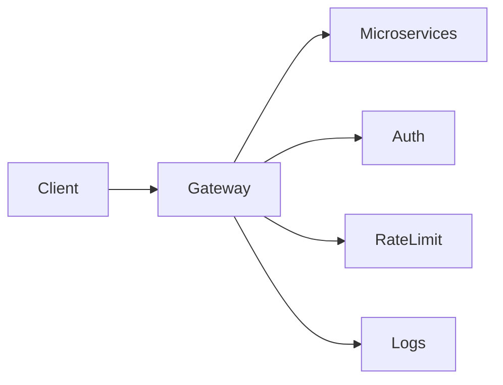

✔ Centralise :

* sécurité
* routing
* monitoring

---

## ⚠️ Astuce 11 — Error Handling

Bonnes pratiques :

* ne pas exposer les stack traces
* messages génériques côté client
* logs détaillés côté serveur

---

## 🧪 Astuce 12 — Input Validation

Toujours valider :

* types
* formats
* tailles
* schémas JSON

✔ Empêche :

* injections
* corruption de données

---

# How to Stop Designing REST APIs the Wrong Way

Designing a REST API is not just about exposing data. A well-designed API should be intuitive, scalable, secure, and consistent. Here are 10 common mistakes developers make and how to avoid them.

---

# 1. Stop Using Verbs in URLs

REST APIs should focus on **resources (nouns)** rather than actions (verbs).

❌ Bad

```http
GET /getUsers
POST /createUser
DELETE /deleteUser/123
```

✅ Good

```http
GET /users
POST /users
DELETE /users/123
```

The HTTP method already describes the action:

| Method | Action   |
| ------ | -------- |
| GET    | Retrieve |
| POST   | Create   |
| PUT    | Replace  |
| PATCH  | Update   |
| DELETE | Remove   |

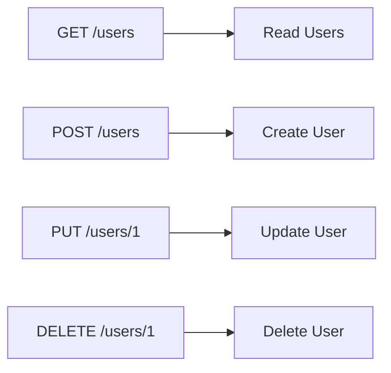

---

# 2. Stop Ignoring HTTP Status Codes

Many APIs return `200 OK` for everything, including errors.

Use appropriate status codes to help clients understand what happened.

| Code | Meaning               |
| ---- | --------------------- |
| 200  | Success               |
| 201  | Resource Created      |
| 204  | No Content            |
| 400  | Bad Request           |
| 401  | Unauthorized          |
| 403  | Forbidden             |
| 404  | Not Found             |
| 409  | Conflict              |
| 422  | Validation Error      |
| 500  | Internal Server Error |

❌ Bad

```json
{
  "success": false,
  "message": "User not found"
}
```

Response:

```http
200 OK
```

✅ Good

```http
404 Not Found
```

```json
{
  "error": "USER_NOT_FOUND",
  "message": "User not found"
}
```

---

# 3. Stop Returning Inconsistent JSON

Consistency improves developer experience.

❌ Bad

Endpoint A

```json
{
  "userName": "John"
}
```

Endpoint B

```json
{
  "name": "John"
}
```

Endpoint C

```json
{
  "username": "John"
}
```

✅ Good

Use a standard response format.

```json
{
  "data": {
    "id": 1,
    "username": "John"
  }
}
```

Error responses should also follow a common structure.

```json
{
  "error": {
    "code": "VALIDATION_ERROR",
    "message": "Email is required"
  }
}
```

---

# 4. Stop Ignoring API Versioning

APIs evolve over time. Without versioning, breaking changes can impact existing clients.

Common approaches:

### URI Versioning

```http
/api/v1/users
/api/v2/users
```

### Header Versioning

```http
Accept: application/vnd.company.v2+json
```

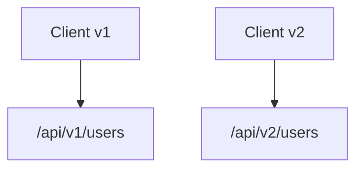

Benefits:

* Backward compatibility
* Easier migrations
* Controlled evolution

---

# 5. Stop Returning Everything (Stop Ignoring Pagination)

Returning thousands of records in a single request hurts performance.

❌ Bad

```http
GET /users
```

Response:

```json
[
  ...100000 users...
]
```

✅ Good

```http
GET /users?page=1&limit=20
```

Response:

```json
{
  "data": [],
  "pagination": {
    "page": 1,
    "limit": 20,
    "total": 5000,
    "pages": 250
  }
}
```

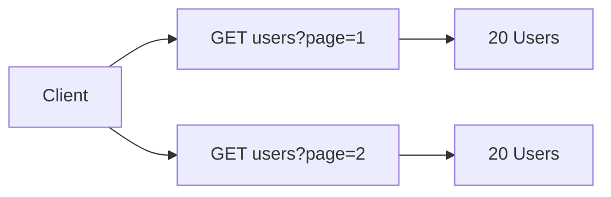

---

# 6. Stop Mixing Authentication & Authorization

These concepts are different.

### Authentication

Who are you?

Example:

```http
Authorization: Bearer eyJhb...
```

### Authorization

What are you allowed to do?

Example:

* Admin can delete users
* Customer cannot delete users

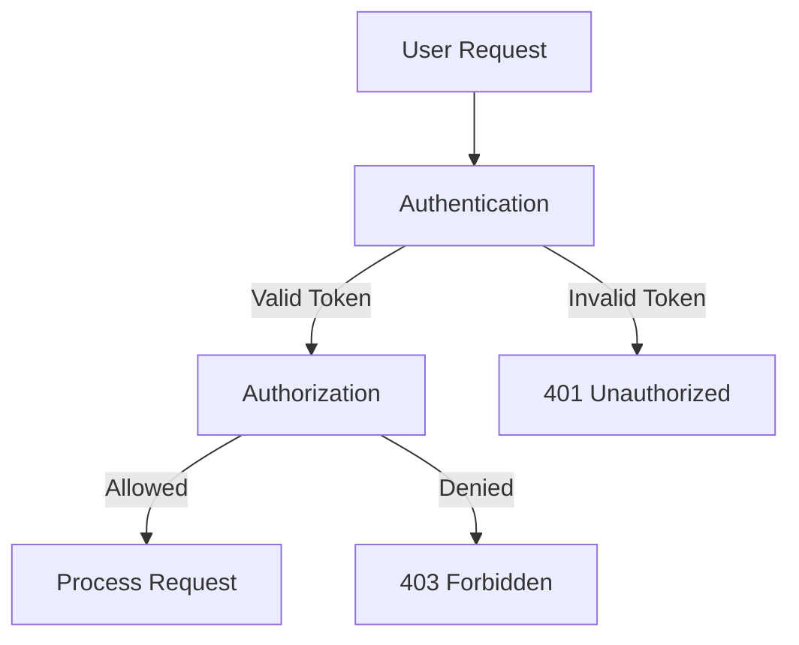

---

# 7. Stop Ignoring Error Structure

Error responses should be predictable.

❌ Bad

```json
{
  "msg": "something wrong"
}
```

✅ Good

```json
{
  "error": {
    "code": "EMAIL_ALREADY_EXISTS",
    "message": "The email is already registered",
    "details": {
      "field": "email"
    }
  }
}
```

Benefits:

* Easier debugging
* Better frontend integration
* Better monitoring

---

# 8. Stop Ignoring Filtering & Sorting Standards

Users often need subsets of data.

❌ Bad

```http
GET /activeUsers
GET /sortedUsers
```

✅ Good

Filtering:

```http
GET /users?status=active
```

Sorting:

```http
GET /users?sort=name
GET /users?sort=-createdAt
```

Multiple filters:

```http
GET /users?status=active&country=FR
```

Advanced example:

```http
GET /products?category=laptop&price_lt=1500
```

This keeps APIs flexible and reduces endpoint proliferation.

---

# 9. Stop Ignoring Security

Security must be considered from day one.

Essential practices:

### Use HTTPS

❌

```http
http://api.company.com
```

✅

```http
https://api.company.com
```

### Validate Inputs

Never trust user input.

### Rate Limiting

Prevent abuse:

```http
100 requests/minute
```

### Use Secure Authentication

* OAuth2
* OpenID Connect
* JWT (when appropriate)

### Protect Sensitive Data

Never expose:

* Passwords
* Secret keys
* Internal IDs when avoidable

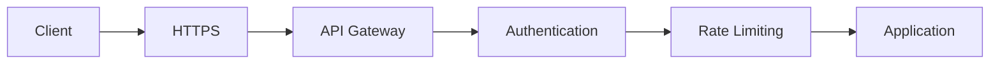

---

# 10. Stop Designing APIs Around Your Database

A REST API is a product for consumers, not a mirror of your database schema.

❌ Database-driven design

```http
/users
/orders
/order_items
/user_addresses
```

Clients may need multiple requests to build a single screen.

❌

```text
GET /users/1
GET /orders?userId=1
GET /addresses?userId=1
```

✅ Consumer-driven design

```http
GET /users/1/profile
```

Response:

```json
{
  "id": 1,
  "name": "John",
  "address": {},
  "recentOrders": []
}
```

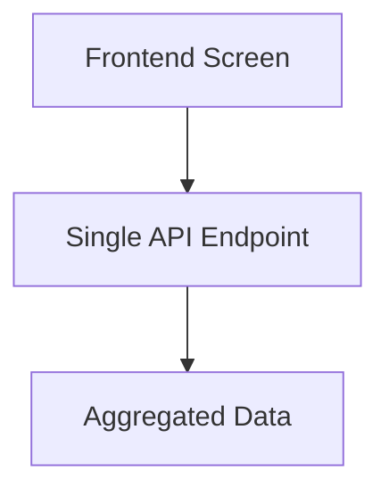

Design APIs around business use cases, not database tables.

---

# Final Thoughts

A good REST API should be:

* Resource-oriented
* Consistent
* Versioned
* Secure
* Easy to consume
* Performance-conscious
* Backward compatible

Before publishing an endpoint, ask yourself:

> "Does this API make sense for the consumer, or only for the backend implementation?"

If the answer is "only for the backend", redesign it.


# 🎯 Conclusion

Une API moderne repose sur 3 piliers :

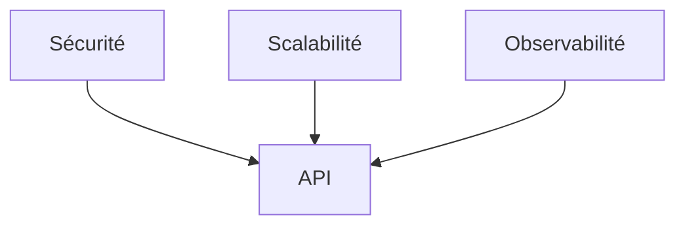


