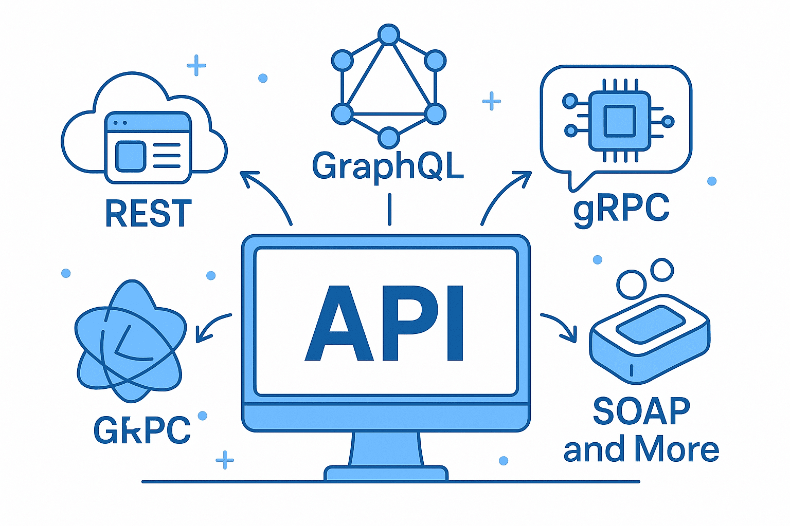
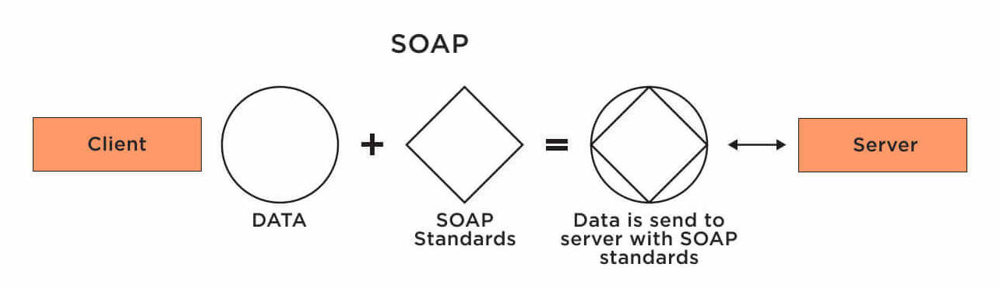
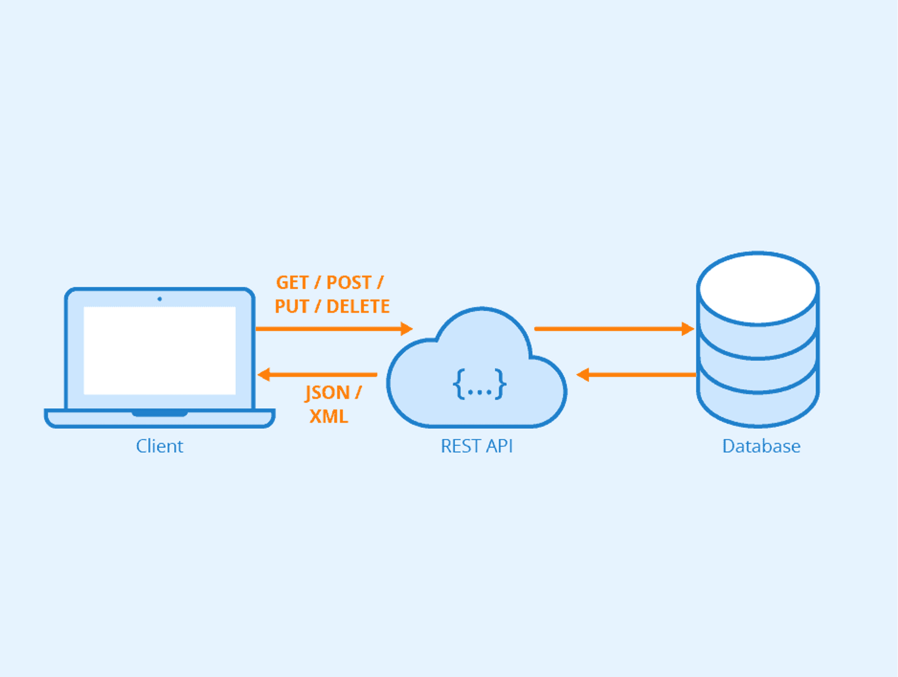
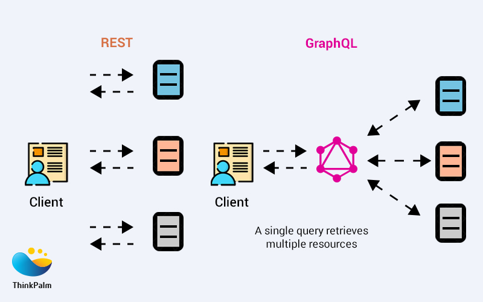
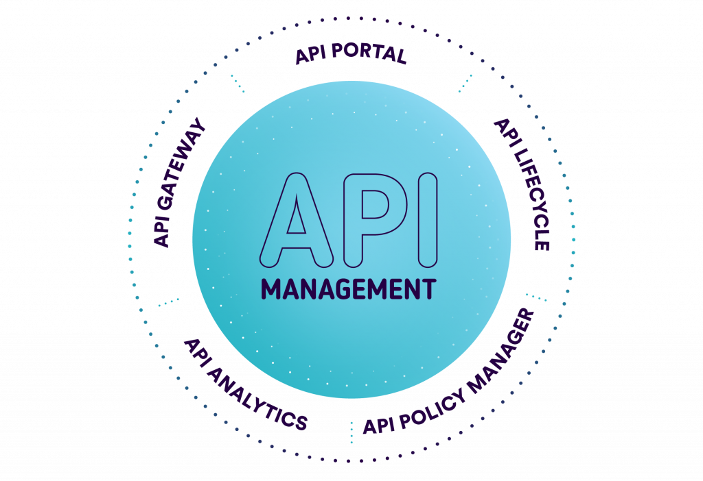

# API (Application Programming Interface) 

## <ins>Kesako ?</ins>
<div align="center">
	
</div>


> L’acronyme API équivaut à l’expression “Application Programming Interface”. <br>
> Traduit par Interface de Programmation Applicative (IPA) en français, 
```
Ce concept renvoie à une solution informatique qui rend possible la communication 
et l’échange de données entre deux applications.
Une API est donc à une interface facilitant la création et l’intégration d’applications. 
Son point fort ? Elle autorise les développeurs à se servir d’un programme existant, 
au lieu de repartir de zéro à chaque fois.
Chacune possède ses propres caractéristiques (clés d’accès, types de données accessibles ou non…). 
Il existe deux types d’APIs : les publiques et les privées. 
Les API publiques sont ouvertes (open source) et facilement accessibles sur le net. 
Les API privées, quant à elles, sont développées en interne.
```

## <ins>Modèles d'API</ins>
```
On retrouve donc plusieurs modèles d’API pour procéder à des échanges de données, 
et bien qu’il en existe d’autres, 
les trois principaux aujourd’hui sont les suivants : SOAP, REST et GraphQL. 
IL existe d'autres modèles bien sûr (gRPC, Webhooks, WebSockets, …)
```

- **SOAP (Simple Object Access Protocol)**<br>
<div align="center">
	
</div>

> C'est un protocole standardisé par le W3C. Ses échanges utilisent des formats de fichier XML.<br> 
> Ce dernier est ancien, ce qui lui donne comme principal avantage d’être lisible par tous les langages.<br>
> Celui-ci peut également passer par divers modes de communications : HTTP, HTTPS, TCP, SMTP, POP, etc. 
```
Ce format d’API est très structuré, car toutes les méthodes et 
propriétés sont décrites par un document XML :
- le Web Services Description Language (WSDL).
```
Le SOAP permet de répondre à : 
- des besoins asynchrones, 
- une validation forte des modèles d'échanges, 
- des opérations statefull
```
Le SOAP est donc utilisé pour des besoins de sécurités des échanges forts, 
par exemple pour des systèmes financiers ou bancaires.
```

- **REST (Representational State Transfer)**<br>
<div align="center">
	
</div>

```
Les architectures REST reposent sur un échange client/serveur où les données sont structurées 
d’une manière à ne pas avoir la main dessus, c’est-à-dire que c’est le serveur qui gère cela 
en renvoyant du texte, du CSV, ou du JSON, par exemple.
L’une des caractéristiques fortes qui qualifie une API de REST est le : 
- HATEOAS (Hypermedia as the Engine of Application State). 
Cela se traduit par le fait que le client 
- n’a pas besoin de connaissance au préalable (ou peu) pour interagir avec l’API. 
Cela passe par une structure forte des routes et des verbes utilisés (GET,POST,PUT,PATCH,DELETE).
```

- **GraphQL (Graph Query Language)**<br>
<div align="center">
	
</div>

```
GraphQL est un nouveau type d’API bien plus récent. 
L’idée est de partir d’une API REST avec des formats de retour JSON, 
mais avec la subtilité en plus que le client doit envoyer :
- les données qu’ils souhaite récupérer au serveur, 
- cela via un Graph, un modèle de données. 
Ainsi, le serveur se retrouve à avoir une couche plus lourde d’initialisation des modèles, 
mais dans la finalité le tout est plus léger de par le moins grand nombre de déclarations de routes 
et de leurs fonctionnements propres.
Graph semble donc être l’avenir des API stateless de par ses qualités, 
mais son utilisation encore limitée peut le rendre un peu moins attrayant 
et donc plus complexe à prendre en main.
```

## <ins>API vs WebService vs Microservice</ins>
**API :**<br>
> Ensemble de règles permettant à deux applications ou composants logiciels de communiquer
- Objectif : Fournir une interface pour échanger des données ou des fonctionnalités.
- Portée : Peut être utilisée localement ou via un réseau.
- Types : REST API, SOAP API, GraphQL API
- Point clé : Une API n’est pas forcément liée au web ; elle peut être utilisée dans des applications desktop, mobiles, etc.

**WebService :**<br>
> Type d’API qui utilise des protocoles web (HTTP, XML, JSON) pour permettre la communication entre applications via Internet.
- Objectif : Assurer l’interopérabilité entre systèmes hétérogènes.
- Protocoles courants : SOAP (Simple Object Access Protocol), REST (Representational State Transfer)
- Point clé : Tous les web services sont des API, mais toutes les API ne sont pas des web services.

**Microservice :**<br>
> Style d’architecture où une application est composée de petits services indépendants,<br>
> chacun étant responsable d’une fonction métier.
- Objectif : Améliorer la scalabilité, la flexibilité et la maintenabilité.
- Caractéristiques : Chaque microservice est autonome, Communication via des API légères (REST, gRPC, ou messages).
- Point clé : Les microservices utilisent des API pour communiquer, mais représentent une architecture, pas seulement une interface.


## <ins>Gestion d'API (API Management)</ins>
<div align="center">
	
</div>


> L’utilisation accrue des API a entraîné avec elle le développement de certains outils.<br>
> Destinés aux entreprises, ceux-ci ont été conçus afin d’aider les organisations à gérer les API de façon efficace.<br> 
> Plus précisément, l’API management (ou gouvernance des API) signifie contrôler et optimiser l’utilisation des API,<br> 
> tout en évitant de perturber le travail des développeurs ainsi que l’expérience utilisateur.<br> 
> Pour une entreprise, ce processus vise à suivre, contrôler et promouvoir ses API.<br>
```
La gestion des API apporte une réelle valeur ajoutée : elle permet notamment de partager 
plus facilement les données d’une entreprise avec ses partenaires commerciaux. 
Par exemple, il devient envisageable pour un fournisseur d’avoir une vision transparente 
sur le stock de produits de ses clients. 
Il peut alors exploiter ces chiffres dans son propre système et ajuster les livraisons.
Les outils de gestion des API aident les utilisateurs à :
- concevoir, 
- créer, 
- tester, 
- surveiller et déployer des API. 
Ils aident les équipes de données à configurer l'intégralité du cycle de vie 
des API au sein d'une seule plateforme.
```
> Certaines fonctionnalités clés des solutions de gestion d'API incluent :
- **Conception et création d'API**<br>
Les outils API aident à concevoir les spécifications de l'API, à définir les points de terminaison 
et à créer la documentation nécessaire pour que les développeurs comprennent comment interagir avec l'API.
- **Sécurité et authentification**<br>
Les outils de gestion des API fournissent des mécanismes pour sécuriser les API, mettre en œuvre l'authentification 
et contrôler l'accès via des méthodes telles que les clés API, OAuth ou d'autres protocoles d'authentification.
- **Gestion du trafic routier**<br>
Ces outils vous permettent de surveiller et de contrôler le flux de données entre les API et les applications, 
évitant ainsi les surcharges ou les utilisations abusives et garantissant des performances optimales.
- **Surveillance et analyse**<br> 
Les solutions de gestion des API offrent des capacités de surveillance et d'analyse en temps réel, vous permettant de suivre 
l'utilisation des API, d'identifier les goulots d'étranglement en matière de performances 
et d'obtenir des informations sur le comportement des utilisateurs.

**Enjeux de l'API Management :** 
- Analyser l'activité de vos API
- Gérer le cycle de vie de vos API
- Contrôler les accès et les connexions
- Disposer d'un portail pour la communauté de développeurs (documentation des APIs)

**Exemples de Solutions d'API Management :**
- Amazon API Gateway
- Kong
- Astera
- IBM API Connect
- Apidog
- SwaggerHub

Les plateformes d’API management permettent de surveiller les différentes métriques liées aux API. On observe trois KPIs fondamentaux :
- la disponibilité : le service fourni par l'application s’arrête si la disponibilité n’est pas de 100% ;
- la consommation : il s’agit du niveau du besoin client ;
- la scalabilité : la capacité de l’API à s’adapter à un nombre croissant d’utilisateurs.


## <ins>L'outil Postman</ins>
<div align="center">
	
</div>

Postman est un outil très populaire pour travailler avec des API. Voici les principaux cas d’usage :


🚀 **1. Tester des API (REST, GraphQL, SOAP…)**
- Envoyer facilement des requêtes GET, POST, PUT, DELETE…
- Ajouter des paramètres, headers, bodies JSON, formulaires, fichiers…
- Visualiser les réponses (code HTTP, temps, payload).

🔁 **2. Automatiser des tests**
- Créer des tests automatisés grâce à du JavaScript directement dans Postman.
- Vérifier le statut HTTP, le format JSON, la présence de champs, etc.
- Intégrer ces tests dans une Collection pour les exécuter en série.

⚙️ **3. Simuler des scénarios complexes**
- Enchaîner plusieurs appels, utiliser des variables, scripts pré-requête.
- Construire des workflows pour tester des parcours utilisateurs.

🌐 **4. Gérer différents environnements**
- Définir des variables d’environnement (dev / test / prod).
- Faciliter le changement de base URL, tokens, identifiants.

🛠️ **5. Documenter une API**
- Générer automatiquement une documentation lisible et partageable.
- La mettre à disposition via un lien public ou privé.

📦 **6. Mocker des API (Mock Servers)**
- Créer des serveurs factices pour simuler une API avant qu’elle n’existe.
- Utile pour développer un front-end en parallèle.

🔐 **7. Gérer l’authentification**
- Support de nombreuses méthodes : API Key, Bearer Token, OAuth 2.0, Basic Auth…
- Gestion automatique du refresh token.

🌩️ **8. Automatiser des pipelines CI/CD**
- Lancer des collections de tests dans GitHub Actions, GitLab CI, Jenkins…
- Prévalider les API avant déploiement.

👥 **9. Collaborer en équipe**
- Collections partagées dans un workspace.
- Historique, versioning, commentaires.

☁️ **10. Superviser des API (monitoring)**
- Exécuter automatiquement des appels à intervalles réguliers.
- Être alerté en cas de défaillance.

# 📡 <ins>Codes de retour HTTP</ins>
Les codes HTTP sont des réponses envoyées par un serveur après une requête. Ils sont regroupés par catégories :

### ✅ 1xx — Information
- **100 Continue** : Le client peut continuer sa requête.

---

### ✅ 2xx — Succès
- **200 OK** : Requête réussie (cas standard).
- **201 Created** : Ressource créée avec succès (souvent après un POST).
- **202 Accepted** : Requête acceptée mais traitement non terminé.
- **204 No Content** : Succès sans contenu en retour (ex : suppression).

---

### 🔁 3xx — Redirection
- **301 Moved Permanently** : Ressource déplacée définitivement.
- **302 Found** : Redirection temporaire.
- **304 Not Modified** : La ressource n’a pas changé (cache utilisé).

---

### ⚠️ 4xx — Erreurs côté client
- **400 Bad Request** : Requête invalide (syntaxe ou données incorrectes).
- **401 Unauthorized** : Authentification requise.
- **403 Forbidden** : Accès refusé même si authentifié.
- **404 Not Found** : Ressource inexistante.
- **405 Method Not Allowed** : Verbe HTTP non autorisé.
- **409 Conflict** : Conflit avec l’état actuel (ex : doublon).
- **422 Unprocessable Entity** : Données valides mais incohérentes.

---

### 💥 5xx — Erreurs côté serveur
- **500 Internal Server Error** : Erreur générique serveur.
- **501 Not Implemented** : Fonctionnalité non supportée.
- **502 Bad Gateway** : Mauvaise réponse d’un serveur intermédiaire.
- **503 Service Unavailable** : Serveur indisponible (maintenance/surcharge).
- **504 Gateway Timeout** : Temps de réponse dépassé.

---

# 🌐 <ins>Verbes HTTP principaux</ins>

Les verbes HTTP définissent l’action à effectuer sur une ressource.

### 📥 GET
- **Utilité** : Récupérer des données
- **Caractéristiques** :
  - Ne modifie pas les données
  - Peut être mis en cache
- **Exemple** : Obtenir une liste d’utilisateurs

---

### 📤 POST
- **Utilité** : Créer une nouvelle ressource
- **Caractéristiques** :
  - Peut modifier l’état du serveur
  - Non idempotent
- **Exemple** : Créer un utilisateur

---

### ✏️ PUT
- **Utilité** : Mettre à jour ou remplacer une ressource existante
- **Caractéristiques** :
  - Idempotent (même requête → même résultat)
- **Exemple** : Modifier un utilisateur entier

---

### 🩹 PATCH
- **Utilité** : Mise à jour partielle d’une ressource
- **Caractéristiques** :
  - Modifie seulement certains champs
- **Exemple** : Modifier l’email d’un utilisateur

---

### ❌ DELETE
- **Utilité** : Supprimer une ressource
- **Caractéristiques** :
  - Idempotent
- **Exemple** : Supprimer un utilisateur

---

### 🔍 HEAD
- **Utilité** : Identique à GET sans le corps de la réponse
- **Exemple** : Vérifier si une ressource existe

---

### ⚙️ OPTIONS
- **Utilité** : Obtenir les méthodes autorisées sur une ressource
- **Exemple** : Vérifier les permissions API (souvent utilisé en CORS)

---

## 🧠 Résumé rapide

| Verbe  | Action principale        | Idempotent |
|--------|------------------------|------------|
| GET    | Lire                   | ✅ Oui     |
| POST   | Créer                 | ❌ Non     |
| PUT    | Remplacer             | ✅ Oui     |
| PATCH  | Modifier partiellement| ❌ Non     |
| DELETE | Supprimer             | ✅ Oui     |

---

## 📌 Bonnes pratiques API
- Utiliser les bons codes HTTP pour refléter le résultat réel
- Respecter la sémantique des verbes HTTP
- Préférer **PUT vs PATCH** selon le type de mise à jour
- Toujours documenter les réponses API

# <ins>Quelques Astuces pour Sécuriser ses API</ins>

## Astuce 1 : Use HTTPS

## Astuce 2 : Use OAuth2

## Astuce 3 : Use WebAuthn

## Astuce 4 : Use Leveled API Keys

## Astuce 5 : Implement Authorization

## Astuce 6 : Rate Limiting

## Astuce 7 : API Versioning

## Astuce 8 : AllowListing

## Astuce 9 : Check OWASP API Security Risks

### OWASP TOP 10 API Security Risks
> OWASP = Open Web Application Security Project

**API1 : Broken Object Level Authorization**<br>
**API2 : Broken Authentication**<br>
**API3 : Broken Object Property Level Authorization**<br>
**API4 : Unrestricted Resource Consumption**<br>
**API5 : Broken Function Level Authorization**<br>
**API6 : Unrestricted Access to Sensitive Business Flows**<br>
**API7 : Server Side Request Forgery**<br>
**API8 : Security Misconfiguration**<br>
**API9 : Improper Inventory Management**<br>
**API10 : Unsafe Consumation of APIs**<br>

## Astuce 10 : Use API Gateway

## Astuce 11 : Error Handling

## Astuce 12 : Input Validation