# 🚀 API (Application Programming Interface)

## 🧩 Kesako ?

	

> Une API (*Application Programming Interface*) est une interface qui permet à deux applications de communiquer entre elles.

Une API sert de **pont standardisé** entre systèmes :

* échange de données
* appel de fonctionnalités
* intégration de services externes

👉 Elle permet de **réutiliser des systèmes existants sans tout reconstruire**.

---

### 🔁 Schéma global d’une API

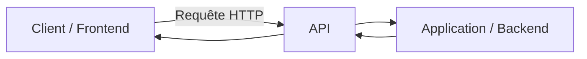

---

## 🧠 Modèles d’API

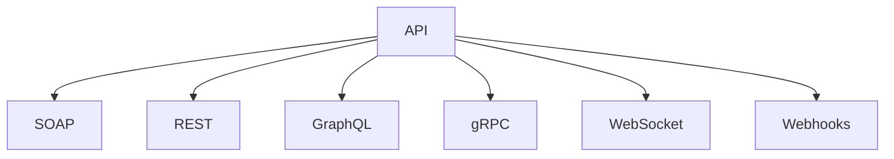

---

## 🧼 SOAP (ancien mais robuste)

	

* Protocole standardisé (W3C)
* Format XML strict
* Contrat via WSDL

### ✔️ Caractéristiques

* très structuré
* sécurisé (WS-Security)
* compatible multi-protocoles (HTTP, SMTP…)

### 📌 Usage

* banques
* systèmes critiques
* environnements legacy

---

## 🌐 REST (le standard moderne)

	

### 📡 Principe

REST repose sur des ressources accessibles via HTTP :

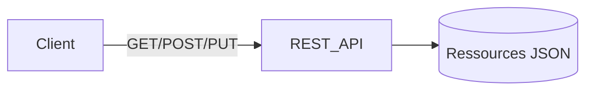

### 🔑 Concepts clés

* stateless
* ressources identifiées par URL
* verbes HTTP (GET, POST, PUT, DELETE)
* format JSON majoritaire

### ⚙️ HATEOAS

Le client découvre les actions possibles via les réponses API.

---

## 📊 GraphQL (flexibilité côté client)

	

### 💡 Principe

Le client demande **exactement ce dont il a besoin** :

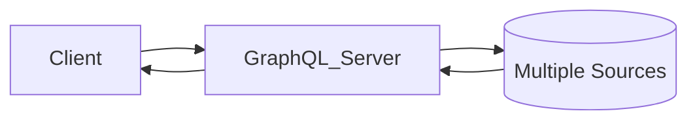

### ✔️ Avantages

* moins de sur-fetching
* une seule endpoint
* flexible pour frontend complexe

### ⚠️ Limites

* complexité serveur
* caching plus difficile

---

## 🔀 API vs WebService vs Microservice

| Concept      | Définition                 | Rôle         |
| ------------ | -------------------------- | ------------ |
| API          | Interface de communication | Contrat      |
| WebService   | API via réseau (HTTP)      | Transport    |
| Microservice | Architecture applicative   | Organisation |

---

## 🧭 API Management

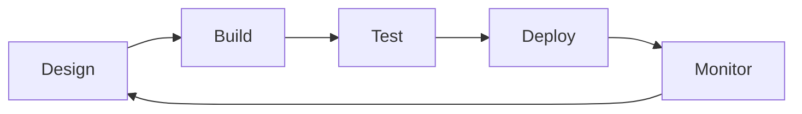

### 🎯 Objectifs

* gérer le cycle de vie des API
* sécuriser les accès
* analyser les usages

### 🧰 Fonctions clés

* design & documentation
* sécurité (OAuth, API keys)
* monitoring
* throttling / rate limiting

---

## 📊 KPIs API

* disponibilité (uptime)
* consommation (trafic)
* scalabilité (charge supportée)

---

## 🧪 Postman

### Cas d’usage principaux

* tests API
* automatisation
* environnements (dev/staging/prod)
* documentation
* mocks
* CI/CD

---

# 📡 Codes de retour HTTP

## 🧭 Vue globale

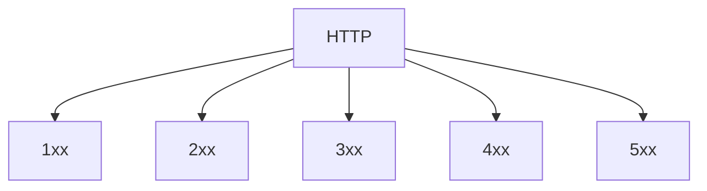

---

## 📌 Résumé

| Code | Signification  |
| ---- | -------------- |
| 2xx  | Succès         |
| 3xx  | Redirection    |
| 4xx  | Erreur client  |
| 5xx  | Erreur serveur |

---

# 🌐 Verbes HTTP

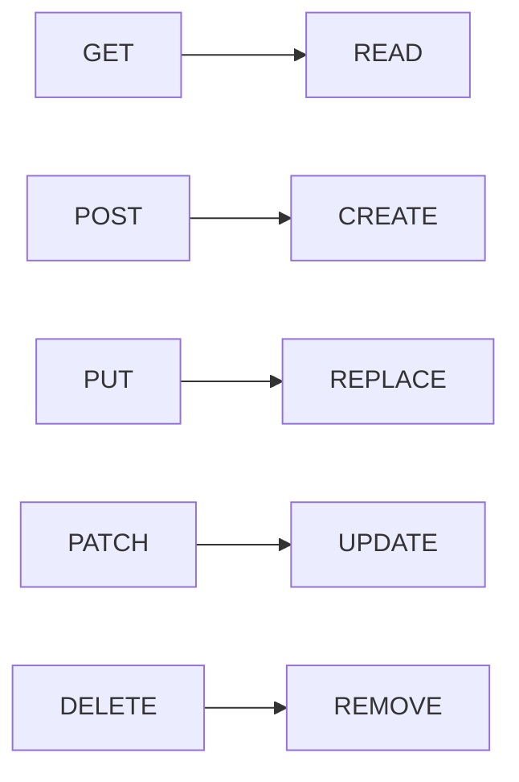

---

# 🔐 Quelques astuces pour sécuriser ses API

## 🔒 Astuce 1 — Utiliser HTTPS

Toutes les communications doivent être chiffrées via TLS.

👉 Empêche :

* interception de données
* attaques MITM

---

## 🔑 Astuce 2 — OAuth2

Protocole d’autorisation moderne.

✔ Permet :

* accès limité
* tokens temporaires
* délégation (Google, GitHub login)

---

## 🔐 Astuce 3 — WebAuthn

Authentification forte sans mot de passe.

✔ Basé sur :

* biométrie
* clés matérielles

---

## 🔑 Astuce 4 — API Keys avec niveaux

Ne jamais utiliser une clé unique globale.

✔ Bonnes pratiques :

* clé par utilisateur
* clé par environnement
* permissions limitées

---

## 🛂 Astuce 5 — Authorization stricte

Différencier :

* authentification (qui es-tu ?)
* autorisation (as-tu le droit ?)

---

## 🚦 Astuce 6 — Rate Limiting

Limiter le nombre de requêtes :

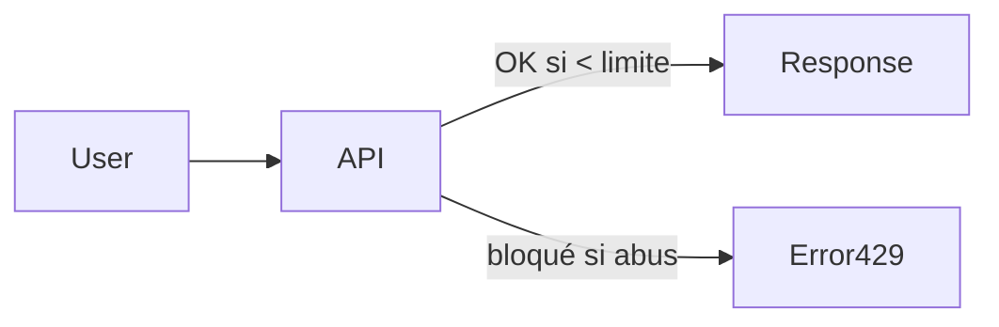

✔ Protège contre :

* brute force
* DDoS
* abus API

---

## 🔁 Astuce 7 — Versioning API

Exemple :

* `/api/v1/users`
* `/api/v2/users`

✔ Permet :

* évolution sans casser les clients

---

## 🧾 Astuce 8 — Allowlisting

Ne pas bloquer ce qui est dangereux → mais autoriser uniquement ce qui est connu.

✔ Très efficace pour :

* endpoints internes
* microservices

---

## 🛡️ Astuce 9 — OWASP API Security

### ⚠️ Principaux risques

* BOLA (Broken Object Level Authorization)
* Broken Authentication
* Excessive Data Exposure
* Rate Limit insuffisant
* SSRF

---

### 🔥 Vue structurée

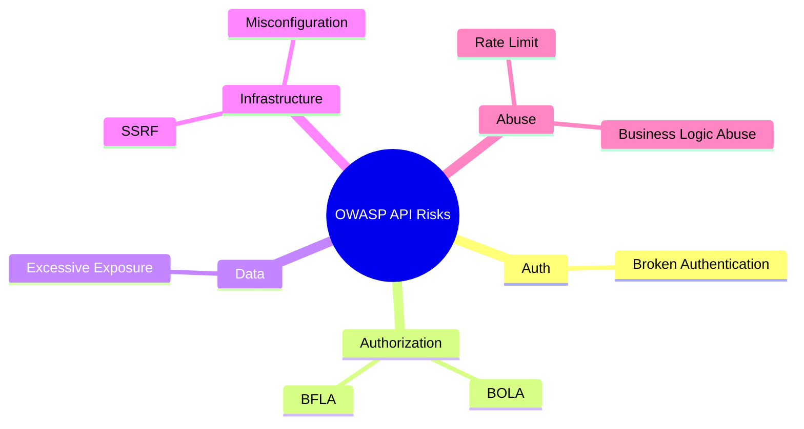

---

## 🛡️ Astuce 10 — API Gateway

Point d’entrée unique :

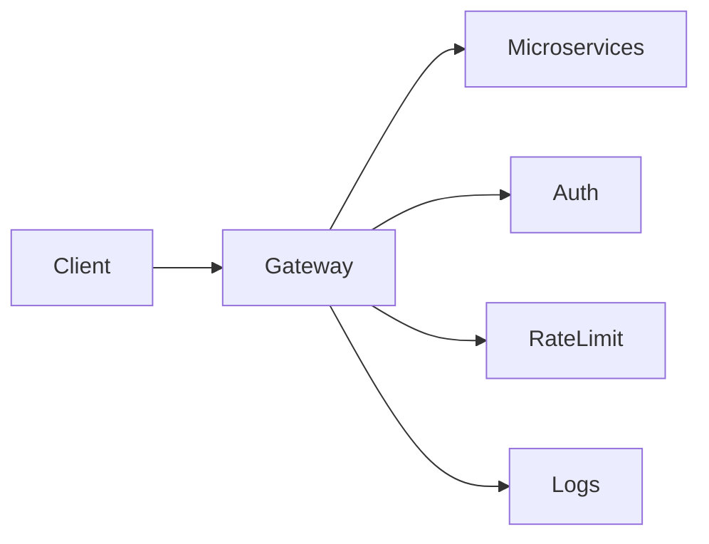

✔ Centralise :

* sécurité
* routing
* monitoring

---

## ⚠️ Astuce 11 — Error Handling

Bonnes pratiques :

* ne pas exposer les stack traces
* messages génériques côté client
* logs détaillés côté serveur

---

## 🧪 Astuce 12 — Input Validation

Toujours valider :

* types
* formats
* tailles
* schémas JSON

✔ Empêche :

* injections
* corruption de données

---

# 🎯 Conclusion

Une API moderne repose sur 3 piliers :

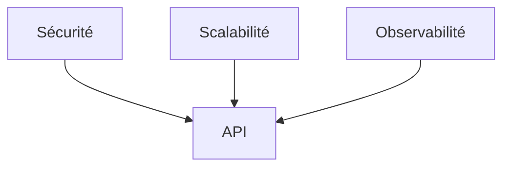

---

Si tu veux, je peux aussi :

* transformer ça en **cours PDF prêt à imprimer**
* ajouter une section **JWT / OAuth2 en profondeur**
* ou faire une version **ultra simplifiée pour révision rapide**
