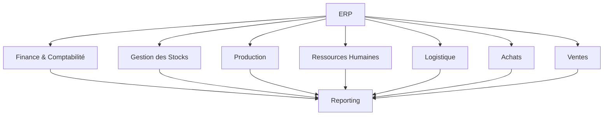
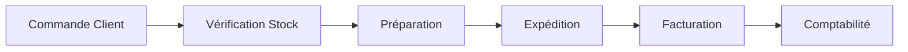
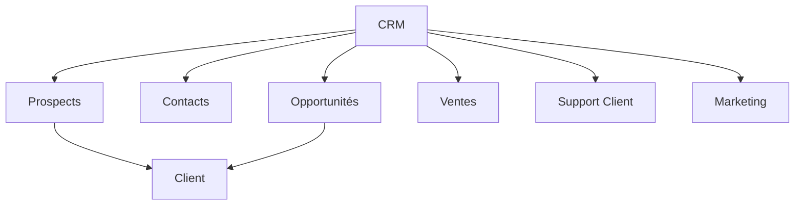
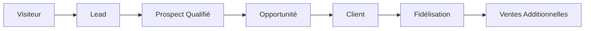
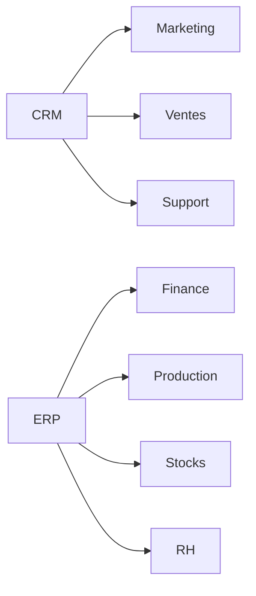
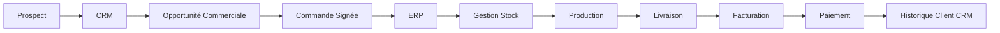
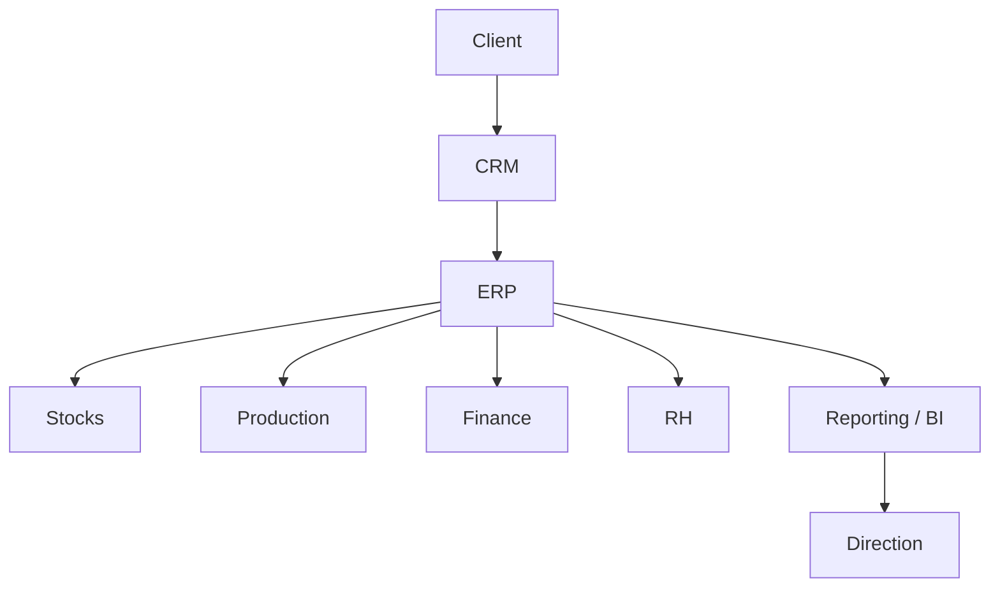
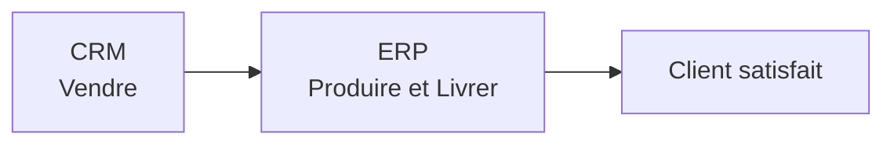

# ERP (Enterprise Resource Planning)

**ERP** = Enterprise Resource Planning

En français : **Progiciel de Gestion Intégré (PGI)**.

👉 Un ERP est le système central qui pilote les processus internes de l'entreprise.

Il permet de gérer :

* Comptabilité
* Gestion des stocks
* Achats / ventes
* Production
* Logistique
* Ressources Humaines
* Paie
* Approvisionnement
* Gestion de projets

🎯 **Objectif :**
Centraliser toutes les données de l'entreprise dans un système unique afin de :

* éviter les doublons ;
* automatiser les processus ;
* améliorer la traçabilité ;
* faciliter le pilotage de l'activité.

## Vision globale d'un ERP

### Exemple de flux ERP

---

## ERP les plus utilisés

| ERP                        | Type d'entreprise       |
| -------------------------- | ----------------------- |
| SAP S/4HANA                | Grandes entreprises     |
| Oracle ERP Cloud           | Grandes organisations   |
| Microsoft Dynamics 365 F&O | Entreprises Microsoft   |
| Odoo                       | PME / ETI               |
| Sage X3 / Sage 100         | PME                     |
| NetSuite                   | Entreprises SaaS / Tech |
| Infor LN / M3              | Industrie & Logistique  |

---

# CRM (Customer Relationship Management)

**CRM** = Customer Relationship Management

En français : **Gestion de la Relation Client**.

👉 Un CRM est spécialisé dans la gestion des interactions avec les clients et prospects.

Il permet de gérer :

* Contacts
* Prospects (Leads)
* Opportunités commerciales
* Pipeline de vente
* Support client
* Campagnes marketing
* Automatisation marketing

🎯 **Objectif :**
Développer les ventes et améliorer la relation client.

---

## Vision globale d'un CRM

---

## Cycle de vie client dans un CRM

---

## CRM les plus utilisés

| CRM                          | Type d'entreprise    |
| ---------------------------- | -------------------- |
| Salesforce                   | Leader mondial       |
| Microsoft Dynamics 365 Sales | Écosystème Microsoft |
| HubSpot CRM                  | PME / Startups       |
| Zoho CRM                     | PME                  |
| Pipedrive                    | Équipes commerciales |
| SugarCRM                     | Open Source          |
| Freshsales                   | PME / Support client |

---

# ERP vs CRM

Bien qu'ils soient complémentaires, ERP et CRM n'ont pas le même objectif.

| Critère      | ERP                                 | CRM                        |
| ------------ | ----------------------------------- | -------------------------- |
| Cible        | Processus internes                  | Relation client            |
| Utilisateurs | Finance, RH, Logistique, Production | Marketing, Vente, Support  |
| Données      | Stocks, factures, achats            | Prospects, clients, ventes |
| Objectif     | Optimiser l'entreprise              | Développer les ventes      |

---

## Comparaison visuelle

---

# Comment ERP et CRM travaillent ensemble

Dans les entreprises modernes, ERP et CRM sont généralement connectés.

Le CRM gère la relation commerciale tandis que l'ERP exécute les opérations internes.

## Exemple de flux complet

---

# Architecture simplifiée d'une entreprise

---

# À retenir

### ERP

* Gère les opérations internes.
* Source de vérité opérationnelle.
* Utilisé par la finance, la logistique, la production et les RH.

### CRM

* Gère les interactions avec les clients.
* Source de vérité commerciale.
* Utilisé par les commerciaux, le marketing et le support.

### Ensemble

👉 Résumé simple :

> **Le CRM aide à trouver et fidéliser les clients.**
>
> **L'ERP aide à exécuter et gérer les opérations de l'entreprise.**
>
> **Le CRM vend, l'ERP délivre.**
