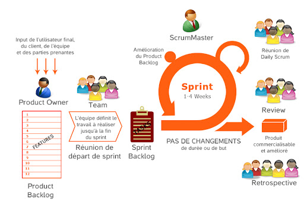

# 🌀 Guide complet sur SCRUM
<div align="center">
	
</div>

## 📌 Qu'est-ce que SCRUM ?

**SCRUM** est un cadre de travail (framework) agile utilisé pour gérer des projets complexes, principalement dans le développement logiciel.
Il permet de livrer rapidement de la valeur en travaillant de manière **itérative et incrémentale**.

---

## 🎯 Objectifs de SCRUM

* Livrer rapidement des fonctionnalités utiles
* S’adapter facilement aux changements
* Améliorer la collaboration entre les équipes
* Favoriser la transparence et la visibilité du projet

---

## 🧩 Les rôles dans SCRUM

### 1. Product Owner (PO)

* Définit la vision du produit
* Gère le **Product Backlog**
* Priorise les fonctionnalités selon la valeur métier
* Représente les besoins des utilisateurs

### 2. Scrum Master

* Garant du respect de SCRUM
* Facilite le travail de l’équipe
* Supprime les obstacles (impediments)
* Aide à améliorer les processus

### 3. Équipe de développement

* Équipe autonome et pluridisciplinaire
* Réalise le produit
* S’organise elle-même pour atteindre les objectifs

---

## 📦 Les artefacts SCRUM

### 1. Product Backlog

* Liste priorisée des fonctionnalités
* Évolue constamment
* Géré par le Product Owner

### 2. Sprint Backlog

* Sous-ensemble du Product Backlog
* Contient les tâches à réaliser pendant un sprint

### 3. Increment

* Version fonctionnelle du produit livrée à la fin du sprint

---

## 🔁 Les événements SCRUM

### 1. Sprint

* Durée : 1 à 4 semaines
* Cycle de développement court et fixe

---

### 2. Sprint Planning

* Début du sprint
* Définition des objectifs
* Sélection des tâches à réaliser

---

### 3. Daily Scrum (Daily Stand-up)

* Réunion quotidienne (15 min max)
* Chaque membre répond à :

  * Qu’ai-je fait hier ?
  * Que vais-je faire aujourd’hui ?
  * Ai-je des blocages ?

---

### 4. Sprint Review

* Présentation du travail réalisé
* Feedback des parties prenantes

---

### 5. Sprint Retrospective

* Analyse du sprint passé
* Amélioration continue des pratiques

---

## ⚙️ Principes clés de SCRUM

* **Transparence** : tout le monde voit l’avancement
* **Inspection** : évaluation régulière du travail
* **Adaptation** : ajustements rapides

---

## 📈 Avantages de SCRUM

* Flexibilité face aux changements
* Livraisons rapides et régulières
* Meilleure communication
* Détection rapide des problèmes

---

## ⚠️ Inconvénients de SCRUM

* Nécessite une forte discipline
* Peut être difficile à mettre en place
* Dépend beaucoup de l’implication des équipes
* Risque de dérive sans Scrum Master efficace

---

## 🧠 Bonnes pratiques

* Prioriser par valeur métier
* Maintenir un backlog clair et à jour
* Favoriser la communication constante
* Limiter le travail en cours (WIP)
* Impliquer les parties prenantes régulièrement

---

## 🔄 SCRUM vs Agile

* **Agile** = philosophie (ensemble de valeurs et principes)
* **SCRUM** = méthode concrète pour appliquer Agile

---

## 📚 Vocabulaire important

| Terme      | Définition                          |
| ---------- | ----------------------------------- |
| Sprint     | Cycle de développement court        |
| Backlog    | Liste des tâches/fonctionnalités    |
| Increment  | Version livrable du produit         |
| User Story | Description d’un besoin utilisateur |
| Velocity   | Vitesse de travail de l’équipe      |

---

## 🧪 Exemple de User Story

```text
En tant qu'utilisateur,
je veux pouvoir me connecter,
afin d'accéder à mon compte.
```

---

## 🚀 Résumé rapide

* SCRUM = méthode agile itérative
* 3 rôles : PO, Scrum Master, Dev Team
* 3 artefacts : Product Backlog, Sprint Backlog, Increment
* 5 événements : Sprint, Planning, Daily, Review, Retro

---

## 💡 Astuce

SCRUM fonctionne mieux avec :

* des équipes petites (5-9 personnes)
* une communication fluide
* un objectif clair par sprint

---

Si tu veux, je peux aussi te faire :

* une **fiche ultra simplifiée pour réviser**
* un **exemple concret de projet en SCRUM**
* ou un **quiz pour t’entraîner** 👍
