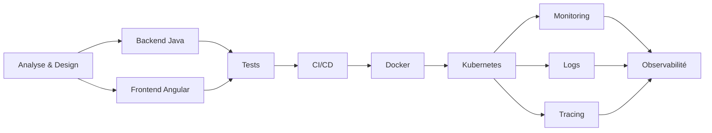
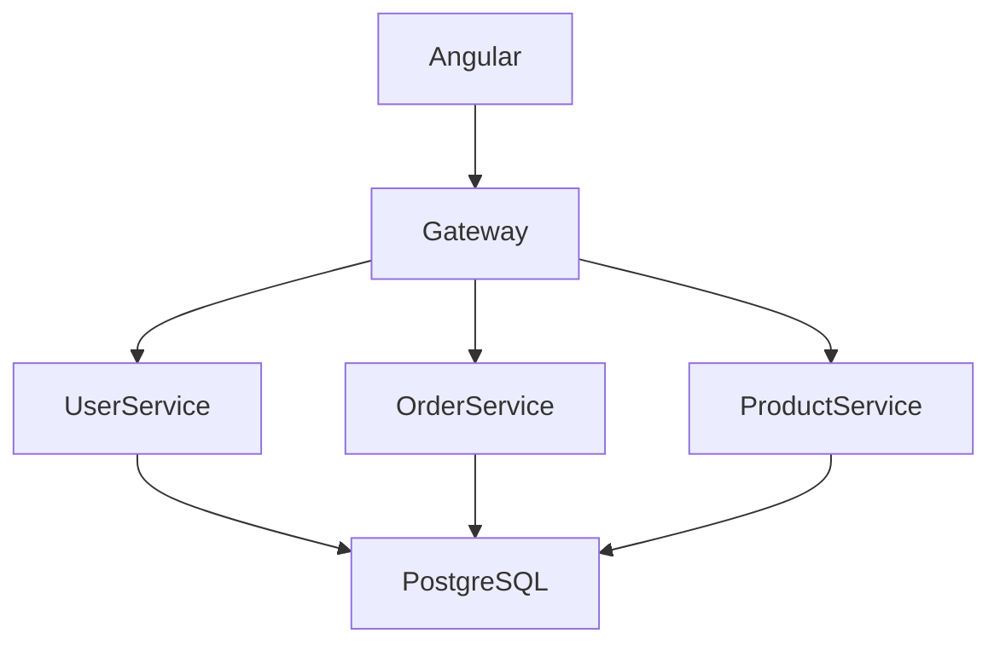
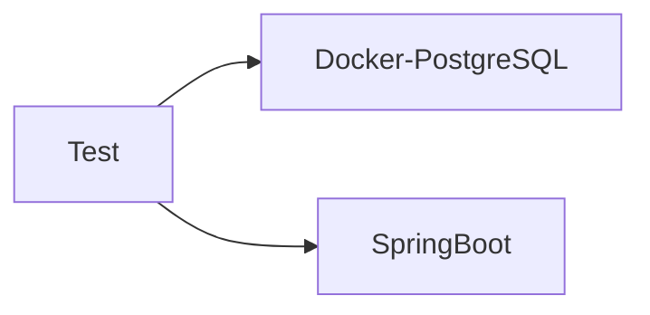
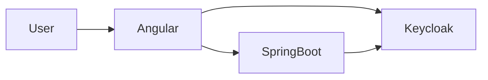
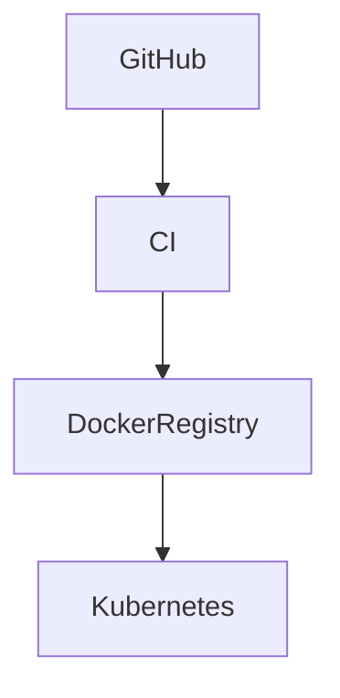
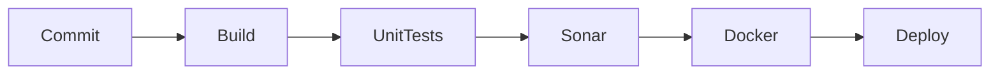
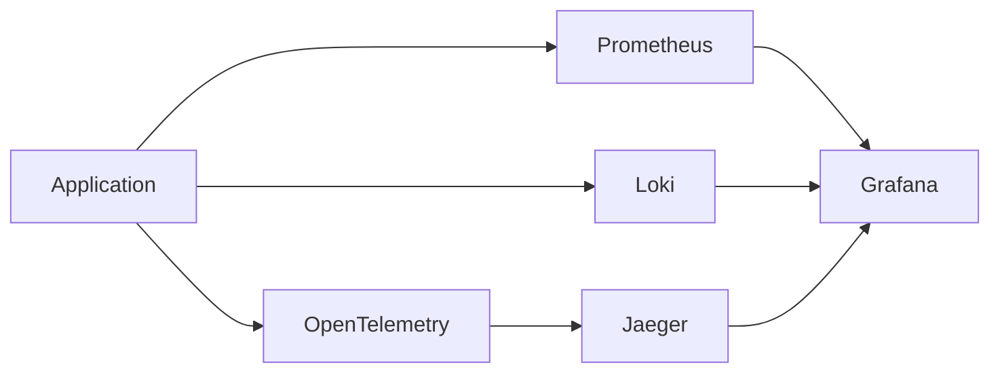

Pour un développeur **Full Stack Java + Angular** en 2026, la "stack ultime" n'est plus seulement un ensemble de frameworks. C'est un **écosystème couvrant tout le cycle de vie** :

* Conception
* Développement
* Qualité
* Sécurité
* CI/CD
* Observabilité
* IA
* Infrastructure Cloud

Je te propose une stack moderne utilisée dans les équipes performantes.

# Vue d'ensemble



---

# 1. Architecture & Design

## Diagrammes

* Draw.io
* PlantUML
* Mermaid

Je recommande :

* Mermaid pour la doc dans Git
* PlantUML pour les architectures complexes

### Exemple de microservices



---

# 2. Backend Java

## Framework principal

### Spring Boot

Toujours le standard.

Modules :

* Spring Web
* Spring Security
* Spring Data JPA
* Spring Validation
* Spring Actuator

## Build

* Maven
* Gradle

Mon choix :

```text
Gradle
```

Plus rapide et flexible.

## API

* REST
* OpenAPI
* Swagger

Outils :

* Springdoc OpenAPI

---

# 3. Base de données

## Relationnel

### PostgreSQL

Le meilleur compromis aujourd'hui :

* robuste
* open source
* performant
* JSON natif

## Migration

### Flyway

Structure :

```text
V1__init.sql
V2__users.sql
V3__orders.sql
```

---

# 4. Frontend Angular

## Framework

### Angular

Version moderne :

* standalone components
* signals
* SSR

## UI

### Angular Material

ou

### PrimeNG

Mon choix entreprise :

```text
Angular Material
```

Mon choix projet métier complexe :

```text
PrimeNG
```

---

# 5. IDE

## Java

### IntelliJ IDEA

Clairement numéro 1.

Plugins :

* SonarLint
* Lombok
* Docker
* Kubernetes

## Front

### Visual Studio Code

Extensions :

* Angular Language Service
* ESLint
* Prettier
* GitLens

---

# 6. Git & Collaboration

## Git

### Git

Plateforme :

* [GitHub](https://github.com?utm_source=chatgpt.com)
* [GitLab](https://gitlab.com?utm_source=chatgpt.com)

Mon choix :

```text
GitHub + GitHub Actions
```

---

# 7. Qualité du code

## Analyse statique

### SonarQube

Détecte :

* bugs
* code smells
* vulnérabilités

## Java

* SpotBugs
* Checkstyle

## Angular

* ESLint
* Prettier

---

# 8. Tests

## Backend

### Unitaires

* JUnit
* Mockito

### Intégration

* Testcontainers

Exemple :



Les tests tournent avec une vraie base PostgreSQL.

---

## Front

### Unitaires

* Jasmine
* Karma

ou

* Vitest

### E2E

### Playwright

Aujourd'hui supérieur à Cypress dans beaucoup de contextes.

---

# 9. Sécurité

## Authentification

### Keycloak

Architecture :



Fonctionnalités :

* OAuth2
* OpenID Connect
* SSO
* MFA

---

# 10. Conteneurisation

### Docker

Chaque service :

```text
Dockerfile
```

Puis :

```bash
docker compose up
```

pour le dev local.

---

# 11. Kubernetes

### Kubernetes

Déploiement :



Pour le local :

### k3d

ou

### Kind

---

# 12. CI/CD

## Pipeline moderne



Outils :

* [GitHub Actions](https://github.com/features/actions?utm_source=chatgpt.com)
* [GitLab CI/CD](https://about.gitlab.com/stages-devops-lifecycle/continuous-integration/?utm_source=chatgpt.com)

---

# 13. Observabilité

## Monitoring

### Prometheus

## Dashboards

### Grafana

## Logs

### Loki

## Traces

### OpenTelemetry

### Jaeger

Architecture :



---

# 14. IA pour développeur

C'est probablement le plus gros gain de productivité aujourd'hui.

## Assistant principal

### [ChatGPT](https://chatgpt.com?utm_source=chatgpt.com)

Utilisations :

* génération de code
* revue d'architecture
* génération de tests
* documentation

## Dans l'IDE

### [GitHub Copilot](https://github.com/features/copilot?utm_source=chatgpt.com)

Complétion en temps réel.

## Recherche technique

### [Perplexity AI](https://www.perplexity.ai?utm_source=chatgpt.com)

Très bon pour :

* veille
* documentation
* comparaison technologique

---

# Stack ultime condensée

```text
Backend
--------
Java 21
Spring Boot
Spring Security
Spring Data JPA
PostgreSQL
Flyway

Frontend
---------
Angular
Angular Material
RxJS
NgRx (si besoin)

Tests
------
JUnit
Mockito
Testcontainers
Playwright

Qualité
--------
SonarQube
ESLint
Prettier

DevOps
-------
Docker
Kubernetes
GitHub Actions

Observabilité
-------------
Prometheus
Grafana
Loki
OpenTelemetry
Jaeger

Sécurité
---------
Keycloak

IA
--
ChatGPT
GitHub Copilot

IDE
---
IntelliJ IDEA
VS Code
```

Pour un développeur Java/Angular qui vise un niveau **senior/lead ou architecte**, cette stack couvre pratiquement 95 % des besoins rencontrés dans les entreprises modernes (startup, scale-up, ESN, grands groupes et cloud natif).
