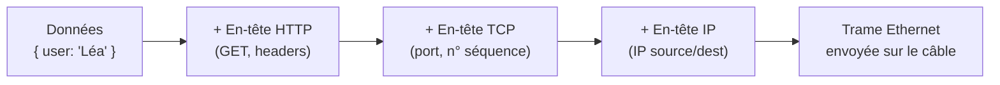
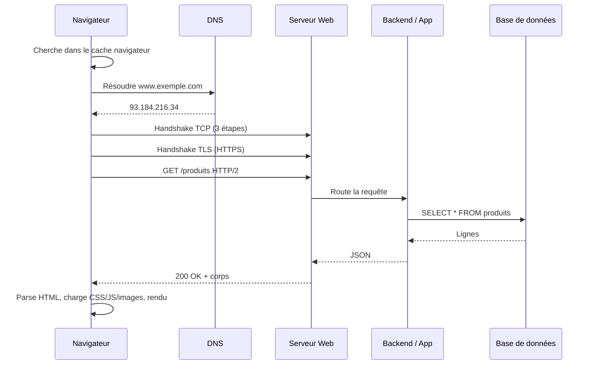
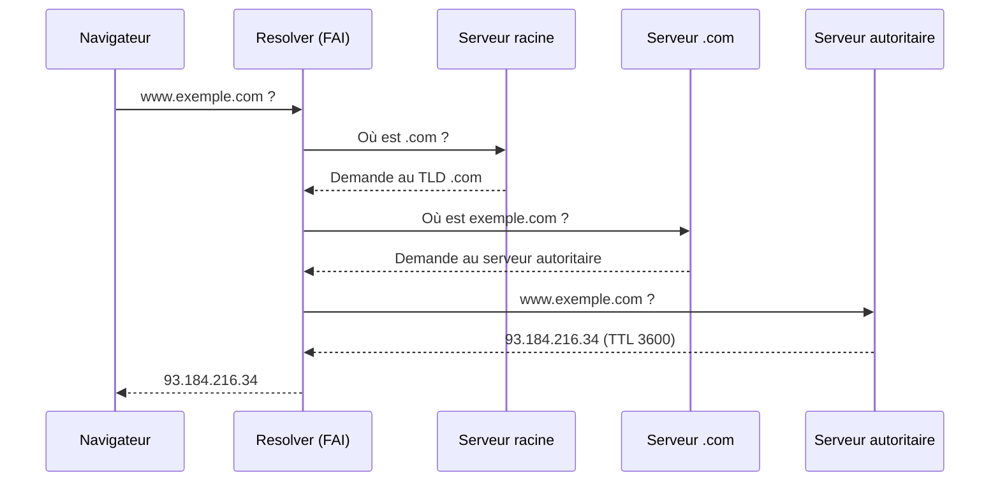
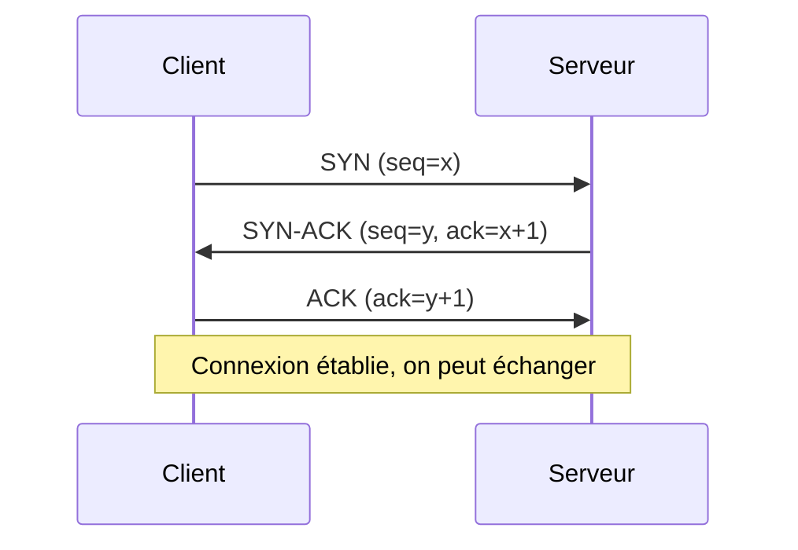
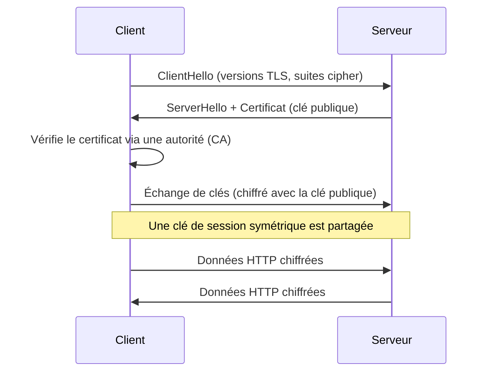
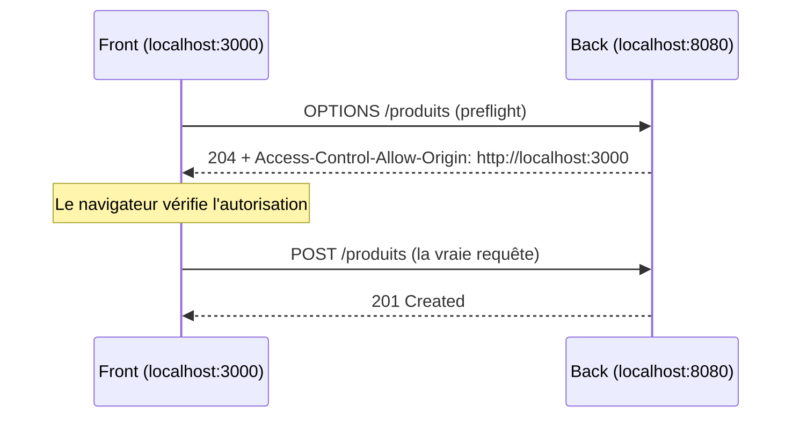
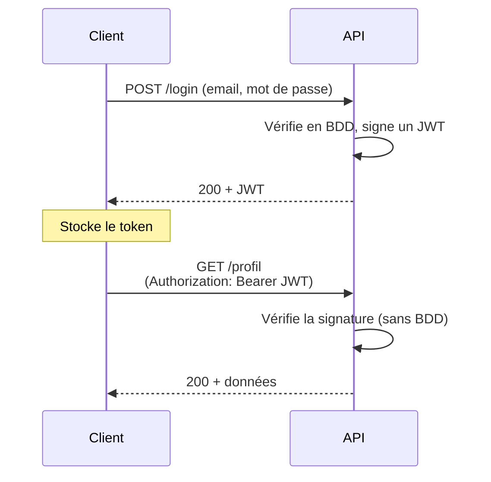
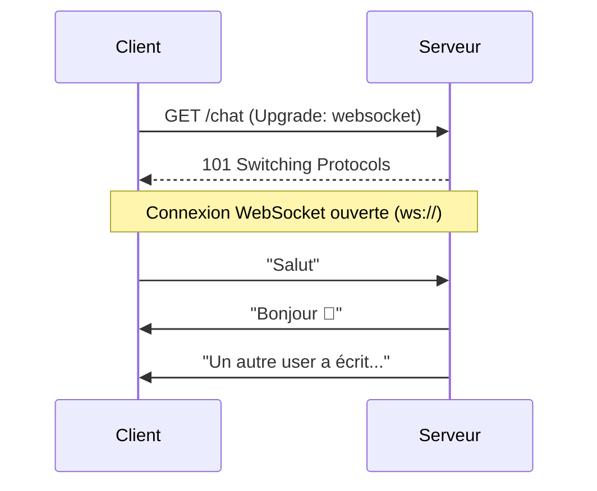
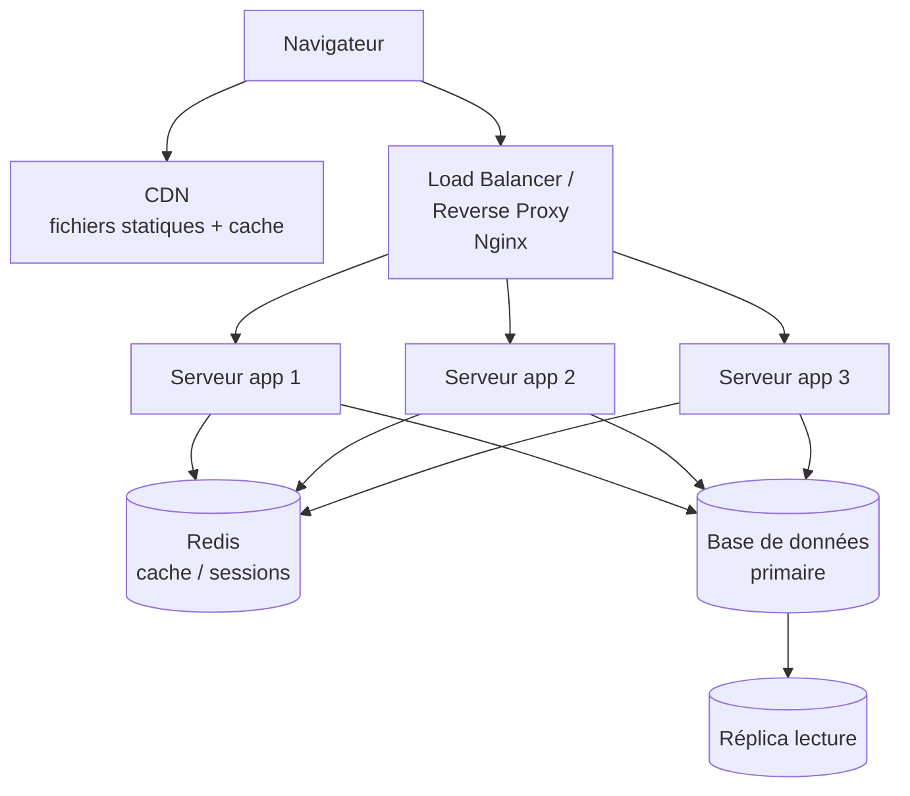
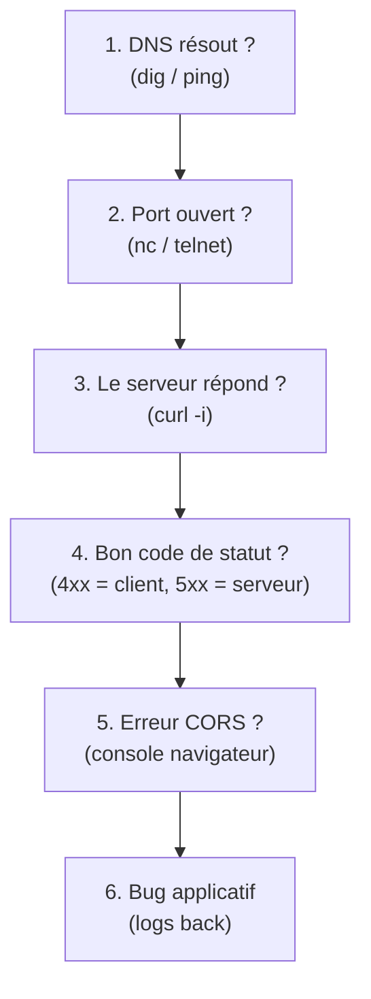

# Les Réseaux pour le Développeur Fullstack — Le Guide Essentiel

> Tout ce qu'un dev fullstack doit vraiment comprendre sur les réseaux pour construire, déboguer et déployer une application web.

---

## Table des matières

1. [Le modèle en couches (vue dev)](#1-le-modèle-en-couches-vue-dev)
2. [Le voyage d'une requête : de l'URL à l'écran](#2-le-voyage-dune-requête--de-lurl-à-lécran)
3. [Adresses IP et ports](#3-adresses-ip-et-ports)
4. [DNS : l'annuaire d'Internet](#4-dns--lannuaire-dinternet)
5. [TCP vs UDP](#5-tcp-vs-udp)
6. [HTTP : le protocole du web](#6-http--le-protocole-du-web)
7. [Versions de HTTP (1.1 / 2 / 3)](#7-versions-de-http)
8. [HTTPS et TLS](#8-https-et-tls)
9. [Les API REST](#9-les-api-rest)
10. [CORS : le piège n°1 du fullstack](#10-cors--le-piège-n1-du-fullstack)
11. [Cookies, sessions et tokens (auth)](#11-cookies-sessions-et-tokens)
12. [Temps réel : polling, SSE, WebSockets](#12-temps-réel)
13. [Le cache (navigateur, CDN, headers)](#13-le-cache)
14. [Architecture de production](#14-architecture-de-production)
15. [En local : localhost, ports, proxy de dev](#15-en-local)
16. [Boîte à outils de débogage](#16-boîte-à-outils-de-débogage)
17. [Sécurité réseau : l'essentiel](#17-sécurité-réseau)

---

## 1. Le modèle en couches (vue dev)

On parle souvent du **modèle OSI** (7 couches) en théorie, mais en pratique on travaille avec le **modèle TCP/IP** (4 couches). L'idée : chaque couche ajoute son enveloppe, sans connaître le détail des autres.

| Couche TCP/IP | Rôle | Exemples concrets | Où tu interviens en tant que dev |
|---|---|---|---|
| **Application** | Donner du sens aux données | HTTP, HTTPS, DNS, WebSocket, FTP | 90 % de ton temps |
| **Transport** | Acheminer de bout en bout | TCP, UDP | Choix WebSocket/UDP, ports |
| **Internet** | Trouver la route entre machines | IP, ICMP | Adresses IP, sous-réseaux |
| **Accès réseau** | Transmettre physiquement | Ethernet, Wi-Fi | Rarement |

L'idée d'**encapsulation** : tes données JSON sont emballées par HTTP, lui-même emballé par TCP, lui-même par IP.



**À retenir :** chaque couche ne parle qu'à son équivalente sur l'autre machine. Ton code HTTP « ne voit » que du HTTP, pas le TCP en dessous.

---

## 2. Le voyage d'une requête : de l'URL à l'écran

La question d'entretien classique : *« Que se passe-t-il quand tu tapes `https://www.exemple.com` ? »*. Voici le parcours complet.



Les grandes étapes :

1. **Résolution DNS** — transformer le nom de domaine en adresse IP.
2. **Connexion TCP** — établir un canal fiable (le « 3-way handshake »).
3. **Négociation TLS** — chiffrer la connexion (le `s` de `https`).
4. **Requête HTTP** — envoyer `GET /produits`.
5. **Traitement serveur** — routing, logique métier, base de données.
6. **Réponse HTTP** — code de statut + corps.
7. **Rendu** — le navigateur construit la page et déclenche d'autres requêtes (CSS, JS, images).

Chaque étape est détaillée dans les sections suivantes.

---

## 3. Adresses IP et ports

Une **adresse IP** identifie une machine sur le réseau. Un **port** identifie un service précis sur cette machine. L'analogie : l'IP est l'adresse de l'immeuble, le port est le numéro d'appartement.

```
http://93.184.216.34:8080/api/users
        └──── IP ─────┘ └port┘
```

### IPv4 vs IPv6

```
IPv4 : 93.184.216.34            (4 octets, ~4,3 milliards d'adresses)
IPv6 : 2606:2800:220:1:248:1893:25c8:1946  (128 bits, quasi infini)
```

### Adresses spéciales à connaître

| Adresse | Signification |
|---|---|
| `127.0.0.1` / `localhost` | Ta propre machine (boucle locale) |
| `0.0.0.0` | « Toutes les interfaces » — utile pour exposer un serveur de dev |
| `192.168.x.x`, `10.x.x.x` | Réseaux privés (LAN, Docker, etc.) |

### Ports courants pour un dev

| Port | Service |
|---|---|
| `80` | HTTP |
| `443` | HTTPS |
| `5432` | PostgreSQL |
| `3306` | MySQL |
| `6379` | Redis |
| `27017` | MongoDB |
| `3000` / `5173` / `8080` | Serveurs de dev (Node/React, Vite, etc.) |

**Piège fréquent :** « Port already in use ». Pour trouver le coupable :

```bash
# Linux / macOS
lsof -i :3000
kill -9 <PID>

# Windows
netstat -ano | findstr :3000
```

---

## 4. DNS : l'annuaire d'Internet

Le **DNS** (Domain Name System) traduit `www.exemple.com` en `93.184.216.34`. C'est une recherche hiérarchique avec mise en cache à chaque niveau.



### Les types d'enregistrements à connaître

| Type | Rôle | Exemple |
|---|---|---|
| `A` | Domaine → IPv4 | `exemple.com → 93.184.216.34` |
| `AAAA` | Domaine → IPv6 | `exemple.com → 2606:2800:...` |
| `CNAME` | Alias vers un autre domaine | `www → exemple.com` |
| `MX` | Serveur de mail | `mail.exemple.com` |
| `TXT` | Texte libre (vérifications, SPF) | `v=spf1 include:...` |
| `NS` | Serveurs de noms du domaine | `ns1.ovh.net` |

### Le TTL (Time To Live)

Chaque réponse DNS a un **TTL** : la durée pendant laquelle elle peut être mise en cache. C'est pour ça qu'un changement DNS (migration de serveur) peut mettre des heures à se propager.

### Outils pratiques

```bash
# Résoudre un domaine
dig exemple.com
nslookup exemple.com

# Voir le chemin réseau jusqu'au serveur
traceroute exemple.com   # ou tracert sous Windows
```

---

## 5. TCP vs UDP

Au-dessus d'IP, deux protocoles de transport. Le choix dépend du compromis **fiabilité vs vitesse**.

### TCP — fiable, ordonné, orienté connexion

TCP garantit que chaque octet arrive, dans le bon ordre, sans doublon. C'est ce qu'utilise HTTP. Avant tout échange, on établit la connexion via le **3-way handshake** :



### UDP — rapide, sans garantie

UDP envoie les paquets sans connexion ni accusé de réception. Plus rapide, mais des paquets peuvent se perdre. Idéal quand la vitesse prime sur la perfection.

### Comparaison

| Critère | TCP | UDP |
|---|---|---|
| Connexion | Oui (handshake) | Non |
| Fiabilité | Garantie | Aucune |
| Ordre | Respecté | Non garanti |
| Vitesse | Plus lent | Plus rapide |
| Usages | HTTP, e-mail, BDD | Streaming, jeux, VoIP, DNS |

**En tant que dev web**, tu fais surtout du TCP (via HTTP). UDP apparaît dans le streaming temps réel (WebRTC) ou avec HTTP/3 (qui s'appuie sur QUIC, basé sur UDP).

---

## 6. HTTP : le protocole du web

HTTP est un protocole **requête → réponse** et **sans état** (chaque requête est indépendante ; le serveur ne « se souvient » pas de toi, d'où cookies et tokens).

### Anatomie d'une requête

```http
GET /api/produits?categorie=livres HTTP/1.1
Host: www.exemple.com
Accept: application/json
Authorization: Bearer eyJhbGc...
User-Agent: Mozilla/5.0

(corps vide pour un GET)
```

- **Ligne de requête** : méthode + chemin + version.
- **En-têtes (headers)** : métadonnées (format attendu, auth, etc.).
- **Corps (body)** : les données (pour POST/PUT/PATCH).

### Anatomie d'une réponse

```http
HTTP/1.1 200 OK
Content-Type: application/json
Cache-Control: max-age=3600
Content-Length: 52

{ "produits": [ { "id": 1, "titre": "1984" } ] }
```

### Les méthodes HTTP

| Méthode | Usage | Idempotent ? | Corps ? |
|---|---|---|---|
| `GET` | Lire une ressource | Oui | Non |
| `POST` | Créer une ressource | Non | Oui |
| `PUT` | Remplacer entièrement | Oui | Oui |
| `PATCH` | Modifier partiellement | Non | Oui |
| `DELETE` | Supprimer | Oui | Optionnel |
| `OPTIONS` | Demander les capacités (utilisé par CORS) | Oui | Non |

> **Idempotent** = appeler la requête 1 fois ou 10 fois produit le même état final. Important pour les retries automatiques.

### Les codes de statut (à connaître par cœur)

| Famille | Sens général | Exemples clés |
|---|---|---|
| **1xx** | Information | `101 Switching Protocols` (WebSocket) |
| **2xx** | Succès | `200 OK`, `201 Created`, `204 No Content` |
| **3xx** | Redirection | `301` (permanente), `302` (temporaire), `304 Not Modified` (cache) |
| **4xx** | Erreur du **client** | `400` (requête invalide), `401` (non authentifié), `403` (interdit), `404` (introuvable), `409` (conflit), `429` (trop de requêtes) |
| **5xx** | Erreur du **serveur** | `500` (erreur interne), `502` (bad gateway), `503` (indisponible), `504` (timeout) |

**Le piège classique : 401 vs 403**
- `401 Unauthorized` → *« Je ne sais pas qui tu es »* (pas connecté / token absent ou invalide).
- `403 Forbidden` → *« Je sais qui tu es, mais tu n'as pas le droit »* (pas les permissions).

### Headers les plus utilisés

| Header | Rôle |
|---|---|
| `Content-Type` | Format du corps (`application/json`, `text/html`...) |
| `Accept` | Format que le client souhaite recevoir |
| `Authorization` | Jeton d'authentification |
| `Cache-Control` | Politique de cache |
| `Set-Cookie` / `Cookie` | Gestion des cookies |
| `Location` | Cible d'une redirection |
| `Content-Length` | Taille du corps |

---

## 7. Versions de HTTP

Tu n'écris pas de code différent selon la version, mais comprendre les différences aide à optimiser les performances.

| Version | Apport principal | Limite |
|---|---|---|
| **HTTP/1.1** | Connexion persistante (réutilisée) | Une requête à la fois par connexion → « head-of-line blocking » |
| **HTTP/2** | **Multiplexage** : plusieurs requêtes en parallèle sur **une seule** connexion TCP + compression des headers | Blocage si un paquet TCP se perd |
| **HTTP/3** | Basé sur **QUIC (UDP)** : plus de blocage TCP, connexions plus rapides | Adoption progressive |

**Conséquence pratique :** en HTTP/1.1, l'astuce historique consistait à regrouper les fichiers (bundling, sprites CSS) pour limiter le nombre de requêtes. En HTTP/2+, le multiplexage rend ces optimisations moins critiques.

---

## 8. HTTPS et TLS

HTTPS = HTTP + chiffrement **TLS**. Il garantit trois choses : **confidentialité** (personne ne lit), **intégrité** (personne ne modifie), **authenticité** (tu parles bien au bon serveur).



### Les idées clés

- **Chiffrement asymétrique** (clé publique/privée) sert seulement à échanger en sécurité une **clé de session symétrique**, plus rapide, utilisée pour le reste de l'échange.
- Le **certificat** prouve l'identité du serveur. Il est signé par une **autorité de certification (CA)** que ton navigateur connaît déjà.
- **Let's Encrypt** fournit des certificats gratuits et automatisables — le standard aujourd'hui.

### Erreurs HTTPS fréquentes en dev

- `ERR_CERT_AUTHORITY_INVALID` → certificat auto-signé en local (normal en dev, à accepter ou contourner).
- Contenu **mixte** : une page HTTPS qui charge une ressource HTTP → bloquée par le navigateur. Tout doit être en HTTPS en production.

---

## 9. Les API REST

REST est un **style d'architecture** pour exposer des ressources via HTTP. Les règles informelles :

- Les **ressources** sont des noms, au pluriel : `/utilisateurs`, `/produits`.
- Les **verbes HTTP** décrivent l'action, pas l'URL.
- L'API est **sans état** : chaque requête contient tout le contexte nécessaire.

### Exemple de conception cohérente

| Action | Méthode + URL | Code de succès |
|---|---|---|
| Lister les produits | `GET /produits` | `200` |
| Lire un produit | `GET /produits/42` | `200` |
| Créer un produit | `POST /produits` | `201` |
| Remplacer un produit | `PUT /produits/42` | `200` |
| Modifier un champ | `PATCH /produits/42` | `200` |
| Supprimer | `DELETE /produits/42` | `204` |

**À éviter** (le verbe dans l'URL) :
```
❌ GET  /getProduits
❌ POST /produits/42/delete
✅ GET    /produits
✅ DELETE /produits/42
```

### Exemple complet avec `curl`

```bash
# Créer un produit
curl -X POST https://api.exemple.com/produits \
  -H "Content-Type: application/json" \
  -H "Authorization: Bearer mon_token" \
  -d '{ "titre": "1984", "prix": 9.90 }'

# Réponse : 201 Created
# { "id": 42, "titre": "1984", "prix": 9.90 }
```

> **REST vs GraphQL :** REST expose plusieurs endpoints fixes ; GraphQL expose un seul endpoint où le client décrit précisément les données voulues. GraphQL réduit le sur/sous-chargement de données mais ajoute de la complexité côté serveur.

---

## 10. CORS : le piège n°1 du fullstack

**CORS** (Cross-Origin Resource Sharing) est LE problème qui bloque tous les débutants en fullstack. Comprends-le une fois pour toutes.

### Le problème

Le navigateur applique la **Same-Origin Policy** : par sécurité, un script sur `http://localhost:3000` (ton front React) **ne peut pas** appeler `http://localhost:8080` (ton back) par défaut. Une **origine** = `protocole + domaine + port`. Si l'un des trois diffère, c'est « cross-origin ».

```
http://localhost:3000   ≠   http://localhost:8080   (port différent)
https://app.com         ≠   http://app.com          (protocole différent)
https://app.com         ≠   https://api.app.com     (domaine différent)
```

### La solution : le serveur autorise explicitement

C'est le **serveur** (le back) qui doit renvoyer des en-têtes autorisant l'origine du front. Pour les requêtes « non simples » (avec headers custom, méthode PUT/DELETE, etc.), le navigateur envoie d'abord une requête **preflight** `OPTIONS`.



### Les en-têtes CORS côté serveur

```http
Access-Control-Allow-Origin: http://localhost:3000
Access-Control-Allow-Methods: GET, POST, PUT, DELETE
Access-Control-Allow-Headers: Content-Type, Authorization
Access-Control-Allow-Credentials: true
```

Exemple concret avec Express (Node.js) :

```js
import cors from "cors";

app.use(cors({
  origin: "http://localhost:3000",   // ⚠️ pas "*" si credentials
  credentials: true,                 // autorise l'envoi de cookies
}));
```

**Points clés à retenir :**
- CORS est appliqué par le **navigateur**, pas par `curl` ni Postman (d'où « ça marche dans Postman mais pas dans le front »).
- `Access-Control-Allow-Origin: *` est interdit si tu envoies des cookies/credentials.
- Une erreur CORS dans la console **n'est pas** un bug du front : c'est le back qu'il faut configurer.

---

## 11. Cookies, sessions et tokens

HTTP est sans état. Pour « reconnaître » un utilisateur entre deux requêtes, deux grandes approches.

### Approche 1 : sessions côté serveur (avec cookie)

Le serveur stocke la session (en mémoire/Redis) et envoie au client un identifiant via un cookie.

```http
# Réponse au login
Set-Cookie: session_id=abc123; HttpOnly; Secure; SameSite=Strict

# Requêtes suivantes (le navigateur renvoie le cookie automatiquement)
Cookie: session_id=abc123
```

### Approche 2 : tokens (JWT)

Le serveur ne stocke rien : il signe un **JWT** que le client renvoie à chaque requête.



Un **JWT** a trois parties séparées par des points, encodées en base64url :

```
eyJhbGciOiJIUzI1NiJ9 . eyJpZCI6NDIsInJvbGUiOiJhZG1pbiJ9 . SflKxw...
└──── header ────────┘ └──────── payload ──────────────┘ └ signature ┘
```

```json
// header
{ "alg": "HS256", "typ": "JWT" }
// payload (lisible par tous ! ne mets jamais de secret dedans)
{ "id": 42, "role": "admin", "exp": 1735689600 }
// signature = HMAC(header + payload, clé_secrète_serveur)
```

> ⚠️ Le payload d'un JWT est **encodé, pas chiffré** : n'importe qui peut le lire. La signature garantit seulement qu'il n'a **pas été modifié**.

### Attributs de cookie à connaître

| Attribut | Effet |
|---|---|
| `HttpOnly` | Inaccessible au JavaScript → protège du vol par XSS |
| `Secure` | Envoyé uniquement en HTTPS |
| `SameSite=Strict/Lax` | Limite l'envoi cross-site → protège du CSRF |
| `Max-Age` / `Expires` | Durée de vie du cookie |

### Sessions vs JWT — comparaison rapide

| Critère | Session + cookie | JWT |
|---|---|---|
| Stockage serveur | Oui (stateful) | Non (stateless) |
| Révocation immédiate | Facile | Difficile (jusqu'à expiration) |
| Scalabilité horizontale | Nécessite un store partagé | Naturelle |
| Idéal pour | Apps web classiques | APIs, microservices, mobile |

---

## 12. Temps réel

HTTP classique = le client demande, le serveur répond. Pour du temps réel (chat, notifications, live), trois techniques.

### 1. Polling / Long-polling

Le client redemande régulièrement. Simple mais inefficace. Le **long-polling** garde la requête ouverte jusqu'à ce qu'il y ait une nouveauté.

### 2. SSE (Server-Sent Events)

Canal **unidirectionnel** serveur → client, sur HTTP. Idéal pour des flux de notifications.

```js
// Côté client
const source = new EventSource("/api/notifications");
source.onmessage = (e) => console.log("Reçu :", e.data);
```

### 3. WebSockets

Canal **bidirectionnel** et **permanent**. La connexion démarre en HTTP puis « monte » en WebSocket via le code `101 Switching Protocols`.



```js
// Côté client
const ws = new WebSocket("wss://exemple.com/chat");
ws.onopen  = () => ws.send("Salut");
ws.onmessage = (e) => console.log("Reçu :", e.data);
```

### Quand utiliser quoi ?

| Besoin | Solution recommandée |
|---|---|
| Données peu fréquentes | Polling |
| Flux serveur → client uniquement | SSE |
| Chat, jeu, collaboration bidirectionnelle | WebSocket |
| Vidéo/audio peer-to-peer | WebRTC |

---

## 13. Le cache

Le cache évite de retransmettre des données identiques. Il intervient à plusieurs niveaux : navigateur, CDN, reverse proxy, serveur.

### Cache-Control : la commande principale

```http
# Ressource immuable (fichier avec hash dans le nom) → cache long
Cache-Control: public, max-age=31536000, immutable

# Données dynamiques → toujours revalider
Cache-Control: no-cache

# Jamais de cache (données sensibles)
Cache-Control: no-store, private
```

| Directive | Effet |
|---|---|
| `max-age=N` | Frais pendant N secondes |
| `public` | Cachable par les proxies/CDN |
| `private` | Cachable seulement par le navigateur |
| `no-cache` | Doit revalider avant de réutiliser |
| `no-store` | Ne jamais stocker |

### Validation conditionnelle : ETag et 304

Plutôt que retélécharger, le navigateur demande « a-t-elle changé ? ». Si non, le serveur renvoie `304 Not Modified` **sans corps** → énorme gain de bande passante.

```http
# 1ère réponse
ETag: "v1-abc123"

# Requête suivante
If-None-Match: "v1-abc123"

# Réponse si inchangé
HTTP/1.1 304 Not Modified
```

### Stratégie classique en fullstack

- **HTML** : `no-cache` (toujours à jour).
- **JS/CSS/images avec hash** (`app.8f3a2.js`) : `max-age` très long + `immutable`. Quand le contenu change, le nom de fichier change → le navigateur retélécharge automatiquement. C'est le **cache busting**.

---

## 14. Architecture de production

En production, ton appli n'est jamais « un seul serveur ». Voici une architecture web typique.



### Les briques à comprendre

- **CDN** (Content Delivery Network) : serveurs répartis dans le monde qui servent tes fichiers statiques depuis le point le plus proche de l'utilisateur → latence réduite.
- **Reverse proxy** (souvent Nginx) : point d'entrée unique. Il gère le TLS, sert les fichiers statiques, et **route** vers les bons services.
- **Load balancer** : répartit la charge entre plusieurs serveurs identiques. Stratégies : round-robin, least-connections, etc.
- **Cache (Redis)** : stocke en mémoire les données chaudes et les sessions, pour soulager la base de données.
- **Réplicas de lecture** : copies de la base pour absorber les lectures massives.

### Reverse proxy vs Load balancer

| | Reverse proxy | Load balancer |
|---|---|---|
| But | Point d'entrée / TLS / routage | Répartir la charge |
| Cible | 1 ou plusieurs services différents | Plusieurs instances identiques |

> Nginx fait souvent les deux à la fois. C'est pour ça qu'on les confond.

---

## 15. En local

### `localhost`, `127.0.0.1`, `0.0.0.0`

- `localhost` / `127.0.0.1` : ta machine, accessible **uniquement** depuis elle.
- `0.0.0.0` : « écoute sur toutes les interfaces » → permet d'accéder à ton serveur depuis ton téléphone sur le même Wi-Fi, ou depuis un conteneur Docker.

```bash
# Accessible seulement en local
node server.js --host 127.0.0.1

# Accessible depuis le réseau local (ton phone, etc.)
node server.js --host 0.0.0.0
```

### Le proxy de dev (résoudre CORS en local)

Pour éviter les soucis CORS pendant le développement, on fait passer les appels API par le serveur de dev du front. Exemple avec **Vite** :

```js
// vite.config.js
export default {
  server: {
    proxy: {
      // Toute requête vers /api est redirigée vers le back
      "/api": {
        target: "http://localhost:8080",
        changeOrigin: true,
      },
    },
  },
};
```

Résultat : le front appelle `/api/produits` (même origine, pas de CORS), et Vite relaie vers `http://localhost:8080/api/produits` en coulisses.

### Variables d'environnement

Ne jamais coder en dur l'URL de l'API. On la met dans une variable d'environnement, différente selon dev/prod.

```bash
# .env
VITE_API_URL=http://localhost:8080
```

```js
fetch(`${import.meta.env.VITE_API_URL}/produits`);
```

---

## 16. Boîte à outils de débogage

### `curl` — tester une API sans front

```bash
# -i affiche les headers de réponse, -v montre tout l'échange
curl -i https://api.exemple.com/produits

# Voir le détail de la connexion (DNS, TLS, etc.)
curl -v https://api.exemple.com/produits

# POST avec corps JSON
curl -X POST https://api.exemple.com/login \
  -H "Content-Type: application/json" \
  -d '{ "email": "lea@x.com", "password": "1234" }'
```

### L'onglet « Network » des DevTools

Ton meilleur ami en fullstack. À surveiller :
- **Status** : le code de réponse (rouge = erreur).
- **Headers** : vérifier `Content-Type`, `Authorization`, en-têtes CORS.
- **Payload / Response** : ce qui part et ce qui revient.
- **Timing** : où le temps est perdu (DNS, attente serveur, téléchargement).
- **Waterfall** : l'ordre et le parallélisme des requêtes.

### Autres commandes utiles

```bash
ping exemple.com          # La machine répond-elle ? (connectivité)
dig exemple.com           # Résolution DNS détaillée
traceroute exemple.com    # Le chemin réseau jusqu'au serveur
nc -zv localhost 8080     # Le port est-il ouvert ?
```

### Méthode de débogage par couches

Quand « ça ne marche pas », remonte les couches dans l'ordre :



---

## 17. Sécurité réseau

L'essentiel à maîtriser en tant que dev fullstack.

### Les attaques à connaître

| Attaque | Principe | Défense |
|---|---|---|
| **XSS** (Cross-Site Scripting) | Injecter du JS malveillant dans une page | Échapper les sorties, `Content-Security-Policy`, cookies `HttpOnly` |
| **CSRF** (Cross-Site Request Forgery) | Faire exécuter une action à l'insu de l'utilisateur connecté | Cookies `SameSite`, tokens CSRF |
| **SQL Injection** | Injecter du SQL via les entrées | Requêtes paramétrées (jamais de concaténation) |
| **MITM** (Man-in-the-Middle) | Intercepter le trafic | HTTPS partout, HSTS |
| **DDoS** | Saturer le serveur de requêtes | Rate limiting, CDN, WAF |

### Réflexes à toujours appliquer

1. **HTTPS partout** — y compris en interne. Active **HSTS** (`Strict-Transport-Security`) pour forcer le navigateur à n'utiliser que HTTPS.
2. **Valider toutes les entrées côté serveur** — la validation front est pour l'UX, pas pour la sécurité.
3. **Requêtes paramétrées** pour la base de données :
   ```js
   // ❌ Vulnérable
   db.query(`SELECT * FROM users WHERE email = '${email}'`);
   // ✅ Sûr
   db.query("SELECT * FROM users WHERE email = $1", [email]);
   ```
4. **Cookies sécurisés** : `HttpOnly` + `Secure` + `SameSite`.
5. **Rate limiting** : limiter le nombre de requêtes par IP/utilisateur (répond `429 Too Many Requests`).
6. **Ne jamais exposer de secret** dans le code front ni dans un payload JWT.
7. **CORS restrictif** : autorise les origines précises, pas `*`, dès qu'il y a des credentials.

### En-têtes de sécurité recommandés

```http
Strict-Transport-Security: max-age=31536000; includeSubDomains
Content-Security-Policy: default-src 'self'
X-Content-Type-Options: nosniff
X-Frame-Options: DENY
```

---

## Récapitulatif : la checklist mentale du fullstack

| Domaine | La question à se poser |
|---|---|
| **DNS** | Le domaine pointe-t-il vers la bonne IP ? |
| **TCP/TLS** | Le port est-il ouvert ? Le certificat est-il valide ? |
| **HTTP** | Bonne méthode, bon code de statut, bons headers ? |
| **REST** | Mes endpoints sont-ils cohérents (noms + verbes) ? |
| **CORS** | Mon back autorise-t-il l'origine de mon front ? |
| **Auth** | Session ou JWT ? Cookies bien sécurisés ? |
| **Cache** | Statiques en cache long, dynamique revalidé ? |
| **Prod** | CDN, reverse proxy, load balancer en place ? |
| **Sécurité** | HTTPS, entrées validées, requêtes paramétrées, rate limiting ? |

**Le principe à graver :** une application web n'est qu'une longue chaîne de requêtes et de réponses. Maîtriser chaque maillon — du DNS jusqu'au rendu — c'est savoir construire **et** déboguer n'importe quelle fonctionnalité.
