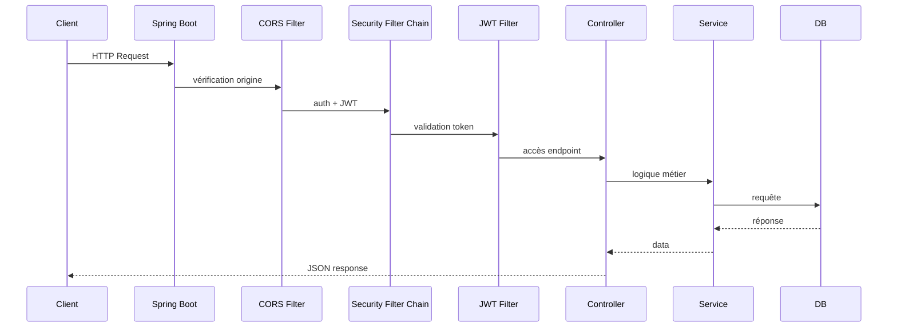
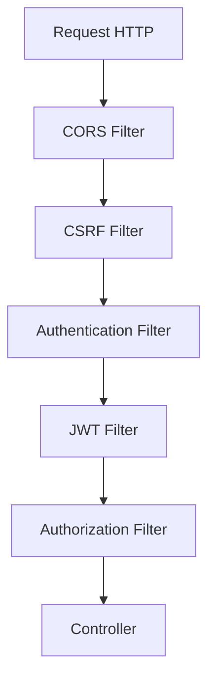
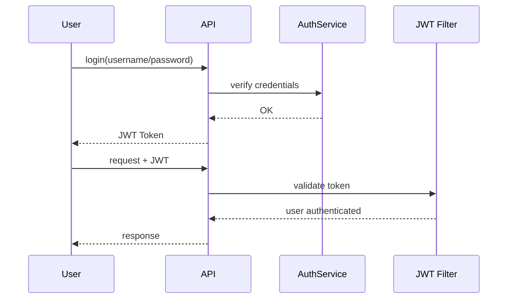
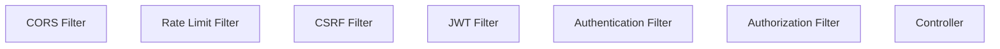

# 🔐 Sécurité des API REST avec Spring Boot & Spring Security (Guide complet + projet)

## 🧭 Projet fil rouge : *Task Manager API sécurisée*

On va construire une API REST sécurisée permettant de gérer des tâches :

* Authentification utilisateur (JWT)
* CRUD de tâches
* Sécurité Spring Security (filter chain)
* CORS + CSRF
* Validation des inputs
* Rate limiting anti-abus

---

# 🏗️ 1. Architecture globale

## 🔁 Flux global d’une requête



---

# 🔐 2. Spring Security Filter Chain (concept clé)

## 🧠 Ordre des filtres (important)



👉 L’ordre est CRITIQUE : une erreur = fail de sécurité ou bug silencieux.

---

## ⚙️ Configuration Spring Security (Spring Boot 3+)

```java
@Configuration
@EnableWebSecurity
public class SecurityConfig {

    private final JwtAuthFilter jwtAuthFilter;

    public SecurityConfig(JwtAuthFilter jwtAuthFilter) {
        this.jwtAuthFilter = jwtAuthFilter;
    }

    @Bean
    public SecurityFilterChain securityFilterChain(HttpSecurity http) throws Exception {

        http
            .csrf(csrf -> csrf.disable()) // ⚠️ seulement si JWT stateless
            .cors(cors -> cors.configurationSource(corsConfigurationSource()))
            .sessionManagement(sm -> sm.sessionCreationPolicy(SessionCreationPolicy.STATELESS))
            .authorizeHttpRequests(auth -> auth
                .requestMatchers("/auth/**").permitAll()
                .anyRequest().authenticated()
            )
            .addFilterBefore(jwtAuthFilter, UsernamePasswordAuthenticationFilter.class);

        return http.build();
    }

    @Bean
    public CorsConfigurationSource corsConfigurationSource() {
        CorsConfiguration config = new CorsConfiguration();

        config.setAllowedOrigins(List.of("http://localhost:3000"));
        config.setAllowedMethods(List.of("GET", "POST", "PUT", "DELETE"));
        config.setAllowedHeaders(List.of("*"));

        UrlBasedCorsConfigurationSource source = new UrlBasedCorsConfigurationSource();
        source.registerCorsConfiguration("/**", config);

        return source;
    }
}
```

---

# 🌐 3. CORS (Cross-Origin Resource Sharing)

## ❌ Problème

Frontend (React) ≠ backend (Spring Boot)

➡️ Bloqué par défaut par le navigateur

## ✅ Solution

Déclarer explicitement les origines autorisées

### Exemple sécurisé

```java
config.setAllowedOrigins(List.of("http://localhost:3000"));
config.setAllowCredentials(true);
```

## ⚠️ Erreurs fréquentes

* `"*"` + credentials ❌ interdit
* oublier OPTIONS preflight ❌
* mismatch ports ❌

---

# 🛡️ 4. CSRF (Cross Site Request Forgery)

## 🧠 Concept

CSRF protège les cookies de session.

## 📌 Dans une API JWT stateless :

👉 On désactive CSRF :

```java
.csrf(csrf -> csrf.disable())
```

## ⚠️ MAIS

CSRF doit être conservé si :

* authentification via cookies
* session-based login

---

# 🔑 5. Auth JWT (sécurisation API)

## 🧩 Flow JWT



---

## 🔐 Génération JWT

```java
@Service
public class JwtService {

    private final String SECRET = "super-secret-key";

    public String generateToken(String username) {
        return Jwts.builder()
                .setSubject(username)
                .setIssuedAt(new Date())
                .setExpiration(new Date(System.currentTimeMillis() + 1000 * 60 * 60))
                .signWith(SignatureAlgorithm.HS256, SECRET)
                .compact();
    }
}
```

---

## 🧪 Filtre JWT

```java
@Component
public class JwtAuthFilter extends OncePerRequestFilter {

    private final JwtService jwtService;

    public JwtAuthFilter(JwtService jwtService) {
        this.jwtService = jwtService;
    }

    @Override
    protected void doFilterInternal(HttpServletRequest request,
                                    HttpServletResponse response,
                                    FilterChain filterChain)
                                    throws ServletException, IOException {

        String header = request.getHeader("Authorization");

        if (header == null || !header.startsWith("Bearer ")) {
            filterChain.doFilter(request, response);
            return;
        }

        String token = header.substring(7);
        String username = jwtService.extractUsername(token);

        if (username != null) {
            UsernamePasswordAuthenticationToken auth =
                new UsernamePasswordAuthenticationToken(username, null, List.of());

            SecurityContextHolder.getContext().setAuthentication(auth);
        }

        filterChain.doFilter(request, response);
    }
}
```

---

# 🧾 6. Validation des inputs (Bean Validation)

## 📌 Exemple DTO sécurisé

```java
public class TaskRequest {

    @NotBlank(message = "Title is required")
    private String title;

    @Size(max = 500)
    private String description;

    @NotNull
    private Boolean done;
}
```

---

## 📌 Controller

```java
@RestController
@RequestMapping("/tasks")
public class TaskController {

    @PostMapping
    public ResponseEntity<?> createTask(@Valid @RequestBody TaskRequest request) {
        return ResponseEntity.ok("Task created");
    }
}
```

---

## ❌ Sans validation = risque

* injection logique
* payloads cassants
* attaques massives API

---

# 🚦 7. Rate Limiting (anti brute force / abuse)

## 🧠 Objectif

Limiter :

* login brute force
* spam API
* scraping

---

## 📦 Solution simple : Bucket4j

```xml
<dependency>
    <groupId>com.bucket4j</groupId>
    <artifactId>bucket4j-core</artifactId>
    <version>8.10.1</version>
</dependency>
```

---

## ⚙️ Filter rate limiting

```java
@Component
public class RateLimitFilter extends OncePerRequestFilter {

    private final Bucket bucket;

    public RateLimitFilter() {
        Bandwidth limit = Bandwidth.simple(10, Duration.ofMinutes(1));
        this.bucket = Bucket.builder()
                .addLimit(limit)
                .build();
    }

    @Override
    protected void doFilterInternal(HttpServletRequest request,
                                    HttpServletResponse response,
                                    FilterChain filterChain)
                                    throws ServletException, IOException {

        if (bucket.tryConsume(1)) {
            filterChain.doFilter(request, response);
        } else {
            response.setStatus(429);
            response.getWriter().write("Too many requests");
        }
    }
}
```

---

## 🔐 Ajout dans Security chain

```java
.addFilterBefore(rateLimitFilter, JwtAuthFilter.class)
```

---

# 🧱 8. Ordre final des filtres (IMPORTANT)



---

# 🧪 9. Exemple complet d’endpoint sécurisé

```java
@RestController
@RequestMapping("/tasks")
public class TaskController {

    @GetMapping
    public List<String> getTasks(Authentication auth) {
        return List.of("Task 1", "Task 2");
    }

    @PostMapping
    public ResponseEntity<?> create(@Valid @RequestBody TaskRequest request) {
        return ResponseEntity.ok("Created");
    }
}
```

---

# 🔥 10. Bonnes pratiques sécurité API REST

## ✅ À faire

* JWT stateless
* validation stricte DTO
* rate limiting
* logs sécurité
* rotation secret JWT
* expiration courte token

## ❌ À éviter

* CSRF désactivé sans JWT
* endpoints publics non contrôlés
* token long durée (ex: 1 an)
* `*` CORS en production

---

# 🧭 Conclusion

Tu as maintenant une base **production-ready Spring Boot Security** avec :

* Spring Security filter chain maîtrisée
* JWT authentication complète
* CORS configuré proprement
* CSRF compris (et désactivé à bon escient)
* Validation robuste
* Rate limiting anti-abus

---

Si tu veux, je peux te faire la **version niveau entreprise** avec :

* Refresh tokens
* OAuth2 / Keycloak
* Redis rate limiting distribué
* Audit logs + SIEM
* Architecture microservices sécurisée
