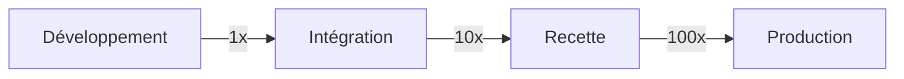
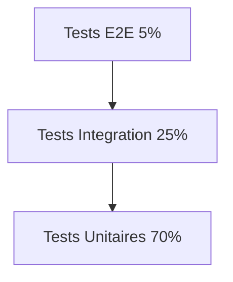
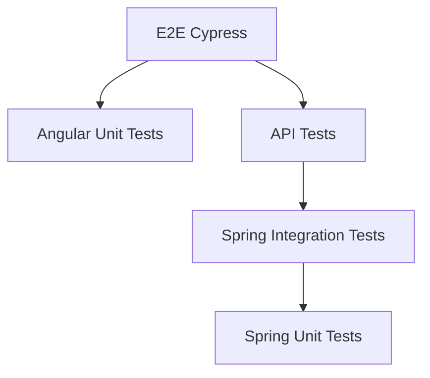
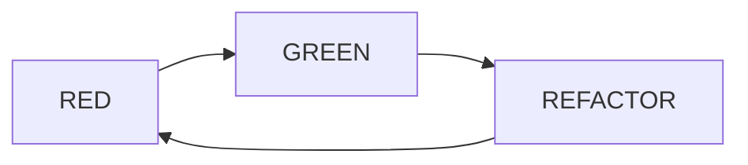
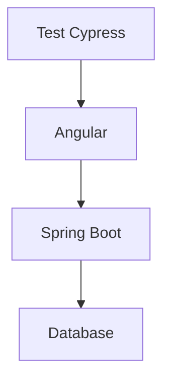
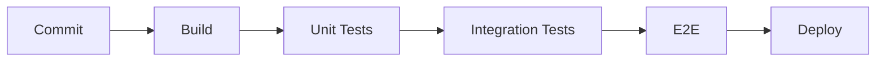
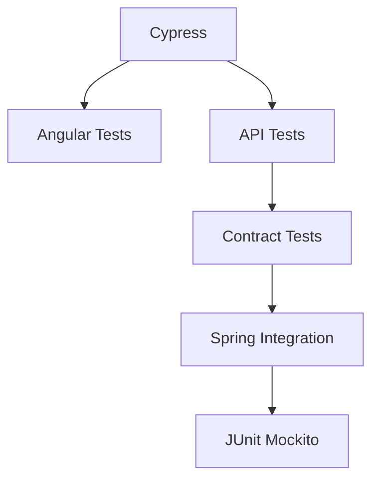
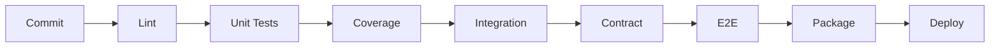

# Stratégie de Tests pour Applications Angular + Java

---

# Table des matières

1. Introduction
2. Pourquoi tester ?
3. La pyramide des tests
4. Les différents types de tests
5. Stratégie globale de tests Angular + Java
6. TDD (Test Driven Development)
7. BDD (Behavior Driven Development)
8. Tests Unitaires Backend Java
9. Tests Unitaires Frontend Angular
10. Tests d'Intégration
11. Tests API
12. Tests de Contrat
13. Tests End-to-End (E2E)
14. Tests de Performance
15. Tests de Sécurité
16. Tests de Régression
17. Mocking et Stubbing
18. Couverture de Code
19. CI/CD et Automatisation
20. Architecture complète de test d'un projet Angular + Spring Boot
21. Bonnes pratiques
22. Anti-patterns à éviter
23. Exemple complet de stratégie entreprise

---

# 1. Introduction

Une application moderne Angular + Java est généralement composée de :

```mermaid

A[Angular Frontend]
B[REST API Spring Boot]
C[Base de données]
D[Services externes]

A --> B
B --> C
B --> D
```

Chaque couche doit être testée différemment.

Objectif :

- Détecter les bugs tôt
- Réduire les coûts
- Faciliter les refactorings
- Garantir la qualité
- Sécuriser les mises en production

---

# 2. Pourquoi tester ?

Le coût de correction augmente avec le temps.



Un bug découvert en production peut coûter jusqu'à 100 fois plus cher qu'un bug détecté pendant le développement.

---

# 3. La pyramide des tests

Concept fondamental.



Répartition idéale :

| Type | Pourcentage |
|--------|-------------|
| Unitaires | 70% |
| Intégration | 20-25% |
| E2E | 5-10% |

Pourquoi ?

Les tests unitaires :

- rapides
- fiables
- peu coûteux

Les tests E2E :

- lents
- fragiles
- coûteux

---

# 4. Les différents types de tests

## Test unitaire

Teste une classe seule.

```java
public class Calculator {

    public int add(int a, int b){
        return a + b;
    }
}
```

Test :

```java
@Test
void shouldAddNumbers() {

    Calculator calc = new Calculator();

    assertEquals(5, calc.add(2,3));
}
```

---

## Test d'intégration

Teste plusieurs composants ensemble.

Exemple :

- Controller
- Service
- Repository
- Base H2

---

## Test E2E

Teste l'application entière.

Exemple :

1. Connexion
2. Création utilisateur
3. Vérification affichage

---

## Test de performance

Exemple :

- 1000 requêtes/s

Outils :

- JMeter
- Gatling
- K6

---

## Test de sécurité

Exemple :

- SQL Injection
- XSS
- CSRF

---

# 5. Stratégie Globale Angular + Java

Architecture cible :



---

# 6. TDD (Test Driven Development)

Cycle :



---

## RED

Créer un test qui échoue.

```java
@Test
void shouldAddNumbers() {
    assertEquals(5, calculator.add(2,3));
}
```

Compilation impossible.

---

## GREEN

Code minimal.

```java
public int add(int a,int b){
   return 5;
}
```

Test passe.

---

## REFACTOR

Code propre.

```java
public int add(int a,int b){
   return a+b;
}
```

---

# 7. BDD

BDD = Behavior Driven Development

Syntaxe :

```gherkin
Feature: Login

Scenario: Successful login

Given User is on login page
When User enters credentials
Then User is redirected to dashboard
```

Outils :

- Cucumber
- JBehave
- SpecFlow

---

# 8. Tests Unitaires Java

Stack classique :

```text
JUnit 5
Mockito
AssertJ
```

---

## Service métier

```java
@Service
public class UserService {

   private UserRepository repository;

   public User findById(Long id){
      return repository.findById(id)
             .orElseThrow();
   }
}
```

---

## Test Mockito

```java
@ExtendWith(MockitoExtension.class)
class UserServiceTest {

   @Mock
   UserRepository repository;

   @InjectMocks
   UserService service;

   @Test
   void shouldFindUser(){

      User user = new User();

      when(repository.findById(1L))
            .thenReturn(Optional.of(user));

      User result = service.findById(1L);

      assertThat(result).isEqualTo(user);
   }
}
```

---

# 9. Tests Unitaires Angular

Outils :

```text
Jasmine
Karma
Jest
```

Aujourd'hui :

```text
Jest recommandé
```

---

## Composant Angular

```typescript
@Component({
 selector:'app-counter'
})
export class CounterComponent {

 count = 0;

 increment(){
   this.count++;
 }
}
```

---

## Test

```typescript
describe('CounterComponent',()=>{

 let component: CounterComponent;

 beforeEach(()=>{
   component = new CounterComponent();
 });

 it('should increment',()=>{

   component.increment();

   expect(component.count).toBe(1);
 });

});
```

---

# 10. Tests Services Angular

Service :

```typescript
@Injectable()
export class UserService {

 constructor(
   private http: HttpClient
 ){}

 getUsers(){
   return this.http.get('/api/users');
 }
}
```

---

## Test avec HttpTestingController

```typescript
it('should load users',()=>{

 service.getUsers().subscribe();

 const req = httpMock.expectOne('/api/users');

 expect(req.request.method)
      .toEqual('GET');

 req.flush([]);
});
```

---

# 11. Tests d'Intégration Spring Boot

Utiliser :

```java
@SpringBootTest
```

Exemple :

```java
@SpringBootTest
class UserIntegrationTest {

   @Autowired
   UserService service;

   @Test
   void shouldSaveUser(){

      User saved =
         service.create(new User());

      assertNotNull(saved.getId());
   }
}
```

---

# 12. Tests API REST

Tester :

- code HTTP
- payload
- validation
- sécurité

---

## MockMvc

```java
@WebMvcTest(UserController.class)
class UserControllerTest {

 @Autowired
 MockMvc mockMvc;

 @Test
 void shouldReturn200() throws Exception {

    mockMvc.perform(get("/users"))
           .andExpect(status().isOk());
 }
}
```

---

# 13. Tests de Contrat

Problème :

Frontend et Backend évoluent séparément.

Solution :

Contract Testing.

---

## Exemple

Angular attend :

```json
{
  "id":1,
  "name":"John"
}
```

Si backend renvoie :

```json
{
  "identifier":1
}
```

Le contrat est cassé.

---

Outils :

```text
Spring Cloud Contract
Pact
```

---

# 14. Tests E2E

Outil moderne :

```text
Cypress
```

Architecture :



---

## Exemple Cypress

```typescript
describe('Login',()=>{

 it('should login',()=>{

   cy.visit('/login');

   cy.get('#email')
      .type('admin@test.com');

   cy.get('#password')
      .type('admin');

   cy.get('button')
      .click();

   cy.url()
      .should('contain','dashboard');
 });
});
```

---

# 15. Tests de Performance

Objectif :

Mesurer :

- Temps réponse
- Throughput
- Charge maximale

---

## K6

```javascript
import http from 'k6/http';

export default function() {

  http.get(
    'http://localhost:8080/users'
  );
}
```

---

# 16. Tests de Sécurité

Tests :

## XSS

```html
<script>alert('hack')</script>
```

---

## SQL Injection

```sql
' OR 1=1 --
```

---

## Authentification

Tester :

- JWT
- OAuth2
- rôles

---

# 17. Mocking et Stubbing

## Mock

Simulation complète.

```java
@Mock
UserRepository repository;
```

---

## Stub

Valeur prédéfinie.

```java
when(repository.findById(1L))
.thenReturn(user);
```

---

# 18. Couverture de Code

Outil :

```text
JaCoCo
```

Mesures :

| Type | Description |
|--------|-------------|
| Line Coverage | lignes exécutées |
| Branch Coverage | branches exécutées |
| Method Coverage | méthodes exécutées |

---

Objectif :

```text
80% minimum
90% idéal
100% inutile
```

Pourquoi ?

100% coverage ≠ 100% qualité.

---

# 19. CI/CD

Pipeline idéal :



---

GitHub Actions :

```yaml
name: CI

on: [push]

jobs:

 build:

   runs-on: ubuntu-latest

   steps:

     - uses: actions/checkout@v4

     - name: Build

       run: mvn clean verify
```

---

# 20. Architecture de Test Entreprise



---

# 21. Ce qu'il faut tester absolument

## Backend

### Service

- règles métier
- calculs
- validations

### Controller

- HTTP
- JSON
- erreurs

### Repository

- requêtes complexes

---

## Frontend

### Components

- affichage
- interactions

### Services

- appels HTTP

### Guards

- sécurité

### Pipes

- transformations

---

# 22. Anti-patterns

## Mauvais

### Tester les getters/setters

```java
user.setName("John");

assertEquals(
   "John",
   user.getName()
);
```

Aucune valeur.

---

### Utiliser la vraie base partout

Tests lents.

---

### Trop de mocks

On finit par tester les mocks.

---

### E2E pour tout

Très coûteux.

---

# 23. Exemple de Stratégie Professionnelle Complète

Pour une application Angular + Spring Boot :

## Développement

TDD obligatoire :

```text
RED
GREEN
REFACTOR
```

---

## Backend

70% Tests Unitaires

```text
JUnit
Mockito
AssertJ
```

20% Intégration

```text
@SpringBootTest
TestContainers
```

10% API

```text
MockMvc
RestAssured
```

---

## Frontend

70% Unitaires

```text
Jest
Testing Library
```

20% Intégration

```text
Angular Testing Library
```

10% E2E

```text
Cypress
```

---

## Pipeline CI/CD

À chaque commit :



---

# Conclusion

Une stratégie de test mature Angular + Java repose sur :

1. TDD systématique
2. Majorité de tests unitaires
3. Quelques tests d'intégration ciblés
4. Très peu de tests E2E
5. Contrats API automatisés
6. Couverture de code surveillée
7. Exécution dans la CI/CD
8. Tests de performance et sécurité réguliers

La formule la plus utilisée dans les grandes entreprises (Banques, Assurances, Télécoms, E-commerce, SaaS) est :

```text
70% Tests Unitaires
20% Tests d'Intégration
10% Tests E2E
```

avec :

```text
Angular
 ├─ Jest
 ├─ Testing Library
 └─ Cypress

Spring Boot
 ├─ JUnit5
 ├─ Mockito
 ├─ AssertJ
 ├─ TestContainers
 ├─ MockMvc
 └─ Spring Cloud Contract
```

C'est aujourd'hui l'approche la plus robuste pour maintenir des applications Angular + Java de plusieurs centaines de milliers de lignes de code tout en gardant une vélocité élevée et un faible taux de régression.
