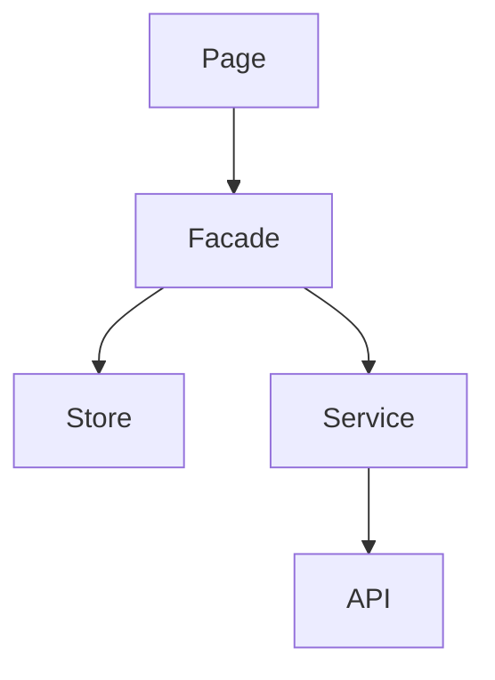
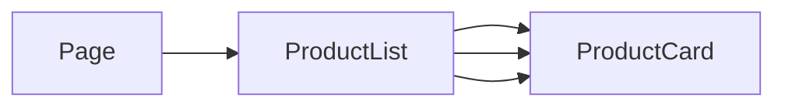
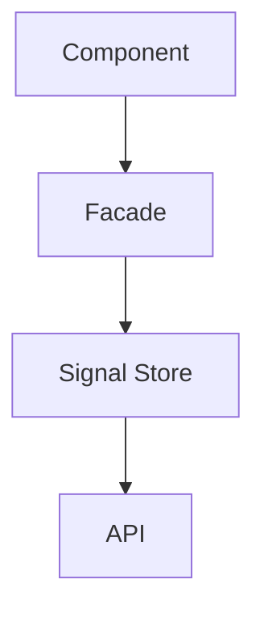
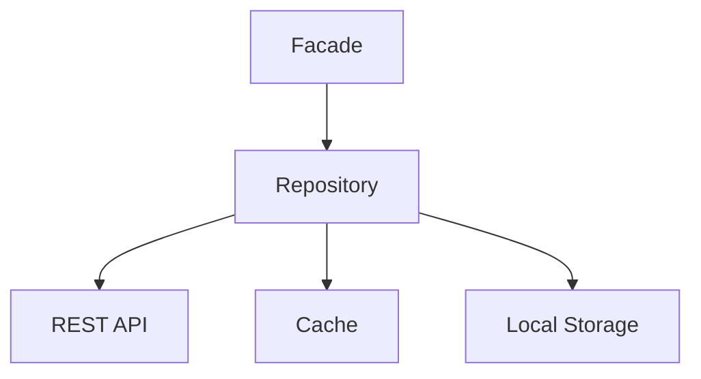
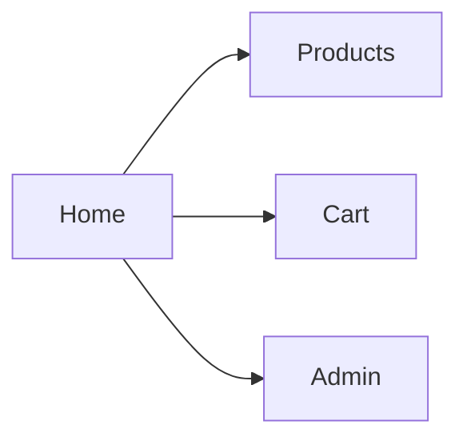
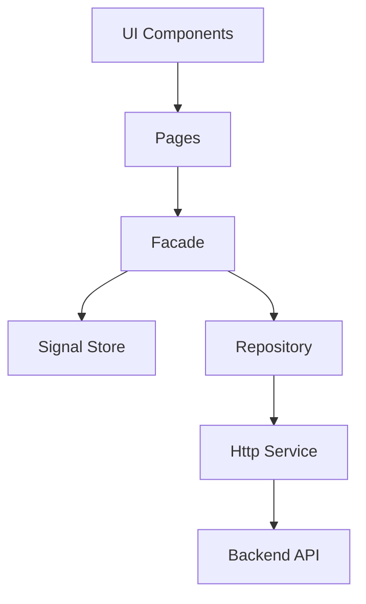
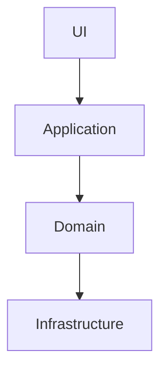
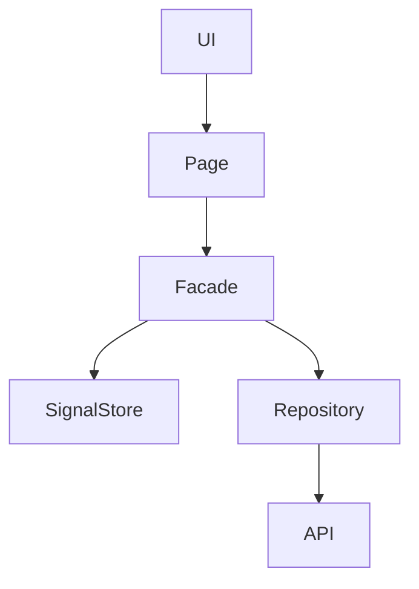

# Cours Magistral : Structurer un Frontend Angular Moderne

> Niveau : Intermédiaire → Expert  
> Version cible : Angular 17+ (Standalone Components, Signals, Lazy Loading moderne)

---

# Introduction

La qualité d'une application Angular dépend moins de la qualité du code individuel que de l'architecture globale.

Une mauvaise architecture entraîne :

- Couplage fort
- Difficulté de maintenance
- Régressions fréquentes
- Temps de développement croissant
- Dette technique

Une bonne architecture permet :

- Scalabilité
- Testabilité
- Réutilisabilité
- Lisibilité
- Évolutivité

---

# Les principes fondamentaux

Avant même Angular, il faut respecter plusieurs principes universels :

## Single Responsibility Principle (SRP)

Chaque élément doit avoir une seule responsabilité.

### Mauvais exemple

```ts
UserComponent
├─ affiche l'utilisateur
├─ appelle l'API
├─ transforme les données
├─ gère les permissions
└─ gère les erreurs
```

### Bon exemple

```text
UserComponent
    │
    ▼
UserFacade
    │
    ▼
UserService
    │
    ▼
HttpClient
```

---

## Séparation des couches

Une UI ne doit jamais connaître les détails techniques.

```text
Présentation
     │
     ▼
Application
     │
     ▼
Domaine
     │
     ▼
Infrastructure
```

---

# Architecture recommandée (Feature-Based)

Aujourd'hui, l'approche recommandée est :

## Architecture orientée fonctionnalités

### Mauvaise pratique

Organisation par type technique

```text
app/
│
├── components/
├── services/
├── models/
├── guards/
├── pipes/
└── directives/
```

Au début :

```text
Facile
```

Après 2 ans :

```text
Impossible à maintenir
```

---

## Bonne pratique

Organisation par domaine métier

```text
app/
│
├── features/
│   ├── auth/
│   ├── products/
│   ├── cart/
│   └── orders/
│
├── core/
│
├── shared/
│
└── app.routes.ts
```

---

# Architecture complète

```text
src/app
│
├── core
│
├── shared
│
├── features
│
└── app.routes.ts
```

---

# Détail des dossiers

# 1. Core

Contient tout ce qui est singleton global.

```text
core/
│
├── services/
├── interceptors/
├── guards/
├── config/
├── layouts/
└── providers/
```

Exemples :

```ts
AuthService
LoggerService
ApiService
AuthInterceptor
ErrorInterceptor
```

Règle :

> Core ne dépend jamais des Features.

---

# 2. Shared

Contient les éléments réutilisables.

```text
shared/
│
├── components/
├── directives/
├── pipes/
├── ui/
└── utils/
```

Exemples :

```ts
ButtonComponent
ModalComponent
DatePipe
AvatarComponent
```

Règle :

> Shared ne contient aucune logique métier.

---

# 3. Features

Le cœur de l'application.

```text
features/
│
├── auth/
├── users/
├── products/
├── cart/
└── orders/
```

Chaque fonctionnalité est autonome.

---

# Structure idéale d'une Feature

Exemple :

```text
products/
│
├── pages/
│
├── components/
│
├── services/
│
├── store/
│
├── models/
│
├── facades/
│
├── utils/
│
└── routes.ts
```

---

# Architecture interne d'une Feature



---

# Pourquoi utiliser une Facade ?

La Facade est aujourd'hui l'une des meilleures pratiques Angular.

---

## Sans Facade

```ts
@Component()
export class ProductPage {
  products$ = this.store.select(...);

  constructor(
    private store: Store,
    private service: ProductService
  ) {}

  load() {
    this.store.dispatch(...);
  }
}
```

Le composant connaît :

- NgRx
- Les actions
- Les selectors

Couplage fort.

---

## Avec Facade

```ts
@Component()
export class ProductPage {
  products$ = this.facade.products$;

  constructor(
    private facade: ProductFacade
  ) {}

  load() {
    this.facade.loadProducts();
  }
}
```

Le composant ignore :

- NgRx
- Signals
- API
- Store

Il connaît uniquement :

```ts
ProductFacade
```

---

# Smart Components vs Dumb Components

---

## Smart Component

Contient la logique.

```ts
ProductPageComponent
```

Responsabilités :

- chargement données
- orchestration
- navigation

---

## Dumb Component

Contient uniquement l'affichage.

```ts
ProductCardComponent
```

Entrées :

```ts
@Input()
```

Sorties :

```ts
@Output()
```

Aucune logique métier.

---

## Diagramme



---

# State Management

Question classique :

> Faut-il utiliser NgRx ?

Réponse :

Pas toujours.

---

# Cas 1 : Petite application

Utiliser :

```ts
Signals
Services
RxJS
```

Suffisant.

---

# Cas 2 : Application moyenne

Utiliser :

```ts
Signals
Facade
Feature Stores
```

Architecture moderne Angular.

---

# Cas 3 : Très grande application

Utiliser :

```text
NgRx
Facade
Effects
Entity
Feature Store
```

---

# Hiérarchie recommandée



---

# Angular Signals

Depuis Angular 16+, les Signals deviennent le standard.

Exemple :

```ts
products = signal<Product[]>([]);
```

Lecture :

```ts
products()
```

Modification :

```ts
products.set(...)
```

---

# Pourquoi préférer Signals ?

Avantages :

- Plus simple
- Plus rapide
- Moins de boilerplate
- Réactivité native

---

# Gestion des appels API

Ne jamais appeler HttpClient directement dans un composant.

---

## Mauvais

```ts
ProductPage
 └─ HttpClient
```

---

## Bon

```text
ProductPage
    │
    ▼
ProductFacade
    │
    ▼
ProductService
    │
    ▼
HttpClient
```

---

# Pattern Repository

Très utilisé dans les grandes entreprises.



---

Exemple :

```ts
ProductRepository
```

Le reste de l'application ignore la provenance des données.

---

# Lazy Loading

Obligatoire pour les applications importantes.

---

## Mauvais

```text
Bundle = 15 MB
```

Chargé dès l'ouverture.

---

## Bon

```text
Home
Auth
Products
Cart
Admin
```

Chargés à la demande.

---

Diagramme :



---

# Architecture Standalone Moderne

Depuis Angular 17 :

```ts
@Component({
  standalone: true
})
```

Les modules deviennent optionnels.

---

Structure moderne :

```text
products/
│
├── pages/
├── components/
├── store/
├── facades/
└── routes.ts
```

---

# Gestion des erreurs

Centraliser.

---

## Interceptor

```text
Http Request
      │
      ▼
Interceptor
      │
      ▼
API
```

---

Exemple :

```ts
ErrorInterceptor
AuthInterceptor
```

---

# Gestion des permissions

Ne jamais faire :

```ts
if (user.role === "admin")
```

dans les composants.

---

Utiliser :

```ts
PermissionService
```

ou

```ts
RoleGuard
```

---

# Architecture idéale complète



---

# Exemple d'arborescence Enterprise

```text
src/
│
└── app/
    │
    ├── core/
    │   ├── interceptors/
    │   ├── services/
    │   └── config/
    │
    ├── shared/
    │   ├── ui/
    │   ├── pipes/
    │   └── directives/
    │
    ├── features/
    │   │
    │   ├── auth/
    │   │
    │   ├── users/
    │   │
    │   ├── products/
    │   │   ├── pages/
    │   │   ├── components/
    │   │   ├── facades/
    │   │   ├── services/
    │   │   ├── repositories/
    │   │   ├── store/
    │   │   ├── models/
    │   │   └── routes.ts
    │   │
    │   └── orders/
    │
    └── app.routes.ts
```

---

# Alternatives d'architecture

## 1. Feature + Facade + Signals (Recommandée 2025+)

```text
Complexité : ★★☆☆☆
Scalabilité : ★★★★☆
Performance : ★★★★★
Maintenance : ★★★★★
```

Utiliser pour :

- 80% des projets

---

## 2. Feature + NgRx

```text
Complexité : ★★★★★
Scalabilité : ★★★★★
Performance : ★★★★☆
Maintenance : ★★★★☆
```

Utiliser pour :

- Très grandes équipes
- Applications complexes

---

## 3. Clean Architecture



```text
Complexité : ★★★★★
Scalabilité : ★★★★★
Maintenance : ★★★★★
```

Utiliser pour :

- SaaS importants
- Produits long terme

---

# Recommandation Finale

Pour un projet Angular moderne (2025+) :

```text
✔ Standalone Components
✔ Feature-Based Architecture
✔ Lazy Loading
✔ Signals
✔ Facades
✔ Smart / Dumb Components
✔ Core / Shared / Features
✔ Interceptors
✔ Repository Pattern
```

Architecture cible :



Cette architecture offre aujourd'hui le meilleur compromis entre simplicité, maintenabilité, performances et évolutivité pour la majorité des applications Angular professionnelles.
