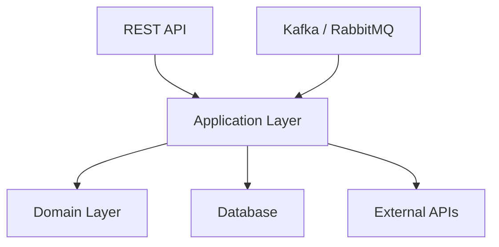
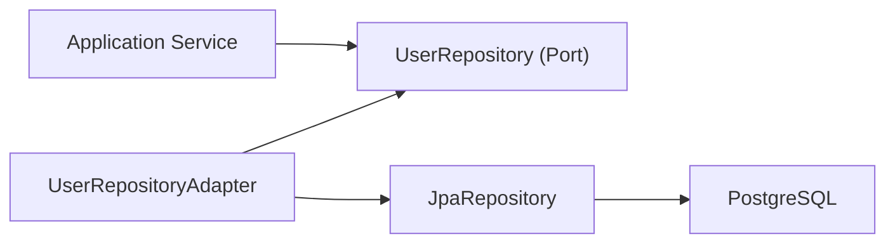
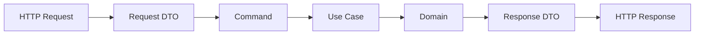
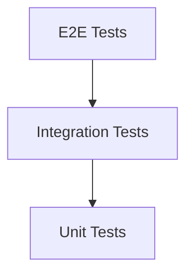
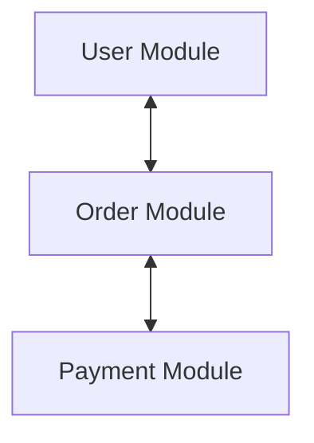
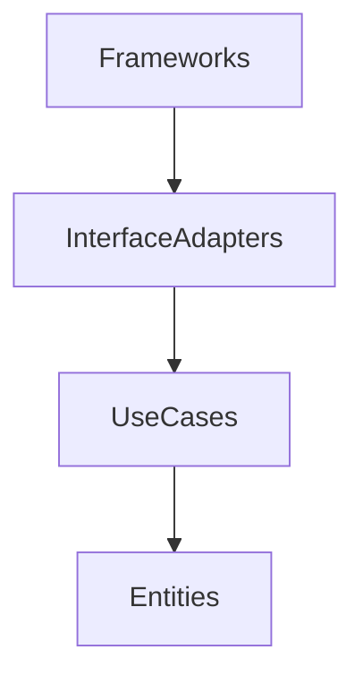

# Cours Magistral : Structurer un Backend Java Spring Boot Professionnel

> Objectif : comprendre comment organiser un projet Spring Boot maintenable, scalable et adapté aux projets professionnels.

---

# Table des matières

1. Pourquoi la structure du projet est importante
2. Les principes fondamentaux
3. L'approche recommandée : Architecture Hexagonale (Ports & Adapters)
4. Structure complète d'un projet Spring Boot moderne
5. Couche Domain
6. Couche Application
7. Couche Infrastructure
8. Couche API / Présentation
9. Gestion des DTOs
10. Gestion des Exceptions
11. Transactions
12. Tests
13. Gestion de la configuration
14. Architecture modulaire
15. Alternatives possibles
16. Anti-patterns à éviter
17. Structure finale recommandée

---

# 1. Pourquoi la structure du projet est importante

Un projet Spring Boot commence souvent simple :

```text
controller
service
repository
entity
```

Mais après plusieurs mois :

- services de 2000 lignes
- dépendances circulaires
- logique métier dispersée
- difficultés de test
- maintenance coûteuse

La structure doit permettre :

- lisibilité
- maintenabilité
- testabilité
- évolutivité
- séparation des responsabilités

---

# 2. Principes fondamentaux

Avant même Spring Boot :

## Single Responsibility Principle

Une classe = une responsabilité.

Mauvais :

```java
UserService
```

qui :

- valide
- sauvegarde
- envoie des emails
- génère du JWT
- appelle Stripe

Bon :

```java
UserCreationService
EmailService
JwtService
PaymentService
```

---

## Dependency Inversion

Les règles métier ne doivent dépendre de rien.

Mauvais :

```java
Domain -> Spring
Domain -> JPA
Domain -> PostgreSQL
```

Bon :

```text
Spring
   ↓
Infrastructure
   ↓
Application
   ↓
Domain
```

Le domaine est au centre.

---

# 3. Architecture recommandée : Hexagonale

Aujourd'hui, c'est l'approche la plus utilisée dans les projets sérieux.

Également appelée :

- Ports & Adapters
- Clean Architecture

---

## Vision globale



Le domaine ne connaît rien :

- ni Spring
- ni PostgreSQL
- ni Kafka

---

# 4. Structure complète recommandée

```text
src/main/java

com.company.project

├── domain
│   ├── model
│   ├── valueobject
│   ├── service
│   ├── exception
│   └── repository
│
├── application
│   ├── usecase
│   ├── dto
│   ├── mapper
│   └── service
│
├── infrastructure
│   ├── persistence
│   ├── configuration
│   ├── security
│   ├── messaging
│   └── external
│
├── api
│   ├── controller
│   ├── request
│   ├── response
│   └── advice
│
└── ProjectApplication.java
```

---

# 5. Domain Layer

Le coeur du métier.

---

## Entités métier

```java
public class User {

    private UserId id;
    private Email email;

    public User(UserId id, Email email) {
        this.id = id;
        this.email = email;
    }
}
```

Pas de :

```java
@Entity
@Table
@Autowired
```

dans le domaine.

---

## Value Objects

Très sous-utilisés.

Mauvais :

```java
String email;
```

Bon :

```java
public record Email(String value) {

    public Email {
        if(!value.contains("@")) {
            throw new InvalidEmailException();
        }
    }
}
```

---

## Repository Port

Le domaine définit le contrat.

```java
public interface UserRepository {

    User save(User user);

    Optional<User> findById(UserId id);
}
```

Aucune implémentation.

---

# 6. Application Layer

Cette couche orchestre les cas d'usage.

---

## Exemple

```java
CreateUserUseCase
```

---

### Interface

```java
public interface CreateUserUseCase {

    UserResponse execute(CreateUserCommand command);
}
```

---

### Implémentation

```java
@Service
@RequiredArgsConstructor
public class CreateUserService
        implements CreateUserUseCase {

    private final UserRepository userRepository;

    @Transactional
    public UserResponse execute(CreateUserCommand command) {

        User user = User.create(command.email());

        userRepository.save(user);

        return UserResponse.from(user);
    }
}
```

---

## Pourquoi ?

Le contrôleur ne contient aucune logique.

Le repository ne contient aucune logique.

Le métier est centralisé.

---

# 7. Infrastructure Layer

Ici vivent les détails techniques.

---

## JPA

```java
@Entity
@Table(name = "users")
public class UserEntity {

}
```

---

## Repository JPA

```java
public interface JpaUserRepository
    extends JpaRepository<UserEntity, UUID> {
}
```

---

## Adapter

```java
@Repository
@RequiredArgsConstructor
public class UserRepositoryAdapter
        implements UserRepository {

    private final JpaUserRepository repository;

}
```

---

## Diagramme



---

# 8. Couche API

Responsable uniquement du HTTP.

---

## Controller

```java
@RestController
@RequiredArgsConstructor
@RequestMapping("/users")
public class UserController {

    private final CreateUserUseCase createUser;

    @PostMapping
    public UserResponse create(
        @RequestBody CreateUserRequest request
    ) {

        return createUser.execute(
            request.toCommand()
        );
    }
}
```

---

## Le contrôleur ne doit jamais :

- appeler un repository
- faire du SQL
- contenir du métier
- gérer les transactions

---

# 9. DTOs

Toujours séparer :

```java
Request
Response
Entity
Domain
```

---

Mauvais :

```java
@PostMapping
public UserEntity create(...)
```

---

Bon :

```java
CreateUserRequest
CreateUserCommand
User
UserResponse
```

---

## Flux complet



---

# 10. Gestion des Exceptions

Centraliser.

---

## Exception métier

```java
public class UserAlreadyExistsException
extends RuntimeException {
}
```

---

## Handler global

```java
@RestControllerAdvice
public class GlobalExceptionHandler {

    @ExceptionHandler(
        UserAlreadyExistsException.class
    )
    public ResponseEntity<?> handle() {

        return ResponseEntity
            .badRequest()
            .build();
    }
}
```

---

# 11. Transactions

Une règle simple :

Les transactions vivent dans les Use Cases.

---

Bon :

```java
@Transactional
public void execute(...)
```

---

Mauvais :

```java
@Repository
@Transactional
```

partout.

---

# 12. Tests

Pyramide de tests.



---

## Répartition

70%

```text
Unit Tests
```

20%

```text
Integration Tests
```

10%

```text
E2E
```

---

## Tester surtout

- Use Cases
- Domain Services
- Value Objects

---

# 13. Gestion de la configuration

---

## ConfigurationProperties

```java
@ConfigurationProperties(
    prefix = "security.jwt"
)
public record JwtProperties(
    String secret,
    Long expiration
) {
}
```

---

Éviter :

```java
@Value("${jwt.secret}")
```

partout.

---

# 14. Architecture modulaire

Pour les gros projets.

---

## Mauvais

```text
controller
service
repository
entity
```

avec 500 classes dans chaque dossier.

---

## Bon

```text
user
├── api
├── application
├── domain
└── infrastructure

order
├── api
├── application
├── domain
└── infrastructure

payment
├── api
├── application
├── domain
└── infrastructure
```

---

## Architecture par Feature

Très utilisée chez :

- Netflix
- Uber
- Amazon
- Zalando

---

Diagramme :



Chaque module possède sa propre architecture hexagonale interne.

---

# 15. Alternatives possibles

---

## 1. Layered Architecture

La plus connue.

```text
controller
service
repository
entity
```

### Avantages

- simple
- rapide à comprendre

### Inconvénients

- devient vite chaotique
- faible isolation métier

---

## 2. Clean Architecture

Très proche de l'hexagonale.



Très adaptée aux gros SI.

---

## 3. Vertical Slice Architecture

Chaque fonctionnalité est autonome.

```text
features

├── create-user
├── update-user
├── delete-user
├── get-user
```

Très populaire avec CQRS.

---

# 16. Anti-patterns à éviter

---

## God Service

```java
UserService
```

de 3000 lignes.

---

## Anemic Domain Model

```java
User
```

sans aucun comportement.

Uniquement :

```java
getters
setters
```

---

## Repository dans Controller

```java
controller
  -> repository
```

Interdit.

---

## DTO = Entity

```java
UserEntity
```

exposé directement à l'API.

---

## Logique métier dans le Controller

```java
if(user.isPremium()) {
   ...
}
```

Interdit.

---

# 17. Structure finale recommandée

Pour un projet Spring Boot moderne :

```text
src/main/java

com.company.project

├── modules
│
├── user
│   ├── api
│   ├── application
│   ├── domain
│   └── infrastructure
│
├── order
│   ├── api
│   ├── application
│   ├── domain
│   └── infrastructure
│
├── payment
│   ├── api
│   ├── application
│   ├── domain
│   └── infrastructure
│
├── shared
│   ├── security
│   ├── exception
│   ├── configuration
│   └── utils
│
└── ProjectApplication.java
```

# Recommandation finale

Pour un backend Spring Boot professionnel en 2026 :

1. Architecture Hexagonale.
2. Organisation par Feature/Module.
3. Cas d'usage explicites (`CreateUserUseCase`, `CancelOrderUseCase`, etc.).
4. Domain pur sans dépendance Spring.
5. DTOs séparés des entités.
6. Transactions au niveau Application.
7. Tests centrés sur les Use Cases.
8. Adaptateurs Infrastructure remplaçables.
9. Value Objects pour les concepts métier importants.
10. Éviter le classique `controller/service/repository` lorsque le projet dépasse quelques dizaines de fonctionnalités.

Cette combinaison (Hexagonal + Modular Monolith) est aujourd'hui l'une des architectures les plus robustes pour construire un backend Spring Boot maintenable sur plusieurs années.
