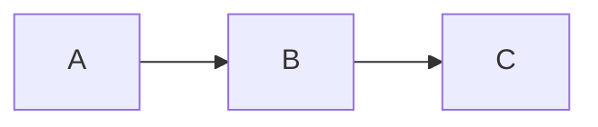
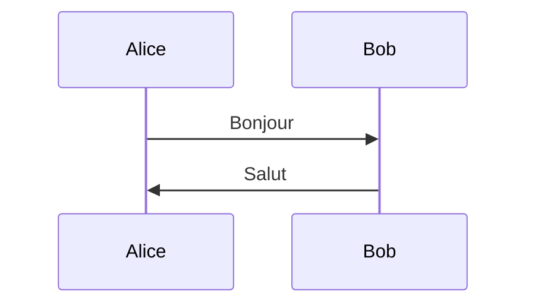
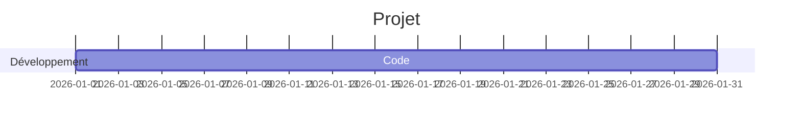
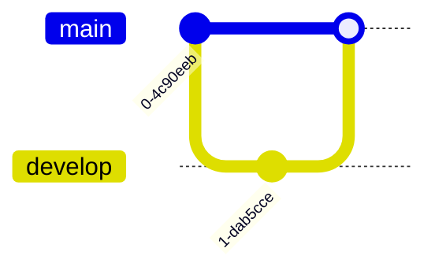
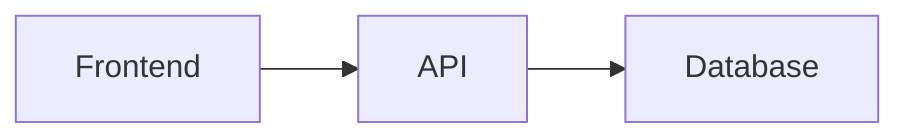
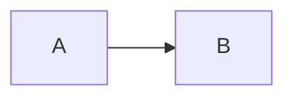

# Markdown : syntaxe, spécificités et possibilités sur GitHub

Markdown est un langage de balisage léger conçu pour écrire du texte formaté de manière simple. GitHub utilise une variante appelée **GitHub Flavored Markdown (GFM)**, qui ajoute de nombreuses fonctionnalités au Markdown standard.

---

# 1. Titres

```md
# Titre niveau 1
## Titre niveau 2
### Titre niveau 3
#### Titre niveau 4
##### Titre niveau 5
###### Titre niveau 6
```

Résultat :

# Titre niveau 1

## Titre niveau 2

### Titre niveau 3

---

# 2. Paragraphes et retours à la ligne

Un paragraphe est simplement séparé par une ligne vide.

```md
Premier paragraphe.

Deuxième paragraphe.
```

Pour forcer un retour à la ligne :

```md
Première ligne  
Deuxième ligne
```

(Deux espaces à la fin de la ligne)

Ou :

```md
Première ligne<br>
Deuxième ligne
```

---

# 3. Mise en forme du texte

## Gras

```md
**texte**
__texte__
```

**texte**

## Italique

```md
*texte*
_texte_
```

*texte*

## Gras + Italique

```md
***texte***
```

***texte***

## Barré

```md
~~texte~~
```

~~texte~~

## Souligné

Markdown standard ne le supporte pas.

GitHub accepte HTML :

```html
<u>texte</u>
```

<u>texte</u>

---

# 4. Citations

```md
> Citation simple
```

> Citation simple

Citation imbriquée :

```md
> Niveau 1
>> Niveau 2
>>> Niveau 3
```

---

# 5. Listes

## Liste non ordonnée

```md
- Élément
- Élément
  - Sous-élément
```

* Élément
* Élément

  * Sous-élément

Autres symboles :

```md
* élément
+ élément
```

---

## Liste numérotée

```md
1. Premier
2. Deuxième
3. Troisième
```

1. Premier
2. Deuxième
3. Troisième

GitHub renumérote automatiquement :

```md
1. Premier
1. Deuxième
1. Troisième
```

---

# 6. Liens

## Lien classique

```md
[Google](https://google.com)
```

## URL automatique

```md
https://google.com
```

## Lien avec titre

```md
[Google](https://google.com "Moteur de recherche")
```

---

# 7. Images

```md

```

Depuis une URL :

```md

```

Avec HTML :

```html

```

---

# 8. Code

## Code en ligne

```md
Utilisez la commande `git status`
```

Utilisez la commande `git status`

---

## Bloc de code

````md
```python
print("Bonjour")
```
````

Résultat :

```python
print("Bonjour")
```

---

# 9. Coloration syntaxique

GitHub supporte des dizaines de langages :

````md
```javascript
const a = 42;
```
````

````md
```python
print("hello")
```
````

````md
```bash
git commit -m "message"
```
````

````md
```json
{
  "nom": "test"
}
```
````

---

# 10. Lignes horizontales

```md
---
```

ou

```md
***
```

ou

```md
___
```

---

# 11. Tableaux

```md
| Nom | Âge |
|------|------|
| Alice | 25 |
| Bob | 30 |
```

| Nom   | Âge |
| ----- | --- |
| Alice | 25  |
| Bob   | 30  |

---

## Alignement

```md
| Gauche | Centre | Droite |
|:--------|:------:|--------:|
| A | B | C |
```

| Gauche | Centre | Droite |
| :----- | :----: | -----: |
| A      |    B   |      C |

---

# 12. Cases à cocher (GitHub)

Très utilisées dans les Issues et Pull Requests.

```md
- [x] Terminé
- [ ] À faire
```

Résultat :

* [x] Terminé
* [ ] À faire

---

# 13. Mentions GitHub

## Mention d'utilisateur

```md
@octocat
```

GitHub crée un lien vers le profil.

---

## Mention d'équipe

```md
@organisation/equipe
```

---

# 14. Références aux Issues

```md
#123
```

Lien automatique vers l'issue.

---

Référencer une issue d'un autre dépôt :

```md
owner/repo#123
```

---

# 15. Références aux commits

```md
abc1234
```

GitHub reconnaît souvent automatiquement les hashes.

---

# 16. Références aux Pull Requests

```md
#456
```

Si le numéro correspond à une PR.

---

# 17. Émojis GitHub

```md
:rocket:
:smile:
:bug:
:fire:
```

Résultat :

🚀 😄 🐛 🔥

Quelques populaires :

| Code               | Emoji |
| ------------------ | ----- |
| :rocket:           | 🚀    |
| :bug:              | 🐛    |
| :fire:             | 🔥    |
| :white_check_mark: | ✅     |
| :warning:          | ⚠️    |
| :star:             | ⭐     |

---

# 18. Échapper les caractères spéciaux

```md
\*texte\*
```

Affiche :

*texte*

Caractères courants :

```md
\#
\*
\[
\]
\(
\)
```

---

# 19. Ancres internes

GitHub génère automatiquement des ancres.

```md
## Installation
```

Lien :

```md
[Installation](#installation)
```

---

## Exemple

```md
# Mon projet

## Configuration

[Aller à la configuration](#configuration)
```

---

# 20. HTML dans Markdown

GitHub accepte une grande partie du HTML.

```html
<details>
<summary>Voir plus</summary>

Texte caché.

</details>
```

Résultat :

<details>
<summary>Voir plus</summary>

Texte caché.

</details>

---

# 21. Blocs repliables

Très utilisés sur GitHub.

````html
<details>
<summary>Installation</summary>

```bash
npm install
````

</details>
```

---

# 22. Ancres personnalisées

```html
<a name="section"></a>
```

Puis :

```md
[Section](#section)
```

---

# 23. Exposants et indices

Markdown ne les supporte pas.

Utiliser HTML :

```html
x<sup>2</sup>
H<sub>2</sub>O
```

Résultat :

x²

H₂O

---

# 24. Diagrammes Mermaid (GitHub)

Une fonctionnalité extrêmement puissante.

## Diagramme de flux

````md

````

## Diagramme de séquence

````md

````

## Diagramme de Gantt

````md

````

## Diagramme Git

````md

````

---

# 25. Mathématiques (GitHub)

GitHub supporte KaTeX.

Inline :

```md
$x^2+y^2=z^2$
```

Bloc :

```md
$$
\int_0^1 x^2 dx
$$
```

---

# 26. Alertes GitHub

Très utile pour la documentation.

```md
> [!NOTE]
> Information importante
```

Affiche un encadré.

Types :

```md
> [!NOTE]
```

```md
> [!TIP]
```

```md
> [!IMPORTANT]
```

```md
> [!WARNING]
```

```md
> [!CAUTION]
```

---

# 27. Références de liens

Pratique pour les gros README.

```md
[Documentation][doc]

[doc]: https://example.com
```

---

# 28. Images avec liens

```md
[](https://example.com)
```

---

# 29. Badges GitHub

Très populaires.

```md

```

Exemples :

* Build
* Version
* Licence
* Téléchargements
* Couverture de tests

---

# 30. Organisation d'un README professionnel

Structure courante :

```md
# Nom du projet

Description

## Fonctionnalités

## Installation

## Utilisation

## Configuration

## API

## Tests

## Déploiement

## Contribution

## Licence
```

---

# 31. README GitHub avancé

Exemple complet :

````md
# Awesome Project


## Description

Projet permettant de gérer X.

## Fonctionnalités

- Gestion utilisateurs
- API REST
- Docker

## Installation

```bash
git clone repo
cd repo
npm install
```

## Utilisation

```bash
npm start
```

## Roadmap

- [x] Authentification
- [ ] Dashboard
- [ ] API GraphQL

## Diagramme



## Licence

MIT
````

---

# 32. Fonctionnalités GitHub souvent méconnues

### Texte masqué

```html
<details>
<summary>Cliquez ici</summary>

Contenu caché

</details>
```

### Liste de tâches interactive

```md
- [ ] Étape 1
- [ ] Étape 2
```

### Ancres automatiques

```md
## Mon titre
```

devient :

```md
#mon-titre
```

### Diagrammes Mermaid

Support natif sans plugin.

### Formules mathématiques

Support natif.

### Alertes colorées

```md
> [!WARNING]
```

### Syntaxe diff

````md
```diff
+ Ajout
- Suppression
```
````

Résultat :

```diff
+ Ajout
- Suppression
```

---

# 33. Limites du Markdown GitHub

GitHub filtre certains éléments HTML :

* JavaScript interdit
* `<script>` interdit
* `<iframe>` généralement bloqué
* CSS personnalisé limité
* Pas d'exécution de code

---

# 34. Cheat Sheet ultime

````md
# Titre

**gras**
*italique*
~~barré~~

> citation

- liste
1. liste

[texte](url)


`code`

```lang
bloc de code
````

| tableau |
| ------- |

* [ ] tâche

:rocket:

<details>
<summary>Détails</summary>

Contenu

</details>

> [!NOTE]
> Alerte



$$
E = mc^2
$$

```

---

## Ce qu'il faut absolument maîtriser sur GitHub

1. Titres (`#`)
2. Liens et ancres internes
3. Blocs de code avec coloration syntaxique
4. Tableaux
5. Cases à cocher
6. Blocs `<details>`
7. Alertes (`[!NOTE]`, `[!WARNING]`)
8. Mermaid
9. Formules mathématiques
10. Badges dans les README

Ces 10 éléments couvrent à eux seuls plus de 95 % des usages professionnels de Markdown sur GitHub.
```
