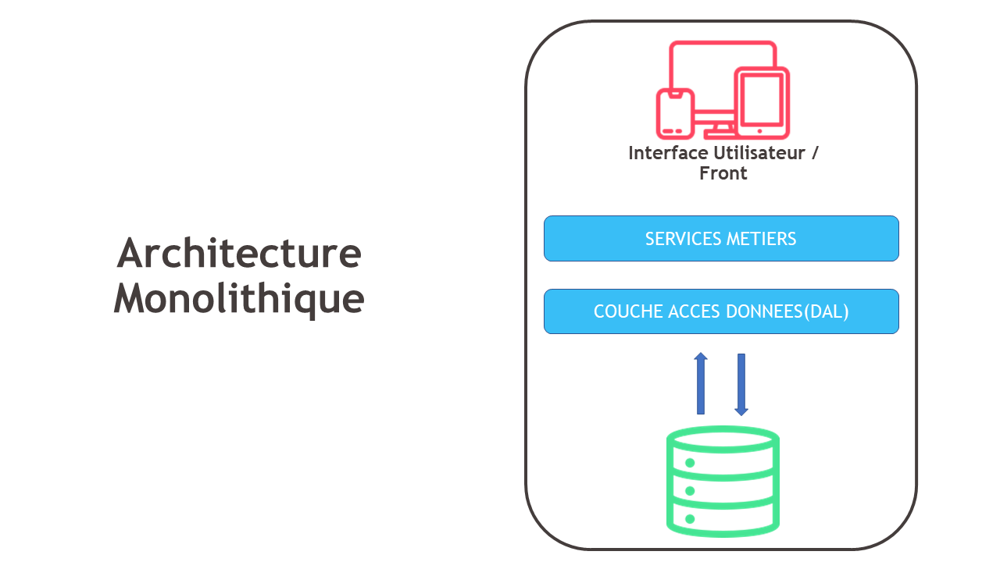
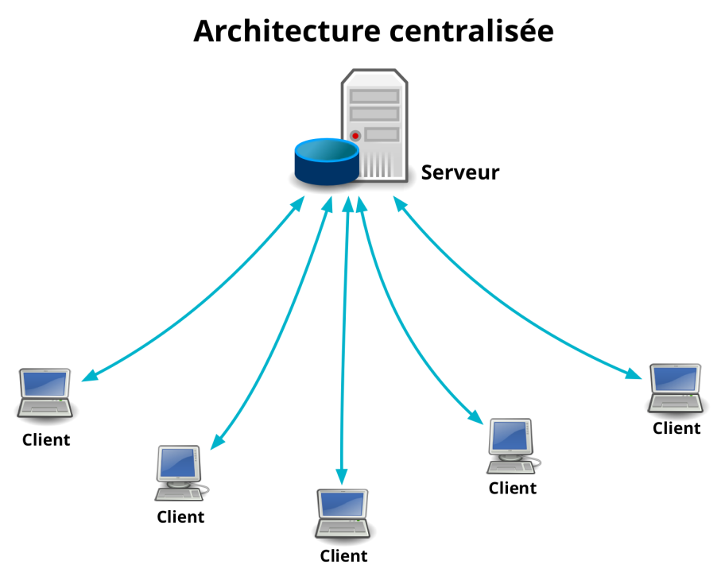
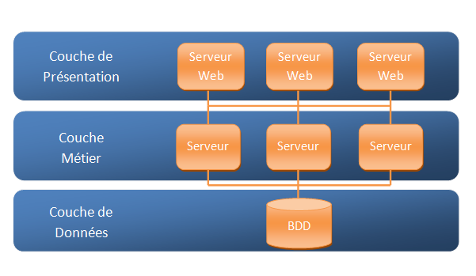
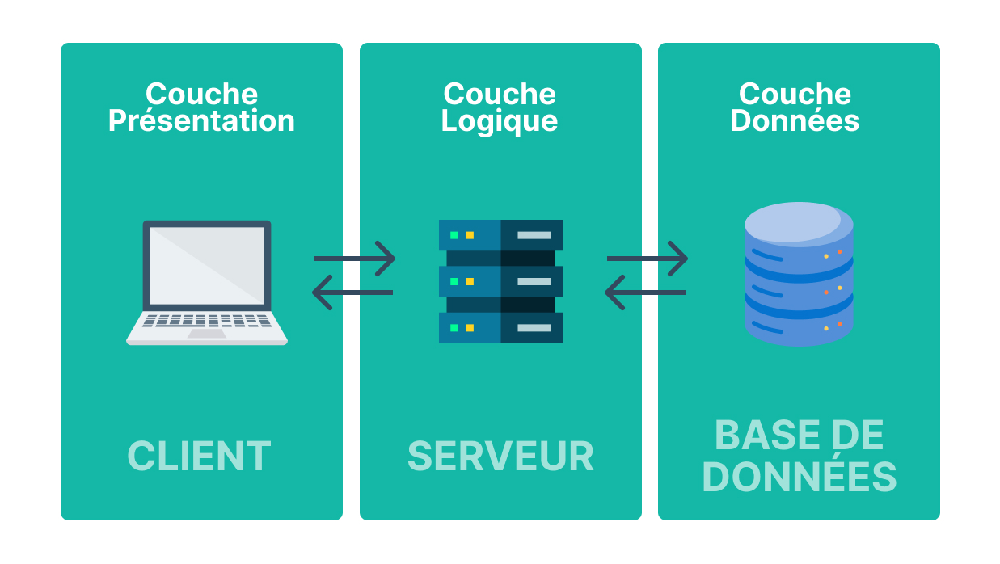
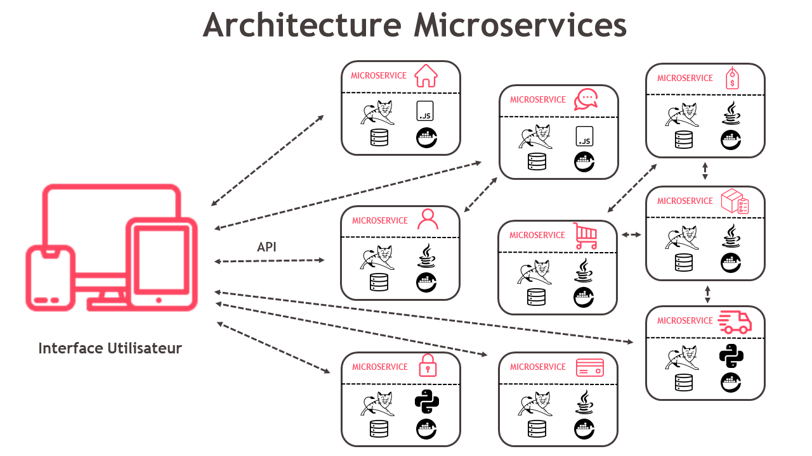
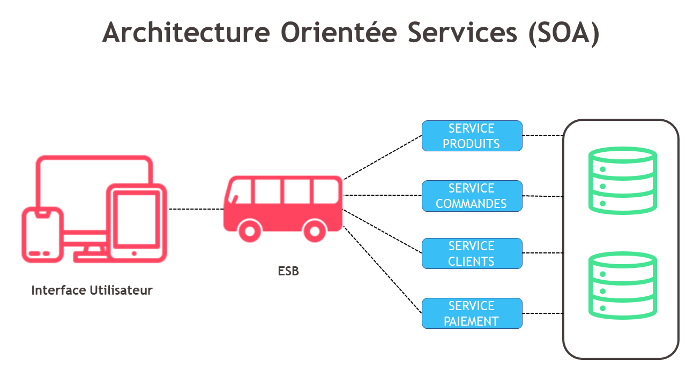

# Types d'architecture d'applications

> L’architecture informatique constitue la colonne vertébrale de tout système d’information.<br>
```
Elle définit comment les composants logiciels et matériels interagissent 
pour accomplir des tâches spécifiques, 
et permet d’assurer : 
- la scalabilité, 
- la fiabilité, 
- la sécurité 
- et l’efficacité des systèmes sur la durée.
```
> Le choix de l’architecture informatique détermine : 
- la scalabilité, 
- la performance 
- et la résilience de votre système d’information.
```
En plus de la stratégie d’entreprise et de la DSI, 
le choix d’une architecture repose aussi sur les compétences disponibles en interne. 
Les architectes et chefs de projet IT doivent évaluer les technologies 
et les modèles qui correspondent aux besoins métiers 
tout en anticipant leur exploitation future et leur maintenabilité.
```

## Architecture Monolithique
<div align="center">
	
</div>

```
L’architecture monolithique est l’un des types d’architecture les plus anciens et les plus simples. 
Elle regroupe toutes les fonctionnalités d’une application dans un seul bloc indivisible. 
Les composants sont étroitement couplés, et toute modification nécessite souvent une re-compilation 
et un redéploiement complet de l’application.
L’architecture monolithique peut être efficace pour des projets de petite envergure, 
mais elle montre rapidement ses limites en termes de scalabilité et de flexibilité.
```

<ins>**Avantages :**</ins><br> 
- Simplicité : La conception et le déploiement sont relativement simples, ce qui convient bien aux petites applications, 
- Performance : Les composants étant étroitement intégrés, la communication entre eux est rapide

<ins>**Inconvénients :**</ins><br>  
- Scalabilité limitée : Difficile à faire évoluer, surtout pour les grandes applications, 
- Maintenance compliquée : Toute modification, même mineure, peut impacter l’ensemble de l’application, 
- Déploiement risqué : Un bug dans un composant peut potentiellement affecter tout le système

## Architecture Client-Serveur
<div align="center">
	
</div>


> L’architecture client-serveur sépare les fonctions de traitement en deux couches : 
- le client, qui interagit avec l’utilisateur, 
- et le serveur, qui gère les données et les opérations. 
```
Globalement, les clients envoient des requêtes au serveur, qui les traite et renvoie les résultats.
L’architecture client-serveur offre une bonne modularité et centralisation des données, 
mais il est important de bien gérer les performances et la scalabilité du serveur.
```

<ins>**Avantages :**</ins><br> 
- Modularité : Séparation claire entre l’interface utilisateur et la logique de traitement.
- Facilité de maintenance : Les clients et les serveurs peuvent être mis à jour indépendamment
- Centralisation des données : Les données sont centralisées, ce qui simplifie la gestion et la sécurité

<ins>**Inconvénients :**</ins><br> 
- Performance : La communication réseau peut introduire des latences
- Scalabilité : Le serveur peut devenir un goulot d’étranglement si le nombre de clients augmente

## Architecture en Couches (N-Tiers)
<div align="center">
	
</div>


> L’architecture en couches, ou N-Tiers, divise une application en plusieurs couches distinctes : 
- présentation, 
- logique métier 
- et accès aux données. 
```
Chaque couche est indépendante et interagit avec les autres via des interfaces bien définies.
Malgré une certaine complexité dans sa mise en œuvre, 
l’architecture en couches est idéale pour des applications complexes 
nécessitant une grande modularité et évolutivité.
```

**Exemple d'architecture en 3-tiers**
<div align="center">
	
</div>

<ins>**Avantages :**</ins><br>  
- Modularité : Facilite la maintenance et l’évolution de l’application
- Réutilisabilité : Les composants de chaque couche peuvent être réutilisés dans d’autres applications.
- Scalabilité : Chaque couche peut être mise à l’échelle indépendamment

<ins>**Inconvénients :**</ins><br> 
- Complexité : La conception et le déploiement peuvent être complexes
- Performance : La communication entre les couches peut introduire des latences

## Architecture Microservices
<div align="center">
	
</div>

```
Portée par la montée en puissance du cloud computing et des conteneurs (notamment Kubernetes), 
l’architecture microservices s’impose comme un modèle privilégié pour les organisations 
souhaitant développer des applications distribuées, résilientes et évolutives. 
L’architecture microservices divise une application en un ensemble de petits services indépendants, 
chacun exécutant une fonction spécifique et communiquant entre eux via des API.
L’architecture microservices permet une grande flexibilité et scalabilité, 
à condition d’être rigoureux dans la gestion des services et des communications entre eux.
```

<ins>**Avantages :**</ins><br>  
- Scalabilité : Chaque service peut être mis à l’échelle indépendamment
- Flexibilité : Facilite l’ajout, la mise à jour ou la suppression de services sans affecter l’ensemble de l’application
- Résilience : Les pannes d’un service n’affectent pas nécessairement les autres services

<ins>**Inconvénients :**</ins><br> 
- Complexité : La gestion de nombreux services indépendants peut être complexe
- Communication : La communication inter-services peut introduire des latences et des points de défaillance

## Architecture Orientée Services (SOA)
<div align="center">
	
</div>

```
L’architecture orientée services (ou SOA pour « Service-Oriented Architecture ») 
organise les fonctionnalités logicielles en services indépendants, 
chacun exposant une interface bien définie et pouvant être utilisé par d’autres services 
via des protocoles de communication standardisés.
SOA offre une grande flexibilité et interopérabilité. 
Une très bonne option pour les organisations ayant des systèmes hétérogènes, 
mais qui nécessite une gestion soignée des services.	
```

<ins>**Avantages :**</ins><br>  
- Réutilisabilité : Les services peuvent être réutilisés par plusieurs applications
- Interopérabilité : Utilise des protocoles standard, facilitant l’intégration avec d’autres systèmes
- Scalabilité : Les services peuvent être mis à l’échelle indépendamment

<ins>**Inconvénients :**</ins><br> 
- Complexité : La conception et la gestion de services interopérables peuvent être complexes
- Performance : La communication entre services peut introduire des latences