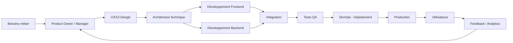
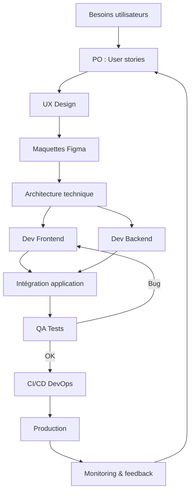

Voici une vue complète et structurée des **métiers autour du développement d’applications / logiciels**, du **process de bout en bout**, et de la **façon dont tout s’articule dans un projet réel**.

Je vais te donner :

1. Les rôles principaux et leur fonction
2. Les étapes chronologiques d’un projet logiciel
3. Les interactions entre ces rôles (qui parle à qui, quand, et pourquoi)
4. Les entrants / sortants à chaque étape
5. Un exemple concret de projet complet
6. Des diagrammes Mermaid pour visualiser

---

# 1. Les principaux postes dans un projet logiciel

## 🎯 Produit & vision

### 🧭 Product Owner (PO)

* Définit **quoi construire et pourquoi**
* Porte les besoins métier
* Priorise les fonctionnalités (backlog)

**Entrants :** besoins business, utilisateurs, marché
**Sortants :** backlog priorisé, user stories

---

### 🧠 Product Manager (PM) (souvent proche du PO)

* Vision produit long terme
* Analyse marché / stratégie
* Mesure la performance (KPIs)

---

### 🎨 UX/UI Designer

* Conçoit l’expérience utilisateur
* Prototypes (Figma, wireframes)
* Définit ergonomie + parcours utilisateur

**Entrants :** user stories, besoins PO
**Sortants :** maquettes, prototypes, design system

---

# 2. Tech & réalisation

### 🏗️ Architecte logiciel

* Définit la structure technique globale
* Choisit les technologies
* Décide comment les systèmes communiquent

**Entrants :** besoins fonctionnels + contraintes
**Sortants :** architecture, schémas techniques

---

### 👨‍💻 Développeurs (Frontend / Backend / Fullstack)

#### Frontend

* Interface utilisateur (web/mobile)
* Ex: React, Vue, Angular

#### Backend

* API, logique métier, bases de données
* Ex: Node.js, Java, Python

**Entrants :** maquettes + API spec
**Sortants :** application fonctionnelle

---

### 🗄️ DBA / Data Engineer (selon projets)

* Conception des bases de données
* Performance, requêtes, sécurité data

---

# 3. Qualité & livraison

### 🧪 QA / Test Engineer

* Teste l’application (bugs, performance)
* Automatisation des tests

**Entrants :** application déployée en test
**Sortants :** rapports de bugs, validation qualité

---

### 🚀 DevOps Engineer

* Déploiement (CI/CD)
* Infrastructure cloud (AWS, Azure…)
* Monitoring

**Entrants :** code validé
**Sortants :** application en production

---

### 🔒 Security Engineer (parfois intégré DevOps)

* Audit sécurité
* Protection des données
* Tests d’intrusion

---

# 4. Support & exploitation

### 📊 Data Analyst / Data Scientist

* Analyse usage produit
* Aide à la décision produit

### 🧑‍💼 Support / Customer Success

* Remonte les bugs utilisateurs
* Analyse les retours terrain

---

# 5. Cycle complet d’un projet logiciel

## 📌 Étapes chronologiques

1. Idéation / besoin métier
2. Analyse produit (PO/PM)
3. Design UX/UI
4. Architecture technique
5. Développement
6. Tests QA
7. Déploiement (DevOps)
8. Exploitation + feedback

---

# 6. Vue globale du flux (diagramme Mermaid)

---

# 7. Interactions entre équipes

## 🔁 Exemple de flux réel

### PO ↔ UX Designer

* PO : “On veut un onboarding simple”
* UX : propose 2–3 parcours utilisateur

### UX ↔ Dev

* UX : fournit maquettes Figma
* Dev : demande clarification sur interactions

### Dev ↔ QA

* QA : “bug sur login mobile”
* Dev : corrige et redéploie

### DevOps ↔ Dev

* DevOps : “pipeline CI cassé”
* Dev : corrige build / dépendances

---

# 8. Exemple concret : application “livraison de repas”

Imaginons une app type Uber Eats.

## 🎯 1. PO

* Objectif : permettre commande de repas
* User stories :

  * voir restaurants
  * commander
  * payer

---

## 🎨 2. UX/UI

* Écran accueil (restaurants proches)
* Fiche restaurant
* Panier + paiement

---

## 🏗️ 3. Architecture

* Frontend : mobile app (React Native)
* Backend : API Node.js
* DB : PostgreSQL
* Paiement : Stripe

---

## 👨‍💻 4. Développement

### Frontend

* liste restaurants
* panier
* tracking commande

### Backend

* API restaurants
* gestion commandes
* paiement

---

## 🧪 5. QA

* test commande complète
* test paiement
* test charge (1000 users)

---

## 🚀 6. DevOps

* déploiement cloud
* monitoring commandes live

---

## 📊 7. Production

* utilisateurs commandent
* analytics :

  * temps de livraison
  * panier moyen

---

# 9. Cycle détaillé avec entrées/sorties

---

# 10. Résumé simple

Un projet logiciel, c’est :

* 🎯 On décide quoi faire (PO / PM)
* 🎨 On dessine l’expérience (UX/UI)
* 🏗️ On conçoit le système (Architecte)
* 💻 On code (Dev)
* 🧪 On vérifie (QA)
* 🚀 On déploie (DevOps)
* 📊 On améliore en continu (data + feedback)

---

Si tu veux, je peux aller encore plus loin et te faire :

* une **version “startup vs grande entreprise”**
* une **carte des carrières (junior → senior → lead → CTO)**
* ou un **schéma d’organisation d’équipe type Netflix / Google / startup early stage**
